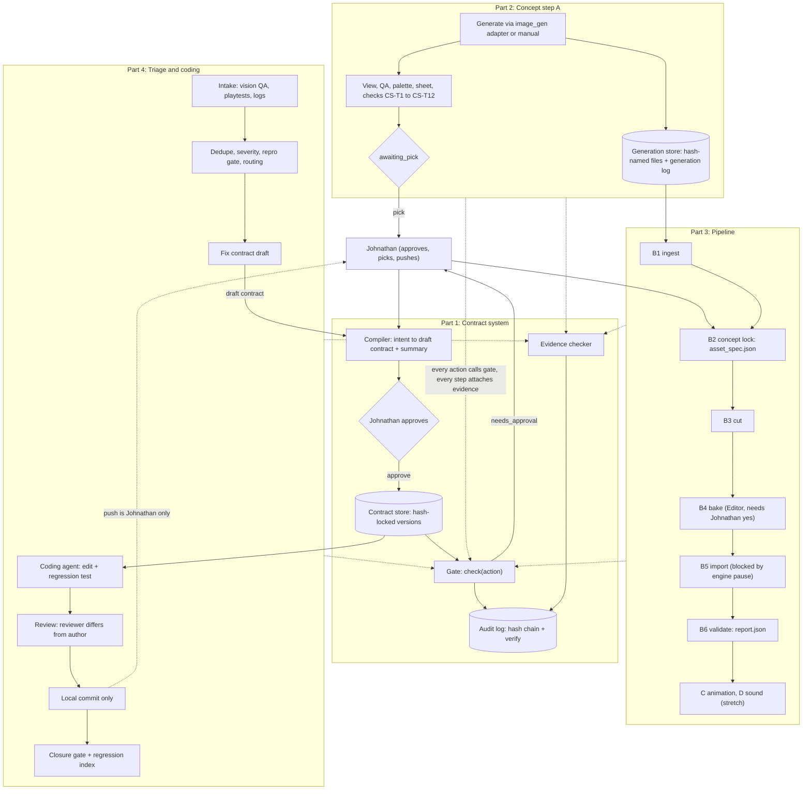
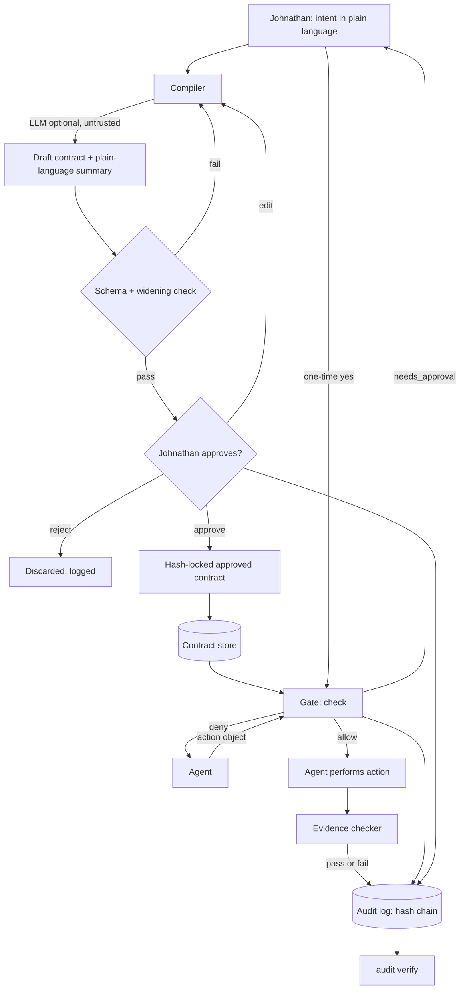
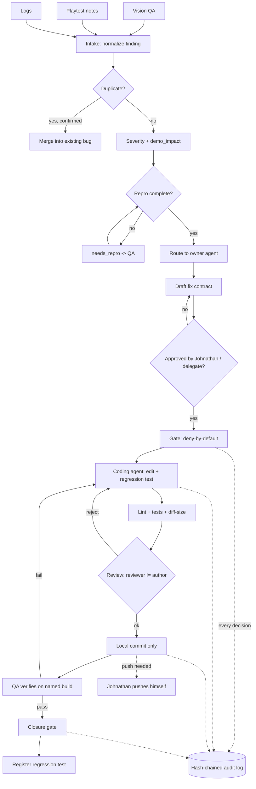
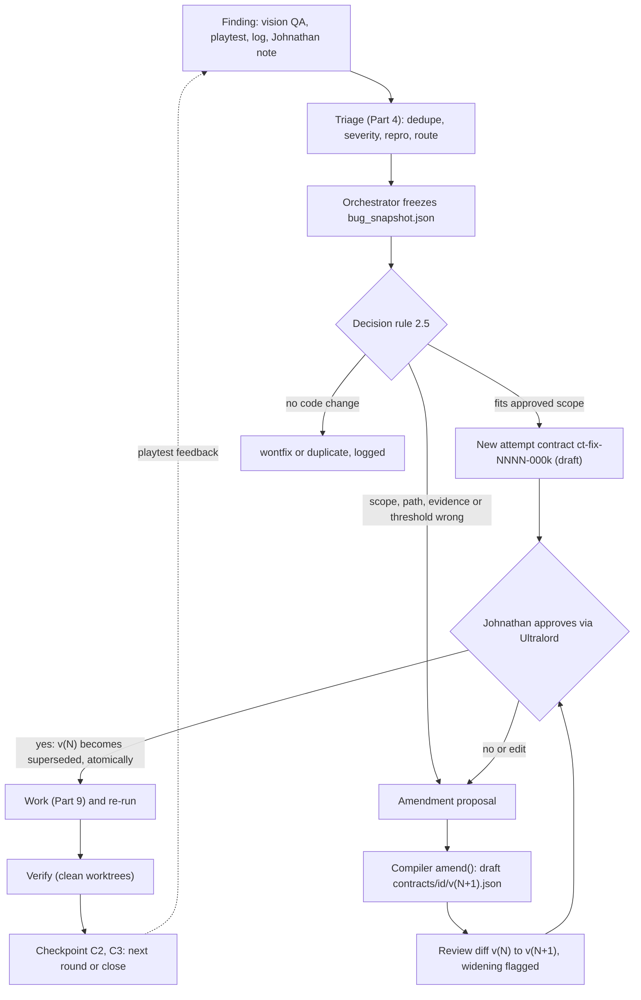

> Public pack copy for ember-courier-harness. Original team draft paths may still mention /workspace/...; treat those as historical source locations, not runtime paths in this repo.

# Wrathful Conquest Contract-Driven Harness: Merged Architecture Draft

**Status:** DRAFT merge **v4** (2026-10-23, 7:00 to 7:03 PM ET: Johnathan's own decisions, tagged **[v4]**, are **decided**, not defaults; see Part 12 and D32 to D45). Earlier history: v3 (2026-10-23, evening, America/New_York; **[v3.1]** 6:58 PM ET: OQ-G6 to OQ-G9 and M-82, M-83, M-90, M-93, M-94, M-96, M-98 closed as defaults pending Johnathan), documentation only; built from v2, which stays unchanged on disk. **v3 adds [v3]:** Pipeline Smith's iteration addendum folded into Parts 3, 6, 7, 9, 10 and 11 and Appendix 3B (step cache keys, failure-as-amendment, per-step attempt cap, LFS routing as design only, orchestrator, worker and verifier mapping with Contract Smith's three bundling conditions, tests `PL-R1` to `PL-R16`, two new class `write` tools); Contract Smith's rulings applied as defaults pending Johnathan (rollback as a forward amendment, separate widening acknowledgement, `Contract-Version` trailer, round and anchor paths, `extensions.recon` as design only, `network_hosts` cannot override the baseline, local `contract-lock` script for the MVP, OQ-G5 no schema impact); reference and test-id fixes; and the new Johnathan questions. v2 added Parts 6 to 11 (iteration, git, workspace, orchestration, transparency, quality focus), folds in the team fix files and Contract Smith's addendum v0.4 (Appendices 1B, 1C, 2A, 3B, 4A), applies the Hack Lead and Contract Smith decisions inline (tagged **[v2]**) and extends Parts B, C and D. Every v3 change is tagged **[v3]**. Nothing in this document has been built, run or installed, and no source spec was edited.
**Merged on:** 2026-10-23 (America/New_York) by Hack Lead's merge task.
**For:** Johnathan Rossi's Meta Global AI Developer Hackathon entry.
**Event dates and deadline:** Oct 26 to Nov 4, 2026; submission due Nov 4, 9:00 PM ET. **[UNVERIFIED]** until the Oct 26 official rules recheck (Part 1 section 3.6 says "from kickoff; confirm").
**Audience:** Johnathan, who will build this himself with Meta's coding agents (for example Muse Code). **[UNVERIFIED]**: availability and capabilities of any Meta agent or model are not confirmed.

**Sources merged (in this order):**

| Part | Source file | Owner |
|---|---|---|
| 1 | `/workspace/contract-system-doc/CONTRACT_SYSTEM.md` | Contract Smith |
| Appendix 1A | `/workspace/contract-system-doc/SCHEMA_DECISIONS_v0.2.md` (addendum to Part 1; wins over Part 1 where they differ; approved by Hack Lead, Johnathan can override) | Contract Smith |
| 2 | `/workspace/concepts/CONCEPT_STEP_SPEC.md` | Concept Artist |
| 3 | `/workspace/pipeline/PIPELINE_SUBSYSTEM.md` (the originally delivered text, byte-identical to `PIPELINE_SUBSYSTEM.v1-as-delivered.md`; NOT the v2 partial edit) | Pipeline Smith |
| Appendix 3A | `/workspace/pipeline/PROPOSED_FIXES.md` (Pipeline Smith's proposed fixes to Part 3; PROPOSAL, not applied to Part 3) | Pipeline Smith |
| 4 | `/workspace/triage-spec/TRIAGE_AND_CODE_SPEC.md` | Triage Smith |
| 5 | Placeholder for Ultralord's architecture doc (not posted when this draft was written; see `PAGE_CONFLICT_CHECK.md` for the exported Page) | Ultralord |
| 6 to 11 **[v2]** | New: iteration-first, git, workspace, subagent orchestration, transparency, quality focus. Detail sources: `CONTRACT_ADDENDUM_v0.4.md` (CA4), `TRIAGE_ADDENDUM_ITERATION.md` (TA), `/workspace/prior-art/PRIOR_ART.md` | Contract Smith, Triage Smith, Hack Lead |
| Pipeline iteration **[v3]** | `/workspace/pipeline/PIPELINE_ADDENDUM_ITERATION.md` (PLA; 199 lines plus Contract Smith's appendix of rulings on the bundling conflict). Folded into Part 3 section 5A and the pipeline sections of Parts 6, 7, 9, 10, 11; the held pipeline spec and fix files are not edited | Pipeline Smith, Contract Smith |
| Appendices 1B, 1C, 2A, 3B, 4A **[v2]** | Folded fix files: `CONTRACT_FIXES_v0.3.md`, `CONTRACT_ADDENDUM_v0.4.md`, `CONCEPT_FIXES_PARTB.md`, `PIPELINE_FIXES_PARTB.md`, `TRIAGE_PROPOSED_FIXES.md` | team |

**Contents:** Overview and system diagram; Decisions made (D1 to D31); Part 1 (contract system) with Appendix 1A; Part 2 (concept step); Part 3 (pipeline, with the **[v3]** iteration section 5A) with Appendix 3A; Part 4 (triage and coding); Part 5 (Ultralord placeholder); **[v2]** Parts 6 to 11 and Appendices 1B, 1C, 2A, 3B, 4A; Part A (global build order); Part B (cross-spec consistency check); Part C (deduplicated open questions); Part D (UNVERIFIED register).

---

## How to read this document

1. **Each part is the source spec with light condensing.** Kept intact: schemas, JSON examples, acceptance tests, build steps, appendices. Removed: each source's title block and its own Open questions section (merged into Part C, with the source question numbers noted). Heading levels were shifted down one level. Nothing else in the source text was reworded.
   - **Part 1 + Appendix 1A.** Appendix 1A (Schema Decisions v0.2) is placed directly after Part 1 and wins where the two differ (its own header says so; Hack Lead has approved it). In particular 1A replaces Part 1's section 3.3 worked example, adds acceptance tests 13 to 25, and adds gate steps (contract selection, inputs pre-flight).
   - **Part 3 + Appendix 3A.** Part 3 is the originally delivered pipeline spec. It predates the contract spec, so its contract fields, gate calls and several paths are out of date. Appendix 3A is Pipeline Smith's list of fixes (a PROPOSAL). The merged document does not apply them to Part 3; where Hack Lead has decided the point (see "Decisions made") the decision wins, and Part B tracks each pending fix.
2. **Numbers inside a part are that spec's own numbers.** "Section 3.3", "Q7", "CS-T3", "test 5" inside Part 2 mean Part 2's own numbering. Use the merged ids (`M-xx` in Part B, `OQ-xx` in Part C) when talking across specs. Test ids collide across specs (see Part B, group T).
3. **Labels** (kept from the sources; each spec defines its own):
   - Part 1: **[OPEN]** unsettled, **[UNVERIFIED]** depends on hackathon rules not yet checked.
   - Part 2: **[SRC]** observed in the real workflow, **[PROPOSAL]** a suggestion, **[OPEN]**.
   - Part 3: **[SRC]**, **[PROPOSAL]**. Appendix 3A also uses **[DECIDED]** (decided by Hack Lead, Johnathan can override). Appendix 1A uses **[OPEN for Johnathan]**.
   - Part 4: **[S]** from Johnathan's brief or the team room, **[A]** assumed by Triage Smith.
4. **UNVERIFIED rule.** Every requirement that depends on a Meta model, a Meta agent, or a hackathon rule is marked **[UNVERIFIED]** until the Oct 26 official rules recheck. The merger appended **[UNVERIFIED]** to any line inside Parts 1 to 4 that mentions a Meta model or agent, Muse, SAM 3.1, ElevenLabs, the event page or the Official Rules and did not already say so. Part D lists every such item. No Meta model or tool is assumed available.
5. **Stale text in the sources was not fixed.** Where a source is out of date against another (for example Part 2 says it could not find a contract schema file; one now exists), the text is left as written and the difference is listed in Part B.
6. **Hard rules common to all four specs:** deny by default; nothing live, published, spent, pushed or submitted without Johnathan's yes (via Ultralord); default spend $0; engine work needs Johnathan's yes while the engine pause stands; no copyrighted or trademarked material; no heat distortion in v1 visuals.
7. **[v2] Test id prefixes.** `CT-n` contract tests (Part 1 tests 1 to 12 are CT-1 to CT-12, Appendix 1A adds CT-13 to CT-25, Appendix 1B CT-26 to CT-30, Appendix 1C CT-31 to CT-45); `CS-T1` to `CS-T14` concept tests; `PL-G`, `PL-A`, `PL-I`, `PL-K`, `PL-CL`, `PL-B`, `PL-AN`, `PL-SD` pipeline tests and, **[v3]**, `PL-R1` to `PL-R16` (iteration; prefix accepted by Contract Smith, D31); `TR-1` to `TR-43` triage tests; new `IT-`, `GT-`, `WS-`, `OR-`, `TP-` (Parts 6 to 10). Inside the sources, bare ids such as "test 8" or "G4" are renamed in place; see M-41 and M-60. **[v3]** Checked in v3: the bodies of Parts 3 and 4 and Appendix C already use `PL-` and `TR-` ids; what was still bare were narrative cross-references (D5, M-18, M-58, M-59, OQ-D9) and the Appendix 1A continuation heading, now renamed (M-97). Contract Smith's own files write the contract tests as `CS-n`; here that is `CT-n`.
8. **[v2] Status values** for a contract are `draft`, `approved`, `revoked`, `superseded`.
9. **[v3] Defaults pending Johnathan.** Contract Smith's rulings (D21 to D27, D30) and the pipeline addendum's choices are written as defaults. Hack Lead and Johnathan can override each; Part C lists the confirmations (C.1G, C.2). Nothing here makes a claim about a Meta model: every Meta or rules claim keeps its **[UNVERIFIED]** tag (Part D).

---

## Overview

The harness lets agents make a game (Wrathful Conquest, Johnathan's own-engine RPG) without working "from vibes". Every agent acts only inside a contract that Johnathan has approved. A deny-by-default gate checks each action, evidence proves each step, and a hash-chained audit log lets the demo show what every agent was allowed to do and did.

| Part | Subsystem | What it adds |
|---|---|---|
| 1 | Contract system | Contract schema, intent-to-contract compiler with plain-language summary, hash-locked approval, deny-by-default gate, evidence checks, hash-chained audit log. Everything else depends on it. |
| 2 | Concept step (Step A, design-with-concepts) | 3 to 4 visual directions per topic (hero, impact, palette, notes) plus a comparison sheet; Johnathan picks; optional refine and engine notes. |
| 3 | Production pipeline | Steps A, B1 ingest, B2 concept lock, B3 cut, B4 bake, B5 import, B6 validate, then stretch C animation and D sound. Each step has its own evidence record. **[v3]** Steps are cached by input hash, failures become amendments, and the MVP bundles the steps into two worker contracts plus a separate verifier (section 5A). |
| 4 | Bug triage and coding under contract | Bug intake, dedupe, S0 to S3 severity with demo-impact flag, repro gate, routing, fix contracts, reviewer-differs-from-author, local commits only, closure gate with regression tests. |
| 5 | Ultralord's architecture doc | Placeholder, not posted yet (exported Page compared in `PAGE_CONFLICT_CHECK.md`). |
| 6 **[v2]** | Iteration-first | Versioned contracts (`superseded`), amendments, rounds C0 to C3, cheap re-runs, feedback loop. |
| 7 **[v2]** | Git | Contracts as files, branches and trailers, `contract-lock` CI, LFS manifest, push stays `needs_approval`. **[v3]** `Contract-Version` trailer; the MVP lock is a local script. |
| 8 **[v2]** | Workspace | Read-only scan, dry-run diff, create-only scaffold. |
| 9 **[v2]** | Subagent orchestration | Orchestrator, worker, verifier contracts; `scope_subset`; budgets; max 2 workers. |
| 10 **[v2]** | Transparency | Status basis, evidence labels, audit viewer, AI-versus-approved marker. |
| 11 **[v2]** | Quality focus | MVP cut ranking across all subsystems; prior-art picks. |

**Priority from the sources [Part 3, tentative]:** contract gate and compiler first; then one vertical slice (concept to asset to validated import for a single asset, test case Molten Slag fireball); animation and sound only if time remains. The sources do not rank triage against the pipeline slice (raised as OQ-B7).

**Contract-system scope note [from Part 1]:** an earlier attempt may have left files under `/workspace/contract-system`. They are an unapproved, shelved sketch and are not part of this design. Likewise `/workspace/triage-system` is to be left where it is and not built on (Hack Lead instruction in the team room).

### System diagram



Reading the diagram: the dotted lines mean "every action in Parts 2 to 4 calls `check(action)` first and attaches evidence afterwards". Johnathan appears at the four points where a human decision is required: contract approval, per-action approval of anything live/publish/spend/push/submit/send_message, the direction pick, and the final push.

---

## Decisions made

These are Hack Lead's decisions, relayed in the team room and in the merge instruction on 2026-10-23 (6:10 PM America/New_York). Each is **decided by Hack Lead and overridable by Johnathan**. They win over the source text where the two differ. The merged document does not rewrite the sources, so each decision lists the **pending fix** the owning spec still needs (tracked in Part B).

| ID | Decision | Resolves (Part B ids) | Pending fix in the sources |
|---|---|---|---|
| D1 | **Ingest is its own contract** (Step B1) and **records both source and destination hashes** (`source_sha256` and `dest_sha256`; a pure copy has them equal, a JPEG to PNG conversion has them different). | M-07, M-25 | Part 2: remove `file_copy` and ingest from the Step A contract (3.3, 3.4) and make ingest a separate contract. Part 3: I1, I2, B1 table use two hashes (3A section 5). Part 1: 3.3 example is replaced by Appendix 1A section 8. |
| D2 | **Slug rule:** the folder name equals the file prefix. Lowercase with hyphens, matching `^[a-z0-9]+(-[a-z0-9]+)*$`. Example: `fireball/molten-slag/molten-slag_hero.png`. | M-28, M-29 | Part 1 3.3 uses `molten_slag_*.png` (underscore). Part 3 uses `<direction>` and `molten_slag_hero.png` (underscore). Both adopt Part 2's regex. |
| D3 | **Comparison sheet name:** `<topic>_comparison_sheet.png` (existing file: `fireball_comparison_sheet.png`). The optional manifest keeps Part 2's proposed name `<topic>_comparison_sheet.manifest.json` (still a PROPOSAL, not part of this decision). | M-30 | Part 3 says "file name TBD" (3.3, Q9). |
| D4 | **`extensions` is namespaced per subsystem:** `extensions.triage`, `extensions.pipeline`, and so on. The gate ignores it. The content hash covers it (so editing it resets approval). Image-size rules live in `extensions.pipeline.thresholds` and are enforced by the step's own check, not by the gate. | M-14, M-15, M-45, M-46, M-47, M-49 | Part 2: CS-T3, CS-T4, CS-T13 read thresholds from `extensions.pipeline.thresholds` instead of hard-coding sizes. Part 3: adopt 3A section 3 keys. Part 4: see D6. |
| D5 | **`spend_usd` 0 means a spending call is deny** (gate step 7 runs before step 8). It is `needs_approval` only under a nonzero approved cap with cumulative spend inside the cap; over the cap is deny. | M-18 | Part 3: PL-G4, Step D, Q6 wording. Part 4: TR-10 and `limits` handling. Part 1: CT-7 wording ("deny or needs_approval") is tightened by CT-19 (1A test 19). |
| D6 | **Triage fields move from plain `extensions` to `extensions.triage`** (Part 4's bug and fix-contract records). Recorded as a **pending fix**; Part 4 is not edited here. | M-15 | Part 4: records 3.x, 7.x and Appendix examples that use plain `extensions` (and its Q8, which asked about this). |
| D7 | **All schema calls in Appendix 1A (SCHEMA_DECISIONS v0.2) are approved by Hack Lead**, and Johnathan can override any of them. Calls in 1A: optional `contract_id` on `action`; open namespaced `extensions`; `source_dest_hash` conversion params; extra `requires_approval` classes (additive only); new constraint `no_overwrite_unless_same_hash`; `verify_inputs()` and `late_bind`; canonical evidence payload and `evidence_refs`; ingest destination; `asset-step` defaults (`max_calls` 12, 4 hour window, approvals expire at `not_after`); explicit `incomplete`; tests 13 to 25. Its open questions Q14 to Q16 stay open (OQ-C8 to OQ-C10). | M-06, M-09 (draft form), M-10 (`asset-step` defaults), M-13, M-16, M-17, M-20, M-21, M-22, M-31, M-36 | Parts 2, 3, 4 realign to the final schema. |

**[v2] Further decisions (relayed 2026-10-23, evening).** Each is decided by the named owner and overridable by Johnathan.

| ID | Decision | Owner |
|---|---|---|
| D8 | `git.push` is `needs_approval` only when a `git.push` action of class `push` is in `allowed_actions` (coding template, `force: false`); otherwise `deny`. Baseline is "minus `git.push`". `deploy.*` is baseline-forbidden. Publish and submit are baseline-forbidden (`deny`, M-59). | Hack Lead, Contract Smith **[v4]** Extended by D37: `git.open_pr` (class `push`, non-force push of the contract's own branch plus a PR) is the only harness push; bare `git.push` stays `deny` unless listed; Part 12.2. |
| D9 | Gate order is unchanged by Parts 6 to 10. | Hack Lead |
| D10 | Contract status enum is `draft`, `approved`, `revoked`, `superseded`. Approving `v<N+1>` supersedes `v<N>` atomically, no grace period. `max_calls` resets per version; spend is cumulative across the lineage. | Contract Smith |
| D11 | Test id prefixes: `PL-`, `PL-CL`, `PL-AN`, `CT-`, `CS-T`, `TR-`. **[v3]** `PL-R` added (D31). | Hack Lead |
| D12 | Run root default `/workspace/pipeline/runs/<run_id>/` (final say Johnathan). | Hack Lead |
| D13 | Refined-frame ingest is a second ingest contract writing only `<slug>/refined/<slug>_*.png`. | Hack Lead |
| D14 | Compute tools `image.render_palette` and `image.render_sheet` are class `write` with `path_within`; `image.convert_png` is agreed (M-26, OQ-C10 closed); M-25 is only the key rename to `dest_sha256`. | Pipeline Smith, Contract Smith |
| D15 | Triage fixed fields in `extensions.triage`; frozen `bug_snapshot.json` replaces `late_bind` (M-16); `commit_id` via `output_snippet` plus a review contract (M-12). | Triage Smith, Contract Smith |
| D16 | Contract id pattern `^ct-[a-z]+(-[a-z0-9]+)*-[0-9]{4}$`; glob dialect (POSIX, `*` and `?` stop at `/`, `**` any depth, case-sensitive, no braces, symlinks resolved first); audit `kind` is an open string. | Hack Lead, Contract Smith |
| D17 | Source writes are class `project_write`; engine paths denied while the engine pause stands; intake is one standing contract per run window, fresh approval at renewal; fix window default 4h, cap 24h. | Contract Smith |
| D18 | Attempt cap per bug 3; max workers per round 2 (MVP); after attempt 3 **Johnathan decides via Ultralord**. | Hack Lead |
| D19 | Amendment: `amend(contract_id, proposal)` builds draft `v<N+1>`; `intent_text` unchanged; hashed `amendment_log` entry (round, reason, source id); approval summary shows the diff; `equals` on `git.commit` and `git.branch` is enough; six new tools class `write`. | Contract Smith |
| D20 | Documentation only; no sending or posting; spend `$0`. | Johnathan |

**[v3] Contract Smith's rulings and pipeline addendum choices (relayed 2026-10-23, 6:47 PM America/New_York).** All are **defaults pending Johnathan**; Hack Lead and Johnathan can override.

| ID | Decision | Owner |
|---|---|---|
| D21 | **Rollback is a forward amendment.** Rolling back from head `v(N+1)` to an earlier `v(M)` produces a new draft `v(N+2)` whose hashed content equals `v(M)` except `version`, `status`, `extensions.lineage` and approval fields. Nothing is re-activated, and it is approved like any amendment (Part 6 section 2.8). | Contract Smith **[v4] Decided (D33):** built on git versioning. |
| D22 | **A widening amendment needs a separate explicit acknowledgement** by Johnathan, recorded before the approval of the version that widens; approving the version alone is not enough (Part 6 section 2.9). | Contract Smith |
| D23 | Commit trailers add **`Contract-Version: N`** to `Round`, `Contract-Id`, `Contract-Hash`, `Subsystem` (Part 7). | Contract Smith |
| D24 | Paths: round records under `triage/rounds/round-NNNN.json` (every subsystem), anchors under `audit/anchors/round-N.txt` (closes OQ-F4 default; OQ-C2 default). | Contract Smith |
| D25 | `extensions.recon` is acceptable but is **design only** in the MVP (Part 11 section 11.5); a recon contract's forbidden list uses `network.*` and `decompile.*`. | Contract Smith, Hack Lead |
| D26 | `extensions.*` keys such as `network_hosts` can never override the baseline `network.*` forbid (Part 1 baseline rule). | Contract Smith |
| D27 | The MVP lock is the **local `contract-lock` script**; a hosted CI job is design only, never a must-have, and never cut-versus-keep wording about "the CI contract check" (Part 7 section 5, Part 11). | Contract Smith, Hack Lead |
| D28 | **Pipeline roles:** orchestrator, two workers (prep worker = ingest, concept lock, cut; editor worker = bake, import) and a separate verifier (validate). Bundling is accepted with three conditions: (a) each worker has one child contract whose `allowed_actions` and `allowed_paths` are a subset of the orchestrator's parent contract; (b) one evidence record per step, step id in the evidence label, a failure amends the bundled worker contract and the `amendment_log` entry names the failing step, the attempt cap counts per step across the lineage; (c) validate stays a separate verifier contract with read-only access to worker outputs (Part 9 section 2.5). Worker cap stays 2. | Contract Smith, Hack Lead |
| D29 | **Attempt cap 3 per (step, slug)**, counted from `failed` step results across the lineage, never reset by an amendment; after attempt 3 Johnathan decides via Ultralord (extends D18). | Pipeline Smith, Hack Lead |
| D30 | Two new class `write` tools: `pipeline.write_step_result` (`path_within` the run directory's `steps/**`, `no_overwrite_unless_same_hash`, every call audit-logged) and `pipeline.propose_amendment` (`path_within` `/workspace/pipeline/amendments/*.json` **[v4]**; drafts only, never approves; a widening still needs Johnathan's separate acknowledgement). | Contract Smith |
| D31 | Test prefix `PL-R1` to `PL-R16` for iteration tests of the pipeline. | Contract Smith, Hack Lead |
| D32 **[v4]** | **Approval mode** (Johnathan): hashed field `approval_mode`, `each` (default) or `approve_all`; Part 12.1. | Johnathan |
| D33 **[v4]** | **Rollback on git versioning**: contract versions are git-tracked files; a rollback is a new amendment commit whose content equals `v(M)` (replaces "default pending" on D21). | Johnathan |
| D34 **[v4]** | **Team defaults accepted** wherever Johnathan did not override them; every "default pending Johnathan" in this draft (D21 to D31, v3.1 closures, Part C defaults) is now **decided**. | Johnathan |
| D35 **[v4]** | **Contracts are system files** that the harness processes and stores (`contracts/`, `triage/`); agents write proposals only. | Johnathan |
| D36 **[v4]** | **Harness may create the files its processes need**, including scaffold files under `.github`, `.husky`, `.agents` (overrides the `manual` default); still a dry-run diff first, never overwriting an existing file. | Johnathan |
| D37 **[v4]** | **Harness may create commits and PRs** (overrides local-commits-only) through `git.open_pr` (Part 12.2); coding template only; pipeline contracts list neither `git.push` nor `git.open_pr`. | Johnathan; PR rule corrected by Ultralord |
| D38 **[v4]** | **OPA is a no-go.** CT-45 and the OPA adapter are void. | Johnathan |
| D39 **[v4]** | **Hackathon:** approved for the hackathon; Track 1 (indie), entering solo (track naming per the Official Rules **[UNVERIFIED]**). | Johnathan |
| D40 **[v4]** | **Demo target:** the harness scopes and builds a sample game for the hackathon; the engine pause stays (no Wrathful Conquest engine edits). | Johnathan |
| D41 **[v4]** | **Scope contract first** (demo step 1): Part 12.7. | Johnathan; Contract Smith (CA4 App. A.1) |
| D42 **[v4]** | **Image quality is judged against `art_direction`**, not numeric thresholds; size and alpha are basic technical gates only; numeric thresholds and `extensions.pipeline.thresholds` are void (Part 12.8). | Johnathan |
| D43 **[v4]** | **Pipeline amendment proposals** live at `/workspace/pipeline/amendments/*.json` (pipeline root, shared across runs), replacing the v3.1 path under `runs/<run_id>/` (Pipeline Smith appendix, confirmed by Ultralord). | Ultralord, Pipeline Smith |
| D44 **[v4]** | **S0/S1 closes still need Johnathan even under `approve_all`.** Johnathan's decision, Oct 23, 7:07 PM ET (via Ultralord). | Johnathan |
| D45 **[v4]** | Test ids: CT-46 to CT-49 (CA4 App. A), PL-R17 to PL-R19 (pipeline appendix) are used as given; new ids added here: CT-50 to CT-55, IT-17 to IT-19, PL-R20, PL-R21. | Hack Lead merge |

**Earlier decisions in the team room, carried here for reference** (stated in the sources or the merge instruction):

- Merge order is contract, concept, pipeline, triage.
- `/workspace/triage-system` is left where it is and not built on; the Part 4 spec is the deliverable (Part 4 header; Hack Lead instruction).
- Hack Lead rechecks the official hackathon rules on Oct 26. Until then every Meta-model or hackathon-rule item is **[UNVERIFIED]** (Part D).

---

## Part 1. Contract system

*Source: `CONTRACT_SYSTEM.md` (sections Quick reference to MVP cut). Appendix 1A directly below wins where it differs.*

### Quick reference: contract fields (other subsystems start here)

| Field | Type | Required | One-line meaning |
|---|---|---|---|
| `id` | string | yes | Stable contract id, e.g. `ct-asset-ingest-0001`; pattern `^ct-[a-z]+(-[a-z0-9]+)*-[0-9]{4}$` **[v2]** |
| `version` | int | yes | Increments on every edit; an edit makes the contract a new draft |
| `agent` | string | yes | The one agent allowed to act under it |
| `intent_text` | string | yes | Johnathan's original words, verbatim |
| `goal` | string | yes | Compiler's strict one-sentence restatement |
| `inputs` | list | yes (may be empty) | Files or values the agent may consume, with optional `sha256` |
| `allowed_actions` | list | yes | Whitelist: `tool` plus argument constraints |
| `forbidden_actions` | list | yes | Explicit denies; always override allows |
| `allowed_paths` | `{read[], write[]}` | yes | Path globs the agent may read or write |
| `limits` | object | yes | `spend_usd` (default 0), `max_calls`, `time_window` |
| `required_evidence` | map | yes | Per action: what proof must exist before the step counts as done |
| `requires_approval` | list | yes | Action classes that always return `needs_approval` |
| `status` | enum | yes | `draft`, `approved`, `revoked`, `superseded` **[v2]** (`superseded` = a newer version of the same id was approved; see Part 6) |
| `extensions` | object | no | One namespace per subsystem (e.g. `triage`, `pipeline`). Ignored by the gate, covered by the content hash. Decided by Hack Lead, Johnathan can override |
| `approved_by` | string or null | when approved | Must be `johnathan` |
| `approved_at` | ISO-8601 or null | when approved | Time of approval |
| `content_hash` | string or null | when approved | sha256 over the canonical content (see 3.2) |

Full definitions, rules and a worked example are in section 3.

### 1. Purpose

Every agent on the hackathon team (asset, animation, sound, coding, bug triage) does work that can touch files, spend money, or reach outside systems. The contract system makes that work safe and checkable:

1. **Intent to contract.** Johnathan states what he wants in plain language. A compiler turns it into a strict, machine-readable contract. He reads a plain-language summary and approves it.
2. **Gate.** Before each action, a gate checks the action against the approved contract. Anything not explicitly allowed is denied.
3. **Evidence.** A step is only "done" when the evidence its contract demands exists and checks out.
4. **Audit.** Every gate decision and evidence check goes into a tamper-evident log, so the demo can show exactly what each agent was allowed to do and did.

This is the hackathon's core idea: agents never work from vibes, only inside a contract the user has approved.

### 2. Design

#### 2.1 Principles

- **Deny by default.** No contract, no action. An action not matched by `allowed_actions`, or matched by `forbidden_actions`, is denied.
- **User approves.** Only Johnathan can move a contract to `approved`. Agents and the compiler cannot.
- **Nothing live, published, spent or pushed without Johnathan's yes.** **[v2]** Actions in a `requires_approval` class (live, publish, spend, push, submit, send_message and any extras) are never `allow` without a separate one-time approval recorded in the audit log. Inside a contract that lists them they return `needs_approval`. `publish.*`, `submit.*`, `network.*`, `payment.*`, `deploy.*` and `fs.delete` are baseline-forbidden, so they return `deny`. Spend defaults to $0 (a spending call is then `deny`). `git.push` returns `needs_approval` only in a contract that lists a `git.push` action of class `push` (and does not forbid it); otherwise `deny` (M-58, M-59).
- **Hash-based tamper evidence.** Approval locks a content hash. The audit log is a hash chain. Any change is detectable.
- **Transport-neutral.** The gate is one pure function over a plain action object. Tool calls, MCP, shell wrappers or a game-engine bridge are thin adapters on top.
- **Plain files, plain JSON.** Contracts and logs are human-readable JSON/JSONL so any language can read them and a port is mechanical.
- **No assumptions about the platform.** No Meta model, track or tool is assumed available (see section 3.6). **[v2]** (was "3.9", M-50) **[UNVERIFIED]**

#### 2.2 Components

| Component | Job |
|---|---|
| Schema | JSON Schema file defining the contract shape (single source of truth) |
| Compiler | Intent text to draft contract plus plain-language summary |
| Approval store | Holds contracts and their status; records Johnathan's approval and hash |
| Gate | `check(action) -> decision`, writes audit entry every time |
| Evidence checker | Verifies required evidence for a completed action or step |
| Audit log | Append-only JSONL hash chain plus a `verify` routine |
| Adapters | Thin wrappers per transport (later) |

#### 2.3 Intent-to-contract compiler

Flow:

1. **Intent in.** Johnathan's words, e.g. "Bring the Molten Slag fireball concept into the asset folder and check it."
2. **Draft contract.** Compiler fills the schema, status `draft`, `intent_text` verbatim. It starts from a template per agent role (asset, coding, triage) and only widens permissions where the intent requires. Unknowns become explicit blanks or questions, never guesses.
3. **Plain-language summary.** Auto-generated from the contract fields, not written free-hand: who may act, what they may do, where they may read and write, the spend cap, what evidence is required, and what always needs a fresh yes. The summary is derived from the same fields the gate enforces, so it cannot drift from them.
4. **User approval.** Johnathan approves, edits, or rejects. Approval records `approved_by`, `approved_at`.
5. **Hash lock.** On approval the canonical content hash is computed and stored. The gate refuses any contract whose recomputed hash differs from the stored one.
6. **Edits invalidate approval.** Any change to a hashed field bumps `version`, resets `status` to `draft`, clears `approved_*` and `content_hash`, and requires a new approval. Old versions stay on file for the audit trail.

Where an LLM plugs in: only at step 2, to map free text to a draft (pick template, fill `goal`, propose paths and evidence). Its output is untrusted. It must pass schema validation, a **widening check** (no permission beyond the role template unless flagged for Johnathan) and a human read of the summary. The LLM never runs the gate, approves, or computes hashes. Which model does this is **[OPEN]**; no Meta model is assumed (3.6). **[v2]** (was "3.9", M-50) A deterministic template-only compiler (no LLM) is a valid fallback and the MVP baseline. **[UNVERIFIED]**

#### 2.4 Gate

One transport-neutral function:

```
check(action) -> { decision, reason, contract_id, contract_version, audit_seq }

action = {
  agent:  string,        // who is acting
  tool:   string,        // e.g. "fs.copy", "git.commit", "image.generate"
  args:   object,        // tool arguments
  paths:  { read[], write[] },   // paths this action will touch
  spend:  number         // USD this action would cost (0 if none)
}
decision in { "allow", "deny", "needs_approval" }
```

Evaluation order (first match wins, all steps logged):

1. Find the agent's `approved` contract; none, or `draft`/`revoked`/`superseded`, gives **deny**. **[v2]** (`superseded` returns `reason: contract_superseded`; Part 6.)
2. Recompute the content hash; mismatch gives **deny** (tampered).
3. Time window expired gives **deny**.
4. Matches `forbidden_actions` gives **deny**.
5. No match in `allowed_actions`, or args violate that action's constraints, gives **deny**.
6. Any path outside `allowed_paths` (read for reads, write for writes, after normalizing `..` and symlinks) gives **deny**.
7. `spend` would push cumulative spend over `limits.spend_usd`, or `max_calls` exceeded, gives **deny**. **[v2]** Counters: `max_calls` is counted per `(id, version)` and resets with each new version; cumulative spend is counted across the whole lineage of the `id` (Part 6, M-67).
8. Action class in `requires_approval` (the six mandatory classes `live`, `publish`, `spend`, `push`, `submit`, `send_message`, plus any extras) gives **needs_approval**, unless an unconsumed one-time approval exists for the same `action_hash` and `(contract_id, version)` inside the time window, in which case **allow** (`reason: one_time_approval_consumed`) and the approval is consumed. **[v2]** `action_hash = sha256(canonical_json({agent, tool, args, paths, spend}))`; a changed commit id or branch needs a new yes. Class `spend` is reached only when `spend > 0` and the contract has a nonzero approved cap. Because step 4 runs first, a tool in both `forbidden_actions` and a `requires_approval` class is always `deny`.
9. Otherwise **allow**.

Every call, including denies, appends an audit entry before returning. If the audit write fails, the gate denies (fail closed).

**Stateful limits.** The gate keeps per-contract counters (calls used, spend used) derived from the audit log, so they survive restarts and cannot be reset by editing a side file. Counters are incremented on `allow`, not on deny.

The gate is a check, not a sandbox: it only constrains agents that call it. See open question Q3.

#### 2.5 Evidence checks

Each action in `required_evidence` names evidence kinds that must be present before the step is marked complete:

| Kind | What is checked |
|---|---|
| `file_hash` | File exists at path; recorded sha256 matches the actual file |
| `file_list` | Listed files exist under an allowed path; sizes recorded |
| `source_dest_hash` | `source_path`, `dest_path`, and equal sha256 for both (copy integrity) |
| `url` | A URL string is recorded (existence is recorded, not fetched, unless the contract allows a fetch) |
| `output_snippet` | Recorded output matches an expected pattern (e.g. test summary line) |
| `reviewer_note` | A note from a named reviewer role (QA, Johnathan) is attached |
| `checklist` | Named boolean checks, each attested, e.g. `images_viewed`, `no_lore_text`, `no_trademarked_material` |

Rules: evidence is attached to the audit log by hash; a missing or failing item makes the step `incomplete`, never silently passed. Checks that need human judgment (e.g. "no trademarked material") are `checklist` or `reviewer_note` items attested by a person or reviewer agent. The system records the attestation but does not verify the claim itself.

#### 2.6 Audit log

- Append-only JSONL file, one entry per gate decision, approval, revocation or evidence check.
- Entry: `seq`, `ts` (ISO-8601 with zone), `kind` (**[v2]** an open string; defined kinds: `decision`, `approval`, `revocation`, `evidence`, `input_check`, `extension_note`; unknown kinds such as `state_transition`, `command`, `checkpoint` are allowed, hash-chained, counted by `audit_verify` and never change gate counters; M-62), `agent`, `contract_id`, `contract_version`, `action` (as submitted), `decision`, `reason`, `evidence_refs`, `prev_hash`, `entry_hash`.
- `entry_hash = sha256(canonical_json(entry without entry_hash))`; `prev_hash` is the previous entry's `entry_hash` (first entry uses a fixed genesis value).
- `verify` re-walks the chain and reports the first broken `seq`, if any. It detects edits, deletions and reordering.
- Limit: a hash chain proves internal consistency, not that the whole file was not replaced. Optional anchoring (e.g. recording the head hash in Johnathan's approval message or committing it locally) is **[OPEN]** Q4.

#### 2.7 Proposed layout (appendix A, for later build)

```
contract-system/
  schema/contract.schema.json      # JSON Schema (source of truth)
  templates/<role>.json            # compiler starting points (asset, coding, triage)
  contracts/<id>/v<version>.json   # every version kept
  approvals/                       # approval records
  audit/audit.jsonl                # hash-chained log
  docs/SCHEMA.md
```
This is a proposal only; nothing has been created.

#### 2.8 Interfaces (appendix B)

- `compile(intent_text, agent, role) -> draft_contract, summary`
- `approve(contract_id, version, approver) -> approved_contract` (only callable from the user-facing approval step)
- `revoke(contract_id, reason)`
- `check(action) -> decision` (the gate)
- `verify_evidence(contract_id, action_id, evidence) -> pass | fail(+items)`
- `audit_verify() -> ok | first_bad_seq`

#### 2.9 Acceptance tests (appendix C, to run once building is allowed)

- CT-1. No contract for the agent: deny.
- CT-2. Draft or revoked contract: deny.
- CT-3. Edit any hashed field of an approved contract on disk: gate denies with hash mismatch.
- CT-4. Allowed tool with an argument outside its constraint: deny.
- CT-5. Read or write outside `allowed_paths`, including via `..` and a symlink: deny.
- CT-6. Forbidden action that is also in allowed: deny.
- CT-7. Spend above $0 with default limits: **deny** with `spend_usd` 0; `needs_approval` only under a nonzero approved cap (CT-19). **[v2]**
- CT-8. **[v2]** `git.push` with a listed `git.push` action of class `push`: `needs_approval`, never `allow` without a recorded one-time approval; an unlisted push: `deny`. `publish.*`, `submit.*`, `network.*`, `deploy.*` are baseline `deny`; they are `needs_approval` only where a contract explicitly removes the forbidden entry and allows the action (M-59). (Source text was: "`git push`, post, publish, submit: always `needs_approval`".) **[v4]** Under `approval_mode: approve_all`, a listed action auto-resolves (Part 12.1, CT-50); force push, `deploy.*`, publish, submit and spend at $0 still `deny`.
- CT-9. `max_calls` and `time_window` enforced across a restart.
- CT-10. Every decision, including denies, appears in the audit log; flipping one byte makes `audit_verify` fail at that `seq`.
- CT-11. Editing an approved contract resets it to draft and requires re-approval.
- CT-12. Audit write failure: gate denies.

#### 2.10 Build step order (appendix D, when building is allowed)

1. Schema and canonical-hash rule. 2. Audit log plus `verify`. 3. Gate with limits. 4. Evidence checker. 5. Template-only compiler plus summary generator. 6. Approval store. 7. Acceptance tests above. 8. Adapters. 9. LLM-assisted compile (optional).

### 3. Contracts

#### 3.1 Field by field

- **`id`** (string, required). Unique and stable across versions, e.g. `ct-asset-ingest-0001`.
- **`version`** (int, required, starts at 1). Bumped on any edit. Approval applies to one `(id, version)` only.
- **`agent`** (string, required). The single agent identity allowed to act. One contract, one agent. A multi-agent job is several contracts.
- **`intent_text`** (string, required). Johnathan's original request, verbatim, kept for audit.
- **`goal`** (string, required). Strict one-sentence restatement the compiler produced; what "done" means.
- **`inputs`** (list, required, may be empty). Each item: `{ name, path | value, sha256? }`. If `sha256` is set, the gate/evidence check refuses the input if the file differs. Unlisted inputs are not usable.
- **`allowed_actions`** (list, required). Each item: `{ action_id, tool, args_constraints, class }`. `args_constraints` is a map of argument name to a constraint: `equals`, `one_of`, `pattern` (glob/regex), `max`/`min`, or `path_within` (a path glob). Arguments not named in the constraints are rejected unless `allow_extra_args: true`. `class` is `read`, `write`, `compute`, `local_commit`, or an approval class (below).
- **`forbidden_actions`** (list, required). Same shape, always wins over allows. Baseline entries for every contract: ~~`git.push`~~, `network.*`, `publish.*`, `submit.*`, `payment.*`, `deploy.*`, `fs.delete`. **[v2]** `git.push` is NOT baseline-forbidden: the tool `git.push` always has class `push` (schema rejects any other class), and it reaches `needs_approval` only when listed in `allowed_actions`; unlisted it is `deny` (step 5). A contract may add `git.push` here as a hard deny. `git.remote`, `git.force` stay in the coding template's forbidden list. Globs: see 3.2 rule 7.
- **[v3] Extensions cannot override the baseline (D26).** `extensions.*` (for example a proposed `network_hosts` list under `extensions.pipeline` or `extensions.recon`) is data the gate never reads, so it cannot lift the baseline `network.*` forbid; a `network.*` call is `deny` whatever the extensions say, and an allowed host list would need a Johnathan-approved schema change, not an extension.
- **`allowed_paths`** (`{ read[], write[] }`, required). Globs. Paths normalized and symlinks resolved before matching. Write does not imply read. Empty list means none.
- **`limits`** (object, required).
  - `spend_usd` (number, default **0**).
  - `max_calls` (int, total allowed actions; default is small and role-specific **[OPEN]** Q6).
  - `time_window` (`{ not_before, not_after }`, ISO-8601 with zone). Outside the window: deny.
- **`required_evidence`** (map, required). `action_id` to a list of evidence items `{ kind, params }` (kinds in 2.5). Actions with no entry require no evidence only if `allow_no_evidence: true` is set for that action; the compiler defaults to requiring at least a `file_hash` or `output_snippet` for write actions.
- **`requires_approval`** (list, required). Action classes that always return `needs_approval`. Mandatory members: `live`, `publish`, `spend`, `push`, `submit`, `send_message`. Removing a mandatory member makes the schema invalid.
- **`extensions`** (object, optional). One namespace per subsystem, for example `extensions.triage` and `extensions.pipeline`. The gate ignores it and the content hash covers it, so changing it invalidates approval. Decided by Hack Lead; Johnathan can still override when he reviews.
- **`status`** (enum `draft | approved | revoked | superseded`). Only `approved` is usable. `revoked` is permanent for that version. **[v2]** `superseded` is permanent too: it is set atomically when a newer version of the same `id` is approved (no grace period; Part 6 section 2.3).
- **`approved_by`** (string or null). Must be `johnathan` when approved.
- **`approved_at`** (ISO-8601 with zone, or null).
- **`content_hash`** (string or null). sha256 of the canonical JSON of the contract with these fields removed: `status`, `approved_by`, `approved_at`, `content_hash`. Canonical JSON means keys sorted, UTF-8, no insignificant whitespace.

#### 3.2 Rules

1. Schema validation failure means the contract cannot be approved.
2. `agent`, `allowed_*`, `forbidden_actions`, `limits`, `required_evidence`, `requires_approval`, `inputs` and `goal` are all inside the hash. Changing any of them invalidates approval.
3. Approval of contract B never extends contract A.
4. Role templates (asset, coding, triage) set safe defaults. Anything broader than the template is flagged in the summary as "WIDER THAN USUAL".
5. **[v2]** A record without `version` and `goal` is not a contract (M-01).
6. **[v2]** `extensions` holds fixed facts only. State that changes during a run (bug `state`, `severity`, `duplicate_count`, `owner`) lives in the subsystem's own record file, outside any contract (M-15).
7. **[v2]** **Glob dialect** for `allowed_paths` and `path_within`: paths are POSIX-normalized and symlinks resolved before matching; matching is case-sensitive; `*` and `?` do not cross `/`; `**` matches any depth; no brace expansion; a bare directory is not a glob and is invalid; compiled paths are absolute (repo-relative globs are accepted in intent files and made absolute at compile time). Window rule: `not_after - not_before` of an approved contract must not exceed 24 hours unless the harness setting `max_window_hours` is raised by Johnathan (recorded as an `approval` audit entry).
8. **[v2]** Contract id pattern `^ct-[a-z]+(-[a-z0-9]+)*-[0-9]{4}$` (Hack Lead decision; see M-61 for the Contract Smith wording that differs).

#### 3.3 Worked example (asset ingest step)

```json
{
  "id": "ct-asset-ingest-0001",
  "version": 1,
  "agent": "pipeline-smith",
  "intent_text": "Bring the Molten Slag fireball concept images into the concepts folder and check they are intact.",
  "goal": "Copy the three Molten Slag refined images from the generation store into /workspace/concepts/fireball/molten-slag/refined/ and record their hashes.",
  "inputs": [
    { "name": "hero",    "path": "<generation-store>/molten_slag_hero.png" },
    { "name": "impact",  "path": "<generation-store>/molten_slag_impact.png" },
    { "name": "palette", "path": "<generation-store>/molten_slag_palette.png" }
  ],
  "allowed_actions": [
    { "action_id": "ingest_copy", "tool": "fs.copy", "class": "write",
      "args_constraints": {
        "src":  { "path_within": "<generation-store>/molten_slag_*.png" },
        "dest": { "path_within": "/workspace/concepts/fireball/molten-slag/refined/*.png" }
      } },
    { "action_id": "hash_file", "tool": "fs.sha256", "class": "read",
      "args_constraints": { "path": { "path_within": "/workspace/concepts/fireball/molten-slag/refined/*.png" } } }
  ],
  "forbidden_actions": [
    { "tool": "git.push" }, { "tool": "network.*" }, { "tool": "publish.*" },
    { "tool": "payment.*" }, { "tool": "fs.delete" }
  ],
  "allowed_paths": {
    "read":  ["<generation-store>/molten_slag_*.png", "/workspace/concepts/fireball/molten-slag/refined/*"],
    "write": ["/workspace/concepts/fireball/molten-slag/refined/*.png"]
  },
  "limits": {
    "spend_usd": 0,
    "max_calls": 12,
    "time_window": { "not_before": "2026-10-26T12:00:00-04:00", "not_after": "2026-10-26T23:59:00-04:00" }
  },
  "required_evidence": {
    "ingest_copy": [
      { "kind": "source_dest_hash", "params": { "fields": ["source_path", "dest_path", "sha256"] } },
      { "kind": "file_list", "params": { "expect_count": 3 } },
      { "kind": "checklist", "params": { "items": ["images_viewed", "no_lore_text", "no_trademarked_material"] } }
    ]
  },
  "requires_approval": ["live", "publish", "spend", "push", "submit", "send_message"],
  "status": "approved",
  "approved_by": "johnathan",
  "approved_at": "<set at approval>",
  "content_hash": "<computed at approval>"
}
```
**[v2]** This worked example is superseded by Appendix 1A section 8 (M-28, M-29, M-31, M-36); its `refined/` destination, underscore slug and `git.push` forbidden entry are stale. The `<generation-store>` path is a placeholder; where generated images actually land is **[OPEN]** Q7. The date window above is illustrative only.

#### 3.4 Approval points

| Point | Who | What happens |
|---|---|---|
| Contract approval | Johnathan | Draft becomes approved, hash locked |
| Edit after approval | Johnathan | New version, back to draft, re-approve |
| Any `live/publish/spend/push/submit/send_message` action | Johnathan, per action | Gate returns `needs_approval`; one-time approval recorded in the audit log |
| Revocation | Johnathan (or Hack Lead on his behalf, **[OPEN]** Q5) | Status `revoked`, gate denies from then on |

#### 3.5 How other subsystems use contracts

- **Asset pipeline (Pipeline Smith).** One contract per step (ingest, cut, bake, import, validate, plus design-with-concepts, animation, sound). `ingest` copies from the generation store into `/workspace/concepts/<topic>/` and records `source_path`, `dest_path`, `sha256` as evidence (example above). Later steps list the ingested files as `inputs` with their `sha256`, and read only from that folder. Audio/other external services are separate actions with `spend_usd` 0 unless Johnathan approves a nonzero cap.
- **Coding under contract (Triage Smith).** Role template `coding`: write paths limited to named source paths, actions limited to edit, run tests, run lint, and `git.commit` with `class: local_commit`. `git.push` is an allowed action of class `push` (remote, branch and commit pinned by constraints, `force` equals false) and is in `requires_approval`, so the gate returns `needs_approval`; Johnathan's one-time yes is required for each push. `git.force`, `git.remote` and `deploy.*` stay forbidden. **[v2]** (source said "forbidden and also in `requires_approval`"; M-58) Required evidence: `output_snippet` of test and lint results, `file_hash` of changed files, `reviewer_note` for the review gate. No engine paths unless Johnathan lifts the engine pause (engine work needs his yes). Changes to those paths are denied by default.
- **Bug triage fix contracts.** Triage creates a **fix contract** per bug as a draft from a template: `goal` from the bug id and repro, `allowed_paths.write` limited to the files routed to, evidence of a failing repro before and passing after plus a regression test. It is still approved by Johnathan before any agent acts. Intake and dedupe: **[v2]** intake reads evidence and writes only the bug folder (one standing intake contract per run window, fresh approval at each renewal; M-69). (Source said "read-only contracts".)
- **All subsystems** call `check(action)` before acting and attach evidence after. The shared field shape (Quick reference) is stable. Field additions are optional and versioned, so downstream code does not break.

#### 3.6 Hackathon config placeholder (to be filled by Hack Lead after the Oct 26 rules check)

Everything here is **[UNVERIFIED]**. Nothing in the design depends on it. Do not assume any Meta model or tool is available or required.

```yaml
hackathon_config:   # UNVERIFIED: fill after official rules check on Oct 26
  event_name: "TBD"
  official_rules_url: "TBD"
  rules_checked_by: "TBD"
  rules_checked_at: "TBD"
  submission_deadline: "2026-11-04 21:00 America/New_York (from kickoff; confirm)"
  track: "TBD"
  required_models: []        # empty means none assumed
  allowed_models: []         # empty means none assumed
  required_tools_or_apis: [] # empty means none assumed
  submission_format: "TBD"
  disallowed_material: ["copyrighted or trademarked material"]  # from kickoff rules
  judging_criteria: "TBD"
```
The config feeds only the compiler's templates (which tools may appear in `allowed_actions`) and a README for judges. It never relaxes the gate.

### 4. Data flow



### 5. MVP cut

**Must work by Nov 4 (smallest useful core):**
1. Contract schema (JSON Schema) and canonical hash rule, with 2 templates: `asset-step` and `coding`.
2. Gate with deny by default, `allowed_actions` with arg constraints, `allowed_paths`, forbidden list, spend $0 and `max_calls`, and `needs_approval` for push (in contracts that list it) and for publish/submit/spend/live/send_message where a contract explicitly allows them; baseline `deny` otherwise. **[v2]**
3. Hash-chained audit log with `verify`.
4. Evidence checks: `file_hash`, `source_dest_hash`, `file_list`, `output_snippet`, `checklist`.
5. Template-based compiler with the generated plain-language summary and hash-locked approval (edits invalidate).
6. One end-to-end demo: Molten Slag ingest contract, one allowed action, one denied action, one `needs_approval` action, a tamper test, and an audit verify.
7. Acceptance tests CT-1 to CT-30 (2.9, 1A section 10, Appendix 1B section 4). **[v2]** (M-43) **[v3]** CT-31 to CT-45 (Appendix 1C) and the IT-, GT-, WS-, OR-, TP- and PL-R tests of Parts 3 and 6 to 10 come after this list and have their own cut lines.

**Dropped or later:** LLM-assisted compiler (template-only first; add LLM drafting only if time allows and a model is permitted), adapters for every transport beyond one, time-window and cross-restart nuance beyond basics if short on time (keep `max_calls` and spend), multi-agent delegation chains, a polished approval UI (approval can be a chat message plus a recorded record), audit anchoring, regex/glob edge cases beyond a documented subset, signature-based approval (public-key signing), OS-level sandboxing.

All of this stays documentation-only until Johnathan lifts the "no building" rule.

### Open questions (Part 1 section 6, moved)

Part 1's numbered questions Q1 to Q11 (and the Q12 and Q13 mentioned in its text and in Appendix 1A) are merged into Part C, with the source numbers kept there. Part 1's own text for them is not repeated.


## Appendix 1A. Schema Decisions v0.2 (addendum to Part 1)

*Source: `SCHEMA_DECISIONS_v0.2.md`. Approved by Hack Lead (D7); Johnathan can override. Its open questions Q14 to Q16 are collected in Part C (OQ-C8, OQ-C9; Q16 is resolved).*

Owner: Contract Smith (schema owner). Date: 2026-10-23. Documentation only; nothing built. `CONTRACT_SYSTEM.md` is held unchanged per Hack Lead. This addendum answers Pipeline Smith's schema questions (`/workspace/pipeline/PROPOSED_FIXES.md` sections 1, 2, 4, 7). Where the two documents differ, this addendum wins once Hack Lead merges.

Every decision below is **DECIDED by Contract Smith, Hack Lead/Johnathan may override.**

### What changed vs CONTRACT_SYSTEM.md

| # | Area | Before | Now |
|---|---|---|---|
| 1 | `action` | No contract id | Optional `contract_id`; required when the agent has several approved contracts |
| 2 | `extensions` | Optional, namespaced | Open object; `compile(..., extensions=None)` carries it verbatim |
| 3 | `source_dest_hash` | Hashes must be equal | New params `conversion`, `source_sha256`, `dest_sha256` |
| 4 | `requires_approval` | Exactly the six classes | Six mandatory plus additive extras; gate order confirmed unchanged |
| 5 | Args constraints | 5 kinds | New kind `no_overwrite_unless_same_hash` |
| 6 | `inputs[].sha256` | Checker unspecified | `verify_inputs()` pre-flight; `late_bind` inputs |
| 7 | Evidence | No format | Canonical payload; `evidence_refs` = sha256 of its canonical JSON |
| 8 | Ingest destination | `<slug>/refined/*.png` (CS example) | `<topic>/<slug>/<slug>_hero\|_impact\|_palette.png`; `refined/` reserved |
| 9 | `asset-step` defaults | Open (Q6) | `max_calls` 12, window approval time to +4h, approvals expire at `not_after` |
| 10 | StepResult | `incomplete` implied | `incomplete` is an explicit status |
| 11 | Tests | 1 to 12 | 13 to 25 added (section 10) |

Unchanged: contract id pattern (**[v2]** now `^ct-[a-z]+(-[a-z0-9]+)*-[0-9]{4}$`); hash rule; the six mandatory classes; deny by default.

### 1. Contract selection

`action` gains optional `contract_id` (string). Gate step 1 becomes:

> Collect the agent's `approved` contracts. If `action.contract_id` is set, use only that contract; if it is not approved, or its `agent` differs from `action.agent`, **deny** (`reason: contract_not_found`). If it is not set: zero approved contracts gives **deny**; exactly one is used; two or more gives **deny** (`reason: contract_id_required`).

One agent identity per step is not required. The audit entry records the chosen `contract_id` and `contract_version` (already in the entry shape).

### 2. Extensions

Schema: `extensions` is an object whose keys match `^[a-z][a-z0-9_]*$` (lowercase subsystem namespace). Each value is an object with `additionalProperties: true`. No other top-level key is allowed in the contract.

`compile(intent_text, agent, role, extensions=None) -> draft_contract, summary`: if `extensions` is given (e.g. read from `intents/<step>.intent.json`) it is copied verbatim into the draft, with no merge, rewrite or default-filling. The summary lists the namespaces present. The gate never reads `extensions`. The content hash covers it, so editing it resets approval.

### 3. `source_dest_hash` with conversion

Evidence kind `source_dest_hash` params: `source_path`, `dest_path`, and the following.

| Param | Type | Rule |
|---|---|---|
| `conversion` | null or string, e.g. `"jpeg_to_png"` | null means pure copy |
| `source_sha256` | hex | Must equal the actual hash of `source_path` |
| `dest_sha256` | hex | Must equal the actual hash of `dest_path` |

Check: recompute both hashes from the files. With `conversion` null, `source_sha256 == dest_sha256` is required. With a declared conversion they may differ; the check still verifies each against its file. Any mismatch fails the item and the step is `incomplete`. The legacy `sha256` param remains valid only when `conversion` is null (it means both hashes).

### 4. `requires_approval`, engine/project writes, gate order

- `requires_approval` must contain the six mandatory classes and may contain more. Extras are additive only; removing a mandatory class makes the schema invalid. Extra classes are free strings matching `^[a-z][a-z0-9_]*$`. An allowed action with `class` equal to a listed class returns `needs_approval`.
- Recommended extras: `engine_change`, `project_write`, `direction_selection`.
- Default for project or engine writes: the path is not in `allowed_paths.write`, so the gate returns **deny** (engine pause). A later approved version may add the path and the `project_write` or `engine_change` class, which then returns `needs_approval`.
- `direction_selection` is for the selection event: an action of that class returns `needs_approval`, and Johnathan's pick is recorded as a `reviewer_note` evidence item.
- **Gate order is unchanged and confirmed.** Step 7 (spend and `max_calls`) runs before step 8 (`requires_approval`). With `limits.spend_usd` 0, a call with `spend > 0` is **deny**. It is `needs_approval` only under a nonzero approved cap, when cumulative spend stays within the cap. Over the cap is **deny**.

### 5. New constraint kind `no_overwrite_unless_same_hash`

Used on a destination argument: `"dest": { "path_within": "...", "no_overwrite_unless_same_hash": true }`. The gate passes the constraint if the destination path does not exist, or if the sha256 of the existing file equals `args.expected_sha256`. For `fs.copy`, `expected_sha256` defaults to the source file's hash. For a converting tool it is required and equals the declared `dest_sha256`. If the file exists and the hashes differ, or `expected_sha256` is missing, the result is **deny**.

### 6. Inputs hash check

New harness call: `verify_inputs(contract_id) -> pass | fail(+items)`. Called once before the first action of a step. For each input with a non-null `sha256`, it recomputes the file hash. Result is an audit entry of kind `inputs_verify` (**[v2]** renamed `input_check`, M-62; the gate reason `inputs_unverified` is unchanged).

New gate step 2b, after the hash check: if the contract has any input with `sha256` or `late_bind`, and no passing `input_check` entry exists for this `(id, version)`, **deny** (`reason: inputs_unverified`). A failing verify means the step is not started and the failure is audit-logged. Contracts with no hashed inputs skip this.

Chained steps: an input may be `{ "name": "...", "path": "...", "sha256": null, "late_bind": true }`. `verify_inputs` records the actual hash in the audit log (`inputs_verify` entry, `late_bound` map) at step start. The `file_hash` evidence for that file is later checked against the recorded value. No new contract version or approval per step. The input still needs a read path in `allowed_paths.read`.

**[OPEN for Johnathan, Q14]** Is late binding acceptable, given that the approved contract does not pin those bytes? The alternative is a new approved version per chained step.

### 7. Evidence payload

The payload passed to `verify_evidence(contract_id, action_id, evidence)`:

```json
{ "contract_id": "ct-pipeline-ingest-0001", "contract_version": 1, "action_id": "ingest_convert",
  "items": [ { "kind": "source_dest_hash", "params": { "...": "..." }, "result": "pass" } ] }
```
`result` is the checker's output for that item (`pass`, or `fail` with a `detail` string). `evidence_refs` in the audit entry is a list holding one value: `sha256(canonical_json(payload))`, using the 3.1 canonical JSON rule. The payload file is stored by the harness; the log carries only the hash.

### 8. Ingest destination and corrected worked example

Convention (Concept Artist): `/workspace/concepts/<topic>/<slug>/<slug>_hero.png`, `_impact.png`, `_palette.png`. `<slug>` matches `^[a-z0-9]+(-[a-z0-9]+)*$` and equals the folder name. `<slug>/refined/` is reserved for refined frames and `engine_notes.md`. **[v2]** The *initial* ingest contract never writes there; refined frames come from a second ingest contract instance limited to `<topic>/<slug>/refined/<slug>_*.png` (pattern `<slug>_<frame>.png`, no `_refined_` prefix), and `engine_notes.md` is written by the concept step, not by ingest (M-31). Run files (generation log, evidence) live under the run root, **[v2]** default `/workspace/pipeline/runs/<run_id>/` (1A wrote `/workspace/runs/<run_id>/`; Johnathan has the final say, M-33).

Corrected example (replaces CONTRACT_SYSTEM.md 3.3; hashes and approval fields are placeholders):

```json
{
  "id": "ct-pipeline-ingest-0001", "version": 1, "agent": "pipeline-smith",
  "intent_text": "Bring the Molten Slag fireball concept images into the concepts folder and check they are intact.",
  "goal": "Convert the three Molten Slag images from the generation store to PNG in /workspace/concepts/fireball/molten-slag/ and record source and destination hashes.",
  "inputs": [
    { "name": "generation_log", "path": "/workspace/runs/run-0001/generation_log.json", "sha256": "<hex>" },
    { "name": "hero",    "path": "<generation-store>/<hex>.jpg", "sha256": "<hex>" },
    { "name": "impact",  "path": "<generation-store>/<hex>.jpg", "sha256": "<hex>" },
    { "name": "palette", "path": "<generation-store>/<hex>.jpg", "sha256": "<hex>" }
  ],
  "allowed_actions": [
    { "action_id": "ingest_convert", "tool": "image.convert_png", "class": "write",
      "args_constraints": {
        "src":  { "path_within": "<generation-store>/*.jpg" },
        "dest": { "path_within": "/workspace/concepts/fireball/molten-slag/molten-slag_*.png",
                  "no_overwrite_unless_same_hash": true },
        "expected_sha256": { "pattern": "^[0-9a-f]{64}$" } } },
    { "action_id": "hash_file", "tool": "fs.sha256", "class": "read",
      "args_constraints": { "path": { "path_within": "/workspace/concepts/fireball/molten-slag/molten-slag_*.png" } } }
  ],
  "forbidden_actions": [ { "tool": "network.*" }, { "tool": "publish.*" }, { "tool": "submit.*" },
                         { "tool": "payment.*" }, { "tool": "deploy.*" }, { "tool": "fs.delete" } ],
  "allowed_paths": {
    "read":  ["<generation-store>/*.jpg", "/workspace/runs/run-0001/generation_log.json",
              "/workspace/concepts/fireball/molten-slag/molten-slag_*.png"],
    "write": ["/workspace/concepts/fireball/molten-slag/molten-slag_*.png"] },
  "limits": { "spend_usd": 0, "max_calls": 12,
              "time_window": { "not_before": "<approved_at>", "not_after": "<approved_at + 4h>" } },
  "required_evidence": {
    "ingest_convert": [
      { "kind": "source_dest_hash", "params": { "conversion": "jpeg_to_png",
          "fields": ["source_path", "dest_path", "source_sha256", "dest_sha256"] } },
      { "kind": "file_list", "params": { "expect_count": 3 } },
      { "kind": "checklist", "params": { "items": ["images_viewed", "no_lore_text", "no_trademarked_material"] } } ] },
  "requires_approval": ["live", "publish", "spend", "push", "submit", "send_message",
                        "engine_change", "project_write", "direction_selection"],
  "extensions": { "pipeline": { "step": "B1", "run_id": "run-0001", "topic": "fireball", "direction": "molten-slag" } },
  "status": "approved", "approved_by": "johnathan",
  "approved_at": "<set at approval>", "content_hash": "<computed at approval>"
}
```
No `refined/` path appears. Hashed filenames are mapped to slots only through `generation_log`, never by eye.

### 9. `asset-step` template defaults

- `limits.max_calls`: 12. It counts every gate-checked action that returns `allow`, reads included (CS rule: counters increment on allow only). Three conversions plus three hashes plus margin fits within 12.
- `time_window`: the draft carries `{ "not_before": null, "not_after": null, "ttl_hours": 4 }`. `approve()` resolves `not_before` to `approved_at` and `not_after` to `approved_at + 4h`, then computes the hash.
- Approvals expire at `not_after`, which includes one-time per-action approvals. After that the gate denies and a new version is needed.
- `StepResult.status` is one of `complete`, `incomplete`, `failed`; **[v2]** plus `needs_approval` (returned when a gate call returned it; `detail.class` names the class). `awaiting_pick` is a Part 2 run state shown as `needs_approval` with `detail.class: direction_selection`, not a separate status (M-19). A missing or failing evidence item gives `incomplete`.

### 10. New acceptance tests (continue after CT-12) **[v3 heading rename]**

**[v2]** Ids in Part 1 and this appendix are `CT-n` (contract tests). Appendix 1B adds CT-26 to CT-30. In Contract Smith's fix file the same tests are written `CS-n`; the prefix `CS-` is reserved for concept tests (`CS-T1` to `CS-T14`), see M-60.

- CT-13. **Selection, several contracts.** Given an agent with two approved contracts, when an action has no `contract_id`, then deny with `contract_id_required`.
- CT-14. **Selection, explicit.** Given the same agent, when an action names one approved contract, then that contract is used and audited. When the id is another agent's or is `draft`, then deny.
- CT-15. **Extensions.** Given an intent file with `extensions.pipeline`, when `compile` runs, then the draft holds it byte-for-byte. When the approved contract's `extensions` is edited on disk, then the gate denies with hash mismatch. When `extensions` is changed in a draft, the gate result for allowed actions is unaffected.
- CT-16. **Conversion hashes.** Given `conversion` null, when source and dest hashes differ, then the item fails. Given `jpeg_to_png`, when they differ and each matches its file, then pass. When `dest_sha256` does not match the real file, then fail and the step is `incomplete`.
- CT-17. **Extra classes.** Given `requires_approval` without a mandatory class, then schema validation fails. Given extra classes added, then it validates, and an allowed action of class `project_write` returns `needs_approval`.
- CT-18. **Project write default.** Given a project path not in `allowed_paths.write`, when an agent writes there, then deny.
- CT-19. **Spend order.** Given `spend_usd` 0, when `spend` is 0.05, then deny (not `needs_approval`). Given an approved cap of 1.00, when `spend` is 0.05, then `needs_approval`. When cumulative spend would exceed 1.00, then deny.
- CT-20. **No overwrite.** Given `no_overwrite_unless_same_hash`, when dest is absent, then allow. When dest exists with a hash equal to `expected_sha256`, then allow. When it differs or `expected_sha256` is missing, then deny.
- CT-21. **Inputs pre-flight.** Given an input whose file hash differs from `sha256`, when `verify_inputs` runs, then it returns fail and logs `input_check`. When an action is then checked, then deny with `inputs_unverified`. **[v2]** (audit kind renamed from `inputs_verify` to `input_check`, M-62)
- CT-22. **Late bind.** Given `late_bind: true`, when `verify_inputs` runs, then the actual hash is in the audit entry. When the file later changes and `file_hash` evidence is checked, then fail.
- CT-23. **Evidence refs.** Given a verified payload, when the audit entry is written, then `evidence_refs[0]` equals sha256 of the payload's canonical JSON. When one byte of the stored payload changes, then recomputation no longer matches.
- CT-24. **[v2: split into 24a and 24b]** **Ingest destination.** Given the corrected example, when an action writes `molten-slag_hero.png` under `<slug>/`, then allow. When it writes under `<slug>/refined/` or outside `<topic>/<slug>/`, then deny (24a, initial ingest). **24b:** the refine-ingest contract writing `refined/<slug>_*.png` is allowed; it writing `<slug>_hero.png` or any other path is denied.
- CT-25. **Defaults.** Given an `asset-step` contract, when a 13th allowed action is attempted, then deny. When `now > not_after`, then deny, and a one-time approval issued earlier is also void.

### 11. Open questions added

- **Q14 (Johnathan):** is `late_bind` acceptable (section 6)?
- **Q15 (Johnathan):** confirm the recommended extra classes, and that engine/project writes stay deny-by-default until the pause is lifted.
- **Q16 (RESOLVED by Pipeline Smith, 2026-10-23):** `image.convert_png` is the agreed tool name (class `write`, `src` and `dest` limited by `path_within`).


## Part 2. Concept step (Step A `design-with-concepts`)

*Source: `CONCEPT_STEP_SPEC.md`.*

### 1. Purpose

Turn a short brief (a topic such as "fireball") into 3 to 4 distinct, on-brand visual concept directions that Johnathan can compare and pick from. Each direction ships with a hero image, an impact image, a labeled palette, and short notes. A topic-level comparison sheet puts them side by side. After the pick, an optional `refined/` folder holds refined frames and `engine_notes.md` for Engine.

Scope: concept art and notes only. It ends at "directions ready, Johnathan picks" (plus optional refine). It does not cut, bake, import, animate or make sound.

Roles and non-goals:
- **Concept Artist** (or a Meta agent in that role) runs the step. **Johnathan picks**; the step never selects a winner. **[UNVERIFIED]**
- **Never publish or post** anything. Concepts may later be reused for X posts, but only Johnathan can approve that, outside this step.
- **No lore or story text** in images or notes. No text of any kind inside generated images.
- **No copyrighted or trademarked material** (names, characters, logos, styles of named IP) in images, prompts or notes.
- **No heat distortion** in v1. Concepts must be buildable with the v1 pipeline: animated noise-scrolled emissive core, bloom, `fire_bolt` particles (core, embers, trail, impact, flash), impact burst, point light on stone, in a dark cathedral interior with torches.
- **No engine changes** and no spend (default $0). Both need Johnathan's yes first.
- Do not assume Muse Image or any other Meta model is available; the event page and Official Rules get rechecked Oct 26 [OPEN]. **[UNVERIFIED]**

### 2. Design

#### 2.1 Brand and look rules [SRC]
- Match the live trailer: molten orange-red on Nefarium black (`#0B0807`). Luceran is a low-poly stone armored figure with twin red eyes. Prefer literal trailer frames as references over new invention; if output drifts, discard and regenerate with stronger "strict match, do not restyle" wording.
- Match approved **VC-02** (`/workspace/sc22/vc02-concept.png`): faceted forms, controlled glow, readable silhouettes, warm emissive glow against dark stone.
- Silhouettes must read at gameplay distance. Palette uses 4 warm colors plus the background.

#### 2.2 Model adapter [SRC constraint, PROPOSAL interface]
Image generation sits behind the `image_gen` adapter role from `config/adapters.json` (provider name or `manual`). The step never names a specific model. If no provider is allowed, the step still runs with `manual` (a human supplies images and the step does ingest, QA, palette, sheet).

#### 2.3 Output contract (exact layout) [SRC, with fixed template added]
```
/workspace/concepts/<topic>/
  <topic>_comparison_sheet.png          topic root; name is a PROPOSAL (existing: fireball_comparison_sheet.png)
  <topic>_comparison_sheet.manifest.json   PROPOSAL: sheet builder's record of slots (see CS-T10)
  <direction-slug>/
    <slug>_hero.png                     projectile (or subject) in flight
    <slug>_impact.png                   impact frame
    <slug>_palette.png                  labeled swatches, 5 colors
    notes.md                            fixed template, 2.3.1
    refined/                            optional, only for the picked direction
      <slug>_<frame>.png                e.g. flight_closeup, trail_ember_breakdown, impact_sequence
      engine_notes.md                   template in 2.3.2
```
Rules:
- `<direction-slug>`: lowercase, hyphens only, matches `^[a-z0-9]+(-[a-z0-9]+)*$`. `<slug>` in file names equals the folder name exactly.
- Images are PNG (RGB). Generated JPEG is converted to PNG at ingest.
- Per-run working files and evidence live in `/workspace/pipeline/runs/<run_id>/`, never inside `/workspace/concepts/` [SRC from PIPELINE].
- Worked example: `/workspace/concepts/fireball/` with `molten-slag/`, `wrath-comet/`, `shardfire/`, `nefarium-ember/`; `molten-slag/refined/` has `engine_notes.md` and 3 frames.

##### 2.3.1 `notes.md` template (exact; replace `<...>`)
```markdown
# <Direction Name>

**Pitch:** <one line, max 140 characters, no line breaks>

## Palette
- <#RRGGBB> <label>
- <#RRGGBB> <label>
- <#RRGGBB> <label>
- <#RRGGBB> <label>
- #0B0807 Nefarium

## Shape language
<1 to 2 sentences: silhouette, how it reads at gameplay distance>

## Core vs. outer flame
<1 to 2 sentences: emissive core vs. outer layer, colors>

## Motion / ember behavior
<1 to 2 sentences: embers, trail, gravity, impact behavior>

## Readability against dark stone
<1 to 2 sentences: contrast, bloom, point light on stone>

Pipeline: noise-scrolled emissive core + bloom + fire_bolt particles (core/embers/trail/impact/flash) + impact burst + point light. No heat distortion.
```
Notes: exactly 5 palette lines, last one `#0B0807`. Hex is uppercase `#RRGGBB`. The existing `fireball/*/notes.md` files use an older bullet format (`- Shape:`, `- Core vs. outer:`, `- Vs. stone:`, no palette list) and must be migrated to this template [SRC gap].

##### 2.3.2 `refined/engine_notes.md` section template
Header paragraph (required): "v1 pipeline only ... **No heat distortion.** ... Emissive values are linear HDR multipliers on the sRGB hex colour." Then these `##` sections in this order (mark a section `N/A: <reason>` if the topic has no such element):
1. `## 1. Emissive core graph`: two noise octaves (scale, UV scroll speed, weight), temperature ramp table (`n | hex | HDR multiplier`), dark crust mask (scale, speed, smoothstep thresholds), Fresnel rim.
2. `## 2. Outer flame`: shell shape and scale, scroll speed, alpha erosion, colors and intensity, stretch.
3. `## 3. Bloom`: threshold, knee, intensity, radius; readability check.
4. `## 4. Particles (fire_bolt)`: table with one row each for `core`, `embers`, `trail`, `impact`, `flash`; columns Count/rate, Lifetime, Size, Colour over life (hex x HDR), Notes (gravity for drips).
5. `## 5. Impact burst timing`: ms-based timeline from t=0 (flash, burst, particles, decal).
6. `## 6. Point light`: color hex, radius m, intensity, flicker formula, impact spike and fade.
7. `## 7. Fade-out`: end-of-life behavior without a hit, with durations.
8. `## 8. Readability against dark stone`: value contrast, silhouette, warm light on stone, what to avoid.
Values are starting points to tune in engine [SRC].

#### 2.4 Step order (numbered, follow in sequence) [PROPOSAL consolidating the real workflow]
1. **brief**: load the brief and reference list; compute sha256 of every reference; confirm references exist (trailer stills, VC-02).
2. **generate**: for each direction (3 to 4), create hero, then impact, via the `image_gen` adapter, passing the references and "strict match, do not restyle, no text, no heat haze". Keep a generation log line per image: direction, role, prompt, source file path. Respect `max_images` in the contract.
3. **ingest (B1)**: copy each image from the generation store into `/workspace/concepts/<topic>/<slug>/<slug>_<role>.png` (convert JPEG to PNG). Record `source_path`, `source_sha256`, `dest_path`, dest `sha256`, `bytes`. Source to destination mapping comes only from the generation log, never guessed by eye (see Q4).
4. **view and QA**: open every image. Regenerate any that are off-brand, unreadable, contain text, or drift from VC-02/trailer. Record a reviewer note per image: viewed, no text, no trademark, no heat distortion.
5. **palette build**: choose 5 hex values per direction (4 warm plus `#0B0807`), write `notes.md` (template 2.3.1), then render `<slug>_palette.png` with 5 labeled swatches whose colors are exactly those hex values.
6. **sheet build**: compose `<topic>_comparison_sheet.png`: one row per direction with title and pitch, columns hero, impact, palette, each labeled. Text must fit the canvas (the existing fireball sheet clips the Shardfire pitch; wrap or truncate). Write the sheet manifest.
7. **run checks**: execute acceptance tests CS-T1 to CS-T12 (2.6); write the evidence record. Fix and re-run on any failure.
8. **hand-off to picker**: set the run to `awaiting_pick`, send Johnathan the sheet path, per-direction paths and one-line pitches via the harness, with no posting. Stop. Johnathan's pick is an approval event recorded in evidence.
9. **refine (optional, picked direction only)**: generate the refined frames from the picked direction's hero, impact and VC-02 as references (match strictly); ingest them into `<slug>/refined/` the same way as step 3; QA as step 4.
10. **engine notes**: write `refined/engine_notes.md` (template 2.3.2); run CS-T13.

#### 2.5 Generation-store handling [SRC, important]
`GenerateImage` ignores any requested file path; images land in a store. Shell can see them at `/cursor/stores/<store-id>/grok-bot/agents/<agent-id>/attachments/<64-hex>.jpg` (not at the `assets/` path the tool reports, which stays empty from Shell). File names are content hashes, unrelated to the prompt name, and files are 1280x720 JPEG. A Meta harness will have its own store; the ingest step must take a mapping, not assume this path [OPEN Q4]. **[UNVERIFIED]**

#### 2.6 Acceptance tests (mechanical; each returns pass/fail with the failing path)
| ID | Check |
|---|---|
| CS-T1 | Topic folder has 3 to 4 direction folders; each slug matches the regex in 2.3. |
| CS-T2 | Each direction has `<slug>_hero.png`, `<slug>_impact.png`, `<slug>_palette.png`, `notes.md`; all non-empty; names exact. |
| CS-T3 | Hero and impact files open as PNG with width and height both >= 1024 px (existing: 1280x720 passes only if the rule is "long side >= 1024"; see Q2 for the exact rule). |
| CS-T4 | Palette PNG opens as PNG, width >= 600 and height >= 150 (existing: 1000x240). |
| CS-T5 | `notes.md` contains, in order, these exact headers: `# `, `**Pitch:**`, `## Palette`, `## Shape language`, `## Core vs. outer flame`, `## Motion / ember behavior`, `## Readability against dark stone`, and the final `Pipeline:` line. |
| CS-T6 | Pitch is one line, <= 140 characters. |
| CS-T7 | Palette section lists exactly 5 hex values matching `^#[0-9A-F]{6}$`, all distinct, and the last equals `#0B0807`. |
| CS-T8 | Palette PNG sampled at the center of each of the 5 swatches equals the 5 hex values in `notes.md` (tolerance 2 per channel). |
| CS-T9 | No file in the run was written outside `/workspace/concepts/<topic>/` and `runs/<run_id>/`; no network or publish action in the audit log. |
| CS-T10 | Comparison sheet exists at the topic root, opens as PNG, and its manifest shows `slots_filled == slots_total == 3 x directions`, with no `[image pending]` and no clipped text (every text width <= its cell). |
| CS-T11 | Each direction's hero, impact and palette in the sheet come from the current files (manifest sha256 equals file sha256). |
| CS-T12 | Evidence record exists at `runs/<run_id>/evidence/design-with-concepts.evidence.json`, parses, and has every key in section 3.5. File sizes and sha256 in it match disk. |
| CS-T13 | If `refined/` exists: it has `engine_notes.md` with all 8 `##` section headers (or `N/A: ...`), the phrase "No heat distortion", and at least 1 PNG >= 1024 px. |
| CS-T14 | `engine_notes.md`, `notes.md` and the evidence do not contain flags for heat distortion/haze/refraction as a feature (string check: only "No heat distortion" or "no heat haze" allowed). |
Human or vision review covers only what code cannot check: images contain no lore text, no trademarked material, match brand and VC-02. That is a required reviewer note (3.5), not a test code can pass alone.

### 3. Contracts (inputs, allowed actions and paths, limits, required evidence, approval points)

#### 3.1 Inputs (the brief)
```json
{
  "topic": "fireball",
  "directions": 3,
  "direction_names": ["optional names, otherwise agent proposes"],
  "references": [
    {"path": "/workspace/wrathful-conquest-trailer/scratch/pass27/stills/f990.png", "role": "trailer-look"},
    {"path": "/workspace/sc22/vc02-concept.png", "role": "approved-vc02"}
  ],
  "pipeline_limits": ["v1 buildable", "noise-scrolled emissive core", "bloom", "fire_bolt particles", "impact burst", "point light on stone", "no heat distortion"],
  "setting": "dark cathedral interior with torches",
  "background_hex": "#0B0807"
}
```
Each reference carries a sha256 in the contract `inputs` [PIPELINE draft].

#### 3.2 Contract fields (Contract Smith's DRAFT; do not extend) [SRC via PIPELINE]
`id`, `agent`, `intent_text`, `inputs`, `allowed_actions`, `allowed_paths`, `forbidden_actions`, `limits`, `required_evidence`, `requires_approval`, `status` (`draft`, `approved`, `revoked`, `superseded` [v2]). Deny by default; anything live, published, spent or pushed returns "needs approval". I could not find Contract Smith's schema file on disk (the draft is only visible in `PIPELINE_SUBSYSTEM.md`), so key names and nesting below are illustrative [OPEN Q5].

#### 3.3 Step A contract: field contents
| Field | Content |
|---|---|
| allowed_actions | `file_read` (references), `image_gen` via adapter (or `manual`), `file_copy` (ingest), `file_write` (notes, palette, sheet, evidence), `vision_review` |
| allowed_paths | read: references, generation store; write: `/workspace/concepts/<topic>/` and `/workspace/pipeline/runs/<run_id>/` |
| forbidden_actions | `publish`, `post`, `network` (except the allowed adapter call), `delete`, `overwrite_without_hash_match`, `engine_change`, any write outside allowed paths |
| limits | `spend_usd: 0`; `max_images` (total per run; the example uses 12 for 3 directions: 2 base images each plus retries); `max_calls`; `time_window` |
| requires_approval | true for: any spend, any publish/post, any engine change, and the selection event (Johnathan's pick is recorded, not decided by the agent) |
| status | must be `approved` before the step starts |

#### 3.4 Example contract (fireball-style) [illustrative values]
```json
{
  "id": "design-with-concepts-fireball-001",
  "agent": "concept-artist",
  "intent_text": "Make 3 distinct fireball concept directions (hero, impact, palette, notes) plus a comparison sheet under /workspace/concepts/fireball/. Match the trailer look and VC-02. Buildable in v1, no heat distortion, no lore text, nothing copyrighted or trademarked. Do not publish. Johnathan picks.",
  "inputs": [
    {"path": "/workspace/wrathful-conquest-trailer/scratch/pass27/stills/f990.png", "sha256": "<64 hex>"},
    {"path": "/workspace/sc22/vc02-concept.png", "sha256": "<64 hex>"},
    {"value": {"topic": "fireball", "directions": 3, "background_hex": "#0B0807"}}
  ],
  "allowed_actions": [
    {"tool": "file_read", "args": {}},
    {"tool": "image_gen", "args": {"adapter_role": "image_gen", "max_images": 12}},
    {"tool": "file_copy", "args": {"dest_prefix": "/workspace/concepts/fireball/"}},
    {"tool": "file_write", "args": {"path_prefix": ["/workspace/concepts/fireball/", "/workspace/pipeline/runs/<run_id>/"]}},
    {"tool": "vision_review", "args": {}}
  ],
  "allowed_paths": {
    "read": ["/workspace/wrathful-conquest-trailer/scratch/pass27/stills/", "/workspace/sc22/", "<generation-store>/"],
    "write": ["/workspace/concepts/fireball/", "/workspace/pipeline/runs/<run_id>/"]
  },
  "forbidden_actions": ["publish", "post", "delete", "overwrite_without_hash_match", "engine_change", "write_outside_allowed_paths"],
  "limits": {"spend_usd": 0, "max_calls": 40, "time_window": "4h"},
  "required_evidence": {
    "file_copy": ["source_path", "source_sha256", "dest_path", "sha256", "bytes"],
    "file_write": ["file list with sizes and sha256"],
    "image_gen": ["references used", "adapter/provider name", "generation log"],
    "vision_review": ["reviewer note: every image viewed; no lore text; no copyrighted or trademarked material; no heat distortion"]
  },
  "requires_approval": ["spend", "publish", "post", "engine_change", "direction_selection"],
  "status": "approved"
}
```

#### 3.5 Required evidence record [PROPOSAL format; Contract Smith owns the final format]
File: `/workspace/pipeline/runs/<run_id>/evidence/design-with-concepts.evidence.json`
```json
{
  "step_id": "design-with-concepts-fireball-001",
  "references": [{"path": "...", "sha256": "<64 hex>", "role": "trailer-look"}],
  "adapter": {"role": "image_gen", "provider": "<name or manual>"},
  "files": [
    {"direction": "molten-slag", "role": "hero",
     "source_path": "<generation-store>/<64hex>.jpg", "source_sha256": "<64 hex>",
     "dest_path": "/workspace/concepts/fireball/molten-slag/molten-slag_hero.png",
     "sha256": "<64 hex>", "bytes": 1249673, "width": 1280, "height": 720}
  ],
  "sheet": {"path": "/workspace/concepts/fireball/fireball_comparison_sheet.png", "sha256": "<64 hex>", "bytes": 0},
  "review": {"viewed_all": true, "no_lore_text": true, "no_trademark": true, "no_heat_distortion": true,
             "reviewer": "<agent or human>", "notes": "<free text>"},
  "tests": {"CS-T1": "pass"},
  "selection": {"status": "awaiting_pick", "picked_direction": null, "approved_by": null, "approved_at": null}
}
```
Required: file list with sizes and sha256, references used, the viewed/no-text/no-trademark confirmation, test results, and (after the pick) the selection record.

#### 3.6 Approval points
1. Contract `status: approved` before start (Johnathan via Ultralord).
2. Any spend (default $0) or use of a paid or restricted model.
3. Johnathan's pick of a direction (recorded in `selection`).
4. Anything posted, published, or pushed (always denied by this step).
5. Any engine change from `engine_notes.md` (Engine is separate and needs Johnathan's yes).

### 4. Data flow

```
brief + references (sha256)
  -> [generate]  image_gen adapter (or manual) -> generation store (JPEG, hash-named) + generation log
  -> [ingest B1] copy + convert -> /workspace/concepts/<topic>/<slug>/<slug>_{hero,impact}.png + ingest evidence (source/dest/sha256)
  -> [view + QA] reviewer notes; regenerate and re-ingest as needed
  -> [palette]   notes.md (5 hex) -> <slug>_palette.png
  -> [sheet]     <topic>_comparison_sheet.png + manifest
  -> [checks]    CS-T1..CS-T12 -> evidence.json
  -> [hand-off]  status awaiting_pick -> Johnathan picks
  -> [refine]    refined frames -> <slug>/refined/ (picked direction only)
  -> [engine notes] refined/engine_notes.md -> CS-T13, CS-T14
  -> downstream: B2 `concept` lock reads the picked direction's hero, impact, palette, notes.md and engine_notes.md by path and sha256
```
Every arrow is a file plus sha256; the next step's `inputs` must match the hashes in this step's evidence. Later steps read only from `/workspace/concepts/`, never the generation store [SRC from PIPELINE]. Palette hex flows one way: `notes.md` is the source of truth; the palette PNG and the sheet are derived from it.

### 5. MVP cut

**Smallest part that must work by Nov 4 (submission due 9:00 PM ET):** one topic, 3 directions, run end to end through step 8 (hand-off to the picker) with the checks passing, plus the refine and engine notes for one picked direction using the existing Molten Slag set as the golden example.
Must work:
- Folder layout and file naming (2.3), `notes.md` template, 5-hex palette, `<slug>_palette.png`.
- Ingest with sha256 recording and a source-to-destination mapping from the generation log.
- Comparison sheet with manifest and no empty or clipped slots.
- Acceptance tests CS-T1 to CS-T12 as a script that exits non-zero on failure, plus the evidence record.
- `manual` adapter mode, so the step works even if no image model is allowed.
- The step contract (3.4) and its example, validated with Contract Smith's gate.
Dropped for the MVP:
- Automated vision QA (the reviewer note stays manual), automatic trademark or text detection, multi-topic batches, automatic refine, X-post crops, animated previews, any provider-specific adapter beyond one, and the stretch checks CS-T13 and CS-T14 if time runs short (engine notes are then reviewed by hand).
- Any spend, any Muse or other Meta model dependency until the rules are confirmed. **[UNVERIFIED]**

### Open questions (Part 2 section 6, moved)

Q1 to Q8 of Part 2 are merged into Part C, with the source numbers kept there.


## Part 3. Production pipeline subsystem

*Source: `PIPELINE_SUBSYSTEM.md` as originally delivered (v1). Out of date against Part 1 and Appendix 1A; see Appendix 3A and Part B.*

**Labels.** **[SRC]** = given by Johnathan, Hack Lead, Contract Smith or Concept Artist. **[PROPOSAL]** = my suggestion, not fact; change freely. Contract fields are Contract Smith's DRAFT, and Contract Smith owns them. Where a field is missing I say so instead of inventing one.

**Hard rules [SRC].** No copyrighted or trademarked material anywhere. Nothing live, published, spent or pushed without Johnathan's yes (via Ultralord). Engine work needs his yes while the engine pause stands. Do not invent facts about Meta models beyond the event page. **[UNVERIFIED]**

### 1. Purpose

Turn an approved design intent into game-ready assets by a chain of small steps. Each step runs under its own contract, produces evidence, and is checked by the deny-by-default gate. Subsystems [SRC]:

1. **Design-with-concepts**: Concept Artist makes visual concepts and Johnathan picks one.
2. **Asset pipeline**: ingest, concept, cut, bake, import, validate.
3. **Animation pipeline**: lower priority.
4. **Sound pipeline**: lower priority.

Priority [SRC, tentative until Hack Lead's plan]: contract gate and compiler first (Contract Smith); then one vertical slice, concept to asset to validated import for a single asset; animation and sound only if time remains.

Ownership [SRC]:

| Area | Owner |
|---|---|
| Contract schema, compiler, gate, audit log | Contract Smith |
| Concepts in `/workspace/concepts/<topic>/` | Concept Artist |
| Editor-side import and bake | Editor (needs Johnathan's yes via Ultralord) |
| Engine changes | Engine (paused; needs Johnathan's yes) |
| Pipeline steps and the contracts between them | Pipeline Smith |

### 2. Design

#### 2.1 Principles
- **Contract first.** No step runs without an `approved` contract for it [SRC].
- **Each step reads only the previous step's declared outputs.** Every handoff is a file plus a sha256 [PROPOSAL on mechanism; sha256 on inputs is in the draft].
- **Evidence is mechanical where possible.** Hashes, file lists and sizes, and checks done by a script. Human or vision reviewer notes cover only what code cannot check (for example "no lore text").
- **Model calls sit behind an adapter** so a model can be swapped or absent [SRC].
- **Fail closed.** Anything unlisted in `allowed_actions` or `allowed_paths` is denied. Anything live, published, spent or pushed returns "needs approval" [SRC].

#### 2.2 Model adapters [SRC constraints, PROPOSAL interface]
- Muse Image and SAM 3.1 are used only if the event page allows them. This is **unverified**; Hack Lead rechecks the official rules on Oct 26. Never hardcode either as required.
- A step that needs a model names an adapter role (`image_gen`, `segmenter`, `audio_gen`). A config file maps each role to a provider or to `manual`.
- Roles: `image_gen` (candidates: Muse Image if allowed, or whatever Concept Artist already uses), `segmenter` (candidate: SAM 3.1 if allowed; the fallback is manual or classic image-processing cut), `audio_gen` (ElevenLabs). **[UNVERIFIED]**
- ElevenLabs is the audio provider [SRC]. Any call that spends money requires Johnathan's yes first. Default spend is $0. **[UNVERIFIED]**

#### 2.3 Proposed directory layout [PROPOSAL]
Only `/workspace/concepts/<topic>/` is fixed by Concept Artist [SRC]. Everything else is proposed.

```
/workspace/pipeline/
  PIPELINE_SUBSYSTEM.md          this spec
  steps/                         one module per step
    ingest.py  cut.py  bake.py  import_.py  validate.py
    animate.py  sound.py                    (animate/sound: stretch)
  adapters/                      model adapters behind a common interface
    image_gen.py  segmenter.py  audio_gen.py
  contracts/                     step contracts as JSON (schema owned by Contract Smith)
    templates/<step>.contract.json
    instances/<run_id>/<step>.contract.json
  runs/<run_id>/                 per-run working output (never inside /workspace/concepts)
    ingest/  cut/  bake/  import/  validate/
    evidence/<step>.evidence.json
  config/adapters.json           role -> provider | "manual"
  tests/                         acceptance tests (Section 4.x)
/workspace/concepts/<topic>/     owned by Concept Artist (fixed layout, see 3.3)
```

#### 2.4 Step interface [PROPOSAL]
Every step module exposes the same entry point so a gate can wrap it:

| Item | Description |
|---|---|
| `run(contract, ctx) -> StepResult` | Executes the step. First asks the gate to authorize each action; never touches a path outside `allowed_paths`. |
| `StepResult` | `{ step_id, status: ok|failed|needs_approval, outputs: [{path, sha256}], evidence_path }` |
| `check(contract, result) -> list[Failure]` | Re-verifies the acceptance tests for this step from files alone. Used by validate and by tests. |
| `ctx` | Gate handle, adapter registry, run directory, clock. No network handle unless the contract allows it. |

The gate call shape and the compile call shape belong to Contract Smith. Pipeline code must call them through a thin wrapper (`gate.authorize(contract, action) -> allow | deny | needs_approval`, a **placeholder name**, [PROPOSAL]) so the real call can be dropped in.

### 3. Contracts

#### 3.1 Contract shape (Contract Smith's DRAFT; do not extend here)
A step contract has these fields [SRC]:

| Field | Meaning |
|---|---|
| `id` | Unique step contract id |
| `agent` | Which agent may execute it |
| `intent_text` | Plain-language intent the user approved |
| `inputs` | List of `{path or value, optional sha256}` |
| `allowed_actions` | List of `{tool, argument constraints}` |
| `allowed_paths` | Read paths and write paths |
| `forbidden_actions` | Explicit denies |
| `limits` | Spend (default $0), max calls, time window |
| `required_evidence` | Per action: file hash, URL, output snippet or reviewer note |
| `requires_approval` | Anything live, published, spent or pushed |
| `status` | `draft`, `approved`, `revoked` or `superseded` **[v2]** |

Gate behavior [SRC]: deny by default; live, published, spent or pushed actions always return "needs approval". **[v2]** Corrected (M-58, M-59, D5): push returns `needs_approval` only where a `git.push` action of class `push` is listed, otherwise `deny`; publish and submit are `deny` (baseline-forbidden); spend at `spend_usd` 0 is `deny`; live is `needs_approval` only where a `live` action is listed.

**Gaps to resolve with Contract Smith (not invented here):** exact JSON key names and nesting, how argument constraints are written, how a contract references an upstream step's output, and the evidence file format. The examples below use the draft's field names with illustrative values.

#### 3.2 Illustrative contract and evidence (ingest) [PROPOSAL values]
```json
{
  "id": "ingest-fireball-molten-slag-001",
  "agent": "pipeline-smith",
  "intent_text": "Copy the approved Molten Slag concept images into /workspace/concepts/fireball/ and record hashes.",
  "inputs": [
    {"path": "<generation-store>/molten_slag_hero.png"},
    {"path": "<generation-store>/molten_slag_impact.png"},
    {"path": "<generation-store>/molten_slag_palette.png"}
  ],
  "allowed_actions": [{"tool": "file_copy", "args": {"dest_prefix": "/workspace/concepts/fireball/"}}],
  "allowed_paths": {"read": ["<generation-store>/"], "write": ["/workspace/concepts/fireball/"]},
  "forbidden_actions": ["network", "delete", "overwrite_without_hash_match"],
  "limits": {"spend_usd": 0, "max_calls": 10, "time_window": "1h"},
  "required_evidence": {"file_copy": ["file hash"]},
  "requires_approval": false,
  "status": "approved"
}
```
Evidence record the step writes [PROPOSAL format]:
```json
{
  "step_id": "ingest-fireball-molten-slag-001",
  "files": [
    {"source_path": "<generation-store>/molten_slag_hero.png",
     "dest_path": "/workspace/concepts/fireball/molten-slag/molten-slag_hero.png",
     "sha256": "<64 hex chars>", "bytes": 123456}
  ]
}
```
`<generation-store>` is the real store folder path that Concept Artist knows; it is not visible from the shell today [SRC]. Open question Q1.

#### 3.3 Concept Artist's conventions (fixed) [SRC]
```
/workspace/concepts/<topic>/
  <direction>/
    <direction>_hero.png
    <direction>_impact.png
    <direction>_palette.png
    notes.md                         shape, color, motion beats, readability
    refined/
      (refined frames)
      engine_notes.md                for Engine/Studio
  comparison sheet                   at the topic root (file name TBD with Concept Artist)
```
- Evidence from Concept Artist: file list with sizes; which references were used (trailer stills, VC-02); confirmation that images were viewed and contain no lore text and no copyrighted or trademarked material.
- Constraints: must match the approved VC-02 look and trailer look; must be buildable in the v1 pipeline, **no heat distortion**; no lore text.
- Worked example and test case: `fireball/molten-slag` (`/workspace/concepts/fireball/molten-slag/refined/` with `engine_notes.md`).
- Note: the worked example folder name in the working tree is `fireball/molten-slag`. This spec treats `fireball` as `<topic>` and `molten-slag` as `<direction>`; confirm against the real tree before the build.

#### 3.4 Per-step contract sketches

**[v3]** The sketches below read as one contract per step. For the MVP the pipeline steps are grouped as `action_id` groups in two worker contracts (prep: ingest, concept lock, cut; editor: bake, import) with validate as a separate verifier contract (section 5A.9, D28); each step keeps its own evidence record, attempt count and amendment path.
Common to all steps [SRC]: `status` must be `approved`; `limits.spend_usd` is 0 unless stated; live, published, spent or pushed actions set `requires_approval` true. Paths below are proposals except `/workspace/concepts/`.

##### Step A: design-with-concepts (owner: Concept Artist; Pipeline Smith defines the contract)
| Field | Content |
|---|---|
| inputs | Brief (topic, direction names), references (trailer stills, VC-02) with sha256, pipeline limits (v1 buildable, no heat distortion) |
| allowed_actions | `image_gen` via adapter; `file_write` into the topic folder; vision review of generated images |
| allowed_paths | read: references; write: `/workspace/concepts/<topic>/` only |
| forbidden_actions | publish or post; writing outside the topic folder; spend without approval |
| limits | spend $0 unless Johnathan approves an image-generation budget; max images per direction (set per run) |
| required_evidence | file list and sizes; references used; reviewer note: images viewed, no lore text, no copyrighted or trademarked material |
| outputs | Section 3.3 layout; Johnathan picks the direction (approval event recorded) |

##### Step B1: ingest
| Field | Content |
|---|---|
| inputs | Images in the generation store (not shell-visible; Concept Artist lists them) |
| allowed_actions | `file_copy` only |
| allowed_paths | read: store folder; write: `/workspace/concepts/<topic>/<direction>/` |
| forbidden_actions | network; delete; overwrite an existing file with a different hash |
| limits | spend $0; max calls = number of files |
| required_evidence | per file: `source_path`, `dest_path`, `sha256` [SRC] |
| outputs | The images at `dest_path`; `evidence/ingest.evidence.json`. Later steps read only from `/workspace/concepts/` |

##### Step B2: concept (selection and spec lock) [PROPOSAL scope]
| Field | Content |
|---|---|
| inputs | Chosen direction's hero, impact, palette, `notes.md`, `refined/engine_notes.md` with sha256 |
| allowed_actions | read files; write an `asset_spec.json` |
| allowed_paths | read: concept folder; write: `runs/<run_id>/` |
| required_evidence | hash of each input; reviewer note recording Johnathan's pick |
| outputs | `asset_spec.json` listing asset name, size budget and the source image to cut |

##### Step B3: cut
| Field | Content |
|---|---|
| inputs | Source image from the spec, with sha256 |
| allowed_actions | `segmenter` via adapter (SAM 3.1 only if the event page allows; otherwise manual or classic cut); image file write **[UNVERIFIED]** |
| allowed_paths | read: concept folder; write: `runs/<run_id>/cut/` |
| forbidden_actions | overwriting concept files; spend |
| required_evidence | output hashes; adapter name used; output snippet (dimensions, alpha coverage) |
| outputs | Cut image(s) with alpha, named per asset spec |

##### Step B4: bake
| Field | Content |
|---|---|
| inputs | Cut outputs with sha256 |
| allowed_actions | **Editor-side bake; interface not yet defined** (Q2). Needs Editor and Johnathan's yes via Ultralord |
| allowed_paths | write: `runs/<run_id>/bake/` |
| required_evidence | output hashes; bake log snippet |
| outputs | Engine-ready baked asset (format per Editor) |

##### Step B5: import
| Field | Content |
|---|---|
| inputs | Baked asset with sha256 |
| allowed_actions | **Editor-side import into the project; touches engine content, so blocked while the engine pause stands** unless Johnathan approves |
| requires_approval | true for any write into the real game project [PROPOSAL; the engine pause is SRC] |
| required_evidence | import log snippet; resulting asset path and hash |
| outputs | Asset registered in the project (or a dry-run report if not approved) |

##### Step B6: validate
| Field | Content |
|---|---|
| inputs | All upstream evidence files and outputs |
| allowed_actions | read only; run checks; write a report |
| allowed_paths | read: concept folder, runs; write: `runs/<run_id>/validate/` |
| required_evidence | pass/fail per check; list of failures |
| outputs | `validate/report.json` with overall `pass|fail` |

Checks list: Section 4.7 (Q5 asks Editor to confirm).

##### Step C: animation (stretch) [PROPOSAL scope]
Inputs: validated asset plus motion beats from `notes.md`. Output: frame sequence or animation spec under `runs/<run_id>/animate/`. Evidence: frame count, hashes, motion beats checked against notes. Allowed actions: file write, optional image adapter. Engine-side hookup needs approval.

##### Step D: sound (stretch) [PROPOSAL scope]
Inputs: sound brief tied to an asset. Allowed actions: `audio_gen` via ElevenLabs adapter. **Any call that spends money has `requires_approval` true and `spend_usd` 0 until Johnathan says yes** [SRC]. Outputs: audio files under `runs/<run_id>/sound/`. Evidence: file hashes, durations, license note confirming the audio carries no copyrighted or trademarked material. **[UNVERIFIED]**

### 4. Data flow and per-step acceptance tests

#### 4.0 Flow
```
brief + refs -> [A design-with-concepts] -> /workspace/concepts/<topic>/<direction>/*  (Johnathan picks)
   generation store (not shell-visible) -> [B1 ingest] -> /workspace/concepts/... + ingest evidence
   -> [B2 concept lock] -> asset_spec.json
   -> [B3 cut] -> cut images
   -> [B4 bake] (Editor) -> baked asset
   -> [B5 import] (Editor, approval) -> project asset
   -> [B6 validate] -> report.json
   -> (stretch) [C animate] -> [D sound]
Every arrow = outputs listed by path + sha256 in the evidence file; next step's `inputs` must match those hashes.
```
Each step is gated before and after: the gate authorizes actions, then the evidence check confirms every `required_evidence` item exists. A missing item means the step fails.

#### 4.1 General tests (every step) [PROPOSAL]
- PL-G1: the step refuses to start unless contract `status` is `approved`. Pass: attempt on a `draft` or `revoked` contract returns deny.
- PL-G2: write outside `allowed_paths` is denied. Pass: attempt to write one directory up is denied and logged.
- PL-G3: an action not in `allowed_actions` is denied (deny-by-default).
- PL-G4: any action marked live, published, spent or pushed returns "needs approval" and does not execute.
- PL-G5: input sha256 mismatch aborts the step.
- PL-G6: every `required_evidence` item is present in the evidence file; otherwise fail.

#### 4.2 Step A tests
- PL-A1: each direction folder has `_hero.png`, `_impact.png`, `_palette.png` and `notes.md`. Pass: all four exist and are non-empty.
- PL-A2: comparison sheet exists at the topic root.
- PL-A3: evidence lists files with sizes, references (trailer stills, VC-02) and the reviewer confirmation. Pass: all three present.
- PL-A4: no image outside `/workspace/concepts/<topic>/` was created by this step.
- PL-A5 (manual review): no lore text, no copyrighted or trademarked material, no heat distortion in the design. Pass: reviewer note attached.

#### 4.3 Step B1 ingest tests
- PL-I1: every input has a copy at `dest_path` and the copy's sha256 equals the recorded sha256. Pass/fail per file.
- PL-I2: evidence has `source_path`, `dest_path`, `sha256` for every file.
- PL-I3: re-running with identical inputs is idempotent (no change, no error). Re-running with a different file at the same `dest_path` is denied.
- PL-I4: names match `<direction>_hero.png`, `_impact.png`, `_palette.png`.
- PL-I5: nothing was written outside `/workspace/concepts/<topic>/<direction>/`.

#### 4.4 Step B2 concept lock tests
- PL-CL1: `asset_spec.json` references only files whose hashes match ingest evidence.
- PL-CL2: spec has the required keys (names are proposals: `asset_name`, `source_image`, `size_budget`, `direction`).
- PL-CL3: a selection note records Johnathan's pick.

#### 4.5 Step B3 cut tests
- PL-K1: each cut file exists, is a PNG with an alpha channel, and is non-empty.
- PL-K2: alpha coverage is between a lower and upper bound set in the contract (values TBD, Q5). Pass if within bounds.
- PL-K3: evidence names the adapter used. If the segmenter is `manual`, a reviewer note exists.
- PL-K4: source concept files are unchanged (hash equal to input).

#### 4.6 Steps B4 and B5 tests (depend on Q2)
- PL-B4-1: baked asset exists and its hash is recorded.
- PL-B4-2: bake log contains no errors.
- PL-B5-1: with no approval on file, the step returns "needs approval" and the project is unchanged (project directory hash before equals after).
- PL-B5-2: with approval, the asset appears at the expected project path and the hash matches the baked asset.

#### 4.7 Step B6 validate checks (proposed list; Q5)
1. Every upstream evidence file exists and parses.
2. Hash chain: each step's input hashes equal the previous step's output hashes.
3. All required files exist and are non-empty.
4. File naming follows the conventions in Section 3.3.
5. Image checks: format, dimensions within budget, alpha present for cut assets.
6. Constraint checks: no heat-distortion flag in `engine_notes.md`; a reviewer note on lore text and trademarks exists.
7. No spend recorded unless an approval record exists; no pushed or published actions.
8. Audit log (Contract Smith's hash chain) has an entry for each step run.
Pass: all checks pass. Any failure fails the report and names the failing check.

#### 4.8 Stretch tests
- PL-AN1: frame count matches the spec; hashes recorded.
- PL-SD1: files exist; if any provider call happened, an approval record with spend amount exists; otherwise zero provider calls.

### 5. MVP cut

**One asset, end to end: concept to asset to validated import for a single asset** [SRC]. Test case: the Molten Slag fireball (`fireball/molten-slag`) [SRC].

#### 5.1 Build sequence (ordered) [PROPOSAL]
0. **Prerequisite: Contract Smith's gate and schema.** Do not start until the final schema and gate call exist (Q2 in the open list covers the schema). Use stubs behind the wrapper in 2.4 only to test the pipeline code in the meantime.
1. **Contract templates**: write `templates/<step>.contract.json` for A, B1 to B6 using Section 3.4. Pass: each validates against Contract Smith's schema.
2. **Step wrapper**: implement `run`/`check` skeleton and gate wrapper. Pass: PL-G1 to PL-G6.
3. **Ingest (B1)**: Pass: PL-I1 to PL-I5 on the Molten Slag images.
4. **Concept lock (B2)**: Pass: PL-CL1 to PL-CL3.
5. **Cut (B3)** with `manual` or classic cut first, adapter later. Pass: PL-K1 to PL-K4.
6. **Validate (B6)** built before bake and import so earlier steps can be checked early. Pass: all 4.7 checks on steps 3 to 5.
7. **Bake (B4)**, with Editor, after Johnathan's yes. Pass: PL-B4-1, PL-B4-2.
8. **Import (B5)** as a dry run first; the real import only with approval. Pass: PL-B5-1; PL-B5-2 if approved.
9. **Model adapters**: wire `segmenter` and `image_gen` only after the event page rules are confirmed. **[UNVERIFIED]**
10. **Stretch, only if time remains**: animation (C), then sound (D, with approval for any spend).

Dependencies: steps 3 to 6 need no engine work and no spend. Steps 7 to 8 need Editor and Johnathan's yes. The vertical slice is "done" when the validate report passes for the single asset, or when it passes through step 6 with 7 and 8 recorded as blocked on approval (the fallback if the engine pause stands).

**[v3]** The iteration slice (planner, one forced cut failure and its amendment, role mapping) is section 5A.14; it adds to this list and replaces nothing.

#### 5.2 Out of scope for the MVP
Animation, sound, multiple assets, any engine change, any Muse or SAM dependency, any spend. **[UNVERIFIED]**

### 5A. Iteration: cheap re-runs, failures as amendments, roles and git **[v3, NEW]**

*Sources: `/workspace/pipeline/PIPELINE_ADDENDUM_ITERATION.md` (PLA; Pipeline Smith) with Contract Smith's appendix of rulings; Parts 6 to 10 of this draft. Labels: **[S]** sourced (Johnathan's requirements via Ultralord, Hack Lead, CA4, CF, TA), **[A]** assumed by Pipeline Smith, **[D-CS]** Contract Smith ruling (default pending Johnathan), **[UNVERIFIED]** depends on the Oct 26 Official Rules check. The held Part 3 above is not edited; where this section differs, this section wins and Part B (M-80 to M-99) lists the difference. No claim is made about any Meta model: adapters stay generic with a `manual` fallback.*

#### 5A.1 Fixed rules [S]

Gate order unchanged. Spend $0 is `deny`. `publish.*`, `submit.*`, `network.*`, `deploy.*`, `fs.delete` are baseline-forbidden. `git.push` is `needs_approval` only where a contract lists a `git.push` action; **no pipeline contract lists one**, so a push is `deny` at gate step 5 (unlisted). Statuses are `draft`, `approved`, `revoked`, `superseded`. Engine paths stay blocked while the pause stands. Pipeline keys live in `extensions.pipeline` (including `thresholds`); the gate ignores them and the content hash covers them.

#### 5A.2 Step cache key and skipping [A]

The harness computes, never an agent: `step_key = sha256(canonical_json({step, input_sha256s (sorted), params, adapter_id, contract_id, contract_version}))`. `params` is the step's slice of `extensions.pipeline`; `adapter_id` is the provider or `manual`. **Same key and a `complete` result means skip.** Nothing is regenerated (generative steps are not reproducible). Forcing a re-run needs a new `run_id` and a reason in the manifest.

A version bump would change every key, so the harness first applies `affected_actions` (Part 6 section 2.7): an unaffected action is `carried_forward` (the harness re-runs `verify_evidence` on the stored payload, recomputes hashes, runs no tool) and its key is re-stamped to the new `contract_version`. Only affected actions get a fresh key and re-run. A skipped step records `carried_from` with the earlier run's output **path and sha256**; no file is copied.

#### 5A.3 Invalidation order [A]

Dependency order: **ingest, concept, cut, bake, import, validate.** A changed input hash, param or adapter on step *k* invalidates *k* and every later step.

| Change | Re-runs |
|---|---|
| Source image hash in the generation log (new concept image) | ingest onward |
| `asset_spec.json` (name, size budget, source image) | cut onward |
| Cut param, adapter, or a threshold the cut step checks | cut onward |
| Bake params (Editor) or validate checks | that step onward |

`validate` is read-only and cheap: it re-runs whenever any upstream step changed. A failed check names the step it blames; that step and its successors are invalidated, not the whole run.

#### 5A.4 Run manifest and idempotent outputs [A; run root OPEN-J, D12]

Default run root `/workspace/pipeline/runs/<run_id>/` (D12; Johnathan has the final say; the `<run_root>` placeholder applies). Layout, extending 2.3:

```
runs/<run_id>/
  steps/<step>.attempt-<n>.json   one StepResult per attempt, written once, via pipeline.write_step_result
  evidence/<step>.evidence.json   one evidence record per step (step id in every evidence label)
  generation_log.json
  manifest.json                   derived by the harness at run close, never agent-written
  validate/**                     the verifier's own report folder (read-only elsewhere; see 5A.9)
```

`manifest.json` lists per step: `step_key`, `attempt`, `status`, `status_basis` (audit seq), `outputs[{path, sha256, bytes}]`, `carried_from` (earlier `run_id` or null), `contract_id`, `contract_version`, `label`. It is plain git. **Re-runs use a new `run_id`**; a later step's `allowed_paths.read` lists the earlier run folder. A retry inside the same run writes `attempt-<n+1>`. Writes use `no_overwrite_unless_same_hash`: the same bytes at the same path are a no-op, different bytes there are `deny`.

**StepResult additions.** `step_key`, `attempt`, `carried_from`. `StepResult.status` is `complete | incomplete | failed | needs_approval` (Part 10 section 2.1; the held 2.4 list lacked `needs_approval`, M-19). A planner entry point `plan(run_id, changes) -> [skip | carried_forward | run]` implements 5A.2 and 5A.3.

#### 5A.5 Spend and counters

Spend stays $0. A skipped step makes zero calls. A re-run never raises spend; a higher cap is a widening only Johnathan approves (Part 6 section 2.9). `max_calls` counters reset per contract version; **spend is cumulative across the lineage**, so an amendment cannot reset a budget (D10). A re-run after the window expires needs a renewal version with its own window (default 4 hours, hard cap 24 hours).

#### 5A.6 Failures become amendments: which route [A]

| Situation | Route |
|---|---|
| Transient: hash mismatch on copy, tool error, Editor timeout; same inputs, params and scope | **Re-run**, no contract change; next attempt in the same version, consuming its `max_calls` |
| Johnathan rejects a direction | Re-run step A under the same contract if `max_images` allows (**OQ-D11**, asked of Johnathan) |
| Needs a changed param, threshold, input pin, write path, window or action | **Amendment** `v<N+1>` |
| Cut fails K2 (alpha coverage) | A new cut param (for example a different method) is an amendment. **Loosening the threshold to make it pass is a widening, flagged "WIDER THAN USUAL", never automatic** (and needs the separate acknowledgement, D22) |
| Bake or import fails on the Editor side | Re-run if transient; amendment if format or path changes; an engine path needs the pause lifted (`engine_change`) |
| Different asset or slug, different agent, or revived scope from a `revoked` or `superseded` version | **Fresh contract**, new id, `extensions.lineage.derived_from` |
| Validation fails | Route by the blamed step using the rows above, then invalidate per 5A.3 |

#### 5A.7 Amendment mechanics [S, CA4 2.4 and 3.1; D-CS conditions]

A failure or rejection is a finding with an id (`source.kind` `pipeline`, or `review` for a rejected direction). The orchestrator writes only a **proposal** file (`pipeline.propose_amendment`, 5A.11); the harness compiler makes the draft:

1. New draft `contracts/<id>/v<N+1>.json`; the approved `v<N>` is never edited (the lock enforces it).
2. `intent_text` carries forward byte-for-byte; Johnathan's comments go into `reason`.
3. An `amendment_log` entry `{to_version, round, reason, source_id, from_hash, failing_step}` is added in `extensions.lineage` (hashed). **[D-CS, condition (b)]** `failing_step` is required when the amended contract bundles more than one step and must name the failing step id (for example `cut`); `source_id` is the id of the failed StepResult. The compiler computes `changed_fields`, `diff`, `widening`. **[v3.1] Decided:** the value is the `step_id`, required when the amendment reason is a failure.
4. Review diff `v<N>` against `v<N+1>` plus `contracts/<id>/amendments/v<N>-to-v<N+1>.json`.
5. Johnathan approves via Ultralord. One audit entry approves `v<N+1>` and sets `v<N>` to `superseded`; afterwards `v<N>` actions get `deny` (`contract_superseded`) and one-time approvals for `v<N>` are void. A widening needs the separate acknowledgement first (D22).
6. The re-run planner (5A.2, 5A.3) then decides what runs. For a bundled worker contract, an amendment that changes only one step's action group makes the other groups `carried_forward` (per action; CA4 2.5).

#### 5A.8 Attempt cap [S, D18; D-CS condition (b)]

Cap **3 attempts per (step, slug)**, mirroring triage. The count is derived from `failed` StepResults across the lineage (every contract version of the id, and of its `derived_from` chain; **[v3.1] decided:** keyed by lineage root + `step_id`, so it carries across `derived_from`), **per step and never per bundle**, and is not stored in a contract, so an amendment does not reset it. After attempt 3 the step is `awaiting_decision`: **Johnathan decides through Ultralord** as a recorded human pick (a `reviewer_note` plus an `approval`, in the style of `direction_selection`) before attempt 4.

#### 5A.9 Roles for the MVP: orchestrator, two workers, verifier [S + D-CS]

One contract and one agent per role; `spend_usd` 0; role in `extensions.orchestration` (Part 9). Agent names are illustrative [A].

| | Orchestrator `ct-pipeline-orch-0001` | Worker 1, prep `ct-pipeline-prep-0001` | Worker 2, editor `ct-pipeline-editor-0001` | Verifier `ct-pipeline-verify-0001` |
|---|---|---|---|---|
| Agent | `pipeline-orch-1` | `pipeline-worker-1` | `editor-1` (Editor) | `pipeline-verifier-1` |
| Steps | plans the re-run, writes proposals and the round record | ingest (both instances), concept lock, cut | bake and import | validate (B6), independent check |
| Writes | `/workspace/pipeline/amendments/*.json` **[v4]**, round record `triage/rounds/round-NNNN.json` | `runs/<run_id>/**` (through `pipeline.write_step_result` and the step tools), its branch only | project path, **blocked** | `runs/<run_id>/validate/**` and its own `steps/validate.attempt-*.json` only (M-93) |
| Never | any asset write, commit, push | concept folders (except ingest), `contracts/**`, push | `contracts/**`, push | any asset write, commit, push |
| `max_calls` | 12 | 12 | 12 | 12 |

Rules (CA4 2.6, D5): the verifier's agent differs from both workers' and from whoever proposed the amendment. One worker per branch (`round/<N>/<contract_id>`), at most **2 workers per round** (D18, `max_children`; the verifier is a different role and does not count). Child limits sit inside `budget_share`; the parent's cap plus the children's shares stay within `envelope` (assumed 60 calls [A]: 48 used, 12 spare for a widening amendment). Window default 4 hours, hard cap 24 hours. Revoking the parent revokes the children; narrowing re-checks them (`parent_narrowed`). **Concept Artist** owns concepts and runs step A under its own contract (outside this worker cap); Johnathan's pick is the checkpoint before ingest. **Editor** owns the editor-side bake and import. **Bake and import stay blocked on approval while the engine pause stands:** Worker 2 is drafted, not approved. While it is a draft, any of its actions is `deny` (no approved contract); once an approved version exists, bake and import return `needs_approval` (classes `engine_change`, `project_write`); the manifest shows the step as `needs_approval`, never "skipped" or "done" (M-96).

**Bundling: Contract Smith's three conditions (D28).** The held spec has one contract per step (seven); with the cap at two workers the steps are bundled into the two worker contracts as separate `action_id` groups.
- **(a) Child contracts, subset of the parent.** The prep worker and the editor worker each get exactly one child contract. Its `allowed_actions` and `allowed_paths` are a subset of the orchestrator's parent contract under `scope_subset` (Part 9 section 2.3), checked at `approve()` and by `contract-lock` step 7. (How the parent can list those actions without letting the orchestrator run them is unreconciled: M-90, OQ-G6.)
- **(b) Evidence, amendment and cap per step.** One evidence record per step (`evidence/<step>.evidence.json`) with the step id in every evidence label (for example `params.label` `cut:alpha_coverage`). A failure amends the bundled worker contract and the `amendment_log` entry names the failing step (5A.7). The 3-attempt cap counts per step across the lineage, not per bundle (5A.8).
- **(c) Validate is a separate verifier contract** with read-only access to the workers' outputs (`allowed_paths.read` on `runs/<run_id>/**`, write only its own `validate/**` and `steps/validate.attempt-*.json`). It is never bundled into a worker.

**[v3.1] Decided (estimates, unmeasured):** `max_calls` 12 per step inside a bundle: prep worker 36 (ingest, concept, cut), editor worker 24 (bake, import), verifier 12; envelope 72; `spend_usd` 0; cap 3 attempts per step. **[v3.1] Gate on bake and import (M-96):** no approved version of the contract means `deny`; otherwise the action is checked against the approved version only and is `needs_approval` only if it is in that version's `requires_approval`; actions present only in a pending draft `v(N+1)` are `deny`. **[v3.1] Verifier writes (M-93):** `runs/<run_id>/validate/**` plus `steps/validate.attempt-<n>.json` through `pipeline.write_step_result` with `step_id: validate`; read-only on worker outputs. **[v3.1] Paths (M-94):** `steps/`, the harness-derived `manifest.json` and `/workspace/pipeline/amendments/ **[v4]** ` are additive; the held per-step folders are unchanged.

#### 5A.10 Two new tools, class `write` [D-CS; D30]

| Tool | Class and constraints | Notes |
|---|---|---|
| `pipeline.write_step_result` | `write`; `path_within` `<run_root>/<run_id>/steps/**`; `no_overwrite_unless_same_hash` | Writes one StepResult file per attempt. **Every call is audit-logged** (a `decision` entry, plus an `evidence` entry with the file hash); a call whose audit write fails is `deny` (CT-12). The step id in the file name must equal the action group's step. |
| `pipeline.propose_amendment` | `write`; `path_within` `/workspace/pipeline/amendments/*.json` **[v4]** | Produces **drafts and proposals only** and never approves; `amend()` is a harness step, not an agent tool. A widening still needs Johnathan's separate acknowledgement (D22). |

Both are `write` with `path_within`, so no new class and no gate change. They are added to the tool registry in Appendix 1C.

#### 5A.11 Git, LFS and scan for the pipeline [A; LFS is an OPTION, design only]

Local commits only; one branch per worker, `round/<N>/<contract_id>` (`equals` on `git.add`, `git.commit`, `git.branch`); a commit anywhere else is `deny`. Trailers: `Round`, `Contract-Id`, `Contract-Hash`, `Contract-Version`, `Subsystem` (Part 7; D23). Amendments live on `contract/<id>/v<N+1>`, written by the harness only. Merges, PRs and pushes are Johnathan's. **No pipeline contract lists `git.push`.** Routing: contracts, amendment records, manifests, step results, evidence json, generation logs, `asset_spec.json`, `notes.md`, `engine_notes.md`, `assets/manifest.json` stay plain git; images (`png`, `jpg`), cut sprites, baked atlases (extension per Editor, Q2), audio (`wav`, `ogg`, `mp3`) and models (`blend`, `glb`, `fbx`) route to Git LFS. Text and json under 1 MiB stay plain (`extensions.git.thresholds.max_plain_file_bytes`). `.gitattributes` is **design only**: the harness proposes the lines as a file in the scaffold plan and never edits an existing one; whether LFS and CI are set up for real is asked of Johnathan (OQ-B3 extended; default design only). The scan (Part 8) reads the concept root (`/workspace/concepts/`), `/workspace/pipeline/`, the project import directory (path unknown until Q2) and the root `.gitattributes`, and reports per `<topic>/<slug>` which of hero, impact, palette, `notes.md`, `refined/` exist, plus runs, oversize files, LFS patterns and secret-like file names (never contents). `.github/**`, `.husky/**`, `.agents/**` are `manual` by default (OQ-F1). **[v4]** Superseded for the coding template by D37 (`git.open_pr`); pipeline contracts still list neither `git.push` nor `git.open_pr`.

#### 5A.12 Transparency [A]

Every status in a StepResult or manifest carries `status_basis: <audit seq>`; the viewer shows it only if that entry exists and agrees, else "claimed, unverified". Evidence labels are the harness-derived `verified`, `self_reported`, `unverified` (Part 10 section 2.2). Cut and alpha-coverage threshold compliance is attested by a checklist item, so it is `self_reported` unless the harness re-measures; a manual cut and the lore-text and trademark reviews are `self_reported`. AI-versus-approved is computed from `approval` entries joined to `(contract_id, version)` and `approval_ref`; no agent writes it. Model id stays null **[UNVERIFIED]**.

#### 5A.13 Acceptance tests `PL-R1` to `PL-R16` [D31]

`PL-` is already used by letter groups, so the iteration tests use `PL-R` (no clash with `CT-`, `CS-T`, `TR-`, `IT-`, `GT-`, `WS-`, `OR-`, `TP-`). Text from PLA; **[v3]** marks Contract Smith's additions.

- PL-R1. **Skip.** Given a `complete` run with unchanged input hashes, params and adapter, when the planner runs, every step is skipped, zero calls are counted, and the new manifest points to earlier outputs with `carried_from` (path and sha256).
- PL-R2. **Key sensitivity.** A changed param, adapter id, or one input byte changes that step's key and it re-runs. A version bump whose diff touches only the cut action leaves ingest and concept `carried_forward` after `verify_evidence`, with keys re-stamped to the new version, and cut re-runs.
- PL-R3. **Cascade.** A new source image hash invalidates ingest through validate; a changed cut param re-runs cut through validate only; a validate-only change re-runs validate only.
- PL-R4. **Idempotent outputs.** The same bytes written again to an output path are a no-op; different bytes there are `deny`; concept files keep their hashes.
- PL-R5. **Spend.** A re-run keeps spend at 0 and any spending call is `deny`. An amendment resets calls, and spend counted under v1 still counts under v2; an amendment raising `spend_usd` is flagged widening.
- PL-R6. **Amendment record.** Given a failed cut, when the proposal is compiled, `v2.json` is `draft`, `v1.json` is byte-identical, `intent_text` is identical, `amendment_log` holds round, reason and source id and is part of the hash, and a hand-typed `widening` is overwritten. **[v3]** On a bundled worker contract the entry also holds `failing_step` naming the failing step (`cut`); an entry without it is rejected.
- PL-R7. **Supersession.** Given `v2` approved, one audit entry carries `supersedes: 1`; a `v1`-pinned action is `deny` (`contract_superseded`); a draft `v2` authorizes nothing.
- PL-R8. **Routing.** Fixtures (transient copy error, threshold change, new cut method, different slug, revived revoked scope) give: re-run, widening amendment, amendment, fresh contract, fresh contract with `derived_from`.
- PL-R9. **Attempt cap.** Three failed attempts for one (step, slug) refuse a fourth and set `awaiting_decision`; an amendment does not reset the count; only a recorded human pick by Johnathan reopens it. **[v3]** The count is per step across the lineage, not per bundle: three failures of `cut` stop `cut` while `ingest` in the same worker contract still has all its attempts.
- PL-R10. **LFS routing.** Given the file set, `png`, `jpg`, `wav`, `ogg`, `mp3`, `blend` route to LFS and json, `notes.md`, manifests to plain git; a plain file over 1 MiB fails the size guard; a pointer-only match shows `basis: lfs_pointer` and `self_reported`. Design only: no LFS setup is performed.
- PL-R11. **Scan and scaffold.** With a differing existing file, the scan writes nothing, `.env` reads are `deny`, the plan marks `conflict` and omits it, `.github/**` is `manual`, apply needs `scaffold_write` approval for the exact plan hash, existing files stay byte-identical and a rerun changes nothing.
- PL-R12. **No push.** No approved pipeline contract lists `git.push`; a push attempt is `deny` (not `needs_approval`); publish, submit and PR creation are `deny`. **[v4]** Also: no pipeline contract lists `git.open_pr`; an attempt is `deny` (D37).
- PL-R13. **Branches.** Worker 1 commits on `round/1/ct-pipeline-prep-0001` are allowed; on `main` or another worker's branch `deny`; two workers sharing a branch fail validation. **[v3]** Every commit carries `Contract-Version` equal to the version of the contract in its `Contract-Id` trailer.
- PL-R14. **Roles and budgets.** A verifier whose agent equals a worker's or the proposer's fails validation; orchestrator and verifier asset writes are `deny`; a third worker, a child above `budget_share`, or a window over 24 hours is refused. **[v3]** A worker child contract with an action or path outside the parent's fails `scope_subset` (condition (a)); a verifier contract with any write path outside `validate/**` and `steps/validate.attempt-*.json`, or any write to a worker's step or output files, fails validation (condition (c)).
- PL-R15. **Blocked on approval.** Under the engine pause, Worker 2 stays draft (no action allowed); once approved, bake and import return `needs_approval`; the project directory hash is unchanged; the manifest shows `needs_approval`.
- PL-R16. **Transparency.** A step claiming `complete` with no audit entry shows "claimed, unverified". A recomputed `file_hash` is `verified`; a checklist `self_reported`; one changed payload byte `unverified`. AI-versus-approved equals the approval join; an agent cannot write it. **[v3]** There is one evidence record per step and each label starts with its step id; a record whose labels carry another step's id is rejected.

#### 5A.14 MVP slice and build order [A; replaces nothing in 5.1, extends it]

After the contract core and CA4 build steps 1 to 9: (1) step result files, derived `manifest.json`, `step_key` (PL-R1, R2, R4); (2) invalidation table and planner (PL-R3); (3) run Molten Slag: ingest (2 images, palette rendered locally), concept lock, cut with the `manual` or classic method, validate; bake and import recorded as blocked (PL-R15); (4) force the cut to fail K2 once, compile and approve the amendment (new cut param), re-run with ingest and concept carried forward (PL-R5 to R9, IT-15); (5) role validators, sequential, and the local worker-branch commit (PL-R12 to R14); (6) labels and `status_basis` in the manifest report (PL-R16); (7) scan and plan, read-only (PL-R11 up to the plan). **Must work:** 1 to 6 and the scan and plan. **Stretch:** full planner carry-forward on version bumps (PL-R2 second half), scaffold apply, the LFS routing check (PL-R10). **Not in the MVP:** parallel workers, real PRs or rulesets, real LFS or CI, OPA, Muse hooks, animation and sound re-runs, any spend. In 5.1 the manifest and planner come before steps 3 to 6 and the amendment loop after step 5. **[v4]** Add PL-R17 to PL-R21 (Part 12.10); thresholds void (D42).

#### 5A.15 Changes this implies for the held Part 3 (list only; the held text is not edited)

2.3 layout: add `steps/`, `manifest.json`, `amendments/`, runs never reused by overwrite. 2.4 interface: add `step_key`, `attempt`, `carried_from` and a planner entry point. 3.4 sketches: add a per-step `params` slice and invalidation line; map steps to action groups under the two worker contracts and Validate to the verifier. Common contract text: add `superseded`, the `equals` branch constraint and "no push action listed". 4.1: add PL-R1 to PL-R16 by reference. 4.7 checks 2 and 8: extend the hash chain check across `carried_from` runs. 5.1: insert the manifest and planner before steps 3 to 6. Evidence labels read `verified`, `self_reported`, `unverified`. Add the open questions in Part C (OQ-B3, OQ-D1, OQ-D8, OQ-D11, OQ-F1).

### Open questions (Part 3 section 6, moved)

Q1 to Q9 of Part 3 are merged into Part C, with the source numbers kept there. **[v3]** The pipeline addendum's five questions are asked of Johnathan in Part C (C.1P): run root (OQ-B3), LFS and CI design only (OQ-B3, OQ-B5), image thresholds (OQ-D1, OQ-D8), re-run after a rejected direction (OQ-D11), scaffold under `.github`, `.husky`, `.agents` (OQ-F1).


## Appendix 3A. Proposed fixes to Part 3

*Source: `PROPOSED_FIXES.md`. Pipeline Smith's PROPOSAL; not applied to Part 3 above. Its "v1", "v2" and "Reconciliation note" wording refers to files not merged here.*

Status: PROPOSAL. Documentation only. Written by Pipeline Smith on 2026-10-23, after Hack Lead asked for specs to be held as delivered.
Sources compared: `/workspace/contract-system-doc/CONTRACT_SYSTEM.md` (CS), `/workspace/concepts/CONCEPT_STEP_SPEC.md` (CA), `/workspace/pipeline/PIPELINE_SUBSYSTEM.md` (mine).
Version note: `PIPELINE_SUBSYSTEM.v1-as-delivered.md` is the exact pre-edit text. `PIPELINE_SUBSYSTEM.md` currently contains a partial first reconciliation pass (see section 8) and no Reconciliation note. I made no further edits after the hold.

### 1. Contract Smith field-name and shape mismatches (fix in 3.1 to 3.4)

| My v1 spec | CONTRACT_SYSTEM.md | Proposed fix |
|---|---|---|
| Top-level fields: `id`, `agent`, `intent_text`, `inputs`, `allowed_actions`, `allowed_paths`, `forbidden_actions`, `limits`, `required_evidence`, `requires_approval`, `status` | Also required: `version`, `goal`; set on approval: `approved_by` (`johnathan`), `approved_at`, `content_hash` | Add them to the 3.1 table and the 3.2 example |
| `inputs`: `{path or value, sha256?}` | `{name, path or value, sha256?}` | Add `name` |
| `allowed_actions`: `{tool, args: {dest_prefix}}`, tool `file_copy` | `{action_id, tool, class, args_constraints}`; constraint kinds `equals`, `one_of`, `pattern`, `max/min`, `path_within`; tools named `fs.copy`, `fs.sha256`, `image.generate`; `class` is `read`, `write`, `compute`, `local_commit` or an approval class | Rewrite with `action_id` and `path_within` globs |
| `forbidden_actions`: strings `"network"`, `"delete"`, `"overwrite_without_hash_match"` | Objects `{tool}` with baseline `git.push`, `network.*` (or `network.post`), `publish.*`, `submit.*`, `payment.*`, `fs.delete` | Use the baseline list **[v2: "baseline minus `git.push`", plus `deploy.*`]**; drop `overwrite_without_hash_match` (not a tool; see 4 below) |
| `allowed_paths`: directory prefixes | Globs; write does not imply read; symlinks resolved | Use globs, e.g. `.../molten-slag/molten-slag_*.png` |
| `limits.time_window: "1h"` | `{not_before, not_after}` ISO-8601 with zone | Use the object |
| `required_evidence: {"file_copy": ["file hash"]}` | Map `action_id` to `[{kind, params}]`; kinds `file_hash`, `file_list`, `source_dest_hash`, `url`, `output_snippet`, `reviewer_note`, `checklist` | Use kinds. Ingest: `source_dest_hash` (`source_path`, `dest_path`, `sha256`), `file_list` (`expect_count`), `checklist` (`images_viewed`, `no_lore_text`, `no_trademarked_material`) |
| `requires_approval: false` | List of classes; mandatory `live`, `publish`, `spend`, `push`, `submit`, `send_message` (removing one makes the schema invalid) | Use the full list in every contract |
| `status` values | Same (`draft`, `approved`, `revoked`; **[v2]** plus `superseded`) | OK |
| Gate: placeholder `gate.authorize(contract, action)` | `check(action) -> {decision, reason, contract_id, contract_version, audit_seq}`, `action = {agent, tool, args, paths{read[], write[]}, spend}`; `verify_evidence(contract_id, action_id, evidence) -> pass | fail(+items)`; `audit_verify() -> ok | first_bad_seq` | Wrapper uses the real names; steps must list `paths.read/write` in every action |
| Evidence "incomplete" not mentioned | A missing or failing item makes the step `incomplete` | Add `incomplete` to `StepResult.status` |
| Evidence file `{step_id, files[]}` | CS defines checks, not a file format | Keep as PROPOSAL, key it by `contract_id`, `contract_version`, `action_id`, `kind`; attach its sha256 to the audit log as `evidence_refs` |
| `contracts/templates` and `contracts/instances/<run_id>/` in my layout | Store is CS's: `contracts/<id>/v<version>.json`, `approvals/`, `audit/audit.jsonl`; compiler is `compile(intent_text, agent, role)`; MVP templates `asset-step` and `coding` | Replace my templates with `intents/<step>.intent.json` (role `asset-step`); do not keep a second contract store |
| Contract ids like `ingest-fireball-molten-slag-001` | `ct-<kind>-<n>` pattern | Use `ct-pipeline-ingest-0001` |

### 2. Gate-behaviour mismatches in my acceptance tests

- **PL-G4 / PL-B5-1 / sound step.** CS gate order checks spend and `max_calls` (step 7) before `requires_approval` (step 8). So with the default `spend_usd` 0, a spending call returns `deny`, not `needs_approval`. A paid call becomes `needs_approval` only under a nonzero approved cap. Fix PL-G4, the sound step ("`requires_approval` true and `spend_usd` 0") and Q6 accordingly.
- **B5 import.** `requires_approval` classes are `live`, `publish`, `spend`, `push`, `submit`, `send_message`. There is no class for "write into the game project". Proposed: omit the project path from `allowed_paths` (gate returns `deny`, matching CS Q10 on engine paths); a later approved version adds it. PL-B5-1 then expects `deny`, not `needs_approval`. If Johnathan prefers `needs_approval`, CS must add a class (Q10 below).
- **PL-G1.** Add "no contract for the agent" to the draft or revoked case (CT-1 and CT-2).
- **PL-G2.** Add read-side and `..` or symlink cases (CT-5).
- **PL-G3.** Add "argument outside `args_constraints`" (CT-4).
- **PL-G5.** CS says the input is refused if `sha256` differs but does not say whether the gate or the evidence checker does it (Q12).
- **PL-G6.** Use `verify_evidence`; failure means `incomplete`.
- **New PL-G7.** Every decision, including denies, has an audit entry, and `audit_verify()` is `ok` (CT-10).
- **New PL-G8.** Editing a hashed field, including `extensions.pipeline`, after approval makes the gate deny with a hash mismatch (CT-3 and CT-11).
- **Validate check 8.** Replace "audit log has an entry for each step run" with `audit_verify()` ok plus entries per `contract_id` and `contract_version`.
- **`max_calls`.** Counted on `allow`; copies and hash reads both count. Ingest example: 3 copies + 3 hashes + margin = 12 (CS uses 12). My v1 said "number of files".

### 3. `extensions.pipeline` (decided by Hack Lead, pending Johnathan's review)

Hack Lead decided the schema gets an optional `extensions` object, one namespace per subsystem. The gate ignores it; the content hash covers it. All pipeline-only data goes under `extensions.pipeline` and is enforced by step `check()` and validate, not the gate. Proposed keys [PROPOSAL]:

```json
"extensions": { "pipeline": {
  "step": "B1", "run_id": "run-0001", "topic": "fireball", "direction": "molten-slag",
  "upstream": [{"step": "A", "contract_id": "ct-...", "evidence_path": "runs/<run_id>/evidence/..."}],
  "outputs": [{"path_glob": "...", "naming": "<direction>_hero|impact|palette.png"}],
  "adapter_role": null,
  "thresholds": {},
  "generation_log": "runs/<run_id>/generation_log.json"
}}
```
Uses: how a step references an upstream output (answers my old Q3 gap), declared outputs for validate, alpha-coverage bounds for PL-K2, size rule thresholds, adapter role. Consequence: editing it resets approval, so it is fixed at approval time.

### 4. Things the gate cannot express (proposed handling)

- "Overwrite only if the existing file has the same hash": `args_constraints` has no such kind. Proposed: ingest step enforces it (test PL-I3) and records it as evidence; or CS adds a `dest_absent_or_hash_equal` constraint.
- Numeric bounds (alpha coverage, image sizes): `output_snippet` matches a pattern, not a range. Proposed: bounds in `extensions.pipeline.thresholds`, checked by the step's `check()`, measured value recorded in an `output_snippet`.
- Writing `runs/<run_id>/evidence/*.json` from a step whose `allowed_paths.write` is the concept folder: either the contract lists the run path in `allowed_paths.write` (Concept Artist's contract does) or the harness writes evidence outside the gate. Proposed: list it, and keep it out of `/workspace/concepts/` (CA does this too).
- Inputs whose sha256 is only known after an upstream step: `inputs[].sha256` is inside the hash, so each later contract can only be completed and approved after the previous step has produced its outputs. Proposed: draft all step contracts up front with the upstream inputs lacking `sha256`, then issue a new version with hashes per step (each needs Johnathan's approval), or approve an `inputs` entry without `sha256` and rely on the `file_hash` evidence plus validate check 2. Question for CS and Johnathan.
- "Which contract does this action belong to?": the gate finds "the agent's `approved` contract" and `action` has no contract id. One contract, one agent, but the pipeline has seven steps. Proposed: either each step runs under a distinct agent identity (`pipeline-ingest`, `pipeline-cut`, ...), or `action` gets an optional `contract_id`. CS to decide (Q13).

### 5. Ingest and the generation store (Concept Artist's correction)

Fact from Concept Artist [SRC, CA 2.5]: the generation store is readable from Shell at `/cursor/stores/<store-id>/grok-bot/agents/<agent-id>/attachments/<64-hex>.jpg` (I confirmed the folder lists hash-named `.jpg` files on this box). Files are 1280x720 JPEG with content-hash names unrelated to the prompt. The tool-reported `assets/` path stays empty from Shell. A Meta harness will have its own store, so the path must not be assumed. **[UNVERIFIED]**

Fixes to my spec:
1. Delete every "not shell-visible" statement (3.2 note, B1 step table, flow in 4.0, Q1). Replace with: "readable from Shell, hash-named, path is harness-specific."
2. B1 ingest `inputs` must include a **generation log** (`runs/<run_id>/generation_log.json`): one entry per generated image `{direction, role (hero|impact|palette|refined frame), prompt, source_path (hash-named file), source_sha256}`. Mapping from hashed file to direction and slot comes only from this log, never by eye (CA step order 2 and 3; CA Q4).
3. Ingest converts JPEG to PNG (CA 2.3), so `source_sha256` and the dest `sha256` differ. My v1 text and the CS `source_dest_hash` kind ("equal sha256 for both") assume an equal-hash copy. Proposed: for converted files record `source_sha256` and dest `sha256` as two fields, and use `file_hash` on the dest instead of `source_dest_hash`; CS to say whether `source_dest_hash` can allow a declared conversion (Q14). Pure copies still use `source_dest_hash`.
4. Contract: `inputs` entries `{name, path: "<store>/<hex>.jpg", sha256: "<hex>"}` plus `{name: "generation_log", path, sha256}`; `allowed_paths.read` includes the store glob and the log; `allowed_actions` add a conversion tool (proposed `image.convert_png`, class `write`) with `src` and `dest` `path_within`.
5. New ingest tests: **PL-I6** every input in `generation_log.json` has exactly one destination and every destination has exactly one log entry (no unmapped or doubly mapped files); **PL-I7** `source_sha256` equals the actual sha256 of the store file and equals the hex part of its filename.
6. Open question rewrite for Q1: "Generation store path in the Meta harness, and does it produce a generation log?" Answerer: Concept Artist, Hack Lead. **[UNVERIFIED]**
7. Step A contract: add a `generation_log` evidence item (CA evidence has "generation log"); kind is `file_hash` of the log.

### 6. Consistency with CONCEPT_STEP_SPEC.md

Consistent: step names (A `design-with-concepts`, B1 `ingest`, B2 `concept`), `runs/<run_id>/evidence/<step>.evidence.json`, run files outside `/workspace/concepts/`, `<direction>_hero|impact|palette.png` in the direction folder, `refined/engine_notes.md`, no heat distortion, no lore text, `image_gen` adapter with `manual` fallback, spend $0, no Meta model assumed. **[UNVERIFIED]**

Mismatches or gaps:
- **Direction naming.** CA uses `<direction-slug>` with regex `^[a-z0-9]+(-[a-z0-9]+)*$` and `<slug>` equal to the folder name. Mine: `<direction>`. Adopt CA's regex in PL-I4 and the naming check.
- **Comparison sheet.** CA proposes `<topic>_comparison_sheet.png` (existing: `fireball_comparison_sheet.png`) plus `<topic>_comparison_sheet.manifest.json`. My Q9 and PL-A2 say "name TBD"; point to CA Q6. PL-A2 should also check the manifest (CA CS-T10, CS-T11).
- **Step A tests.** CS-T1 to CS-T14 are more specific than my PL-A1 to PL-A5; proposal: Step A's acceptance tests are CA's CS-T1 to CS-T14 by reference, and my PL-A1 to PL-A5 are kept as the summary.
- **Extra Step A actions.** CA's step builds palette PNGs, `notes.md` and the sheet (`file_write`, `file_copy`, `vision_review`). My Step A sketch lacks `file_copy` (ingest) and palette/sheet writes; add them or say Step A includes B1.
- **Step A and B1 overlap.** CA's Step A includes ingest (its step 3) and writes `<topic>/<slug>/...`, while mine treats B1 as a separate contract. Decide whether B1 is its own contract (mine) or an action inside Step A's contract (CA's 3.3 lists `file_copy`). Question for Hack Lead.
- **Allowed actions naming.** CA uses `file_read`, `image_gen`, `file_copy`, `file_write`, `vision_review`; CS tools are dotted (`fs.copy`, `image.generate`). CA's contract (3.4) has the same field mismatches listed in section 1 above (strings in `forbidden_actions`, `time_window: "4h"`, `requires_approval` with `post` and `engine_change` and `direction_selection`, which are not CS classes). CA said it could not find CS's schema when writing; CA should realign to CONTRACT_SYSTEM.md. Note CS mandatory classes are only the six listed; `engine_change` and `direction_selection` would need to be either extra classes (schema allows? CS silent; Q15) or handled as `reviewer_note` evidence and an omitted path.
- **Selection event.** Mine: B2 `reviewer_note` from Johnathan. CA: `selection {status, picked_direction, approved_by, approved_at}` in evidence. Align: the pick is recorded as a `reviewer_note` evidence item whose body is CA's `selection` object.
- **Image size rule (CA Q2).** CS-T3: hero and impact >= 1024 on both sides (existing 1280x720 only passes if the rule is "long side >= 1024"); CS-T4: palette width >= 600 and height >= 150 (existing 1000x240). Mine: "image checks: format, dimensions within budget" (4.7) and `size_budget` in `asset_spec.json`. Proposal: do not hard-code a size rule in the pipeline; put thresholds (`min_long_side`, `min_short_side`, palette minimums) in `extensions.pipeline.thresholds`, defaulting to CA's existing values (long side >= 1024, short side >= 720 for hero and impact; palette >= 600 x 150) until Johnathan answers CA Q2. Validate check 5 reads the thresholds.
- **Existing `notes.md` files** use an older format; CA proposes migrating to the template (CA Q6). B2 reads `notes.md`, so B2's tests should parse CA's template (CS-T5, CS-T7).
- **Palette.** CA: exactly 5 hex values, the last `#0B0807`; B2/`asset_spec.json` could carry those colors; optional.
- **Counts.** CA: 3 to 4 directions, `max_images` 12 for 3 directions. My Step A limit "max images per direction (set per run)" becomes `max_images` total per run, in `extensions.pipeline.thresholds` (not a schema field; gate enforces only `max_calls`).
- **Evidence kinds for CA items.** "References used": `file_hash` per reference plus the references listed in `inputs` with `sha256`. "viewed / no text / no trademark / no heat distortion": a `checklist` (add `no_heat_distortion`) plus a `reviewer_note`; CA's `review` object maps to a `checklist`.

### 7. Questions for Contract Smith

1. **Agent identity per step.** The gate finds "the agent's approved contract". Pipeline has several steps and one agent identity. One identity per step, or an optional `contract_id` in `action`? (Q13)
2. **Extensions in the compiler.** Does `compile(intent_text, agent, role)` accept and carry `extensions.pipeline` from an intent file, and does the JSON Schema leave `extensions` open (`additionalProperties`)?
3. **`source_dest_hash` with conversion.** Can it allow a declared JPEG-to-PNG conversion (two different hashes) or should we use `file_hash`? (Q14)
4. **Approval class for project import.** Is there or will there be a class for engine or project writes, or is "path not in `allowed_paths`" the intended way? Can `requires_approval` contain classes beyond the six (for example `engine_change`, `direction_selection`)? (Q10, Q15)
5. **"Destination absent or hash-equal"** constraint for overwrite protection, or is it step code? (Q11)
6. **Input hash timing.** Who checks `inputs[].sha256`, gate or evidence checker, and at which point? And how should chained steps whose inputs are produced upstream be approved (new version per step)? (Q12)
7. **Evidence file format.** Is there a canonical evidence payload that `verify_evidence(contract_id, action_id, evidence)` expects, and how are `evidence_refs` hashed into the audit log?
8. **Ingest destination.** CS's ingest example writes `molten_slag_*.png` into `.../molten-slag/refined/`; Concept Artist's convention puts `<slug>_hero|impact|palette.png` in `<slug>/` and reserves `refined/` for refined frames plus `engine_notes.md`. Which is intended? (Q10 in my spec)
9. **`time_window` and `max_calls` defaults** for `asset-step` (CS Q6) and whether `max_calls` also counts reads.

### 8. What I already changed in `PIPELINE_SUBSYSTEM.md` before the hold

The file now holds a partial pass of the section 1 and 2 fixes. Exact pre-edit text: `PIPELINE_SUBSYSTEM.v1-as-delivered.md`. Changed sections: header labels (added **[DECIDED]**), 1 Purpose (one line), 2.1 fail-closed bullet, 2.2 spend line, 2.3 layout (CS store, `intents/`), 2.4 step interface and gate calls and the `extensions` decision, 3.1 table, `extensions.pipeline` keys and gate order, 3.2 example and evidence record, 3.4 all step tables, 4.1 PL-G1 to PL-G8, PL-I2, PL-I3, PL-I5, PL-K2, PL-K3, PL-B5-1, PL-B5-2, 4.7 checks 7 and 8, PL-SD1, 5.1 steps 0 and 1 and 6, Q3, Q6, new Q10 to Q12. Not done: the generation-store and generation-log changes (section 5), Concept Artist consistency (section 6), size thresholds, and the "Reconciliation with CONTRACT_SYSTEM.md" note at the end. Q3 and Q11 in the edited file point to a Reconciliation note that does not exist; if the edited file is merged, either use this file as that note or restore the v1-as-delivered file.

### 9. Open questions for Johnathan (new or changed)

- Size rule (CA Q2): both sides >= 1024, long side >= 1024, or higher for X-ready art?
- Does he confirm `extensions` (Hack Lead's decision)?
- Is Step B1 ingest its own contract, or part of Step A's?
- Is a chat "yes" through Ultralord sufficient as the recorded approval (CS Q8)? Affects how selection and one-time approvals are recorded.

### 10. Muse Image and SAM 3.1

Unchanged: both stay conditional on the event page and Official Rules (Hack Lead rechecks Oct 26). Neither is required, hard-coded or assumed anywhere in this file. Unsourced items remain labelled [PROPOSAL]. **[UNVERIFIED]**


## Part 4. Bug triage and coding under contract

*Source: `TRIAGE_AND_CODE_SPEC.md` (sections 1 to 5 and Appendices A to D).*

**Labels.** `[S]` = sourced from Johnathan's brief or the team room. `[A]` = assumed by Triage Smith, needs confirmation. Contract field names are a **draft sketch from Contract Smith** and may change; this spec does not depend on any contract-system code. No Meta model is assumed available until the event page or Official Rules confirm it (check Oct 26). **[UNVERIFIED]**

### 1. Purpose

Two subsystems of the contract-driven game-development harness for Wrathful Conquest [S]:

- **(A) Bug triage:** turn raw findings (vision QA, playtests, logs) into deduplicated, severity-rated, reproducible, routed bug records, then drive each to verified closure with a regression test.
- **(B) Coding under contract:** let a coding agent change code only inside an approved fix contract: allowed paths, tests, lint, independent review, local commits only, full audit log. Never push or deploy [S].

Why it matters for the hackathon: it demonstrates the core idea [S] that every agent acts inside a machine-checkable contract the user approves, applied to the highest-risk activity (editing code).

Rules inherited [S]: nothing is published, submitted, spent or pushed without Johnathan's yes via Ultralord; engine work needs his yes while the engine pause stands; no copyrighted or trademarked material.

### 2. Design

#### 2.1 Bug intake (A)

Sources [S]: vision QA (screenshot/video review), playtests (human notes), logs (crash, assert, error lines).

Each source produces a **finding**: `source`, `build_id`, `timestamp`, `summary`, `evidence[]` (file path + sha256), optional `log_excerpt`. An intake step normalizes findings into a Bug record in state `new`. Intake may only write under `triage/bugs/` [A].

#### 2.2 Deduplication [A]

A new bug is compared to open bugs by fingerprint:
1. Logs: normalized top-3 stack frames or error code + subsystem (strip addresses, timestamps, numbers).
2. Visual/playtest: same `area` + same `symptom_tag` + same `build_id` family.
3. Text similarity is a hint only; a duplicate is **proposed** and a human or QA agent confirms. Merge keeps the oldest bug, appends evidence and a `duplicate_count`.

#### 2.3 Severity (S0 to S3) [A: thresholds are proposals]

| Sev | Rule | Examples |
|---|---|---|
| S0 | Crash, hang, data loss/corrupt save, or blocks launching or finishing the demo path | Crash on load; save wipes world |
| S1 | Core loop broken or major feature unusable, no workaround | Cannot mine/build/craft; spell never fires |
| S2 | Feature degraded, workaround exists, or clear visual/audio defect | Wrong glow color; stutter in one area |
| S3 | Cosmetic, polish, typo, low-visibility | Minor clipping; text misalignment |

**Demo-impact flag** (`demo_impact: true|false`): true if the bug appears on the scripted demo/trailer path. Independent of severity. Priority order: S0 > any demo_impact S1 > S1 > demo_impact S2 > S2 > S3. Severity is proposed by the triage step; **S0 and any demo_impact change of severity require reviewer confirmation** [A].

#### 2.4 Repro capture and completeness [A]

A bug is `triaged` only when it passes a completeness check:
- `build_id`, `steps[]` (numbered), `expected`, `actual`, `frequency` (always/often/sometimes/once), `evidence[]` (at least one file with sha256), `area`.
- Logs-only crash bugs may substitute `log_excerpt` for steps.
Incomplete bugs go to `needs_repro` and are routed back to QA with a list of missing fields.

#### 2.5 Routing (A) [S owners list; A mapping]

Owner agents [S]: Engine, Editor, QA, Narrative, Concept Artist, Herald, Comms, Systems Designer.

| Area tag | Owner |
|---|---|
| rendering, physics, crash, performance, engine code | Engine |
| tools, level/world editing, asset import | Editor |
| repro, verification, regression tests | QA |
| dialogue, quest text, lore consistency | Narrative |
| visual look, VFX/palette mismatch vs approved concept | Concept Artist |
| store pages, announcements, public posts | Herald |
| messages to users/community | Comms |
| balance, crafting/loot numbers, progression | Systems Designer |

Ambiguous areas go to Hack Lead for assignment. Herald/Comms bugs never lead to code changes. While the engine pause stands [S], any Engine-owned bug sets `requires_approval: true` on its fix contract.

#### 2.6 Lifecycle

`new -> triaged | needs_repro -> assigned -> fix_contract_drafted -> contract_approved -> in_fix -> in_review -> verifying -> closed` (also `wontfix`, `duplicate`, `reopened`). Only forward transitions listed in Appendix A's state table are legal [A].

#### 2.7 Closure gate

A bug may enter `closed` only if all hold [A]:
1. Fix contract status `approved` and all its required evidence present.
2. Review recorded with `reviewer != author`.
3. Regression test exists, fails on the pre-fix commit, passes on the fix commit (evidence: output snippets).
4. QA verifies on a named build (repro steps re-run, evidence attached); verifier differs from author.
5. S0/S1: Johnathan's own approval, recorded via Ultralord (D44).

#### 2.8 Regression tests [A]

Every closed S0-S2 bug gets one regression test registered in `triage/regression/index.json` (bug id, test path, command, build introduced). S3 is optional. The regression suite is re-run at every closure and before demo freeze.

#### 2.9 Coding under contract (B)

A coding agent receives a **fix contract** (section 3.2) and may only:
- read and write paths listed in `allowed_paths`;
- run the whitelisted commands in `allowed_actions` (build, unit tests, lint, formatter, `git add`, `git commit` local);
- never run `git push`, deploy, publish, network upload, package install, or anything in `forbidden_actions`.

Gate behavior: deny by default [S]. Any action not matched by an allowed action, or touching a path outside `allowed_paths`, is denied and logged. Anything live/published/spent/pushed returns `needs approval` [S].

Code quality gates, in order [A]: (1) path-scope check on the diff, (2) lint clean, (3) tests pass including the new regression test, (4) diff size within `limits.max_files` / `max_lines`, (5) review by a different agent or human, (6) local commit.

**Commit rules [A]:** commit message includes `bug_id`, `contract_id`, `author`, `reviewer`; one commit per fix contract; commits stay local. Pushing is performed by Johnathan himself.

**Audit log [S]:** hash-chained JSONL. Every gate decision (allow/deny/needs_approval), every command, every state transition is an entry: `seq`, `ts`, `actor`, `contract_id`, `action`, `args`, `decision`, `evidence_refs`, `prev_hash`, `hash`. Hash = sha256 over the canonical entry including `prev_hash`.

**Approval points [S+A]:**
- Fix contract `draft -> approved`: Johnathan (via Ultralord) or Hack Lead if delegated [A]; always Johnathan for Engine code while the pause stands [S].
- Any path outside `allowed_paths` (contract amendment).
- Any push, deploy, publish, spend.
- Closing S0/S1.

### 3. Contracts (inputs, allowed actions and paths, limits, required evidence, approval points)

Field names follow Contract Smith's **draft sketch** [S, unstable]: `id, agent, intent_text, inputs, allowed_actions, allowed_paths, forbidden_actions, limits, required_evidence, requires_approval, status`. Triage-specific fields are under `extensions` [A] so they can be moved or dropped if the shared schema changes.

#### 3.1 Bug record (JSON example)

```json
{
  "id": "BUG-0042",
  "agent": "triage",
  "intent_text": "Triage finding: ember glow missing on Molten Slag fireball impact",
  "inputs": [
    {"path": "triage/evidence/BUG-0042/impact_frame.png", "sha256": "<hash>"},
    {"path": "triage/evidence/BUG-0042/run.log", "sha256": "<hash>"}
  ],
  "allowed_actions": [
    {"tool": "triage.write_bug", "args": {"path_prefix": "triage/bugs/"}},
    {"tool": "triage.set_severity", "args": {"max_without_review": "S2"}}
  ],
  "allowed_paths": {"read": ["triage/evidence/", "triage/bugs/"], "write": ["triage/bugs/"]},
  "forbidden_actions": ["git.push", "net.upload", "fs.write_outside_allowed"],
  "limits": {"spend_usd": 0, "max_calls": 50, "time_window": "PT1H"},
  "required_evidence": {
    "triage.write_bug": ["file_hash"],
    "triage.set_severity": ["reviewer_note"]
  },
  "requires_approval": false,
  "status": "approved",
  "extensions": {
    "bug": {
      "title": "Fireball impact has no ember glow",
      "source": "vision_qa",
      "build_id": "dev-2026-10-27-a",
      "area": "vfx",
      "severity": "S2",
      "demo_impact": true,
      "frequency": "always",
      "steps": ["Load test map", "Cast fireball at stone wall", "Observe impact"],
      "expected": "Orange ember glow on impact per approved concept",
      "actual": "Grey flash only",
      "fingerprint": "vfx|fireball_impact|no_glow",
      "duplicate_of": null,
      "duplicate_count": 0,
      "owner": "Concept Artist",
      "state": "triaged",
      "completeness": {"complete": true, "missing": []}
    }
  }
}
```

#### 3.2 Fix contract (JSON example)

```json
{
  "id": "FIX-0042-1",
  "agent": "coder",
  "intent_text": "Restore ember glow on fireball impact (BUG-0042) without touching engine core",
  "inputs": [
    {"path": "triage/bugs/BUG-0042.json", "sha256": "<hash>"}
  ],
  "allowed_actions": [
    {"tool": "fs.read", "args": {}},
    {"tool": "fs.write", "args": {"max_files": 3, "max_lines_changed": 80}},
    {"tool": "cmd.run", "args": {"allow": ["make test", "make lint", "make format"]}},
    {"tool": "git.add", "args": {}},
    {"tool": "git.commit", "args": {"local_only": true, "message_must_include": ["BUG-0042", "FIX-0042-1"]}}
  ],
  "allowed_paths": {
    "read": ["src/vfx/", "tests/", "triage/bugs/BUG-0042.json"],
    "write": ["src/vfx/fireball/", "tests/regression/BUG-0042/"]
  },
  "forbidden_actions": [
    "git.push", "git.remote", "git.force", "deploy.*", "net.*",
    "pkg.install", "cmd.run:rm -rf", "fs.write:src/engine/", "fs.write:contracts/", "fs.write:triage/audit/"
  ],
  "limits": {"spend_usd": 0, "max_calls": 120, "time_window": "PT2H"},
  "required_evidence": {
    "fs.write": ["file_hash"],
    "cmd.run": ["output_snippet"],
    "git.commit": ["commit_id", "file_hash"],
    "review": ["reviewer_note"]
  },
  "requires_approval": true,
  "status": "draft",
  "extensions": {
    "bug_id": "BUG-0042",
    "author": "coder-agent-1",
    "reviewer": "reviewer-agent-2",
    "reviewer_must_differ_from_author": true,
    "regression_test": {"path": "tests/regression/BUG-0042/test_ember_glow.*", "must_fail_before": true, "must_pass_after": true},
    "gates": ["path_scope", "lint", "tests", "diff_size", "review", "local_commit"],
    "approval_points": ["contract_approve", "path_amendment", "push", "close_S0_S1"]
  }
}
```

#### 3.3 Permissions summary

| Step | Reads | Writes | Evidence required | Needs approval |
|---|---|---|---|---|
| Intake | `triage/evidence/` | `triage/bugs/` | file hashes | No |
| Dedupe/merge | `triage/bugs/` | `triage/bugs/` | merge note | Human/QA confirm |
| Severity S0, or demo_impact change | bug | bug | reviewer note | Yes (reviewer) |
| Routing | bug | bug (`owner`) | none | No (ambiguous: Hack Lead) |
| Fix contract approve | contract | contract status | approver id | **Yes** |
| Code change | per contract | per contract | hashes, test output | Within contract only |
| Review | diff | review record | reviewer note | No |
| Local commit | diff | local git | commit id | No |
| Push/deploy/publish | n/a | n/a | n/a | **Always; not performed by agents** |
| Close S0/S1 | bug | bug | verification output | **Yes** |

#### 3.4 Limits defaults [A]
`spend_usd: 0`, `max_calls: 120` per fix contract, time window 2h, `max_files: 3`, `max_lines_changed: 80`. Exceeding a limit denies the action and logs it.

### 4. Data flow



### 5. MVP cut (smallest part that must work by Nov 4, and what gets dropped)

Must work (demoable end to end on one real or staged bug) [A]:
1. Bug record schema + intake of at least two sources (a screenshot finding and a log excerpt), written as JSON files.
2. Exact-fingerprint dedupe with human-confirmed merge.
3. S0-S3 + demo_impact applied by documented rules; routing table lookup.
4. Repro completeness check with `needs_repro` bounce.
5. Fix contract with path scope, forbidden actions, limits; deny-by-default gate check on a proposed action list (allow / deny / needs_approval).
6. Reviewer != author check; local commit rule; push refused and logged.
7. Hash-chained audit log with a verify routine, and tamper detection.
8. Closure gate checking evidence, regression test, verifier.

Dropped or deferred: fuzzy/semantic dedupe, automated vision-QA screenshot analysis (use Meta models only if the event page confirms availability), auto-assignment from history, dashboards, multi-repo support, flaky-test handling, automatic bisecting, trend reports, Notion/Mission Control sync (manual card update instead). **[UNVERIFIED]**

Suggested daily split of the 10-day window (Oct 26 to Nov 4) [A]: D1-2 schema and intake; D3-4 dedupe, severity, routing, completeness; D5-6 fix contract and gate; D7 review/commit rules and audit; D8 closure + regression; D9 end-to-end demo run and fixes; D10 freeze, demo script, submission materials.

### Appendix A. File and interface layout (for the implementing agent)

Language assumed to match whatever Johnathan picks [A]; interfaces below are language-neutral.

```
triage/
  bugs/              BUG-####.json          (Bug record, 3.1)
  evidence/          BUG-####/*             (screenshots, logs; hashed)
  fix_contracts/     FIX-####-n.json        (Fix contract, 3.2)
  reviews/           FIX-####-n.review.json (reviewer, verdict, note, ts)
  regression/        index.json
  audit/             audit.jsonl            (append-only, hash-chained)
  config/            severity_rules.json, routing.json, limits.json
src/triage/          (implementation: intake, dedupe, severity, completeness, route, closure)
src/codegate/        (implementation: gate, path_scope, diff_check, commit_guard, audit)
tests/triage/        (tests for the above)
```

Interfaces (names are suggestions) [A]:
- `intake(finding) -> Bug`
- `find_duplicate(bug, open_bugs) -> candidate | None`
- `rate(bug) -> {severity, demo_impact, needs_review}`
- `check_completeness(bug) -> {complete, missing[]}`
- `route(bug) -> owner`
- `draft_fix_contract(bug) -> FixContract(status=draft)`
- `gate(contract, action) -> {decision: allow|deny|needs_approval, reason}`
- `check_diff(contract, diff) -> {ok, violations[]}`
- `check_review(contract, review) -> {ok}` (fails when reviewer == author)
- `commit_guard(contract, command) -> allow|deny` (refuses push, remote, force) **[v2]** (M-58: `commit_guard` checks only message format and local-only for commits; `git.remote` and `git.force` are `deny` through the forbidden list; `git.push` is decided by the gate: `needs_approval` where listed)
- `can_close(bug) -> {ok, missing[]}`
- `audit_append(entry)`, `audit_verify() -> {ok, first_bad_seq}`

State transitions (Appendix A table) [A]: new->triaged|needs_repro|duplicate; needs_repro->triaged; triaged->assigned->fix_contract_drafted->contract_approved->in_fix->in_review->verifying->closed; in_review->in_fix (rejected); verifying->in_fix (failed); closed->reopened->triaged; any->wontfix (with reason and approval for S0/S1).

### Appendix B. Step order (build order)

1. Bug record schema and sample files (3 bugs: visual, playtest, log).
2. Intake normalizer.
3. Audit log append + verify (needed by everything after).
4. Fingerprint dedupe and merge.
5. Severity rules and demo-impact flag; config files.
6. Repro completeness check; `needs_repro` path.
7. Routing table.
8. Fix contract builder and validator (checks required fields, forbidden `git.push`, `spend_usd` = 0).
9. Gate: deny-by-default decisions and path scope.
10. Diff check, lint/test runner whitelist, reviewer != author.
11. Commit guard (local only; push refused).
12. Closure gate and regression index.
13. End-to-end scripted demo scenario.

### Appendix C. Acceptance tests (concrete, checkable)

Triage:
- TR-1. Two findings with the same fingerprint produce one bug with `duplicate_count: 1` after confirmed merge; unconfirmed stays two bugs.
- TR-2. Crash log finding rates S0; a cosmetic typo rates S3; same bug on the demo path sets `demo_impact: true` without changing severity.
- TR-3. Bug missing `steps` (non-log) goes to `needs_repro` and lists `steps` in `missing`.
- TR-4. Each area tag in the routing table maps to the listed owner; unknown area returns "Hack Lead".
- TR-5. S0 rating without a reviewer note is rejected.
- TR-6. An illegal transition (e.g. `new -> closed`) is refused and logged.

Coding:
- TR-7. Write to a path outside `allowed_paths` returns `deny` and an audit entry.
- TR-8. `git push`, `git remote add`, `git push --force`, any `deploy.*`, any `net.*` return `deny`.
- TR-9. Fix contract with `status: draft` cannot authorize any write (`deny`: not approved).
- TR-10. Contract with `spend_usd` > 0, or missing `forbidden_actions`, fails validation.
- TR-11. Diff of 4 files or 81 changed lines against limits (3 / 80) is rejected.
- TR-12. Review where `reviewer == author` is rejected; with a different reviewer it passes.
- TR-13. Commit without `bug_id` and `contract_id` in message is rejected.
- TR-14. Commit succeeds locally; `git log` shows no remote operation; audit log has the entry.
- TR-15. Failing lint or failing tests block the review step.

Closure and audit:
- TR-16. Closure refused if regression test did not fail pre-fix, or did not pass post-fix.
- TR-17. Closure refused if verifier == author, or S0/S1 lacks approval record.
- TR-18. `audit_verify()` passes on an untouched log; editing, deleting or reordering any line makes it fail and reports the first bad `seq`.
- TR-19. 100% of gate decisions in an end-to-end run have a matching audit entry (counts equal).
- TR-20. End-to-end demo: one bug goes `new -> closed` with all evidence files present and hashes matching.

### Appendix D. Out of scope

Pushing, deploying, publishing, any spend; engine-core edits unless Johnathan approves; building art, audio, or animation assets; defining the contract schema or compiler itself (Contract Smith); player-facing communications (Herald, Comms); automatic fixes with no review; any claim about Meta model capabilities beyond the event page. **[UNVERIFIED]**

### Open questions (Part 4 section 6, moved)

Q1 to Q9 of Part 4 are merged into Part C, with the source numbers kept there.


## Part 5. Ultralord's architecture doc — PLACEHOLDER

> **PLACEHOLDER. NOT POSTED YET.** Ultralord's architecture doc has not been posted, so nothing in this part is content. Do not treat any line below as a requirement. When the doc is posted, paste or condense it here, then run the reconciliation checklist.

**Status:** not received as of 2026-10-23, evening (America/New_York).
**Owner:** Ultralord. **Merge owner:** Hack Lead.

**Reconciliation checklist for when it arrives** (a to-do list, not facts about the doc). Compare it against Parts 1 to 4 and Part B on:

1. Subsystem boundaries and names (does it keep: contract system, concept step, pipeline, triage and coding?).
2. Priority order and the MVP cut (gate first, then one asset slice; where triage sits; OQ-B7).
3. Repo location, run root, language and runtime (OQ-B2, OQ-B3, M-33, M-34).
4. Approval channel and who may approve or revoke (OQ-C3, OQ-C4); how the "yes through Ultralord" is recorded.
5. Which gate and audit log are the single implementation (M-23, OQ-C11).
6. Anything it says about Meta models, Meta agents or hackathon rules. All of it stays **[UNVERIFIED]** until the Oct 26 recheck.
7. Demo script, submission materials and the Nov 4, 9:00 PM ET deadline.
8. Any decision that conflicts with "Decisions made" (D1 to D7). Johnathan decides conflicts.

**Merge instruction:** insert the doc's content below this line, keeping its own numbering, and add any new mismatches to Part B (groups S, P, T, I, R) and any new questions to Part C.

<!-- ULTRALORD DOC GOES HERE -->

**[v2] Placeholders to fill when the Page is merged (no content invented here):** `[ULTRALORD PAGE: concept recon, Blender-first skills, Muse-native design]`; `[CONTRACT_ADDENDUM_v0.4.md: folded in, Appendix 1C]`. The exported Page was compared with this draft in `/workspace/architecture-merge/PAGE_CONFLICT_CHECK.md` (not merged).

---
## Part 6. Iteration-first: versioned contracts, rounds and feedback **[v2, NEW]**

*Sources: Johnathan's requirement (via Ultralord): "not a one-prompt solver"; Contract Smith's `CONTRACT_ADDENDUM_v0.4.md` (CA4: sections 2.1 to 2.5, 3.1, 3.2, 3.6, tests CS-31 to CS-45 renumbered CT-31 to CT-45, M-60); `/workspace/triage-spec/TRIAGE_ADDENDUM_ITERATION.md` (TA: triage side, tests TR-27 to TR-43); Hack Lead and Contract Smith decisions of 2026-10-23. Test prefix `IT-` (each IT test names the CT/TR tests it reuses). Labels: **[S]** requirement or decision from Johnathan, Hack Lead or the team room; **[D-CS]** decided by Contract Smith, overridable; **[A]** assumed by Hack Lead; **[OPTION]** prior-art option, not a decision; **[UNVERIFIED]** depends on a Meta tool or the Official Rules.*

### 1. Purpose

The product is a loop, not a prompt [S]. Contracts are versioned and amended; work happens in rounds with review checkpoints; any step can be re-run cheaply; and playtest and bug feedback flows back into the contract instead of being patched around it. Everything stays inside the existing schema: an amendment is a new `version` of the same `id` (Part 1: editing a hashed field bumps `version`, resets approval, keeps old versions on file). The nine-step gate order is unchanged.

### 2. Design

#### 2.1 Vocabulary

| Term | Meaning |
|---|---|
| Lineage | All versions of one contract `id`: `contracts/<id>/v1.json`, `v2.json`, ... |
| Amendment | A proposal to change a contract, compiled into a new draft `v<N+1>.json` and approved by Johnathan |
| Round | One batch of work (for the MVP: bug work), plain-data record `triage/rounds/round-NNNN.json` (not a contract, mutable) |
| Checkpoint | A review point inside a round, written to the audit log (C0 to C3, below) |
| Attempt | One fix contract for one bug: `ct-fix-0042-0001`, `-0002`, `-0003` (last group = attempt number) |
| Re-run | Running a step again under the same approved contract version |

#### 2.2 The loop



#### 2.3 Versions, `superseded` and atomic approval [S + D-CS]

- **Files.** `contracts/<id>/v<N>.json`. Approved bytes are never edited (only the `status` field may change, along the allowed edges below). An amendment is a new `v<N+1>.json` with `status: draft`, `approved_by`, `approved_at`, `content_hash` null.
- **Status enum** `draft | approved | revoked | superseded`. Edges: none to `draft` (compile or amend); `draft` to `approved` (Johnathan's approval); `draft` to `revoked` (withdrawn, logged); `approved` to `superseded` (approval of the next version); `approved` to `revoked` (revocation). `revoked` and `superseded` are terminal. Only the head (`approved`) version can be amended; at most one `draft` successor exists per id. A revived scope is a new `id` with `extensions.lineage.derived_from`.
- **Atomic.** Approving `v<N+1>` writes one audit entry (`kind: approval`, `contract_version: N+1`, `supersedes: N`, `actor_type: human`, `channel`, `relayed_by` when relayed). That entry is authoritative: the gate derives effective status from the log, and `contracts/<id>/STATE.json` is a derived cache written only by the harness. After that entry, checks resolve to `v<N+1>` only, with **no grace period**. While `v<N+1>` is a draft, decisions are unchanged and a pin on it gives `deny`.
- **In-flight actions.** An `allow` returned before the approval entry stays in the log; if its evidence arrives later it is annotated `late_under_superseded`. A new optional action field `contract_version` pins a version; pinning a superseded one gives `deny` (`reason: contract_superseded`). One-time approvals and a pending `needs_approval` bind to `(contract_id, version)`, so supersession voids them: the identical action under `v<N+1>` returns `needs_approval` again. A step's result is judged at completion against the version then in force: evidence required by `v<N+1>` for that `action_id` must exist, else `incomplete`.
- **Counters.** `max_calls` per `(id, version)` and resets with each version. **Spend is cumulative across the lineage of the `id`**; an amendment cannot reset a budget. Each version resolves its own `time_window` (cap 24h). With `spend_usd` 0 a spending call is `deny` in every version.
- **Original intent.** `intent_text` carries forward byte-for-byte. What Johnathan says about the change goes into the amendment `reason`, never into `intent_text`. `goal` may change (hashed, re-approved).
- **Lineage namespace (hashed).** `extensions.lineage = {supersedes: {version, content_hash} | null, amendment_log: [...], derived_from: null}`. Each log entry is `{to_version, round, reason, source_id, from_hash}` (round, reason and source id as Contract Smith specified). **[v3]** When the amended contract bundles several steps (the pipeline worker contracts, Part 3 section 5A.9) the entry also holds **`failing_step`** (the step id, for example `cut`); the compiler refuses a bundled-contract amendment without it. The field name is decided (**[v3.1]**: `failing_step`, value = `step_id`, required when the reason is a failure); it is hashed with the rest of the lineage. Chaining each version to the previous hash makes the history impossible to reorder unnoticed. (This replaces the earlier PROPOSAL name `extensions.iteration`; M-74.)
- **Amendment record** (plain file, not part of the contract hash; CI checks it against both contract files): `contracts/<id>/amendments/v<N>-to-v<N+1>.json` with `from_hash`, `to_hash`, `changed_fields`, `diff[] {op, pointer, old, new}`, `widening {computed: true, items}`, `reason`, `source {kind: bug|playtest|review|manual|pipeline, id, snapshot_sha256}`, `round`, `proposal_ref {path, sha256}`, `proposed_by {actor, actor_type}`, `approved_by`, `approved_at`, `approval_seq`. Compiler-computed fields overwrite anything hand-typed.
- **Summary.** The approval summary for `v<N+1>` shows the field-level `v<N>` to `v<N+1>` diff with "WIDER THAN USUAL" per widening item. Widening comes from the single function `scope_subset(a, b)` (also used for parent and child checks, Part 9) [D-CS]. If the subset check cannot decide, it fails. **[v3]** A widening item also shows the line "needs your separate acknowledgement" (section 2.9); the approval of the version is refused until that acknowledgement exists.

#### 2.4 Who may amend and how [S + D-CS]

Agents cannot write `contracts/**` (listing it in `allowed_paths.write` is a schema error). The orchestrator writes only a **proposal** (untrusted input) `triage/amendments/<id>.v<N>-to-v<N+1>.json` through `triage.propose_amendment` (path_within `triage/amendments/*.json`; proposals and drafts only, never an approved version). The harness then calls the compiler function `amend(contract_id, proposal) -> draft v<N+1>, amendment_record, summary`: it copies `v<N>`, applies the proposal's `changes[]` (JSON-pointer ops), sets `version` N+1 and `status` draft, recomputes `widening`, appends the `amendment_log` entry. `amend` is a harness step like `approve`, not an agent tool. It refuses a revoked or superseded base and a second concurrent draft. **Approval authority:** `approved_by` must be `johnathan` for every version; Hack Lead and Ultralord may relay his yes with `channel` and `relayed_by` recorded (OQ-C3, OQ-C4).

#### 2.5 Contract change or fix task only [A, TA]

| Situation | Outcome |
|---|---|
| Fix fits the template scope | New fix contract `ct-fix-0042-0001` (needs approval as always) |
| Attempt failed, same scope | Next attempt `ct-fix-0042-0002`. **Attempt cap per bug: 3** [S, Hack Lead]. After attempt 3 the bug is `awaiting_decision`: **Johnathan decides through Ultralord**, as a recorded human pick (a `reviewer_note` plus `approval`, in the style of `direction_selection`), before any attempt 4 (matches CA4's recommendation) |
| Fix needs a write path, action, evidence item or threshold outside the approved contract | Amendment of that contract |
| Root cause is a wrong expectation in a pipeline or concept contract | Triage proposes; the owning subsystem drafts the amendment |
| Engine path needed | Amendment only after Johnathan lifts the engine pause; class `engine_change` stays listed |
| Duplicate or wontfix | No contract; logged |
| **[v3]** Pipeline step failed (per step) | Attempt cap **3 per (step, slug)**, counted from `failed` StepResults across the lineage, never per bundled contract or per version; after attempt 3 the step is `awaiting_decision` and Johnathan decides via Ultralord (Part 3 section 5A.8) |

#### 2.6 Rounds and checkpoints [A]

Round statuses: `planned`, `in_progress`, `awaiting_approval`, `complete`, `abandoned`. Checkpoints are `state_transition` audit entries with `detail: {scope: "round", round, checkpoint}`; approvals at checkpoints are `approval` entries (CA4 3.7):

| Checkpoint | When | Recorded |
|---|---|---|
| C0 plan | Tasks listed; every task's contract approved (one batched message may cover the list; each contract still gets its own `approval` entry) | task list sha256, contract ids and versions |
| C1 work reviewed | Worker commit exists and its review is recorded | commit id, branch |
| C2 verified | Verifier evidence recorded on clean worktrees | evidence_refs |
| C3 close | `close_critical` for S0/S1, push decision, next-round list | audit head hash (anchor, OQ-C2) |

A new round cannot start until the previous one reaches C3 or is `abandoned` with a reason. Playtest feedback becomes findings in the next round's C0.

#### 2.7 Cheap re-run [D-CS]

`affected_actions(amendment_record)` maps `changed_fields`: pointers under `/allowed_actions[action_id]` or `/required_evidence/<action_id>` affect that action only; `agent`, `inputs`, `allowed_paths`, `forbidden_actions`, `requires_approval` or a narrowed `limits` affect all; a pure widening of `max_calls`, `spend_usd` or the window affects none. For unaffected actions the earlier `complete` StepResult is `carried_forward`: the harness re-runs `verify_evidence` on the stored payload (hashes recomputed, no tool re-run) and records an `evidence` entry under the new version. Affected actions re-run under `v<N+1>`. A plain failed verify re-runs only that task under the **same version**, consuming that version's `max_calls`; at exhaustion the options are a new attempt (fix contracts) or an amendment. Pipeline re-runs use a new `run_id` and rely on `no_overwrite_unless_same_hash` (CT-20), so nothing is silently replaced. **[v3]** For the pipeline the harness also computes a per-step `step_key` (hash of step, sorted input hashes, params, adapter id, contract id and version); the same key with a `complete` result is skipped, and a skipped or `carried_forward` step records the earlier output **path and sha256** in `carried_from` (Part 3 sections 5A.2 to 5A.4).

#### 2.8 Rollback is a forward amendment [D-CS, default pending Johnathan; D21] **[v4] Decided by Johnathan (D33):** versions are git-tracked files under `contracts/`; the rollback is a new amendment commit (or revert PR on the contract branch) whose content equals `v(M)`.

There is no "undo" that re-activates a superseded version, because that would break "approved bytes are never edited" and the one-way status edges. Rolling back from head `v(N+1)` to an earlier `v(M)` is a **new amendment `v(N+2)`**: the compiler copies the hashed content of `v(M)` and sets `version` N+2, `status` draft, `extensions.lineage` (supersedes `v(N+1)`, a new `amendment_log` entry with `reason: rollback`, `rollback_to: M`, the round and the source id, plus `failing_step` where it applies), and empty approval fields. Everything else equals `v(M)` byte for byte, so `v(N+2)` has the same terms as `v(M)` and a different hash. Rules:
- Approved like any amendment (Johnathan approves, one audit entry carries `supersedes: N+1`); `v(M)` stays `superseded` and `v(N+1)` becomes `superseded`; nothing goes back to `approved`.
- The `widening` flag is computed against the **head** (`v(N+1)`), not against `v(M)`: rolling back to a wider earlier version is a widening and needs the separate acknowledgement (section 2.9).
- Counters follow the lineage: spend is cumulative and is **not refunded**; `max_calls` resets for `v(N+2)`.
- Re-runs use `affected_actions` of the rollback record against `v(N+1)`, so only actions whose terms differ re-run; a pipeline step whose `step_key` (made with the contract version) is unchanged is `carried_forward`.
- `contract-lock` accepts it as an ordinary version with an amendment record whose `diff` is the reverse of the `v(M)` to `v(N+1)` changes.

#### 2.9 Widening needs a separate explicit acknowledgement [D-CS, default pending Johnathan; D22]

A widening is any item in `widening.items`: a new or looser action, a wider glob, a higher `max_calls`, `spend_usd` or window, a dropped forbidden entry or approval class, a loosened `extensions.pipeline.thresholds` value (for example a smaller alpha coverage minimum), or a rollback to a wider version. Approving the version is not enough:
1. The approval summary lists each widening item as "WIDER THAN USUAL" with its own number.
2. Johnathan acknowledges them in a separate message that names `contract_id`, `for_version` and the `widening_sha256` of the canonical `widening.items`. The approval interface writes a distinct `approval` entry with `class: widening_ack`, `widening_sha256`, `for_version`, `actor_type: human`, `channel` (and `relayed_by` when relayed).
3. `approve()` of that version is refused (`widening_ack_missing`) unless a `widening_ack` entry exists whose hash equals the current `widening`. If the proposal changes afterwards, the hash differs and a new acknowledgement is needed.
4. The supersession entry of the version approval carries `widening_ack_seq`.
5. A blanket yes ("approve everything") does not count: the acknowledgement must carry the hash. Hack Lead or Ultralord may relay it only through the approval interface (OQ-C4).
6. The agent can never acknowledge: an `ai` actor on a `widening_ack` entry is rejected (CT-35).
No new `requires_approval` class and no gate change: this is a precondition of `approve()` and of the viewer's marker (Part 10 TP-12).


### 3. Files and interfaces

```
contracts/<id>/v<N>.json                       versions (never edited except status; Part 7 CI)
contracts/<id>/amendments/v<N>-to-v<N+1>.json  compiler's amendment record (plain data)
contracts/<id>/STATE.json                      derived cache, harness-written
triage/amendments/<id>.v<N>-to-v<N+1>.json     proposal (untrusted, agent-written)
triage/rounds/round-NNNN.json                  round record (plain data; CA4 calls it rounds/, subsystem-owned)
triage/fix_contracts/<id>/bug_snapshot.json    frozen bug content, pinned in inputs with sha256
/workspace/pipeline/amendments/<id>.v<N>-to-v<N+1>.json   [v4] pipeline proposal (pipeline root, shared across runs) (untrusted, agent-written)
<run_root>/<run_id>/manifest.json               [v3] derived by the harness; carried_from = path + sha256
audit/anchors/round-N.txt                       [v3] audit head hash per round (D24)
```
Interfaces: `amend(contract_id, proposal)`; `approve(...)` extended with `supersedes`; `affected_actions(record)`; `scope_subset(a, b)`; `round.open|checkpoint|close`; `rerun(task_id)`. Audit: `approval` (with `supersedes`), `state_transition` (checkpoints), `evidence` (carry-forward).

### 4. How this uses the schema

| Aspect | Use |
|---|---|
| `extensions` namespace | `extensions.lineage` (reserved; the gate never reads it; **[v3]** the log entry may hold `failing_step` and `reason: rollback` with `rollback_to`); triage fields stay in `extensions.triage` |
| `requires_approval` | Unchanged: six mandatory classes plus `engine_change` and `close_critical` for triage roles. No new class: an amendment is approved like any contract. **[v3]** `widening_ack` is an `approval` entry class (section 2.9), not a contract class |
| Gate order | Unchanged. Step 1 gains the `superseded` outcome only |
| New tool names | `triage.propose_amendment`, `triage.write_round`, `triage.snapshot_bug`, `triage.record_review` (class `write`; `path_within` on their own folders; `no_overwrite_unless_same_hash` on snapshots). **[v3]** `pipeline.write_step_result`, `pipeline.propose_amendment` (class `write`; `path_within`; D30) |
| Evidence | Existing kinds only: `file_hash` of proposal and snapshot, `reviewer_note` for checkpoints |

### 5. Acceptance tests (prefix `IT-`; CT-31 to CT-45 are Contract Smith's v0.4 tests, TR-27 to TR-43 the triage ones)

- IT-1. **Atomic supersession.** One `approval` entry carries `supersedes: N`; `v<N>` is `superseded` from that `seq`; a `v<N>` action afterwards resolves to `v<N+1>`; a pin on `N` gives `deny` (`contract_superseded`); while `v<N+1>` was a draft nothing changed and a pin on it gave `deny` (CT-31, TR-29).
- IT-2. **Crash safety.** Simulate a crash after the audit write and before `STATE.json` and the file `status` update: the gate still denies `v<N>` and allows `v<N+1>`.
- IT-3. **In-flight and approvals.** An old `allow` stays in the log with `late_under_superseded` on late evidence; the step is `incomplete` until `v<N+1>`'s evidence exists; an identical previously approved action returns `needs_approval` again (CT-32).
- IT-4. **Counters.** `max_calls` resets in `v<N+1>`; with a cap 1.00 and 0.60 spent, a 0.50 spend in `v<N+1>` is `deny`; with cap 2.00 it is `needs_approval` (CT-33).
- IT-5. **Amendment record.** `intent_text` byte-equal to `v1`; `v<N>` file byte-identical; `changed_fields` and `diff` equal the real diff; a hand-typed `widening` is overwritten; editing the `amendment_log` changes `content_hash` (CT-34, TR-28, TR-30).
- IT-6. **Preconditions and approver.** `amend()` on a revoked or superseded base is refused; a second concurrent draft is refused; approval by anyone other than `johnathan`, or by an `ai` actor, is refused; the entry has `actor_type: human` and `channel` set (CT-35).
- IT-7. **CI lock.** Editing a hashed field in place fails; a status-only `approved` to `superseded` change passes; `v2` without an amendment record fails; two approved versions of one id fail (CT-36, TR-39).
- IT-8. **Cheap re-run.** Changing only `required_evidence` of action X: others `carried_forward` after hashes are recomputed; changing `allowed_paths`: all re-run; a pure `max_calls` widening: none re-run (CT-37).
- IT-9. **Snapshot pin and decision rule.** Editing the bug file after the snapshot leaves the contract hash unchanged and `verify_inputs` passes; editing the snapshot is `deny` (`inputs_unverified`); five fixtures give: new contract, attempt `-0002`, amendment, amendment plus engine flag, no contract (TR-27, TR-32).
- IT-10. **Engine path.** An amendment that adds an engine path is `deny` until the pause is lifted; then `needs_approval` (`engine_change`) (TR-31).
- IT-11. **Attempt cap.** A fourth attempt for one bug is refused; the bug is `awaiting_decision`; only a recorded human pick by Johnathan (via Ultralord) reopens it (TR-33, amended by Hack Lead decision).
- IT-12. **Round gate and end to end.** `complete` needs C1 to C3 `state_transition` entries; a new round while one is open is refused; finding, snapshot, `v1` deny, amendment `v2`, approval, re-run, verify, C3: `audit_verify` passes and the report matches the log (TR-37, TR-43).
- IT-13. **[v3] Rollback.** Head `v3` rolled back to `v1`: a new draft `v4` equals `v1` except `version`, `status`, `extensions.lineage` and approval fields; its `amendment_log` has `reason: rollback`, `rollback_to: 1`; approving it supersedes `v3` and `v1` stays `superseded`; nothing returns to `approved`; spend counted under `v1` to `v3` still counts; `widening` is computed against `v3`, so rolling back to a wider `v1` is flagged and needs IT-14.
- IT-14. **[v3] Widening acknowledgement.** A widening draft with no `widening_ack` entry: `approve()` is refused (`widening_ack_missing`); an acknowledgement with a hash for a different `widening` is refused; an `ai` actor is refused; a blanket "approve everything" is refused; with the matching entry the approval succeeds and its supersession entry carries `widening_ack_seq`; editing the proposal afterwards invalidates the acknowledgement.
- IT-15. **[v3] Failing step and per-step cap.** An amendment of a bundled worker contract without `failing_step` is refused; with it, the entry names the step. Three failed attempts of `cut` across `v1`, `v2` and a `derived_from` successor stop `cut` (`awaiting_decision`) while `ingest` in the same contract keeps all three attempts (PL-R6, PL-R9).
- IT-16. **[v3] Carry-forward by path and sha256 (stretch).** After a version bump that affects only `cut`, ingest and concept are `carried_forward` with `carried_from` holding the earlier path and sha256, hashes recomputed and no file copied; `verify_evidence` fails if the earlier file changed (PL-R1, PL-R2).

### 6. MVP cut

**Must work:** one bug, one round, one amendment (`v1` to `v2`) with the diff view, atomic supersede, the three counters rules, checkpoints C0 to C3, attempt cap 3, tests IT-1 to IT-15 (IT-13 to IT-15 added in v3). **Stretch:** IT-16 full carry-forward by path and sha256. **Dropped:** multi-round automation, automatic amendment drafting by a model, fan-out of candidates. **[v3]** Replaces the v2 "amendments to pipeline contracts beyond a proposal file" drop: the pipeline MVP slice includes one forced cut failure, its amendment compiled and approved, and the re-run (Part 3 section 5A.14), which is a client of this loop and adds no new mechanism (M-95).

### 7. Open questions (defaults)

| ID | Question | Default |
|---|---|---|
| OQ-C3 (extended) | Do you approve every amendment, or may narrowing-only ones go to Hack Lead? (CA4 Q1, TA Q6) | Johnathan approves all; one batched message at C0 may cover a round's list. **[v4] CLOSED:** team default accepted (D34); S0/S1 close under `approve_all` still needs Johnathan (D44, his decision Oct 23). |
| OQ-C4 (extended) | Does a relayed chat yes (Ultralord, recorded with `channel` and `relayed_by`) count as approval? (CA4 Q2) | Yes, recorded as `actor_type: human` through the approval interface only. **[v4] CLOSED:** team default accepted (D34); `approve_all` auto-resolutions are labelled separately (Part 12.1). |
| (closed) | Where does the amendment log live? | `extensions.lineage.amendment_log` (CA4 3.2). |
| OQ-G1 **[v3]** | Is rollback a new forward amendment `v(N+2) = v(M)` (D21)? | Yes (Contract Smith ruling; default pending Johnathan). **[v4] CLOSED (D33):** rollback on git versioning. |
| OQ-G2 **[v3]** | Does a widening need a separate acknowledgement before approval (D22)? | Yes (Contract Smith ruling; default pending Johnathan). **[v4] CLOSED:** team default accepted (D34). |

## Part 7. Git: contracts, rounds and CI in the repo **[v2, NEW]**

*Sources: CA4 section 3.3 (layout, CI), CF section 1 (push rules), TA section 4 and test TR-38/39, PRIOR_ART (rulesets, required checks, CODEOWNERS, Git LFS, Aider-style commit trailers). Test prefix `GT-`.*

### 1. Purpose

Contract versions are files in the repo; each round is a set of commits on branches; amendments are reviewable as the diff of `v<N>` to `v<N+1>`; a CI script verifies the locked contract; large assets use Git LFS [S]. Push stays `needs_approval`, the coding template alone lists `git.push` (with `force: false`), and `deploy.*` is baseline-forbidden. Nothing here requires a remote: every check also runs locally.

### 2. Design

#### 2.1 Repo layout [D-CS, CA4 3.3]

```
<repo>/
  contracts/<id>/v<N>.json            approved bytes never edited, except `status` on the allowed edges
  contracts/<id>/amendments/v<N>-to-v<N+1>.json
  contracts/<id>/STATE.json           derived cache (harness-written)
  approvals/<id>-v<N>.json            approval record (approved_by, approved_at, audit seq)
  templates/<role>.json   schema/{contract.schema.json, tools.json}
  triage/rounds/round-NNNN.json       round record for every subsystem [v3, D24; CA4's `rounds/` is the same file]
  evidence/<payload-hash>.json        plain git; large assets in Git LFS
  audit/anchors/round-N.txt           optional: audit head hash per round (OQ-C2; default path [v3, D24])
  .gitattributes                      LFS patterns
  .github/CODEOWNERS                  option; plan support [UNVERIFIED]
```

#### 2.2 Branches and commits

- **Worker branch** `round/<N>/<contract_id>` (one per worker; also the `equals` value in the worker contract, Part 9). **Amendment branch** `contract/<id>/v<N+1>`: touches only `contracts/<id>/**` and `approvals/`.
- **Commit trailers** on every local commit: `Round: N`, `Contract-Id: <id>`, `Contract-Version: N` **[v3, D23]**, `Contract-Hash: <sha256>`, `Subsystem: <ns>` (PRIOR_ART, Aider pattern). `Contract-Version` and `Contract-Hash` together pin the exact approved file, so a rollback or amendment can be told apart from the original at a glance. The commit message rule from Part 4 (`bug_id` and `contract_id` present) still applies to fix commits.
- **Round close:** C3 may record the audit head hash in `audit/anchors/round-N.txt` and in the approval message (OQ-C2 default).

#### 2.3 Script `contract-lock` (local for the MVP; hosted CI job design only) [D-CS; stable name, because PRIOR_ART warns that a renamed required check can silently stop gating; D27]

**[v3]** The MVP lock is the **local `contract-lock` script**, run by hand or from a local hook-free command; nobody needs a hosted repo, a required check or a CI runner for the demo. A hosted CI job running the same script is design only (plan support is **[UNVERIFIED]**) and is never a must-have. Steps, in order:

1. Validate every `contracts/**/v*.json` against the schema.
2. Recompute `content_hash` for each non-draft file; mismatch fails.
3. Against the base ref: a non-draft file may change only `status` along the allowed edges (Part 6, 2.3). Any other change fails.
4. Each version >= 2 has an amendment record with matching `from_hash`, `to_version`, and a `diff` equal to the recomputed one.
5. Each approved file has an `approvals/` record naming `johnathan` and the same hash.
6. At most one `approved` version per id; no gap in version numbers.
7. Run `scope_subset` for each child contract against its parent (Part 9).
8. Evidence refs resolve: a payload file's sha256 equals its file name; an LFS pointer's `oid sha256:` equals the recorded sha256 (a pointer-only match is `basis: lfs_pointer`, never `verified`).
9. Optional: the committed anchor head hash exists in the audit chain.
10. **[A, TA 2.6]** The diff of a worker commit stays inside the `allowed_paths.write` of the contract named in its `Contract-Id` trailer.
11. **[v3, D23]** Every commit trailer set has all five trailers, `Contract-Version` equals the `version` of the file named by `Contract-Id`, and `Contract-Hash` equals that file's `content_hash`.
12. **[v3]** A rollback version's amendment record has `reason: rollback`, and a widening version has a `widening_ack` approval whose hash matches its `widening` (Part 6 sections 2.8 and 2.9).

`contract.lock` from PRIOR_ART [OPTION] is not a second hash: the lock is the approved file's own `content_hash` plus the `approvals/` record (M-76).

#### 2.4 Git actions and approvals (unchanged gate)

| Action | Result |
|---|---|
| `git.add`, `git.commit` on the worker's own branch | allowed in the coding and worker templates (`equals` on `branch`) |
| `git.branch` (name `equals` the concrete branch), `git.worktree_add` (`path_within` worktree root; `branch` `equals`) | allowed only in the orchestrator contract |
| `git.push` | `needs_approval` only where the contract lists a `git.push` action of class `push` with `force: false`, the remote `equals` the configured one and the branch and commit pinned; otherwise `deny`. One-time yes, bound to `action_hash`, consumed **[v4]** The harness's push path is `git.open_pr` (Part 12.2); bare `git.push` is `deny` unless listed. |
| `git.force`, `git.remote`, `deploy.*`, `network.*` | `deny` (PR creation is a network action: `deny`) |
| Merge to the main branch, open a PR, set rulesets | Johnathan's own step, outside the harness (OQ-B5) |

Only the coding template lists `git.push`. Asset-step, concept, triage-intake, orchestrator, verifier and workspace contracts never do. **[v3]** That includes the pipeline prep, editor and verifier contracts: no pipeline contract lists a push action, so a push is `deny` at gate step 5 (Part 3 section 5A.11, PL-R12). **[v4]** Only the coding template (fix worker) may list `git.open_pr`; orchestrator, verifier and every pipeline contract never list it.

#### 2.5 Git LFS for large assets [S; quota and plan limits **[UNVERIFIED]** per PRIOR_ART]

`.gitattributes` tracks `*.png`, `*.wav`, `*.ogg`, `*.blend` (marked lockable), `*.glb`, `*.fbx` with `filter=lfs diff=lfs merge=lfs -text`; JSON, markdown and the manifest stay plain. `assets/manifest.json` (plain git) lists `path`, `sha256` of the real bytes and `size`, so verification does not depend on LFS being installed; a pointer-only checkout verifies with `basis: lfs_pointer` and is shown as `self_reported` (Part 10). A size guard fails CI for a plain-git file over the threshold `extensions.git.thresholds.max_plain_file_bytes` (default 1 MiB). The harness is told whether to set LFS up (OQ-B3 default: design plus manifest only).

#### 2.6 Pipeline routing, design only **[v3]**

For the pipeline the same `.gitattributes` idea adds `*.jpg` and `*.mp3`. The harness only **proposes** `.gitattributes` lines as a file in the scaffold plan (Part 8) and never edits an existing `.gitattributes`. Plain git: contracts, amendment records, `manifest.json`, step results, evidence json, `generation_log.json`, `asset_spec.json`, `notes.md`, `engine_notes.md`. LFS candidates: images (`png`, `jpg`), cut sprites, baked atlases (extension per Editor, Q2), audio (`wav`, `ogg`, `mp3`) and models (`blend`, `glb`, `fbx`). A skipped step's `carried_from` holds path and sha256, so a pointer-only checkout still verifies by `basis: lfs_pointer` (`self_reported`). Whether LFS and CI are really set up is Johnathan's decision (OQ-B3, OQ-B5; default design only). Test: PL-R10.

### 3. How this uses the schema

| Aspect | Use |
|---|---|
| `extensions` | `extensions.git` (optional, per coding contract): `{remote, branch_prefix, thresholds {max_plain_file_bytes}}`; read by CI and the compiler, never by the gate |
| `requires_approval` | `push` (mandatory class, already there); no new class |
| Tools | `git.add`, `git.commit`, `git.branch`, `git.worktree_add` (class `write` or `local_commit`; `equals` and `path_within` constraints), `git.push` (class `push`, only in the coding template) |
| Evidence | `output_snippet` for the commit id (pattern `^[0-9a-f]{7,40}$`) as in Appendix 4A; a separate review contract (M-12) |
| Audit | `decision` entries for each git call; `approval` for the one-time push yes; anchor files are optional |

### 4. Acceptance tests (`GT-`)

- GT-1. **Immutable approved files.** Editing a hashed field of an approved `v<N>.json` fails `contract-lock`; a status-only edge passes; adding `v<N+1>.json` with an amendment record passes (CT-36, TR-39).
- GT-2. **Trailers.** A commit missing `Contract-Id`, `Contract-Version`, `Contract-Hash`, `Round` or `Subsystem` fails the local check; a trailer hash that differs from the contract's `content_hash` fails; **[v3]** a `Contract-Version` that differs from the `version` of the file named by `Contract-Id` fails.
- GT-3. **Amendment diff scope.** A branch `contract/<id>/v<N+1>` that touches anything beyond `contracts/<id>/**` and `approvals/` fails.
- GT-4. **Hash and approval records.** A wrong `content_hash`, a missing `approvals/` record, or two approved versions of one id fails.
- GT-5. **Path scope in CI.** A worker commit that changes a file outside its contract's `allowed_paths.write` fails (step 10).
- GT-6. **Push rules.** `git.push` in a coding contract that lists it: `needs_approval`; with `force: true`, with a `git.remote` call, or any `deploy.*` or PR creation: `deny`; push in an asset, orchestrator or verifier contract: `deny` (CT-26 to CT-30, TR-38). **[v4]** PR creation is now `git.open_pr`: `needs_approval` under `each`, auto-resolved under `approve_all` when listed (CT-52, CT-53); PR merge stays `deny`.
- GT-7. **One-time approval.** A push approval is consumed by the push it names; a push with a different commit id or branch returns `needs_approval` again.
- GT-8. **LFS patterns.** `.blend` and `.png` are LFS-tracked; `foo.blend.json` and `manifest.json` are not; a pointer-only file checks as `lfs_pointer`; a large plain-git file fails the size guard.
- GT-9. **Required check name.** The script and any hosted job use the name `contract-lock`; a test fixture with a different name fails the self-check. (**[v3]** Hosted job optional, design only.)
- GT-10. **Contracts are not agent-writable.** Any agent contract with `contracts/**` in write paths fails validation, and a write attempt is `deny` (CT-42).
- GT-11. **Branch per worker.** A commit on `main`, on another worker's branch, or by `git.branch` from a worker: `deny` (TR-34).
- GT-12. **Local only.** All of GT-1 to GT-11 run with no remote configured and with no network action in the audit log.
- GT-13. **[v3] Pipeline lists no push.** No approved pipeline contract (orchestrator, prep, editor, verifier) lists `git.push`; a push attempt is `deny`, not `needs_approval` (PL-R12). **[v4]** Nor `git.open_pr` (D37).
- GT-14. **[v3] Extensions cannot lift the baseline.** A contract with `extensions.pipeline.network_hosts` (or `extensions.recon`) and a `network.fetch` action: the call is `deny` (baseline forbid), and the compiler warns that the extension has no effect (D26).

### 5. MVP cut

**Must work:** the layout, trailers (five, including `Contract-Version`), the **local `contract-lock` script**, steps 1 to 6, 10 and 11 (steps 7, 8, 9 and 12 as soon as parent and child contracts, evidence refs and widening exist), the push rules, `assets/manifest.json`, tests GT-1 to GT-5, GT-10 to GT-14. **Design only:** a hosted CI job, required checks, rulesets, CODEOWNERS, LFS setup, signed anchors, PR automation (`github` or `origin` tools are outside the harness). **[v3]** The hosted CI job is never a must-have, and no cut list in this document says "keep the CI contract check": the lock is the local script (D27).

### 6. Open questions (defaults)

| ID | Question | Default |
|---|---|---|
| OQ-B3 (extended) | Which repo hosts `contracts/`; is local-only fine for the demo; LFS and CI set up or design only? (CA4 Q3, TA Q8) | Local-only repo; CI as a local script; LFS and rulesets as design only. **[v4] CLOSED:** team default accepted (D34). |
| OQ-B5 (extended) | Do you merge worker branches and open PRs, with a one-time push yes through Ultralord? (TA Q7) | Yes: Johnathan merges and opens PRs; push is a one-time `needs_approval`. **[v4] CLOSED (D37):** the harness may create commits and PRs via `git.open_pr`; merges stay `deny` for agents. |
| OQ-C2 (extended) | Anchor only a head hash per round, or the full log? (CA4 Q4) | Head hash per round, in the approval message and `audit/anchors/round-N.txt` (path default [v3, D24]). **[v4] CLOSED:** team default accepted (D34). |

## Part 8. Workspace: attach to an existing workspace, scan first, scaffold by approved diff **[v2, NEW]**

*Sources: CA4 section 3.4 and 3.5 (three contracts, tool registry, `scaffold_write`), tests CT-38 and CT-39; Johnathan's requirement (via Ultralord). The architecture Page has no section for this yet (see PAGE_CONFLICT_CHECK.md), so the team addenda are the source. Test prefix `WS-`.*

### 1. Purpose

Point the harness at an existing workspace [S]. First a **read-only scan**. Then it can scaffold the structure that agentic work needs, shows a **dry-run diff for approval**, and **never overwrites an existing file**. All of this goes through the same gate; nothing in the target workspace is touched until Johnathan approves the exact plan.

### 2. Design

#### 2.1 Three contracts, run in order [D-CS, CA4 3.4]

| # | Contract | Class and tools | Writes | Approval |
|---|---|---|---|---|
| 1 | `ct-workspace-scan-0001` | `read` only: `workspace.scan`, `fs.read`; read globs = the workspace root | `scan_report.json` to a harness folder via `workspace.write_report` (class `write`, `no_overwrite_unless_same_hash`); **nothing in the workspace** | contract approval only |
| 2 | `ct-workspace-plan-0001` | input `scan_report.json` pinned by `sha256`; `workspace.scaffold_plan` (class `write`) | only `plans/<id>.json` (the dry run) | contract approval only |
| 3 | `ct-workspace-apply-0001` | `workspace.scaffold_apply`, extra class **`scaffold_write`** listed in `requires_approval` | only the new files named in the plan | one-time approval of the exact plan |

Secret-like reads are blocked by `forbidden_actions` entries with `args_constraints`, so no new path-exclude field exists: `{tool: "fs.read", args_constraints: {path: {path_within: "**/.env*"}}}`, and the same for `**/*.pem` and `**/id_*`. `fs.delete` and `network.*` stay baseline-forbidden, so undo is a manual step (OQ-F1 sub-item; the plan's manifest lists every created file with its sha256).

#### 2.2 Scan report [A]

Fields (all with evidence labels, Part 10): root path; file and directory counts; detected engine and language (`observed` from file names, `inferred` otherwise); existing agent files (`AGENTS.md`, `.agents/`, `.muse/`; Muse Code guardrail paths are `.git`, `.muse`, `.agents`, `.husky` per PRIOR_ART **[UNVERIFIED]**); git state (repo yes or no, branch, dirty, remotes listed but never contacted); LFS in use; large files over a threshold; names (never contents) of secret-like files found; the symlink targets resolved. Limits: maximum files and bytes, respects `.gitignore`. Symlinks are resolved before the path check (glob rule), so a link out of the root is `deny`.

#### 2.3 Plan (the dry run)

Each entry is `{path, action: create | skip_exists | conflict | manual, content_sha256, bytes}`.
- `create`: the file does not exist.
- `skip_exists`: the file exists with identical content; listed, not written.
- `conflict`: the file exists with different content; **reported, never planned for write**, and never overwritten later.
- `manual`: anything under `.git/**`, `.husky/**`, `.github/**` (and, by OQ-F1 default, `.agents/**`): Johnathan creates it himself. **[v4]** Overridden by D36: `.github/**`, `.husky/**`, `.agents/**` may be created by the harness (create-only, dry-run diff first, never overwriting); `.git/**` stays `manual`.

`plan_sha256` is the hash of the canonical plan. The approval summary renders the plan as a diff: new files, skipped files, conflicts, manual items. The diff is the whole approval surface.

**[v3] Pipeline scan scope.** For the pipeline the scan reads the concept root (`/workspace/concepts/`), `/workspace/pipeline/`, the project import directory (path unknown until Editor Q2) and the root `.gitattributes`, and reports per `<topic>/<slug>` which of hero, impact, palette, `notes.md` and `refined/` exist, which runs exist, oversize files, LFS patterns and secret-like file names (names only, never contents). `.github/**`, `.husky/**`, `.agents/**` stay `manual` by default (OQ-F1).

#### 2.4 Target structure the scaffold proposes [A]

```
AGENTS.md                         how agents work here: read the contract first, gate first
contracts/ approvals/ templates/ schema/ evidence/             (Part 7 layout; [v3] round records live in triage/rounds/, D24)
intents/                          plain-language intent files
runs/                             only if the run root is inside the workspace (default is /workspace/pipeline/runs/)
triage/{bugs,evidence,amendments,rounds,report}/
.gitattributes                    LFS patterns (Part 7)
```
Skills under `.agents/skills/<name>/SKILL.md` and hooks under `.muse/` are proposed as `manual` entries [UNVERIFIED: Muse Code skill and hook locations per PRIOR_ART]. The scaffold never edits an existing file; if `AGENTS.md` exists, the scaffold proposes `contracts/README.md` content instead and lists a `conflict`.

#### 2.5 Apply

`workspace.scaffold_apply` args: `plan_sha256` (`equals`, pinned), a `paths` list (each in the plan and within the contract's `path_within`), and `dest` with `no_overwrite_unless_same_hash`. The gate returns `needs_approval`; the `action_hash` covers the whole plan, so Johnathan's one-time yes approves exactly the dry-run diff. A different `plan_sha256` is `deny` (the workspace changed after the plan: re-scan). A re-run is idempotent.

#### 2.6 Engine pause

If the pointed workspace holds the Wrathful Conquest engine, engine paths are in `forbidden_actions` of every workspace contract while the pause stands. Default demo target: a staged sample workspace (OQ-E2).

### 3. How this uses the schema

| Aspect | Use |
|---|---|
| `extensions` | `extensions.workspace`: `{root, scan_report_sha256, plan_sha256}` (hashed fixed facts) |
| `requires_approval` | the six mandatory classes plus extra `scaffold_write` (CT-17 allows extras); `engine_change` listed as in other templates |
| Tools | `workspace.scan` (`read`), `workspace.write_report`, `workspace.scaffold_plan` (`write`), `workspace.scaffold_apply` (`scaffold_write`) |
| Gate order | unchanged; the apply gate result comes from step 8 |
| Evidence | `file_hash` of `scan_report.json` and `plan`; `file_list` of created files after apply |

### 4. Acceptance tests (`WS-`)

- WS-1. **Scan writes nothing.** A directory hash of the workspace before and after the scan is equal; any write inside the workspace is `deny` (CT-38).
- WS-2. **Secrets.** `.env`, `*.pem`, `id_*` reads are `deny`; the scan lists their names only.
- WS-3. **Symlink and `..`.** A symlink out of the root and a `..` path are `deny` (CT-5).
- WS-4. **Conflict handling.** An existing differing `README.md` is `conflict`, omitted from writes; `.github/**`, `.husky/**`, `.git/**` entries are `manual` (CT-38).
- WS-5. **Plan pin.** The plan contract rejects a `scan_report.json` whose sha256 differs (`inputs_unverified`).
- WS-6. **Approval is the diff.** Apply returns `needs_approval` (`scaffold_write`); the summary lists created, skipped, conflict and manual entries; a different `plan_sha256` is `deny` (CT-39).
- WS-7. **Create-only.** After approval only listed new files appear; every existing file is byte-identical (directory hash of existing files equal) (CT-39).
- WS-8. **Idempotence.** Re-running apply changes nothing and returns no error.
- WS-9. **Stale plan.** Creating a file at a planned path between plan and apply makes that entry `deny`, the rest unchanged, and the audit log says why.
- WS-10. **No delete, no network.** `fs.delete` and `network.*` are `deny` in all three contracts.
- WS-11. **Engine paths.** Engine paths are `deny` in all three contracts while the pause stands.
- WS-12. **Dry-run equals result.** The set of files created equals the plan's `create` set exactly (`file_list` evidence).

### 5. MVP cut

**Must work:** scan (contract 1) and plan with the rendered diff (contract 2), WS-1 to WS-6. **Stretch:** apply into a **sandbox copy or an empty folder** (WS-7 to WS-9, CA4 build step 13). **Not in MVP:** editing existing files, undo tooling, `.github`, `.husky`, `.agents` creation, scaffold for the live engine repo. **[v4]** `.github`, `.husky`, `.agents` creation is allowed (D36), create-only and never overwriting.

### 6. Open questions (defaults)

| ID | Question | Default |
|---|---|---|
| OQ-F1 (Johnathan) | May the scaffold create files under `.github/**`, `.husky/**` or `.agents/**`, or are they always manual? Which workspace do I scan first, and is apply allowed anywhere except a sandbox copy? (CA4 Q5) | Always manual. Scan the harness workspace first; apply only to a sandbox copy. **[v4] CLOSED (D36):** the harness may create them; dry-run diff, never overwrite. |

## Part 9. Subagent orchestration: orchestrator, worker, verifier **[v2, NEW]**

*Sources: CA4 section 2.6 (role namespace, `scope_subset`, envelope, cascade), TA sections 3 to 5 and tests TR-34 to TR-38, PRIOR_ART (Muse Code subagents and worktrees, circuit breaker, oracle-first). The architecture Page has no section for this yet. Test prefix `OR-`.*

### 1. Purpose

Work is split into scoped tasks. Each role has its own contract; each worker has its own branch; budgets are bounded by construction; and the verifier is independent [S]. Spend defaults to **$0** for every role. One contract per agent still holds: the role is a property of the contract, not of the agent.

### 2. Design

#### 2.1 Roles [D-CS, TA 3]

| Role | May | May not |
|---|---|---|
| Orchestrator | read bugs and rounds; `triage.snapshot_bug`, `triage.propose_amendment`, `triage.write_round`; `git.branch` and `git.worktree_add` for concrete worker branches; spawn tasks (a harness action, one task at a time per approved contract) | write source; `git.commit`; `git.push`; edit contracts; approve anything |
| Worker | read the snapshot; write only its task's source paths; `git.add` and `git.commit` on **its own branch** (`equals`); run whitelisted lint and tests; record its report | merge; touch another branch or `main`; `git.branch`; push (unless its contract lists the one `git.push` and the coding template rules apply); read other workers' work |
| Verifier | read the worker commit in a clean worktree; run the regression test and the whitelisted checks; `triage.record_review` | write source; commit; push; share an `agent` id with the worker or with the amendment proposer |

#### 2.2 Role data in the contract (`extensions.orchestration`) [D-CS]

```json
"extensions": { "orchestration": {
  "role": "orchestrator|worker|verifier",
  "parent_id": "ct-triage-round-0001",
  "budget_share": { "max_calls": 120, "spend_usd": 0 },
  "branch": "round/1/ct-fix-0042-0001",
  "envelope": { "max_calls": 220, "spend_usd": 0 } } }
```
`envelope` only on a parent (the subtree ceiling); `branch` only on workers; `parent_id` only on children. The gate never reads this namespace; checks run at `approve()`. **PROPOSAL (pending CS confirmation, M-75):** a parent-only `max_children` (default **2**, the Hack Lead MVP decision on workers per round) is validated at `approve()` the same way. The gate cannot enforce it (not a gate limit).

#### 2.3 Scope and budget rules

`scope_subset(child, parent) -> ok | fail(items)`; undecidable means fail. A child is a subset when: (1) each child action matches a parent action with the same `tool` and `class` and constraints at least as tight (`equals` within `equals`, `one_of` or a matching `pattern`; `one_of` a subset; `pattern` an identical string, otherwise the child uses `equals`; `max` <=, `min` >=; `no_overwrite_unless_same_hash` kept); (2) each child path glob, treated as a literal, matches a parent glob, and a `**` meets a `**` in the same segment; (3) the parent's forbidden entries are a subset of the child's, and the parent's `requires_approval` a subset of the child's; (4) the child's window is inside the parent's and its `max_calls` and `spend_usd` are <= its `budget_share`; (5) `parent.limits.max_calls` plus the sum of the children's `limits.max_calls` is <= `envelope.max_calls` (same for spend). The aggregate bound holds by construction with no gate change; the viewer sums used counts for display.

**Budget defaults.** `spend_usd` 0 for every role (a spending call is `deny`); the numbers in the example (worker 120 calls, envelope 220) are the TA coding defaults; **Muse Code's own step cap** (`--max-model-steps`) is an additional outer limit [UNVERIFIED, PRIOR_ART].

**Rules.** One approved worker per `branch`. The verifier's `agent` differs from the worker's and from the proposer of the amendment. Cascade: a revoked parent revokes all children; when a parent is superseded the check re-runs on each approved child and a failing child is `revoked` (`reason: parent_narrowed`) in the same audit entry; a child amendment is bounded by the same check. Agents never list `contracts/**` in write paths.

#### 2.4 One task, start to finish

1. C0: orchestrator freezes `bug_snapshot.json`, proposes the task list; Johnathan approves each task's contract (one batched message may cover the list). **Max workers per round: 2** [S, Hack Lead], enforced at `approve()` by the PROPOSAL above.
2. The orchestrator creates `round/<N>/<contract_id>` with `git.branch` and a worktree with `git.worktree_add` (both `equals` and `path_within`).
3. The worker edits and commits on its branch inside its own contract; hand-off is a file `triage/fix_contracts/<id>/handoff.json` holding the commit id and the diff stat, hashed into the verifier's `inputs`.
4. C1, then the verifier re-runs the regression test on two clean worktrees (base and head); C2 records evidence.
5. C3: Johnathan decides close and push. **Circuit breaker:** three failed attempts for one bug stop the loop; the bug is `awaiting_decision` and Johnathan decides through Ultralord (not Hack Lead) [S].
6. The verifier judges against the contract and the evidence, never against the worker's story. Worker text is untrusted data (prompt-injection caveat, PRIOR_ART).

The MVP runs the three roles **in sequence**; two workers may run in parallel only after the sequential flow is green (M-66).

#### 2.5 Pipeline mapping **[v3, PLA with Contract Smith's conditions]**

The pipeline reuses the three roles (full table in Part 3 section 5A.9; D28). **Orchestrator** `ct-pipeline-orch-0001`; two workers, **prep** `ct-pipeline-prep-0001` (ingest, concept lock, cut) and **editor** `ct-pipeline-editor-0001` (bake, import); **verifier** `ct-pipeline-verify-0001` (validate). `max_children` counts workers only: **2**, and the cap stays 2. The verifier is a different role.
- **(a)** Each worker has exactly one child contract; its `allowed_actions` and `allowed_paths` are a subset of the orchestrator's parent contract under `scope_subset` (2.3 above), checked at `approve()`.
- **(b)** One evidence record per step with the step id in the evidence label; a failure amends the bundled worker contract and the `amendment_log` entry names the failing step (`failing_step`, Part 6 section 2.3); the 3-attempt cap counts per step across the lineage, not per bundle.
- **(c)** Validate is a separate verifier contract with read-only access to the workers' outputs; it writes only its own `validate/**` and `steps/validate.attempt-*.json`.
Budgets (assumed [A] in v3; **[v3.1]** superseded by the decided figures below): `max_calls` 12 per role (the PLA number), envelope 60: parent 12 plus workers 24 plus verifier 12 is 48, leaving 12 spare for a widening amendment, within `scope_subset` rule (5). Window default 4 hours, cap 24 hours; `spend_usd` 0. **[v3.1] Budgets decided (estimates, unmeasured):** 12 calls per step inside a bundle: prep 36, editor 24, verifier 12, envelope 72; this replaces the 12-per-role and 60 figures above. **[v3.1] Ceiling parent decided (M-90, default pending Johnathan):** the parent carries the union of the children's actions and paths as a **ceiling** used by `scope_subset` at child approval; it grants the orchestrator no rights. The orchestrator is gated only on its own `allowed_actions` and gets `deny` on ceiling-only actions.

### 3. File and interface layout

```
contracts/<id>/v<N>.json                              (all role contracts; Part 7 layout)
triage/rounds/round-NNNN.json                         tasks[], contract ids, checkpoints
triage/fix_contracts/<id>/{bug_snapshot.json, handoff.json}
```
Interfaces: `orch.plan_round(findings) -> tasks`; `orch.spawn(task_id)` (needs the task's contract approved); `worker` actions under the gate; `verify.run(task_id)`; `scope_subset`; envelope and role validators run by `approve()`. Tool names: Part 6 and Part 7 lists.

### 4. How this uses the schema

| Aspect | Use |
|---|---|
| `extensions` | `extensions.orchestration` (reserved); `extensions.triage` for fixed bug facts; `extensions.lineage` (Part 6) |
| `requires_approval` | six mandatory classes plus `engine_change` and `close_critical` (the verifier's closure of S0/S1 still needs Johnathan, OQ-C3) |
| Gate order | unchanged; role checks run at approval, not in `check()` |
| Spend | 0 |

### 5. Acceptance tests (`OR-`)

- OR-1. **Subset table.** Each of: an extra action, a looser `max`, a wider glob, `**` against a single-level parent glob, a dropped parent forbidden entry, a missing `requires_approval` class, a window outside the parent, fails; a child with `equals` inside a parent `one_of` or `pattern` passes (CT-40).
- OR-2. **Envelope and cascade.** Shares plus the parent's own cap above the envelope: approval refused; an amendment raising a child above its share: refused; narrowing the parent revokes a failing child (`parent_narrowed`) in the same entry; revoking the parent revokes all children (CT-41).
- OR-3. **Role validators.** A worker without a `branch` `equals`, two workers on one branch, a verifier whose `agent` equals the worker's or the proposer's, or an agent contract listing `contracts/**` in write paths, fails validation (CT-42, TR-35).
- OR-4. **Worker branch.** A commit on its own branch is allowed; on `main`, on another worker's branch, or via `git.branch` by the worker: `deny` (TR-34).
- OR-5. **Orchestrator and verifier limits.** Source write, commit and push are `deny` for both (TR-35, TR-38).
- OR-6. **Budgets.** The 121st worker call and a `spend` of 0.01 are `deny` (TR-36).
- OR-7. **Max workers.** Approving a third worker contract under one orchestrator in a round is refused (default 2) (M-75).
- OR-8. **Push.** A worker contract that lists `git.push`: `needs_approval`; `--force`, `git.remote`, `deploy.*`, PR creation: `deny` (TR-38). **[v4]** A fix worker may list `git.open_pr` (Part 12.2); orchestrator and verifier never do.
- OR-9. **Verifier independence.** The verifier re-runs the regression test in clean worktrees: pre-fix fails, post-fix passes; a worker claim of success without the verifier's evidence leaves the bug unclosed (TR-16).
- OR-10. **Hand-off pin.** Editing `handoff.json` after approval gives `inputs_unverified`.
- OR-11. **Circuit breaker.** Three failed attempts stop the loop and set `awaiting_decision`; a fourth attempt is refused until Johnathan's recorded decision (TR-33, amended).
- OR-12. **Sequential run.** One round with orchestrator, one worker and one verifier completes with every decision in the audit log and `audit_verify` ok (TR-43).
- OR-13. **[v3] Pipeline child subset.** The prep and editor child contracts each pass `scope_subset` against the ceiling parent; an extra action or path, or a third worker, fails; a verifier contract with a write path outside `validate/**` and `steps/validate.attempt-*.json` fails (PL-R14).
- OR-14. **[v3] Evidence and cap per step.** In a bundled worker contract each step has its own evidence record whose labels start with its step id; a failure of `cut` produces an `amendment_log` entry with `failing_step: cut`; three failed `cut` attempts stop `cut` only; `ingest` and `concept` in the same contract keep their own counts (PL-R6, PL-R9, PL-R16).

### 6. MVP cut

**Must work:** the three role templates and validators, the subset check, branch constraints, one worker, one verifier, sequential, circuit breaker at 3, tests OR-1 to OR-12; **[v3]** for the pipeline slice the prep worker, the editor worker (blocked on approval) and the verifier in sequence, OR-13 and OR-14, with the ceiling parent decided in **[v3.1]** (no rights to the orchestrator). **Stretch:** two workers in parallel (cap 2). **Not in MVP:** nested orchestrators, worker-to-worker messaging, real PRs, automatic task decomposition by a model.

### 7. Open questions (defaults)

| ID | Question | Default |
|---|---|---|
| OQ-F6 (Contract Smith) | Is `max_children` on a parent in `extensions.orchestration` acceptable for the "max 2 workers per round" rule? | Yes, validated at `approve()`. **[v4] CLOSED:** team default accepted (D34). |

## Part 10. Transparency: real statuses, evidence labels, audit viewer, AI-versus-approved marker **[v2, NEW]**

*Sources: CA4 section 2.8 (status basis, labels, audit fields, viewer queries), TA section 7, tests CT-43 and CT-44, TR-40 to TR-42, PRIOR_ART (evidence labels observed/measured/inferred/unknown; circuit breaker; field notes). The architecture Page has no section for this yet. Test prefix `TP-`.*

### 1. Purpose

Johnathan can see what is real [S]. A status is shown only when the audit log backs it. Claims carry an evidence label. A read-only viewer renders the audit log and records. A marker shows what the AI did and what Johnathan approved. The chain proves internal consistency, not that a human typed an approval; signing is a later option.

### 2. Design

#### 2.1 Real statuses [D-CS]

Every status string in any record (contract, StepResult, bug, round) carries `status_basis: <audit seq>`. The viewer shows the status only if that entry exists and says the same thing; otherwise it renders "claimed, unverified". `complete` needs evidence per Part 1 section 2.5 with at least one machine-checked item. `incomplete` is never shown as done.

| Record | Status vocabulary |
|---|---|
| Contract | `draft`, `approved`, `revoked`, `superseded` |
| StepResult | `complete`, `incomplete`, `failed`, `needs_approval` (`awaiting_pick` is a run state shown as `needs_approval` with `class: direction_selection`; M-19) |
| Bug | Part 4 states; `verifying` and `closed` exist only with matching `state_transition` entries |
| Round | `planned`, `in_progress`, `awaiting_approval`, `complete`, `abandoned` |

#### 2.2 Evidence labels [D-CS; M-77 maps the two vocabularies]

Labels are derived by the harness on read, never typed by an agent.

| Label | Means | Examples |
|---|---|---|
| `verified` | the harness recomputed it from bytes (`actor_type: system`) | `file_hash`, `source_dest_hash`, `file_list`, passing `output_snippet` |
| `self_reported` | attested by an agent or person, recorded not recomputed | `checklist`, `reviewer_note`; a pointer-only LFS match (`basis: lfs_pointer`) |
| `unverified` | no evidence, or the payload hash no longer matches | a claim with nothing behind it |

Triage's four labels map in: `measured` with a passing `evidence_ref` is `verified`; `observed` is `self_reported`; `inferred` and `unknown` are `unverified`. Severity and root cause stay `inferred` until a test or reviewer confirms. A claim record is `{claim_id, text, status_claimed, evidence_ref, audit_seq, label}`; agents write the first four, `label` is computed on read. TA rules still hold: "fixed" needs `measured` `post_fix_pass`; an `inferred` claim lists `what_would_confirm`.

#### 2.3 AI versus approved marker [D-CS]

Audit entries gain `actor_type` (`ai` for a gated agent action, `system` for harness work, `human` only for `approval`, `revocation` and checkpoint approvals, written by the approval interface alone), `actor`, `approval_ref` (on a `decision` entry: the `seq` of the one-time approval it consumed), plus `channel` and `relayed_by` for relayed approvals. The viewer derives "human-approved" for any action from the contract-approval `seq` of its `(id, version)` plus `approval_ref`. Display: "AI-proposed" or "Approved by Johnathan, seq N". Triage records also carry `origin` (`ai` or `human`, plus `agent`). Model id stays null **[UNVERIFIED]**. A `decision` entry with `actor_type: human` is rejected by the writer; an entry without `actor_type` fails `audit_verify`.

#### 2.4 Audit viewer [D-CS]

Read-only. It runs `audit_verify` first and shows the result. A rebuildable derived index is allowed and never trusted over the JSONL. Query object (all optional, ANDed): `{contract_id, contract_version, agent, actor_type, kind, decision, reason, ts_from, ts_to, seq_from, seq_to, human_approved, limit, order}`. Named views: contract timeline; all denies with reasons; approvals ledger; AI-versus-human counts; amendment lineage. Result rows: `seq, ts, kind, actor_type, agent, tool, decision, reason, approved_by_seq, label`. **MVP viewer = the generated report** `triage/report/round-N.md` (and `.json`), produced by `report.generate` (class `write`, `path_within` the report folder), containing decisions, denies, approvals, hash-chain result, labels and markers.

#### 2.5 Pipeline manifest transparency **[v3, PLA]**

The pipeline run manifest (Part 3 section 5A.4) follows 2.1 to 2.3 exactly. `status_basis` is the audit `seq` of the `evidence` or `decision` entry that backs the step's status. Evidence labels carry the step id (`cut:alpha_coverage`), so a viewer row can be traced to one step. Bake and import are shown as `needs_approval` (blocked on the engine pause), never as skipped or done. Cut and alpha-coverage compliance is `self_reported` unless the harness re-measures it; manual cut, lore-text and trademark reviews are `self_reported`. A step with `carried_from` shows the earlier run id and the path and sha256 it points to. A version approved with a widening shows the `widening_ack` marker next to its approval (TP-12). Model id stays null **[UNVERIFIED]**; no claim about any Meta model is made.

### 3. File and interface layout

```
audit/audit.jsonl                  authoritative, hash-chained, append-only
triage/report/round-N.{md,json}    generated report (MVP viewer)
claims/<round>/<claim_id>.json     claim records (plain data)
```
Interfaces: `audit_verify()`; `viewer.query(query_object)`; `report.generate(round)`; `label(claim)`; `status_shown(record)`.

### 4. How this uses the schema

| Aspect | Use |
|---|---|
| Audit | new fields `actor_type`, `actor`, `approval_ref`, `channel`, `relayed_by`; `kind` stays an open string |
| `extensions` | none new; records outside contracts hold `status_basis` |
| `requires_approval` | unchanged; the report contract needs none beyond the mandatory six |
| Gate order | unchanged |

### 5. Acceptance tests (`TP-`)

- TP-1. **Status truth.** A `complete` claim with no evidence shows "claimed, unverified" and the step is `incomplete` (CT-43).
- TP-2. **Labels.** Only a `checklist`: `self_reported`; a passing `file_hash` recomputed by the harness: `verified`; changing the payload by one byte: `unverified`, flagged; a pointer-only match shows `basis: lfs_pointer` (CT-43).
- TP-3. **Label rules.** `measured` without `evidence_ref`, or `inferred` without `what_would_confirm`, is rejected; "fixed" needs `measured` `post_fix_pass` (TR-40).
- TP-4. **Marker.** A record claiming `approved` with no matching audit `approval` shows "unverified claim"; an agent cannot write the approved marker (TR-41).
- TP-5. **State truth.** `verifying` and `closed` exist only with matching `state_transition` entries (counts equal) (TR-42).
- TP-6. **Actor types.** Every entry has `actor_type`; a `decision` with `actor_type: human` is rejected; a decision under an approved version shows the approval `seq` (CT-44).
- TP-7. **Queries.** Queries by contract, agent, decision, `actor_type` and time range equal a brute-force filter of the JSONL; a modified index is rebuilt from the log (CT-44).
- TP-8. **Chain first.** The viewer refuses to render labels as `verified` when `audit_verify` fails.
- TP-9. **Report equals log.** Counts of decisions, denies and approvals in `round-N.md` equal the JSONL counts (TR-43).
- TP-10. **Report is read-only.** `report.generate` writes only under the report folder; any other write is `deny`.
- TP-11. **[v3] Manifest status truth.** A manifest step marked `complete` without a backing audit entry shows "claimed, unverified"; a step with `carried_from` shows the path and sha256 and the check passes only if the earlier file's hash matches; bake and import show `needs_approval` while blocked (PL-R16, PL-R15).
- TP-12. **[v3] Widening-ack marker.** A version approved with a `widening_ack` shows the marker and the acknowledgement `seq`; a version with a widening but no acknowledgement cannot show as approved (IT-14).

### 6. MVP cut

**Must work:** `status_basis` and label derivation (CA4 build step 8), the audit fields, `viewer.query` as library functions, and the generated report (step 9), TP-1 to TP-12. **Not in MVP:** a UI, signing, hosted viewer, charts.

### 7. Open questions (defaults)

| ID | Question | Default |
|---|---|---|
| OQ-F5 (Contract Smith, Triage Smith) | Which label vocabulary is shown: `verified/self_reported/unverified` (CA4) or `observed/measured/inferred/unknown` (TA)? | CA4's three are shown; TA's four are stored on triage claims and mapped (M-77). **[v3]** OQ-G5 (the step-id convention for evidence labels) has no schema impact: it only fixes the text of `params.label`. **[v4] CLOSED:** team default accepted (D34). |

## Part 11. Cross-cutting: quality focus and the MVP cut across all subsystems **[v2, NEW]**

### 11.1 Quality focus [S]

Fewer subsystems, done really well. A subsystem is in the MVP only if (1) it has a demo scenario under about 90 seconds, (2) every acceptance test is mechanical (a script, not a judgment), (3) it needs nothing blocked: no engine edits while the pause stands, no spend, no unverified Meta model. The event page says projects are judged on "whether it works" and, for the second track, "technical execution" and holding up in production (event page fetched 2026-10-23; which track Johnathan enters is OQ-A2 and stays **[UNVERIFIED]** until the Official Rules publish before Oct 26). That favors a small system that demonstrably works over a wide one that demonstrably does not. **[v4]** Johnathan enters Track 1 (indie), solo (D39); track naming and criteria per the Official Rules **[UNVERIFIED]**.

### 11.2 MVP cut ranking

| Rank | Item | Parts | Tier | Why |
|---|---|---|---|---|
| 0 **[v4]** | **Scope contract**: the compiler proposes the sample game's scope from Johnathan's intent; he approves it first; every build contract must be a subset (Part 12.7) | 1, 6, 12 | A (must) | Demo step 1 (D41); everything after runs against it |
| 1 | Contract core: schema, hash lock, deny-by-default gate, audit chain, approvals, `amend` and `superseded` | 1, 6 | A (must) | Everything else is a client of it; its tests are all mechanical |
| 2 | Iteration loop: one round, one amendment `v1` to `v2`, checkpoints C0 to C3, attempt cap 3 | 6 | A | Johnathan's headline requirement; shows "not a one-prompt solver" |
| 3 | Coding under contract through orchestrator, worker, verifier (sequential, one bug) | 4, 9 | A | Proves the gate against a real agent; fully testable on a staged sample project |
| 4 | Transparency: status basis, labels, AI-vs-approved marker, generated report | 10 | A | Cheap (derived from the log) and the most judge-visible proof |
| 5 | Concept step and B1 ingest on Molten Slag (real files exist) | 2, 3 | A | Best visual demo; uses existing assets; ingest and refine-ingest are gate demos |
| 6 | Local git layout, trailers (including `Contract-Version`) and the **local `contract-lock` script**; a hosted CI job is design only | 7 | A | Small; makes the lock verifiable by anyone, with no remote or runner; hosted CI is never a must-have **[v3, D27]** |
| 7 | B2 concept lock and B6 validate | 3 | B (if A is green) | Mechanical checks, no engine |
| 7b **[v3]** | Pipeline iteration slice: planner and `step_key` skip, one forced cut failure and its amendment, orchestrator, two workers and verifier mapping, PL-R tests (Part 3 section 5A.14) | 3, 6, 9, 10 | B (if A is green) | Shows "not a one-prompt solver" on the pipeline; the cut runs `manual` or classic only (SAM stays design and **[UNVERIFIED]**); bake and import are recorded as blocked; every test is mechanical |
| 8 | Workspace scan and rendered dry-run plan | 8 | B | Read-only, strong safety story; apply only to a sandbox |
| 9 | B3 cut with a model (SAM 3.1 only if allowed **[UNVERIFIED]**); **[v3]** the `manual` or classic cut is inside rank 7b | 3 | C (design) | Depends on models and thresholds not yet decided (OQ-D1, OQ-D8) |
| 10 | Scaffold apply, LFS setup, rulesets, CODEOWNERS, OPA adapter, two parallel workers | 7, 8, 9 | C (design only) | Not needed to prove the idea; each has an open question **[v4]** OPA adapter removed (D38); scaffold apply is allowed (D36) but stays tier C for the MVP. |
| 11 | B4 bake, B5 import, animation, sound, real PRs, any UI, LLM-assisted compiler | 3 | cut | Engine pause, spend $0, unverified tools **[v4]** Real PRs are allowed (D37) and move to tier B through `git.open_pr`; bake and import stay cut (engine pause, D40). |

**[v4] Demo step 1: the harness scopes the sample game** (Part 12.7): intent in plain language, a proposed scope contract, Johnathan's approval, then every later build contract checked against it. The demo target is a sample game built by the harness (D40); the engine pause stays. Then the earlier scenarios: (1) Molten Slag: concept to ingest under contract, with a denied overwrite, a `needs_approval` import, and a tamper test; (2) a staged bug: finding to amendment to fix to verify to report, ending with a push that returns `needs_approval`.

### 11.3 Prior-art picks mapped to the parts (all **[UNVERIFIED]** unless on the event page; details and caveats in `/workspace/prior-art/PRIOR_ART.md`)

| Pick | Used in | Caveat carried over |
|---|---|---|
| Muse Code hooks (a `PreToolUse`-style call to the gate), subagents and worktrees, guardrail paths, `/goal`, `--max-model-steps` | 3 (hook), 9, 8 | Muse Code details come from dev.meta.ai docs read by the team, not from the event page; confirm before building |
| Meta structured output for the plain-language compiler and claims (limits: depth 10, 5,000 properties, 120k string characters, no recursion; strict mode) | 6, 10 | Template-only compiler is the baseline (OQ-A3); the schema must fit these limits |
| OPA/Rego as the gate engine | option, behind one input document (CA4 2.7) | Option only; glob dialect (braces, classes) must be pinned; second language; OPA unreachable means `deny`; Cupcake is inspiration only **[v4] Void: OPA is a no-go (D38).** |
| GitHub rulesets, required checks, CODEOWNERS; Git LFS (lockable `.blend`) | 7 | Plan support and LFS quota are unverified; keep the required check name stable |
| Blender MCP (mcp-for-blender safe mode, localhost; Blender Lab MCP read-only) | Ultralord's Blender-first design | Third-party tool rules [UNVERIFIED]; no new tool setup under the documentation-only rule |
| Agent Skills format; evidence labels; circuit breaker (3 failures); oracle-first; `ROUND_LOG.md` field notes | 8, 9, 10, 6 | Patterns, not dependencies |

### 11.4 Pointers (placeholders, no content invented)

- **Ultralord's architecture Page** holds concept reconnaissance, Blender-first skills and Muse-native design. It was not posted when this draft was written; **placeholder:** `[ULTRALORD PAGE: concept recon, Blender-first skills, Muse-native design]`. See `PAGE_CONFLICT_CHECK.md` for the comparison against the exported Page.
- **`CONTRACT_ADDENDUM_v0.4.md`** is folded in (Appendix 1C).
- **[v3] `PIPELINE_ADDENDUM_ITERATION.md`** is folded in (Part 3 section 5A and the pipeline notes in Parts 6, 7, 9, 10).

### 11.5 `extensions.recon` is acceptable but cut or design only **[v3, D-CS; D25]**

Contract Smith's ruling for Ultralord's concept-reconnaissance idea: a namespaced `extensions.recon` is **acceptable** (the gate ignores it, the hash covers it) and needs **no schema change**. It is **cut or design only** in the MVP: reconnaissance is not on the MVP ladder above and depends on tools and rules that are not verified. A recon contract, if one is ever written, must carry a `forbidden_actions` list that includes `network.*` and `decompile.*` (the baseline already forbids `network.*`; `decompile.*` is added explicitly), and `extensions.recon` keys such as a host list can never override that forbid (D26, GT-14). Anything about what such a role may read or fetch depends on the Official Rules and third-party terms: **[UNVERIFIED]** (Part D). The exported Page's recon section is compared in `PAGE_CONFLICT_CHECK.md`; nothing is invented here.

## Part 12. Johnathan's decisions (Oct 23, 7:00 to 7:03 PM ET, relayed by Ultralord and Hack Lead) **[v4, NEW]**

*Sources:* Johnathan's answers as relayed to Hack Lead; `/workspace/contract-system-doc/APPROVAL_MODE_AND_PR_NOTE.md` (Contract Smith; fills both placeholders); Appendix A of `CONTRACT_ADDENDUM_v0.4.md` (CA4 App. A); the last two appendices of `PIPELINE_ADDENDUM_ITERATION.md`; the Johnathan appendix of `TRIAGE_ADDENDUM_ITERATION.md`. **[v4.2]** Concept Artist landed `/workspace/concepts/CONCEPT_ADDENDUM_ART_DIRECTION.md` (CAD; documentation only; `CONCEPT_STEP_SPEC.md` is held and untouched and is superseded only by note; the `notes.md` migration is deferred; no files moved). Folded into 12.8. These are **decisions**, not defaults. The gate order (9 steps, first match wins) is unchanged. Documentation only; no held spec was edited.

### 12.1 Approval mode: `each` (default) or `approve_all` (D32)

**Contract Smith's gate note (from `APPROVAL_MODE_AND_PR_NOTE.md` section 1):**
- **Field.** `approval_mode` is a contract field, hashed into `content_hash` and shown in the approval summary; default `each`. Johnathan sets it when he approves a version. Changing it is a new version (an amendment); moving from `each` to `approve_all` **counts as a widening** and needs his separate widening acknowledgement (Part 6 section 2.9).
- **What it changes.** Only the gate's `needs_approval` outcome. Under `approve_all`, a `needs_approval` result for an action **listed in the approved, active version's `allowed_actions` and `requires_approval`** auto-resolves to `allow`.
- **Still `deny` in both modes.** Baseline-forbidden actions, `deploy.*`, `network.*`, publish, submit, any spend while the limit is $0, force push, actions not in `allowed_actions`, paths outside `allowed_paths`, exceeded limits, and any action checked against a `draft`, `revoked` or `superseded` version. **Drafts have no authority**; actions that exist only in a pending draft `v(N+1)` are `deny` (v3.1, M-96).
- **Never auto-resolved (always prompts Johnathan).** Approving or amending a contract, any widening (including switching to `approve_all`), asset acceptance after an `art_score` (12.8, CA4 A.3), and S0/S1 bug closes (**Johnathan's decision, Oct 23, D44**).
- **Audit.** Each auto-resolution writes `kind: decision`, `outcome: allow`, `resolved_by: approve_all`, `contract_id`, `version`, `content_hash` and the action, plus a `kind: approval` entry citing the version's original approval record (who, when, quoted words).
- **Viewer label.** "auto-approved under `approve_all`" (short: **auto-approved**), kept separate from "approved by Johnathan" (Part 10).
- **Revocation.** Revoking the version, or a new version with `approval_mode: each`, ends auto-resolution at once, with no grace period.

### 12.2 `git.open_pr` implies push (D37)

**Contract Smith's PR note (from `APPROVAL_MODE_AND_PR_NOTE.md` section 2, with Ultralord's correction, Oct 23 7:01 PM ET):**
- One action, `git.open_pr`, class `push`: a **non-force** push of the contract's own branch only (`branch` `equals` the contract's branch, `force: false`), then a PR against the target named in the contract (`base` `equals`).
- Listed only in the coding template (the fix worker, per `TRIAGE_ADDENDUM_ITERATION.md`). Under `approval_mode: each` it is `needs_approval`; under `approve_all` it auto-resolves to `allow` when the approved, active version lists it. The earlier proposed carve-out ("always `needs_approval` even under `approve_all`") is **removed**.
- `deny` in both modes: force push, bare `git.push` unless listed, PR merge (`git.merge_pr` is not covered, so `deny`), `deploy.*`, publish, submit and any spend.
- The orchestrator, the verifier and **every pipeline contract list neither `git.push` nor `git.open_pr`** (pipeline appendix; PL-R12, GT-13).
- **Evidence:** `output_snippet` with the PR URL, the head commit id and its `Contract-Version` trailer.
- **Audit:** every resolution writes `kind: decision` with `approval_mode` and `resolved_by` (Johnathan's quoted yes, or `approve_all` plus a link to the version's approval record).

### 12.3 Rollback on git versioning (D33)

Contract versions are git-tracked system files under `contracts/`. A rollback is a new amendment commit (or a revert PR on the contract branch) whose content equals `v(M)`, approved as a new version `v(N+2)`; `superseded` stays terminal (Part 6 section 2.8 mechanics unchanged).

### 12.4 Contracts are system files (D35)

The harness processes and stores contracts (`contracts/`, `triage/`, `/workspace/pipeline/amendments/`); agents write only proposals; approved bytes are never edited.

### 12.5 Files, scaffolding, commits and PRs (D36, D37)

The harness may create the files its processes need, including `.github/**`, `.husky/**` and `.agents/**` scaffold files (this overrides the `manual` default of Part 8 and OQ-F1). It still shows the dry-run diff first and **never overwrites an existing file**; `.git/**` stays manual. The harness may create commits and PRs (overrides local-commits-only) through 12.2.

### 12.6 OPA is a no-go (D38)

The in-process gate is the only engine. Every OPA reference (Part 11.3, CA4 2.7, CT-45, Stage 4B.9, rank 10) is void.

### 12.7 Scope contract: demo step 1, "the harness scopes the sample game" (D40, D41)

1. Johnathan states his intent in plain language. The intent-to-contract compiler proposes a **small sample-game scope** sized for the hackathon window (Oct 26 to Nov 4 **[UNVERIFIED: dates per the event page and Official Rules]**).
2. The proposal is a root **scope contract** (role `scope`, class `direction_selection`; CA4 A.1) with, in `extensions.scope`: game concept, core loop, feature list, an explicit out-of-scope list, an asset budget, and done criteria, plus the `art_direction` block (12.8).
3. Johnathan approves it **first**. Nothing builds before that approval exists.
4. Every later build contract (pipeline, triage, fix, verify, orchestration) carries `extensions.lineage.scope_id` plus the scope version, and the validator rejects approval unless its `allowed_actions`, `allowed_paths` and `limits` are a subset of the scope contract (`scope_subset`, the same check as the orchestration ceiling).
5. A scope change is an **amendment to the scope contract**; widening it needs Johnathan's widening acknowledgement. If the scope version is revoked or superseded, its children are rechecked; any that no longer fit get `deny` until re-amended.
6. The engine pause stays: `engine_change` is not in the scope contract; bake and import remain blocked.

**Example scope (original, no copyrighted or trademarked material):** concept "Ember Courier", a top-down arcade game in which a small fire spirit carries embers through a cooling cave before they go out; core loop: pick up an ember, dodge dripping water, deliver to a brazier, score; features: one level, three hazards, a score and a timer; out of scope: multiplayer, story, save system, audio beyond placeholder, any engine edit, any spend; asset budget: one player sprite, three hazard sprites, one tile sheet, one brazier; done criteria: playable start to finish, all assets accepted by Johnathan, all acceptance tests green.

### 12.8 `art_direction` and image quality (D42)

- **Block (CA4 A.2; optional top-level field, hashed):** `art_direction: {style, palette: [hex or named colours], mood, references: [{path, sha256, note}], do: [..], dont: [..]}`. References are **local files plus sha256 only** (no URLs fetched) and must not be copyrighted or trademarked material. Required on any contract whose `required_evidence` includes an art score; inherited from the scope contract unless a build contract overrides it (an override is shown in the diff). **Changing `art_direction` is an amendment.**
- **Scoring (CA4 A.3, pipeline appendix):** the verifier (validate) scores each asset against the block and writes evidence kind **`art_score`** (verifier only): `{asset_path, sha256, art_direction_hash, per_criterion: [{criterion, score 0-1, confidence 0-1, note}], overall, confidence}`, recorded in `steps/validate.attempt-<n>.json`. Viewer label: **"AI-scored, not approved"** (status basis `self_reported` until Johnathan's approval entry). The verifier recommends; **Johnathan approves each asset**, even under `approve_all`.
- **Technical gates only (CA4 A.4, pipeline appendix):** **[v4.1] Decided:** (1) precondition: the file opens (decodes) and its size is not zero; (2) then, if the contract declares a target size for that asset, its dimensions must match that per-asset target; if no target is declared, only the precondition applies; (3) alpha is present where the step needs it. Numeric quality thresholds, `extensions.pipeline.thresholds` and the earlier size defaults are void. A pass on the technical gates alone never counts as approval.
- **Failed art score:** a judgment failure becomes an amendment naming the step in `failing_step` (for example a sharper `do` or `dont`, or a new reference), not a re-run with no contract change; cap 3 attempts per step. Vision-QA art failures may be triaged as bugs, but an `art_score` never closes a bug by itself (triage appendix).
- **[v4.2] Concept step reads `art_direction` (CAD s1):** the concept step reads the block the build contract inherits from the scope contract and records its sha256 in its evidence. Every direction's `notes.md` gets a final `## Art direction fit` section, one line per criterion (style, palette, mood, do, dont), citing that hash. `## Palette` lists the direction's 5 hex values; each comes from `art_direction.palette` or is marked `(variant of #XXXXXX)`. Every reference is a local file listed in `art_direction.references` with its sha256: no web references, nothing copyrighted or trademarked. The concept step never approves anything.
- **[v4.2] Concept scoring (CAD s2):** the verifier scores five criteria, each with a score 0-1, a confidence and evidence (file, region or crop, plus one sentence): (1) **silhouette** reads at gameplay distance, checked on a crop downscaled to 128 px on its long side; (2) **palette match**, sampled hero swatches near `art_direction.palette`; (3) **mood and style** against `style` and `mood`; (4) **do and dont**, pass/fail per entry with evidence; (5) **buildable**, only effects the target pipeline lists, given as `do`/`dont` entries. A low score becomes an amendment naming `failing_step: concept`; cap 3 attempts per step. **Johnathan still accepts or rejects each direction himself, including under `approve_all`.**
- **[v4.2] CS-T superseding notes (CAD s3; notes in the addendum only, the held `CONCEPT_STEP_SPEC.md` is not edited):** **CS-T3, CS-T4** become the pass/fail size gates above (file opens and is not empty; then dimensions match the declared target if one exists; numeric minimums and Q2 void). **CS-T7** drops the fixed last value `#0B0807`; the 5 values must be distinct valid hex following CAD s1. **CS-T8** unchanged. **CS-T14** keeps the heat-distortion string check only in the Wrathful Conquest reference example; elsewhere it is driven by `art_direction.dont`. **New CS-T15:** every `notes.md` has `## Art direction fit` and its cited hash equals the contract's `art_direction` hash. **New CS-T16:** an `art_score` record exists per direction, written only by the verifier, with score, confidence and evidence per criterion.
- **[v4.2] Wrathful Conquest reference example (CAD s4):** CAD's fireball `art_direction` JSON is a **Wrathful Conquest reference example only**, separate from the hackathon demo; the Ember Courier sample game gets its `art_direction` from Johnathan's intent via the scope contract (12.7). The example is original WC material with no third-party references. See CAD s4 for the block; it is not copied here.
- **[v4.2] Deferred `notes.md` migration (CAD s5):** not done, no files moved. When v4 settles, the four `/workspace/concepts/fireball/*/notes.md` files get only the `## Art direction fit` section citing the hash of the CAD s4 block; images and code are not touched.

### 12.9 Track and hackathon (D39)

Approved for the hackathon; **Track 1 (indie), entering solo**. Track name, criteria and submission format remain per the Official Rules **[UNVERIFIED]** until Hack Lead's Oct 26 recheck. No Meta model is assumed.

### 12.10 Acceptance tests [v4]

- CT-46. **Build contract outside scope.** A build contract whose actions, paths or limits exceed the approved scope contract is rejected at approval (CA4 A.5).
- CT-47. **Scope revocation.** Revoking or superseding the scope version denies children that no longer fit until re-amended (CA4 A.5).
- CT-48. **`art_score` hash.** An `art_score` whose `art_direction_hash` does not match the contract's block is rejected (CA4 A.5).
- CT-49. **Score is not acceptance.** An art score never resolves asset acceptance by itself, in either approval mode (CA4 A.5).
- CT-50. **approve_all resolves listed actions only.** Under `approve_all` a listed `requires_approval` action is `allow` with `resolved_by: approve_all` and a link to the approval record; an unlisted action, a baseline-forbidden action, `deploy.*`, publish, submit, spend at $0 and an action only in a draft `v(N+1)` are `deny`.
- CT-51. **Switching mode is a widening.** A new version changing `each` to `approve_all` without a separate widening acknowledgement is refused; revoking the version ends auto-resolution immediately.
- CT-52. **open_pr under each.** In a coding contract listing `git.open_pr` (`branch` and `base` `equals`, `force: false`): `needs_approval`; evidence holds the PR URL and the head commit with its `Contract-Version` trailer.
- CT-53. **open_pr under approve_all.** Same contract under `approve_all`: `allow`, logged as auto-approved; a different branch or base, `force: true`, a bare `git.push` (unlisted) or a PR merge: `deny` in both modes.
- CT-54. **No PR from pipeline or orchestration.** A pipeline, orchestrator or verifier contract listing `git.open_pr` is rejected at approval; an attempt is `deny`.
- CT-55. **Prompts that never auto-resolve.** Under `approve_all`, contract approval, amendment, widening, asset acceptance and S0/S1 close (D44) still produce `needs_approval`.
- IT-17. **Scope proposed from intent.** Given Johnathan's plain-language intent, the compiler outputs a `draft` scope contract with concept, core loop, features, out-of-scope list, asset budget, done criteria and `art_direction`; nothing is approved automatically.
- IT-18. **Nothing builds before scope.** With no approved scope contract, every build contract fails approval and every build action is `deny`.
- IT-19. **Scope change is an amendment.** Adding a feature produces scope `v(N+1)` with an `amendment_log` entry; a widening needs the separate acknowledgement; children are rechecked against the new version.
- PL-R17. A pipeline contract wider than the approved scope contract is rejected at approval (pipeline appendix).
- PL-R18. Validate writes one `art_score` per asset with evidence and confidence; the asset stays unapproved until Johnathan's approval entry exists (pipeline appendix).
- PL-R19. An image missing alpha or failing to decode fails the technical gate before any art scoring (pipeline appendix).
- PL-R20. **Technical pass is not approval.** An asset passing every technical gate with no `art_score` and no Johnathan approval is shown as not accepted.
- PL-R21. **art_direction change is an amendment.** Editing any `art_direction` field yields a new version with a new `content_hash` and an `amendment_log` entry; a failed art score's amendment names `failing_step`.

### 12.11 Reconciliation notes [v4]

- **Amendments path.** The v3.1 instruction put pipeline proposals under `runs/<run_id>/pipeline/amendments/`; the newer pipeline appendix (confirmed by Ultralord) puts them at `/workspace/pipeline/amendments/*.json`, shared across runs, because a re-run gets a new `run_id`. v4 follows the newer one (D43).
- **Test ids.** CA4 and pipeline ids are used as given; new ids continue after them (D45).
- **[v4.2] Concept addendum:** CLOSED, landed and folded into 12.8 (CAD). Its size-gate wording matches the decided 12.8 gate.
- **Still pending from Johnathan:** nothing. D44 decided Oct 23: S0/S1 closes need him under `approve_all`.

---

## Appendices 1B, 1C, 2A, 3B, 4A: team fix files folded in **[v2, NEW]**

*These appendices fold the four team fix files and Contract Smith's addendum into the draft. They are condensed; the files are the full text: `/workspace/contract-system-doc/CONTRACT_FIXES_v0.3.md` (CF), `/workspace/contract-system-doc/CONTRACT_ADDENDUM_v0.4.md` (CA4), `/workspace/concepts/CONCEPT_FIXES_PARTB.md` (CAF), `/workspace/pipeline/PIPELINE_FIXES_PARTB.md` (PLF), `/workspace/triage-spec/TRIAGE_PROPOSED_FIXES.md` (TF), `/workspace/triage-spec/TRIAGE_ADDENDUM_ITERATION.md` (TA). Where a fix file and a Hack Lead decision differ, the decision wins and the difference is a Part B row (M-59 to M-77). Inline `[v2]` tags in Parts 1 to 4 mark the corrections.*

### Appendix 1B. Contract fixes (CF v0.3)

**1. Push and deploy rules (M-58, M-59).** (1) Baseline `forbidden_actions`: `network.*`, `publish.*`, `submit.*`, `payment.*`, `fs.delete`, `deploy.*`; **`git.push` is not in it**. (2) `git.push` always has class `push`; the schema rejects another class. (3) A contract that lists a `git.push` action (class `push`, `force` `equals` false) and has `push` in `requires_approval` gets `needs_approval`; unlisted it gets `deny` at step 5. (4) Coding templates also forbid `git.remote` and `git.force`. (5) A one-time approval binds to `(contract_id, version)` and `action_hash`, is consumed on use, and a changed commit id or branch needs a new one. (6) Spend at `spend_usd` 0 is `deny`; `needs_approval` only under a nonzero approved cap. (7) **M-59:** `publish.*` and `submit.*` are baseline-forbidden, so they return `deny`, not `needs_approval`; Part 1 test CT-8 is reworded accordingly. Push approval record: `{kind: approval, class: push, action_hash, commit_id, branch, remote, consumed_by_seq}`.

**2. Edits applied inline [v2].** (a) 2.1 principle and CT-8 wording; (b) baseline list in 3.1 without `git.push`, with `deploy.*`; (c) coding-template example: `git.push` allowed (class `push`, `force: false`), not forbidden; (d) `3.9` reference changed to `3.6` (M-50); (e) status enum gains `superseded`; (f) contract id pattern, glob dialect and window cap added to 3.2 rules; (g) audit `kind` open string, with renames `gate` to `decision` and `inputs_verify` to `input_check`; (h) intake text: writes the bug folder; (i) Appendix 3A forbidden row reads "baseline minus `git.push`"; (j) CT-24 split into 24a and 24b; (k) `StepResult` gains `needs_approval`; (l) the run root default.

**3. Answers to the triage schema questions (CF section 7).** (1) `deploy.*` is baseline-forbidden. (2) Id pattern: CF relaxed it to `-[0-9]+$`; **Hack Lead's decided pattern is `^ct-[a-z]+(-[a-z0-9]+)*-[0-9]{4}$`, which wins (M-61)**; examples use `ct-fix-0042-0001`. (3) Glob dialect: POSIX normalization; `*` and `?` do not cross `/`; `**` any depth; case-sensitive; no brace expansion; symlinks resolved first. (4) Audit `kind` is an open string; defined kinds `decision`, `approval`, `revocation`, `evidence`, `input_check`, `extension_note`; unknown kinds are hash-chained and change no counters (M-62). (5) Source writes use class `project_write`; the coding template does not list it in `requires_approval`; engine paths are denied while the engine pause stands. (6) Intake is one standing contract per run window, writing the bug folder only, with fresh approval at renewal (M-69). (7) Fix window default 4 hours, cap 24 hours via `max_window_hours` (M-68). (8) M-16: frozen `bug_snapshot.json`, not `late_bind`. (9) M-12: `commit_id` is an `output_snippet` with pattern `^[0-9a-f]{7,40}$` plus a separate review contract (M-63).

**4. Tests CT-26 to CT-30 (push).** CT-26 a listed `git.push` returns `needs_approval` and nothing runs without approval. CT-27 an unlisted `git.push` returns `deny`. CT-28 `git.push` with `force: true`, `git.remote` and `deploy.*` return `deny`. CT-29 a one-time approval is consumed by the push it names; a changed commit id or branch returns `needs_approval` again. CT-30 `publish.*` and `submit.*` return `deny` in every template. (CF numbers these `CS-26` to `CS-30`; M-60.)

**5. Tool registry names** fixed by CF: `fs.copy`, `fs.sha256`, `image.convert_png`, `image.render_palette` and `image.render_sheet` (class `write` with `path_within`; compute-class naming was dropped), `cmd.run`, `git.*`, `triage.*`. M-26 and OQ-C10 are closed. **[v3]** Added: `pipeline.write_step_result` and `pipeline.propose_amendment` (class `write`, `path_within`; D30, Part 3 section 5A.10).

### Appendix 1C. Contract Addendum v0.4 (CA4) folded into Parts 6 to 10

Where each CA4 item landed: statuses, `superseded`, atomic approval, counters, `amend()`, amendment record, `extensions.lineage`, in-flight rules, `affected_actions` and `carried_forward` re-run: **Part 6**. Layout, `contract-lock` CI, trailers, LFS manifest: **Part 7**. Scan, plan, apply, `scaffold_write`, tools: **Part 8**. Role namespace `extensions.orchestration`, `scope_subset`, envelope, cascade: **Part 9**. Status basis, labels, audit fields, viewer: **Part 10**. OPA: option only (Part 11.3). The tool registry additions: `triage.snapshot_bug`, `triage.write_round`, `triage.record_review`, `triage.propose_amendment`, `git.branch`, `git.worktree_add` (class `write`, `path_within` or `equals`), `workspace.scan` (`read`), `workspace.write_report`, `workspace.scaffold_plan` (`write`), `workspace.scaffold_apply` (`scaffold_write`). **[v3]** Pipeline additions: `pipeline.write_step_result` (class `write`; `path_within` the run directory's `steps/**`; `no_overwrite_unless_same_hash`; every call audit-logged) and `pipeline.propose_amendment` (class `write`; `path_within` `/workspace/pipeline/amendments/*.json` **[v4]**; drafts only, never approves).

**Tests CT-31 to CT-45** (CA4 file numbers them `CS-31` to `CS-45`; renumbered here because `CS-` is reserved for concept tests; M-60). CT-31 atomic supersession. CT-32 in-flight actions and approvals. CT-33 counters. CT-34 amendment record. CT-35 preconditions and approver. CT-36 CI lock. CT-37 cheap re-run. CT-38 scan and plan. CT-39 scaffold apply. CT-40 subset check (table-driven). CT-41 envelope and cascade. CT-42 role validators. CT-43 labels and statuses. CT-44 marker and viewer. CT-45 OPA conformance (only if the option is adopted). Part 6 to 10 tests cite them. **[v4]** CT-45 (OPA) is void (D38); CT-46 to CT-55 are in Part 12.10.

**Ids:** CA4 repeats `-[0-9]+` and uses `ct-fix-0042-1` in examples; this draft uses the decided `{4}` form (M-61). **Amendment authority:** CA4 3.6 matches OQ-C3.

### Appendix 2A. Concept fixes (CAF)

CAF agrees with M-28, 29, 30, 32, 33, 35, 36, 41 to 44, 52, 53. Disputed or extended: **M-31** (refine-ingest is a second ingest contract limited to `<topic>/<slug>/refined/<slug>_*.png`, pattern `<slug>_<frame>.png`, no `_refined_` prefix; `engine_notes.md` written by the concept step; CT-24 split; decided by Hack Lead H1). **M-34** (Part 2 also hardcodes `/workspace/concepts/`, `config/adapters.json`, the trailer scratch stills, `/workspace/sc22/vc02-concept.png`, the generation store; each is a parameter, not a fixed value). **M-37** (Part 2 does define log fields `{direction, role, prompt, source file path}`; `generation_log.json` with `source_sha256` is accepted; Part 2 lacks tests like PL-I6 and PL-I7). **M-38** (Step A runs as two contract phases around the ingest contract: A1 generate, ingest, A2 finish; one contract with two actions or two contracts is open). **M-39** (after D1 `file_copy`, `dest_prefix` and `required_evidence.file_copy` leave Step A; palette and sheet use `image.render_palette` and `image.render_sheet`, class `write` with `path_within`; `overwrite_without_hash_match` becomes `no_overwrite_unless_same_hash`). **M-40** (Part 2's ten sub-steps are labels inside Step A; the pick is recorded once as a `reviewer_note` carrying Part 2's `selection` object). **M-51** (realign Part 2 sections 3.2 to 3.5 to Part 1 and 1A; close Q5; drop `[PIPELINE draft]` tags). Outside its range CAF notes M-25 (only the key `sha256` becomes `dest_sha256`) and M-26 (closed).

### Appendix 3B. Pipeline fixes (PLF)

PLF agrees or corrects: **M-41** adopts `PL-` with `PL-G1..G8`, `PL-A1..A5`, `PL-I1..I7`, `PL-CL1..CL3`, `PL-K1..K4`, `PL-B4-1`, `PL-B4-2`, `PL-B5-1`, `PL-B5-2`, `PL-AN1` (was `C-anim`), `PL-SD1` (was `D-sound`); Part 4 has 20 tests, not 19. **M-42** Step A acceptance is Part 2's `CS-T1` to `CS-T14` by reference; PL-A4 becomes "no file outside `/workspace/concepts/<topic>/` and the run folder". **M-43** "tests 1 to 25" (now CT-1 to CT-30). **M-44** B2 parses Part 2's template only; Concept Artist migrates `fireball/molten-slag/notes.md` first (OQ-D10). **M-51** Part 3 has the same stale schema statements (3.1 "do not extend", the Gaps paragraph, Q3, 5.1 step 0). **M-52** 5.1 step 0 points to Q3, not Q2. **M-53** replace every Q-reference in 3A with merged ids. **M-58** pipeline impact is small: no pipeline step pushes; asset-step and pipeline contracts never list a `git.push` action; PL-G4 splits into **PL-G4a** (a listed push gives `needs_approval`, an unlisted one `deny`) and **PL-G4b** (spend at $0 gives `deny`); check 7 of 4.7 reads "no `push` or `publish` with `decision: allow` unless the audit log holds the matching one-time approval". **M-27** B1 `expect_count` 2 (hero and impact; the palette is rendered locally, OQ-D3 default). H2 run root: `<run_root>` placeholder, default `/workspace/pipeline/runs/<run_id>/`.

**[v3] PLA folded in (Pipeline Smith's iteration addendum).** Part 3 section 5A holds the design and tests `PL-R1` to `PL-R16` (the pipeline's iteration tests; prefix accepted by Contract Smith, D31). PLF's M-58 stays: no pipeline step pushes. Updates to PLF items: M-41 count (Part 4 has 20 tests); M-43 "tests 1 to 25" means CT-1 to CT-30 plus CT-31 to CT-45; PL-G4 split stays (PL-G4a, PL-G4b). Pipeline test ids as adopted by PLF (M-41; the Part 3 body today lists PL-G1 to PL-G6 and PL-I1 to PL-I5, the others are PLF additions): PL-G1 to PL-G8, PL-A1 to PL-A5, PL-I1 to PL-I7, PL-CL1 to PL-CL3, PL-K1 to PL-K4, PL-B4-1, PL-B4-2, PL-B5-1, PL-B5-2, PL-AN1, PL-SD1, **PL-R1 to PL-R16**.

### Appendix 4A. Triage fixes (TF, TA) with corrected examples

**Fields.** Fixed per-contract facts move to `extensions.triage` of the contract; mutable bug state stays in `triage/bugs/BUG-####.json`: `severity`, `demo_impact`, `duplicate_*`, `owner`, `state`, `completeness`. `title`, `steps`, `expected`, `actual`, `frequency` are bug-file content. `author` is dropped (it is the contract's `agent`); `reviewer` goes to the review record and commit message; `approval_points` is dropped (`requires_approval` is the source). Because intake is now one standing contract per run window (CF 7, M-69), the per-bug fields `bug_id`, `source`, `build_id`, `area`, `fingerprint` that TF placed in the intake contract's `extensions.triage` live in the **bug file** instead; the intake contract carries only the window and thresholds.

**Intake contract, corrected (standing, one per run window).**
```json
{ "id": "ct-triage-intake-0001", "version": 1, "agent": "triage-agent-1",
  "intent_text": "Triage findings during the run window: record, dedupe and rate bugs",
  "goal": "Write bug records from attached evidence; never touch source.",
  "inputs": [],
  "allowed_actions": [
    {"action_id": "write_bug", "tool": "triage.write_bug", "class": "write", "args_constraints": {"path": {"path_within": "triage/bugs/*.json"}}},
    {"action_id": "set_sev", "tool": "triage.set_severity", "class": "write", "args_constraints": {"severity": {"one_of": ["S1","S2","S3"]}}},
    {"action_id": "set_sev_s0", "tool": "triage.set_severity", "class": "write", "args_constraints": {"severity": {"equals": "S0"}}}],
  "forbidden_actions": [{"tool": "git.*"}, {"tool": "network.*"}, {"tool": "publish.*"}, {"tool": "submit.*"},
                        {"tool": "payment.*"}, {"tool": "deploy.*"}, {"tool": "fs.delete"}],
  "allowed_paths": {"read": ["triage/evidence/**", "triage/bugs/*.json"], "write": ["triage/bugs/*.json"]},
  "limits": {"spend_usd": 0, "max_calls": 50, "time_window": {"not_before": null, "not_after": null, "ttl_hours": 4}},
  "required_evidence": {"write_bug": [{"kind": "file_hash"}], "set_sev_s0": [{"kind": "reviewer_note"}]},
  "requires_approval": ["live","publish","spend","push","submit","send_message","engine_change","close_critical"],
  "extensions": {"triage": {"window": "run-window-1"}},
  "status": "draft", "approved_by": null, "approved_at": null, "content_hash": null }
```
Fresh approval at each renewal of the window; the 4-hour default is the template's, the cap is 24 hours.

**Fix contract, corrected** (TF example with the decided id form, 4-hour default window, `deploy.*`, `git.push` allowed with `force: false` and `needs_approval` through step 8; the schema is otherwise unchanged from TF).
```json
{ "id": "ct-fix-0042-0001", "version": 1, "agent": "coder-agent-1",
  "intent_text": "Restore ember glow on fireball impact (BUG-0042) without touching engine core",
  "goal": "Fix BUG-0042 in src/vfx/fireball with a regression test; local commit only.",
  "inputs": [{"name": "bug", "path": "triage/fix_contracts/ct-fix-0042-0001/bug_snapshot.json", "sha256": "<hex>"}],
  "allowed_actions": [
    {"action_id": "read_src", "tool": "fs.read", "class": "read", "args_constraints": {"path": {"path_within": "src/vfx/**"}}},
    {"action_id": "write_src", "tool": "fs.write", "class": "project_write", "args_constraints": {"path": {"path_within": "src/vfx/fireball/**"}}},
    {"action_id": "write_test", "tool": "fs.write", "class": "project_write", "args_constraints": {"path": {"path_within": "tests/regression/BUG-0042/*"}}},
    {"action_id": "run_make", "tool": "cmd.run", "class": "compute", "args_constraints": {"cmd": {"one_of": ["make test","make lint","make format"]}}},
    {"action_id": "stage", "tool": "git.add", "class": "write", "args_constraints": {"branch": {"equals": "round/1/ct-fix-0042-0001"}}},
    {"action_id": "commit", "tool": "git.commit", "class": "local_commit", "args_constraints": {"branch": {"equals": "round/1/ct-fix-0042-0001"}, "message": {"pattern": "^BUG-0042 ct-fix-0042-0001: .+"}}},
    {"action_id": "push", "tool": "git.push", "class": "push", "args_constraints": {"force": {"equals": false}}}],
  "forbidden_actions": [{"tool": "git.remote"}, {"tool": "git.force"}, {"tool": "deploy.*"}, {"tool": "network.*"}, {"tool": "publish.*"},
                        {"tool": "submit.*"}, {"tool": "payment.*"}, {"tool": "fs.delete"}, {"tool": "pkg.install"}],
  "allowed_paths": {"read": ["src/vfx/**", "tests/**", "triage/fix_contracts/ct-fix-0042-0001/*"], "write": ["src/vfx/fireball/**", "tests/regression/BUG-0042/*"]},
  "limits": {"spend_usd": 0, "max_calls": 120, "time_window": {"not_before": null, "not_after": null, "ttl_hours": 4}},
  "required_evidence": {"write_src": [{"kind": "file_hash"}], "write_test": [{"kind": "file_hash"}],
    "run_make": [{"kind": "output_snippet", "params": {"label": "pre_fix_fail"}}, {"kind": "output_snippet", "params": {"label": "post_fix_pass"}}],
    "commit": [{"kind": "output_snippet", "params": {"label": "commit_id", "pattern": "^[0-9a-f]{7,40}$"}}]},
  "requires_approval": ["live","publish","spend","push","submit","send_message","engine_change","close_critical"],
  "extensions": {
    "triage": {"bug_id": "BUG-0042", "reviewer_must_differ_from_author": true,
      "regression_test": {"path": "tests/regression/BUG-0042/", "must_fail_before": true, "must_pass_after": true},
      "thresholds": {"max_files": 3, "max_lines_changed": 80, "max_attempts": 3},
      "gates": ["path_scope","lint","tests","diff_size","review","local_commit"]},
    "orchestration": {"role": "worker", "parent_id": "ct-triage-round-0001", "budget_share": {"max_calls": 120, "spend_usd": 0}, "branch": "round/1/ct-fix-0042-0001"},
    "lineage": {"supersedes": null, "amendment_log": [], "derived_from": null}},
  "status": "draft", "approved_by": null, "approved_at": null, "content_hash": null }
```
Engine-owned bugs: engine paths stay out of `allowed_paths.write` (deny) while the pause stands; a later approved version may add them with class `engine_change`. Review runs under a separate contract for the reviewer agent (action `record_review`, `reviewer_note` evidence). **Push wording corrections** (TF section 2): `git.push` is `needs_approval` where listed; commit_guard checks message format and local-only; validator (B8) checks an allowed `push` action exists with `force` false and `push` in `requires_approval`; test 8 splits into **TR-8a** (`git push` gives `needs_approval`; with no approval nothing runs) and **TR-8b** (`git push --force`, `git remote add`, any `deploy.*` or `net.*` give `deny`). **New tests TR-21 to TR-26** (two approved fix contracts and no `contract_id`: `deny`; a pinned file changes: `inputs_unverified` `deny`; editing `extensions.triage` of an approved contract: hash `deny`; evidence overwrite with a different hash: `deny`; engine path: `deny`; bug-file state edits never change a contract hash). **TR-27 to TR-43** (TA): mapped into IT, OR, GT, TP tests in Parts 6 to 10.

**Field-name realignment table (TF 3)** is accepted in full: add `version`, `goal`, `approved_by`, `approved_at`, `content_hash`; one agent identity per contract; `inputs` as `{name, path, sha256}`; actions as `{action_id, tool, class, args_constraints}`; globs for paths; forbidden entries as `[{tool}]`; `ttl_hours` in drafts and ISO dates when approved; evidence keyed by `action_id`; class list for `requires_approval`; `check(action)` with optional `contract_id`; audit fields `agent`, `entry_hash`, `kind`, `contract_version`, `reason`; fix id `ct-fix-0042-0001`; bug ids stay `BUG-####` (data); `approved_by` must be `johnathan`; `diff_size` is a step check under `thresholds`, not a gate step.

---

## Part A. Consolidated global build order

This merges each spec's own build order (Part 1 section 2.10 and MVP cut; Part 2 step order and checks; Part 3 section 5.1; Part 4 Appendix B and MVP cut) into one order across subsystems, applying Appendix 1A and the "Decisions made". It is the merger's **PROPOSAL**; the sources do not give a cross-subsystem order. Items marked **[UNVERIFIED]** depend on hackathon rules or Meta tooling that the Oct 26 recheck must confirm.

**Rules for the order:**
- A later stage may not start until the earlier stage's acceptance tests pass.
- Nothing is built until Johnathan lifts the "no building" rule (Part 1 Q1; OQ-B1).
- The gate and audit log exist once (Part 1). Parts 2 to 4 call them; none builds its own (M-23).
- Each stage ends with its tests (prefix per M-41).

### Stage 0. Before any code

| # | Task | Source | Done when |
|---|---|---|---|
| 0.1 | Oct 26 official-rules recheck by Hack Lead; fill `hackathon_config` (track, models, tools, submission format) **[UNVERIFIED]** | Part 1 3.6, Part 3 Q4, Part 4 Q6 | Part D items are each marked verified, or removed | **[v4]** Track decided: Track 1 (indie), solo (D39).
| 0.2 | Johnathan's go-ahead to build, with a repo location and language (OQ-B1, OQ-B2, OQ-B3) | Part 1 Q1, Q2; Part 3 Q7, Q8; Part 4 Q5, Q9 | Written answer |
| 0.3 | Johnathan confirms or overrides D1 to D7 and answers Q14 to Q16 (OQ-C6 to OQ-C10) | Appendix 1A, Decisions | Written answer |
| 0.4 | Apply the pending source fixes (below), so no build agent starts from stale text | Part B | Part B shows each as fixed |
| 0.5 | Confirm which Meta agent(s) will do the build and what input format they need **[UNVERIFIED]** (merger-raised; OQ-A4) | Overview | Written answer |

**Pending source fixes (spec owners; the merged doc leaves the sources unedited):**
- **F1 Part 1.** Replace 3.3 with 1A section 8; add 1A gate steps (1 and 2b), constraint kind, `verify_inputs`, evidence payload and tests 13 to 25; MVP cut step 7 becomes tests 1 to 25; fix "3.9" to 3.6 (M-31, M-43, M-50).
- **F2 Part 2.** Realign the contract (3.2 to 3.4) to Part 1 and 1A: required fields, `action_id`, `class`, globs, ISO time window, full `requires_approval`; remove ingest and `file_copy` from the Step A contract (D1); write evidence in the 1A payload; thresholds from `extensions.pipeline.thresholds` (D4); decide palette ingest (M-27).
- **F3 Part 3.** Apply Appendix 3A sections 1 to 6; replace "not shell-visible"; two hashes in ingest (D1); sheet name (D3); slug (D2); PL-G4 and Step D per D5; PL-B5-1 expects deny; fix Q2/Q3 reference.
- **F4 Part 4.** Realign contracts to Part 1 and 1A; move fields to `extensions.triage` (D6); drop its own gate and audit log in favour of Part 1's (M-23); booleans become class lists; evidence kinds; time window format.

### Stage 1. Contract core (Part 1, with Appendix 1A) — everything else depends on it

| # | Task | Tests that must pass |
|---|---|---|
| 1.0 **[v4]** | Scope contract: role `scope` template, compiler proposes scope from intent, `scope_id` in lineage, `scope_subset` at every build approval (Part 12.7) | IT-17 to IT-19, CT-46, CT-47 |
| 1.1 | Schema (JSON Schema), canonical-JSON hash rule, `extensions` (D4), extra `requires_approval` classes (1A section 4) | CT-3, CT-11, CT-15, CT-17 |
| 1.2 | Append-only audit log and `audit_verify` | CT-10, CT-12 (tamper; audit write failure denies) |
| 1.3 | Gate `check(action)`: 9 steps, plus `contract_id` selection (1A section 1) and inputs pre-flight step 2b (1A section 6); constraint kinds incl. `no_overwrite_unless_same_hash`; counters derived from the audit log | CT-1, CT-2, CT-4 to CT-9, CT-13, CT-14, CT-18 to CT-21, CT-24, CT-25 (test 8 needs the M-58 decision first) |
| 1.4 | Evidence checker (`verify_evidence`, canonical payload, `evidence_refs`; `source_dest_hash` with conversion) | CT-16, CT-22, CT-23 |
| 1.5 | Template-only compiler with plain-language summary (templates `asset-step`, `coding`; `triage` role to be added) | CT-15 (extensions carried verbatim); summary matches the fields the gate enforces |
| 1.6 | Approval store, hash-locked; approvals expire at `not_after` | CT-11, CT-25 |
| 1.7 | **Demo checkpoint:** Molten Slag ingest contract with one allowed, one denied, one `needs_approval` action, a tamper test, and an audit verify (Part 1 MVP step 6) | End-to-end script |
| 1.8 | Optional, only if time and a model is permitted **[UNVERIFIED]**: adapters, LLM-assisted compile | None required |

### Stage 2. Concept step and ingest (Parts 2 and 3 steps A, B1)

Follows Part 2's own 10-step order, with ingest as a separate contract (D1).

| # | Task | Tests |
|---|---|---|
| 2.1 | Step A contract from the `asset-step` template (no ingest inside it) | Compiles; gate allows and denies as expected |
| 2.2 | Brief, reference hashes, then generate hero and impact per direction with a generation log; `image_gen` adapter with `manual` fallback (Meta model only if allowed) **[UNVERIFIED]** | Part 2 steps 1 and 2 |
| 2.3 | Ingest (B1) as its own contract: convert JPEG to PNG, record `source_sha256` and `dest_sha256`, map files only through the generation log | Part 3 PL-I1 to PL-I5 (+ PL-I6, PL-I7 from 3A), 1A test 24 |
| 2.4 | View and QA every image; palette build; `notes.md` template; comparison sheet `<topic>_comparison_sheet.png` (D3) | Part 2 CS-T5 to CS-T8, CS-T10, CS-T11, CS-T14 |
| 2.5 | Check set, with sizes read from `extensions.pipeline.thresholds` | Part 2 CS-T1 to CS-T4, CS-T9, CS-T12 |
| 2.6 | Hand-off: run set to `awaiting_pick`; Johnathan's pick recorded as a `reviewer_note` carrying the `selection` object | Part 2 step 8 |
| 2.7 | Optional: refine the picked direction and write `refined/engine_notes.md` | Part 2 CS-T13 |

---

### Stage 3. Asset pipeline vertical slice (Part 3, one asset: Molten Slag fireball)

| # | Task | Tests |
|---|---|---|
| 3.1 | Step wrapper and general tests PL-G1 to PL-G8 (3A section 2) | PL-G1 to PL-G8 |
| 3.2 | B2 concept lock: `asset_spec.json` | PL-CL1 to PL-CL3 |
| 3.3 | B3 cut with `manual` or classic image processing first; segmenter adapter later (SAM 3.1 only if allowed) **[UNVERIFIED]** | PL-K1 to PL-K4 |
| 3.4 | B6 validate, built before bake and import so earlier steps can be checked | All 4.7 checks on steps 3.1 to 3.3 |
| 3.5 | B4 bake (Editor; Johnathan's yes) | PL-B4-1, PL-B4-2 |
| 3.6 | B5 import: dry run first; real import only with Johnathan's approval, and with the engine pause the project path is not in `allowed_paths` (deny) | PL-B5-1 (expects deny), PL-B5-2 if approved |
| 3.7 | Vertical slice is done when the validate report passes for the single asset, or passes through 3.4 with 3.5 and 3.6 recorded as blocked on approval (Part 3 fallback) | Report |
| 3.8 **[v3]** | Step result files, derived `manifest.json`, `step_key` and skip with `carried_from` (path and sha256); `pipeline.write_step_result` | PL-R1, PL-R2, PL-R4 |
| 3.9 **[v3]** | Invalidation table and planner `plan()` | PL-R3 |
| 3.10 **[v3]** | Forced cut failure, amendment (`failing_step: cut`), approval, re-run with ingest and concept carried forward; attempt cap per step; routing fixtures; `pipeline.propose_amendment` | PL-R5 to PL-R9, IT-15 |
| 3.11 **[v3]** | Role validators for the prep worker, editor worker (blocked) and verifier; worker branches; no push | PL-R12 to PL-R15, OR-13, OR-14 |
| 3.12 **[v3]** | Step-id labels and `status_basis` in the manifest report | PL-R16, TP-11 |
| 3.13 **[v3]** | Stretch: LFS routing check, scaffold apply | PL-R10, PL-R11 |

### Stage 4. Triage and coding under contract (Part 4)

| # | Task | Tests |
|---|---|---|
| 4.1 | Bug record schema and 3 sample files (visual, playtest, log) | TR-1 to TR-3 inputs |
| 4.2 | Intake normalizer; fingerprint dedupe with human-confirmed merge | TR-1, TR-3 |
| 4.3 | Severity S0 to S3 plus `demo_impact`; repro completeness; routing | TR-2, TR-3, TR-4, TR-5, TR-6 |
| 4.4 | Fix contract builder and validator, on the Part 1 compiler (`coding` template, `extensions.triage`) | TR-9, TR-10 (TR-10 changed by D5: `spend_usd` above 0 is valid only as an approved cap) |
| 4.5 | Gate use and path scope (Part 1 gate; no second gate); diff check; lint/test whitelist; reviewer differs from author | TR-7, TR-8a, TR-8b, TR-11, TR-12, TR-15 |
| 4.6 | Commit guard (local only; a push returns `needs_approval` and is logged) | TR-13, TR-14 (push is `needs_approval`, not refused; TR-8a) |
| 4.7 | Closure gate and regression index | TR-16, TR-17, TR-18, TR-19 |
| 4.8 | End-to-end scripted demo scenario | Scenario passes |

(Part 4 Appendix B puts the audit log third; here it is Stage 1.)

### Stage 4B. Iteration, git, workspace, orchestration, transparency (Parts 6 to 10) **[v2]**

Follows CA4's own build order (steps 1 to 14), after Stage 1. Each row is a client of the Stage 1 gate; none changes gate order.

| # | Task | Tests that must pass |
|---|---|---|
| 4B.1 | `superseded` status in every enum; `approve()` supersedes `v<N>` atomically (one audit entry with `supersedes`); counters per version, spend per lineage | CT-31, CT-33, IT tests (Part 6) |
| 4B.2 | `amend(contract_id, proposal)`; `extensions.lineage`; amendment record; approval summary with the diff; `scope_subset` helper | CT-34, CT-35, CT-40 |
| 4B.3 | Audit fields (`actor_type`, `actor`, `approval_ref`, `channel`, `relayed_by`); `status_basis` and label derivation | CT-43, CT-44, TP-1 to TP-8 |
| 4B.4 | Role validators and envelope check at `approve()`; worker branch constraints; `max_children` (M-75) | CT-41, CT-42, OR-1 to OR-8 |
| 4B.5 | Git layout, five trailers (including `Contract-Version`), local `contract-lock` script (hosted CI design only) | CT-36, GT-1 to GT-14 (Part 7) |
| 4B.6 | Round loop C0 to C3 on a staged bug (sequential orchestrator, worker, verifier); attempt cap 3 | CT-37, TR-27 to TR-43, OR-9 to OR-12 |
| 4B.7 | Generated report `triage/report/round-N.md` | TP-9, TP-10 |
| 4B.8 | Workspace scan and plan (must); apply to a sandbox (stretch) | CT-38, CT-39, WS-1 to WS-12 |
| 4B.9 | Optional: OPA adapter | CT-45 only if adopted (OQ-F2) **[v4] Void (D38).** |
| 4B.11 **[v4]** | `approval_mode` field and gate behaviour; `git.open_pr` in the coding template; `art_score` evidence and `art_direction` block | CT-48 to CT-55, PL-R18, PL-R20, PL-R21 |
| 4B.10 **[v3]** | Rollback as a forward amendment; widening acknowledgement before approval; `failing_step` in the log | IT-13, IT-14, IT-15, TP-12 |

### Stage 5. Integration, demo and submission

| # | Task |
|---|---|
| 5.1 | Run the end-to-end demo: **[v4] step 1, the harness scopes the sample game (scope contract approved first)**; then contract approval, Step A with ingest, one pipeline slice, one triage-to-fix loop (with one amendment), tamper test, `audit_verify`, generated report. |
| 5.2 | Run all tests from all parts (CT-, CS-T, PL- including PL-R, TR-, IT-, GT-, WS-, OR-, TP-). Part 1's rule of "no building until lifted" ends only by Johnathan's word. |
| 5.3 | Freeze, demo script, submission materials by Nov 4, 9:00 PM ET **[UNVERIFIED: submission format and deadline pending the rules recheck]**. Submitting needs Johnathan's explicit yes. |
| 5.4 | Stretch only if time remains: Part 3 C animation, D sound (any spend is deny at $0 per D5; a nonzero cap needs Johnathan). |

**Suggested time split [PROPOSAL, from Part 4's own 10-day split and Part 1's MVP order]:** Oct 26 to 27 Stage 0 and Stage 1 start; Oct 28 to 30 Stage 1 finish and Stage 2; Oct 31 to Nov 2 Stage 3 and Stage 4 in parallel if different agents work them (they depend only on Stage 1); Nov 3 integration; Nov 4 freeze and submit. Dates inside the event window are **[UNVERIFIED]**.

---

## Part B. Cross-spec consistency check

Method: the four specs, Appendix 1A and Appendix 3A were compared field by field, path by path, step name by step name, and image-size rule by image-size rule. **Every mismatch found is listed.** Nothing in the sources was edited.

**Status column key:**
- **DECIDED Dn**: settled by a Hack Lead decision (section "Decisions made"); the source text still needs the pending fix; Johnathan can override.
- **1A**: answered by Appendix 1A (approved by Hack Lead per D7; Johnathan can override).
- **3A**: Pipeline Smith proposes a fix in Appendix 3A (PROPOSAL, not applied).
- **PROPOSAL**: the merger's suggestion; not a decision.
- **OPEN (OQ-xx)**: needs an answer; see Part C.
- **Spec fix**: a wording or reference error that only needs the owning spec to correct it.

"Part 3" means the originally delivered pipeline spec. Appendix 3A already lists many Part 3 contract-shape fixes (its section 1); they are repeated here so the list is complete in one place.

### Group S. Contract schema and gate calls (Parts 2, 3, 4 against Part 1 and Appendix 1A)

| ID | Item | What differs (where) | Status and proposed resolution |
|---|---|---|---|
| M-01 | Required top-level fields | Part 1 requires `version`, `goal`, and on approval `approved_by` (must be `johnathan`), `approved_at`, `content_hash`. Part 2 (3.2, 3.4), Part 3 (3.1, 3.2) and Part 4 (3, 3.1, 3.2) list only the 11 pre-schema fields and their examples omit these. Part 4's bug record carries `"status": "approved"` with no approval fields. | 3A section 1 (Part 3 only). Part 2 and Part 4: spec fix; add the fields to every example. |
| M-02 | `inputs` item shape | Part 1: `{name, path or value, sha256?}`. Parts 2, 3, 4 omit `name`. | 3A section 1 (Part 3). Parts 2, 4: spec fix. |
| M-03 | `allowed_actions` shape and constraint kinds | Part 1: `{action_id, tool, class, args_constraints}` with kinds `equals`, `one_of`, `pattern`, `max/min`, `path_within` (+ `no_overwrite_unless_same_hash` from 1A). Part 2: `{tool, args}` with `dest_prefix`, `path_prefix`, `max_images`. Part 3: `{tool, args: {dest_prefix}}`. Part 4: `{tool, args}` with `path_prefix`, `max_without_review`, and limits such as `max_files` that are not one of the constraint kinds. | 3A section 1 (Part 3). Parts 2, 4: spec fix. PROPOSAL: map every `*_prefix` to `path_within` globs and every max to `max/min`. |
| M-04 | Tool names | Part 1: dotted names (`fs.copy`, `fs.sha256`, `image.generate`, `git.push`, `network.*`). Part 2: `file_read`, `image_gen`, `file_copy`, `file_write`, `vision_review`. Part 3: `file_copy`, `image_gen`/`segmenter`/`audio_gen` roles. Part 4: `triage.write_bug`, `triage.set_severity`, `net.upload`, `fs.write_outside_allowed`. Appendix 1A adds `image.convert_png`. | OPEN (OQ-C10 for `image.convert_png`). PROPOSAL: one registry of tool names (`fs.*`, `image.*`, `git.*`, `triage.*`, `vision.*`) kept in Part 1's contract store. |
| M-05 | `forbidden_actions` shape and baseline | Part 1: objects `{tool}`; baseline `git.push`, `network.*` (or `network.post`), `publish.*`, `submit.*`, `payment.*`, `fs.delete`. Part 2: plain strings (`publish`, `post`, `delete`, `overwrite_without_hash_match`, `engine_change`, `write_outside_allowed_paths`; the prose also lists `network`). Part 3: strings (`network`, `delete`, `overwrite_without_hash_match`). Part 4: bug record uses strings `git.push`, `net.upload`, `fs.write_outside_allowed`; fix contract uses strings with wildcards (`git.push`, `deploy.*`, `net.*`, `fs.write:src/engine/`). Part 4 `net.*` against Part 1's `network.*`. | 3A section 1 (Part 3; drops `overwrite_without_hash_match`). Parts 2, 4: spec fix. |
| M-06 | `requires_approval` shape and classes | Part 1: list of classes; must contain the six mandatory ones (`live`, `publish`, `spend`, `push`, `submit`, `send_message`). Part 2: list `spend`, `publish`, `post`, `engine_change`, `direction_selection`, which is missing `live`, `push`, `submit`, `send_message` (and `post` is not a Part 1 class). Part 3: `false` (3.2) and `true` (B5, Step D). Part 4: `false` (boolean) and "set `requires_approval: true`" for Engine bugs. | 1A section 4 (D7): extras allowed, additive only, so `engine_change`, `direction_selection` become legal extras. Still wrong: booleans (Parts 3, 4) and Part 2's missing mandatory six. Spec fix in Parts 2, 3, 4. Part 4's "requires_approval true for Engine bugs" must become `engine_change` class. |
| M-07 | Is ingest its own contract? | Part 3 (B1): own contract. Part 2 (2.4 step 3, 3.3, 3.4): `file_copy` is inside the Step A contract. | **DECIDED D1**: own contract. Pending fix: Part 2 removes `file_copy` and ingest from Step A's contract; 3A section 6 asked this. |
| M-08 | `allowed_paths` format | Part 1: globs; write does not imply read; symlinks resolved. Part 2: directory prefixes with a literal `<run_id>`. Part 3: directory prefixes. Part 4: relative paths (`triage/bugs/`). Part 1 3.3 example uses globs. | 3A section 1 (Part 3). PROPOSAL: absolute globs everywhere; `<run_id>` is substituted at compile time. |
| M-09 | `time_window` form | Part 1: `{not_before, not_after}` ISO-8601 with zone. Part 2: `time_window` named only; PF notes `"4h"`. Part 3: `"1h"`. Part 4: `"PT1H"`. Appendix 1A: draft carries `{not_before: null, not_after: null, ttl_hours: 4}` and `approve()` resolves it, which is a draft-only shape not in Part 1's schema. | 3A section 1 (Part 3). 1A (D7) for the draft shape. Parts 2, 4: spec fix. PROPOSAL: Part 1's schema section states both forms (draft: `ttl_hours`; approved: dates). |
| M-10 | `limits` keys and default values | Part 1/1A: `spend_usd`, `max_calls`, `time_window`; `asset-step` defaults 12 calls and 4 hours (counts reads). Part 2: `max_images` (12 for 3 directions) plus `max_calls` 40. Part 3: `max_calls` 10 (example) and "number of files" (B1 table). Part 4: `max_calls` 50 (bug record) and 120 (fix contract, 2 hours); `max_files` 3 and `max_lines_changed` 80 sit in `allowed_actions` args in the example but in `limits.max_files` / `max_lines` in prose (2.9, 3.4). | 1A for `asset-step` (D7). 3A section 2 and section 6 (`max_images` goes to `extensions.pipeline.thresholds`; gate enforces only `max_calls`). Part 4: OPEN (OQ-C5 for the other roles). |
| M-11 | `required_evidence` shape and keying | Part 1: map `action_id` to `[{kind, params}]`. Part 2: keyed by tool name (`file_copy`, `file_write`, `image_gen`, `vision_review`) with free-text items; evidence record in 3.5. Part 3: `{"file_copy": ["file hash"]}`. Part 4: `{"triage.write_bug": ["file_hash"]}` keyed by tool name, not `action_id`. | 3A section 1 (Part 3). Parts 2, 4: spec fix. |
| M-12 | Evidence kinds and checklist item names | Part 1 kinds: `file_hash`, `file_list`, `source_dest_hash`, `url`, `output_snippet`, `reviewer_note`, `checklist`. Part 4 uses `commit_id` (not a Part 1 kind) and an evidence key `review` that is not an action. Part 4 regression-test output relies on `output_snippet`. Part 2 `review` object and "viewed / no text / no trademark / no heat distortion". Checklist spellings differ: Part 3 `images_viewed`, `no_lore_text`, `no_trademarked_material`; Part 2 prose; 3A adds `no_heat_distortion`. | 3A section 6 (map Part 2 to `checklist` + `reviewer_note`). Part 4: OPEN (OQ-C13: new kinds or `output_snippet`?). **[v2]** Decided (D15): `commit_id` is an `output_snippet` with pattern `^[0-9a-f]{7,40}$`; review is a separate contract with `reviewer_note` evidence (M-63). |
| M-13 | Which contract does an action belong to | Part 1 gate: "the agent's approved contract" (one per agent). Pipeline has 7 steps with one agent identity. Part 4 uses agents `triage` and `coder` and passes the contract in (`gate(contract, action)`). | 1A section 1 (D7): optional `action.contract_id`, required when several are approved; gate step 1 rewritten. Parts 3, 4 adopt `check(action)` with `contract_id`. |
| M-14 | `extensions` openness | Part 1 3.1/Q13: optional, one namespace per subsystem, gate ignores, hash covers. 1A section 2: open object, keys `^[a-z][a-z0-9_]*$`, no other top-level key allowed, `compile(..., extensions=None)` copies verbatim. Parts 2 and 3 (v1): no `extensions`. | **DECIDED D4**, 1A. Pending fix: Part 2 and Part 3 use `extensions.pipeline` (3A section 3 keys). |
| M-15 | Where Part 4 keeps its fields | Part 4 puts bug and fix-contract fields under `extensions` (example key `extensions.bug`; prose says "Triage-specific fields are under `extensions`"). Also keeps mutable state there (`state`, `severity`, `duplicate_count`), but the content hash covers `extensions`, so any edit resets approval. | **DECIDED D4, D6**: move to `extensions.triage` (pending fix). PROPOSAL: mutable bug state lives in `triage/bugs/*.json` outside any contract's hashed `extensions`; the fix contract's `extensions.triage` holds only fixed fields (bug id, regression command). OPEN question if Johnathan wants a different split (OQ-C7). |
| M-16 | Who checks `inputs[].sha256`, and when | Part 1: refused if differing, checker unspecified (Q12). Part 3 PL-G5: "input sha256 mismatch aborts the step". 3A: asks. 1A section 6: `verify_inputs()` before the first action; gate step 2b denies with `inputs_unverified`; `late_bind` for chained inputs. | 1A (D7). `late_bind` itself is OPEN for Johnathan (OQ-C8, Q14). Parts 2, 3 PL-G5: spec fix. **[v2]** Decided (D15): a frozen `bug_snapshot.json` pinned by sha256 replaces `late_bind`. |
| M-17 | Evidence record format and refs | Part 1: checks only, no file format. Part 2 3.5 record keys (tested by CS-T12). Part 3 3.2 record `{step_id, files[]}`. 1A section 7: payload `{contract_id, contract_version, action_id, items[]}`; audit `evidence_refs` = sha256 of its canonical JSON. | 1A (D7). Pending: Part 2 CS-T12 and 3.5, Part 3 3.2, Part 4 evidence use the 1A payload. Both file name conventions (`<step>.evidence.json`) can stay as the storage name. |
| M-18 | Spend rule | Part 1 test 7 (CT-7): spend above the cap is "deny or needs_approval". Part 3: PL-G4 and Step D say any spending call returns `needs_approval` with `spend_usd` 0. Part 4 test 10 (TR-10): a contract with `spend_usd` > 0 fails validation (so a nonzero approved cap is impossible there). 1A section 4 and test 19 (CT-19): with `spend_usd` 0 a spending call is deny; `needs_approval` only under a nonzero approved cap. | **DECIDED D5**, 1A. Pending: Part 3 PL-G4/Step D/Q6, Part 4 TR-10 (decide if a nonzero cap can ever be approved; OQ-D9). |
| M-19 | `StepResult` status vocabulary and other status words | Part 3: `ok`, `failed`, `needs_approval`. 3A: `ok`, `incomplete`, `failed`, `needs_approval`. 1A section 9: `complete`, `incomplete`, `failed`. Part 2: `awaiting_pick` run state. Part 4: bug lifecycle states. Contract `status`: `draft`, `approved`, `revoked` in all (consistent). | 1A is the approved set (`complete|incomplete|failed`), but it drops `needs_approval` and `ok`. PROPOSAL: `StepResult.status` = `complete | incomplete | failed | needs_approval | awaiting_pick`. OPEN (OQ-C13). **[v2]** `awaiting_pick` stays a run state, not a StepResult status; shown as `needs_approval` with `class: direction_selection`. `superseded` is added to the contract status enum (D10). |
| M-20 | Overwrite protection | Part 1: no constraint kind. Part 2 and Part 3: forbid `overwrite_without_hash_match` (not a tool). Part 3 PL-I3 expects "idempotent re-run; a different file at the same path is denied". 1A section 5: new constraint `no_overwrite_unless_same_hash`. | 1A (D7). Pending: Parts 2, 3 drop the string and use the constraint. |
| M-21 | Writes to the game project or engine | Part 3 B5: `requires_approval` true, test PL-B5-1 expects `needs_approval` with no approval. Part 1 Q10 and 3A section 2: omit the project path so the gate returns deny. Part 4: Engine bugs set `requires_approval: true`. 1A section 4: default deny; later versions may add `project_write` / `engine_change` classes. | 1A (D7). Pending: Part 3 PL-B5-1 expects deny; Part 4 uses the extra class. OPEN: confirm deny-by-default (OQ-C9, Q15) and the pause itself (OQ-C12). |
| M-22 | `asset-step` template defaults and expiry | Part 1 Q6 open. Part 2: no defaults. Part 3: B1 "max calls = number of files". Part 4: separate numbers. 1A section 9: `max_calls` 12, 4 hours, approvals (including one-time) expire at `not_after`. | 1A (D7). Pending: Part 3 B1, Part 2 limits. |
| M-23 | Gate and audit log: one implementation or several | Part 1: `check(action)`, `verify_evidence`, `audit_verify`, one audit log (`contracts/.../audit/audit.jsonl`). Part 3 v1: placeholder `gate.authorize(contract, action)`. Part 4: its own `gate(contract, action)` and `audit_append`/`audit_verify` with its own entry fields (`seq, ts, actor, contract_id, action, args, decision, evidence_refs, prev_hash, hash`) and its own log `triage/audit/`. Part 1's entry has `audit_seq`, `contract_version`, `reason`. Part 4's entries also record state transitions and commands. | 3A section 1 (Part 3). Part 4: OPEN (OQ-C11). PROPOSAL: Part 4 calls Part 1's gate and appends to Part 1's log, adding `kind: state_transition` entries; Part 4's own implementation is dropped. **[v2]** One gate and one log; audit `kind` is an open string (M-62). |
| M-24 | Contract store and layout | Part 1: `contracts/<id>/v<version>.json`, `approvals/`, `audit/audit.jsonl`; templates `asset-step`, `coding`. Part 3: `contracts/templates/<step>.contract.json` and `contracts/instances/<run_id>/`. Part 4: `triage/bugs/BUG-####.json`, `triage/fix_contracts/FIX-####-n.json` (ids `FIX-0042-1`, not `ct-<kind>-<n>`), and its fix contract forbids writing `contracts/` and `triage/audit/`. Part 4 roles: triage and coding. Part 2: none. | 3A section 1 (Part 3 uses `intents/<step>.intent.json` with role `asset-step`; no second store). Part 4: OPEN (OQ-C11). **[v2]** Contract ids use the pattern `^ct-[a-z]+(-[a-z0-9]+)*-[0-9]{4}$` (M-61); `ct-fix-0042-0001`. |
| M-25 | `source_dest_hash` with a conversion | Part 1: hashes must be equal. Part 2 step 3 and Part 3 PL-I1: JPEG converted to PNG (hashes differ) yet "copy's sha256 equals the recorded sha256". Part 2 records `source_sha256` and dest `sha256`. | **DECIDED D1**, 1A section 3 (`conversion`, `source_sha256`, `dest_sha256`). Pending: Part 3 PL-I1, PL-I2, B1 table; Part 2 evidence names. **[v2]** Only the key rename `sha256` to `dest_sha256` applies to Part 2 (Part 2 already records `source_sha256` and a separate destination hash); "copy sha256 equals recorded sha256" is Part 3 I1 only. |
| M-26 | Ingest tool name | Part 1/1A: `fs.copy` (pure copy), `image.convert_png` for conversion. Part 2/3: `file_copy`. Conversion is not a copy. | OPEN (OQ-C10, Q16: Hack Lead). **CLOSED [v2]:** `image.convert_png` agreed (class `write`, `path_within`); OQ-C10 closed. |
| M-27 | Palette image: ingested or rendered locally | Part 1/1A ingest example and Part 3 B1: all three images (hero, impact, palette) are ingested from the generation store (`expect_count` 3). Part 2 step 5: the palette PNG is rendered locally from the hex values in `notes.md` (CS-T8 samples swatch colors from it), and step 3 ingests only generated images. | OPEN (OQ-D3). PROPOSAL until answered: hero and impact are ingested (`expect_count` 2), palette is produced by the palette-build step as a separate action. **[v2]** CAF agrees: B1 `expect_count` 2; `PL-I1`, `PL-I2`, `PL-I4` check hero and impact only; the palette is Part 2 `CS-T8`. |
| M-58 | Is `git push` deny or `needs_approval`? | Part 1 test 8 (CT-8) and gate step 8: push is `needs_approval`; but Part 1's baseline `forbidden_actions` includes `git.push`, and forbidden is checked first (deny). Part 3 (2.1 fail-closed, 4.2 gate behaviour, PL-G4) and Part 4 (3.x gate behaviour): anything pushed returns "needs approval". Part 4 forbidden list includes `git.push` and its test 8 (TR-8) expects `deny` for `git push`. Part 4 commit rules: Johnathan pushes himself. | **DECIDED [v2]** (D8): `git.push` is `needs_approval` when a `git.push` action of class `push` is in `allowed_actions` (coding template, `force: false`), else `deny` at step 5. Baseline forbidden list is minus `git.push` (3A forbidden row, Appendix 3A reads "baseline minus git.push"); coding templates also forbid `git.remote`, `git.force`; `deploy.*` is baseline-forbidden. Reword Part 1 test 8 (CT-8), Part 3 gate text, PL-G4 (split G4a, G4b) and Part 4 test 8 (TR-8a, TR-8b). OQ-C14 closed in favor of `needs_approval`. Related: M-59. |

### Group P. Paths, naming and stores (Parts 1 to 4, Appendices 1A, 3A)

| ID | Item | What differs (where) | Status and proposed resolution |
|---|---|---|---|
| M-28 | Slug and file prefix | Part 1 3.3: `molten_slag_*.png` (underscore). Part 2: `<slug>_hero|impact|palette.png`, slug equals the folder name, regex `^[a-z0-9]+(-[a-z0-9]+)*$` (hyphen). Part 3: `<direction>_hero.png` and `molten_slag_hero.png` (underscore) in examples. | **DECIDED D2**, 1A section 8. Pending: Part 1 3.3 (replaced by 1A), Part 3 3.2 and PL-I4. |
| M-29 | `<direction>` vs `<slug>` and `<topic>` terms | Part 3 calls the folder `<direction>`; Part 2 `<slug>`/`<direction-slug>`; 1A `<slug>`; Part 3 also notes the working-tree name `fireball/molten-slag` must be confirmed. | **DECIDED D2** (slug). Part 3 note: spec fix. |
| M-30 | Comparison sheet name | Part 3: "file name TBD with Concept Artist" (3.3, PL-A2, Q9). Part 2: `<topic>_comparison_sheet.png` plus `.manifest.json`; the existing file is `fireball_comparison_sheet.png`. | **DECIDED D3**. Pending: Part 3 3.3, PL-A2, Q9. The manifest name is still a PROPOSAL. |
| M-31 | Ingest destination and `refined/` | Part 1 3.3 example wrote ingested images into `<slug>/refined/molten_slag_*.png`. Parts 2, 3 and 1A: `<topic>/<slug>/<slug>_*.png`; `refined/` is reserved for refined frames and `engine_notes.md`, ingest never writes there. | 1A section 8 (D7). Pending: Part 1 3.3, 3.5 text and the Part 1 MVP cut example. **DECIDED [v2]** (D13): refined-frame ingest is a second ingest contract instance writing only `<slug>/refined/<slug>_*.png` (pattern `<slug>_<frame>.png`); the initial ingest still never writes `refined/`; CT-24 splits. |
| M-32 | Image-size rules | See Group I (M-45 to M-49). | See Group I. |
| M-33 | Run directory root | Part 2 (3.3, 3.5, CS-T9, CS-T12) and Part 3 (2.3, 3.2) and 3A: `/workspace/pipeline/runs/<run_id>/`. 1A section 8: `/workspace/runs/<run_id>/` (also `generation_log.json` and `run-0001`). 3A section 5: `runs/<run_id>/generation_log.json` (relative). Part 4: `triage/evidence/<BUG-id>/`, `triage/...` (relative). | OPEN (OQ-B3). PROPOSAL: one run root, relative to the repo root; decide when the repo location is known (Part 3 Q8, Part 4 Q9). **DECIDED [v2]** (D12): default run root `/workspace/pipeline/runs/<run_id>/`; final say Johnathan (OQ-B3). Part 2 and 1A paths follow it; Part 3 relative run paths become `<run_root>`. |
| M-34 | Repo and tool roots | Part 1 shelves `/workspace/contract-system`; docs live in `/workspace/contract-system-doc`. Part 3: `/workspace/pipeline/` local only, no repo. Part 4: `triage/`, `src/`, `/workspace/triage-system` left alone. Meta agents may build elsewhere. | OPEN (OQ-B3). |
| M-35 | Generation store visibility | Part 3 (3.2 note, B1 table, flow 4.0, Q1) and Part 1 Q7: store "not shell-visible". Part 2 (2.5) and 3A section 5: readable from Shell at `/cursor/stores/<store-id>/grok-bot/agents/<agent-id>/attachments/<64-hex>.jpg`, hash-named 1280x720 JPEG, unrelated to the prompt; the tool-reported `assets/` path stays empty. 3A says Pipeline Smith confirmed the folder lists hash-named `.jpg` files on this box. | Resolved in fact by 3A section 5 (Concept Artist's correction; Part 3 text is wrong). Pending: delete the "not shell-visible" statements. The Meta harness's own store is unknown and must not be assumed (OQ-D2). |
| M-36 | Hash-named `.jpg` vs placeholder `.png` source names | Part 1 3.3 and Part 3 3.2 inputs: `<generation-store>/molten_slag_hero.png`. Part 2/1A: `<hex>.jpg`. | 1A section 8 (D7). Pending: Parts 1 (3.3 replaced), 3. |
| M-37 | Generation log | Part 2 (steps 2 to 3) requires mapping only via a generation log but leaves its format as a question (Q4). Part 3 v1 has none. 1A: `generation_log` is an input (example path `/workspace/runs/run-0001/generation_log.json`). 3A section 5: fields `{direction, role, prompt, source_path, source_sha256}` and new tests PL-I6 (one-to-one mapping), PL-I7 (`source_sha256` equals the file hash and its file name). Part 1 has no evidence kind for the log beyond `file_hash`. | 3A (PROPOSAL) plus 1A example. OPEN (OQ-D2): does a Meta harness produce one? |
| M-38 | Step A write paths | Part 2: write to the topic folder and the run dir. Part 3 Step A: write only to `/workspace/concepts/<topic>/`. Part 3's B1 evidence goes to `runs/<run_id>/evidence/` but write allows only the concept folder. | 3A section 4 (list the run path in `allowed_paths.write`). PROPOSAL: adopt. |
| M-39 | Step A actions | Part 2 Step A includes ingest, palette render, sheet build, `vision_review`. Part 3 Step A lists `image_gen`, `file_write` and vision review; no `file_copy`, palette or sheet actions. | 3A section 6; with D1 ingest moves out of Step A (M-07). Pending: Part 3 adds palette and sheet writes. |

### Group T. Steps, test ids and checks

| ID | Item | What differs (where) | Status and proposed resolution |
|---|---|---|---|
| M-40 | Step names and numbering | Consistent: A `design-with-concepts`, B1 `ingest`, B2 `concept` lock, B3 `cut`, B4 `bake`, B5 `import`, B6 `validate`, C animation, D sound (Parts 2, 3, 3A). Part 3 names B2 "concept"/"concept lock" in different places; Part 2 numbers its own sub-steps 1 to 10. | Consistent; PROPOSAL: use the Part 3 names. No fix needed beyond label care. |
| M-41 | Test ids collide | Part 1 tests 1 to 12 (1A adds 13 to 25). Part 4 numbered tests 1 to 20 (Appendix C; the v2 text said 19, **[v3]** corrected: TR-1 to TR-20). Part 2 CS-T1 to CS-T14. Part 3 PL-G1 to PL-G6, PL-A1 to PL-A5, PL-I1 to PL-I5, PL-CL1 to PL-CL3, PL-K1 to PL-K4, PL-B4-1.., plus PL-AN1; the id `C` means concept lock and animation. | **DECIDED [v2]** (D11): prefixes `CT-` (contract), `CS-T` (concept), `PL-` with `PL-G`, `PL-A`, `PL-I`, `PL-K`, `PL-CL` (concept lock), `PL-B4-n`, `PL-B5-n`, `PL-AN` (was `C-anim`), `PL-SD` (was `D-sound`), `TR-` (Part 4 has 20 tests, TR-1 to TR-20; TR-21 to TR-43 are added by TF and TA). New `IT-`, `GT-`, `WS-`, `OR-`, `TP-`. Applied in this draft (Appendix 3A and Part A use them). **[v3] checked:** the bodies of Parts 1 to 4 already use the new ids; v3 renamed only the narrative references (D5, M-18, M-58, M-59, OQ-D9) and the Appendix 1A continuation heading (M-97). `PL-R` is added (D31). |
| M-42 | Step A acceptance tests | Part 2 CS-T1 to CS-T14 versus Part 3 PL-A1 to PL-A5. | 3A section 6 (Part 2's CS-T1 to CS-T14 are the tests by reference; PL-A1 to PL-A5 stay as the summary). PROPOSAL: adopt. **[v2]** Step A acceptance is Part 2 `CS-T1` to `CS-T14` by reference; PL-A4 reworded to "no file outside `/workspace/concepts/<topic>/` and `<run_root>/<run_id>/`". |
| M-43 | MVP test count in Part 1 | Part 1 MVP cut (step 7) still refers to "acceptance tests 1 to 12"; with 1A there are 25 (tests 13 to 25 are new). | Spec fix (Part 1). PROPOSAL: MVP gate requires tests 1 to 25. **[v2]** Now "CT-1 to CT-30" (CT-1 to CT-45 with Appendix 1C). |
| M-44 | `notes.md` format | Part 2 template (CS-T5, CS-T7) versus the existing `notes.md` files in older format; Part 3 B2 reads `notes.md`. | OPEN (OQ-D10): Part 2 Q6 second half. Part 3 B2 tests should parse Part 2's template (3A section 6). **[v2]** CAF and PLF: B2 parses Part 2's template only; Concept Artist migrates `fireball/molten-slag/notes.md` first (OQ-D10). |

### Group I. Image-size rules

| ID | Item | What differs (where) | Status and proposed resolution |
|---|---|---|---|
| M-45 | Hero and impact (CS-T3) | Part 2 CS-T3: both width and height >= 1024 px, but the existing images are 1280x720 and pass only if the rule is "long side >= 1024" (Q2). CS-T13 (refined frame): "at least 1 PNG >= 1024 px" is ambiguous in the same way. | **DECIDED D4**: thresholds live in `extensions.pipeline.thresholds`, enforced by the step check. Values: OPEN (OQ-D1). 3A proposes defaults (long side >= 1024, short side >= 720) [PROPOSAL]. |
| M-46 | Palette (CS-T4) | Part 2 CS-T4: width >= 600 and height >= 150; existing 1000x240. | **DECIDED D4** (location); values in 3A: palette >= 600x150 [PROPOSAL]; OPEN (OQ-D1). |
| M-47 | Part 3's size rule | Part 3 4.7 check 5: "dimensions within budget"; B2 `size_budget` in `asset_spec.json`; no numbers; Q5 asks for thresholds. The cut step uses alpha coverage bounds (PL-K2) "set in the contract" (no schema field for it). | **DECIDED D4**; 3A section 3 and section 6: `extensions.pipeline.thresholds`; validate check 5 reads them. Values OPEN (OQ-D8). |
| M-48 | Source image size | Part 2 2.5: the store produces 1280x720 JPEG; the 1024 px rule and the sheet layout assume other sizes; pipeline `asset_spec` `size_budget` is for the cut asset, which differs from the concept image size. | PROPOSAL: keep concept-image thresholds (Part 2) and asset budgets (Part 3 B2) as two named entries in `extensions.pipeline.thresholds`. |
| M-49 | Where the gate stops | Gate cannot compare numbers (Part 1: `output_snippet` matches patterns, not ranges). Part 2 and Part 3 treat the size and alpha rules as checks. | 3A section 4: bounds in `extensions.pipeline.thresholds`; the measured value recorded as an `output_snippet`. **DECIDED D4**. |

### Group R. Stale or broken cross-references and labels

| ID | Item | What differs (where) | Status and proposed resolution |
|---|---|---|---|
| M-50 | Part 1 internal reference | Part 1 2.1 (twice: the no-assumptions bullet and the compiler paragraph) points to "section 3.9" for hackathon rules; the real section is 3.6. | Spec fix (Part 1). **[v2]** Resolved: reference points to section 3.6 (CF). |
| M-51 | Part 2 "could not find the contract schema" | Part 2 3.2 and Q5 say the schema file was not found; it now exists (Part 1). Part 2 also cites the "[PIPELINE draft]". | Spec fix (Part 2): realign to Part 1 + 1A. |
| M-52 | Part 3 internal Q reference | Part 3 5.1 step 0 says "Q2 in the open list covers the schema"; the schema question is Q3 (Q2 is Bake and import). | Spec fix (Part 3). |
| M-53 | Appendix 3A question numbering | 3A cites "Q10", "Q11", "Q12", "Q13", "Q14", "Q15" from the edited v2 pipeline spec and from Part 1; these do not match Part 3's Q1 to Q9 or Part 1's Q13 (extensions) or 1A's Q14 to Q16 (late bind, extra classes, tool name). Its section 8 talks about a "Reconciliation note" that does not exist in either file. | Merged ids avoid the collision (OQ-xx). Spec fix: 3A should use merged ids. |
| M-54 | Part 4 questions answered by decisions | Part 4 Q8 asks about the final `extensions` shape and the shared schema; Part 1 Q12 asks whether the field shape is frozen. | Answered by D4, D6, D7 (Part C lists it as resolved). |
| M-55 | Part 1 pointers on questions | Part 1 Q6 (defaults), Q10 (engine), Q12 (input hash), Q13 (extensions) are partly answered by 1A and D4. Part 1's numbered questions are Q1 to Q11 (Q12 and Q13 are in the body text and the 1A cross-references); all are replaced here by Part C. | Part C marks which are answered. |
| M-56 | Muse Image, SAM 3.1 and "Muse Code" | Part 3 (2.2, B3 table, Q4), Part 2 (2.4) treat Muse Image and SAM 3.1 as optional and unverified; Part 1 3.6 calls any Meta model/tool unconfirmed; none of the specs says which Meta agent builds the harness. | Consistent: all UNVERIFIED (Part D). No spec requires any Meta model. |
| M-57 | Priority of triage | Part 3 states the tentative priority (gate, then one vertical slice, then stretch); Part 4 does not say where triage sits. | OPEN (OQ-B7). |

### Group V. Contradictions and decisions from the fix files, the addenda and the Hack Lead decisions **[v2, NEW]**

| ID | Item | What differs (where) | Status and proposed resolution |
|---|---|---|---|
| M-59 | Publish and submit: `deny` or `needs_approval` | Part 1 test 8 (CT-8) and Part 3 and Part 4 gate text say publish and submit are `needs_approval`; baseline `forbidden_actions` lists `publish.*`, `submit.*` (so `deny`). PLF H3 and CF section 1. | **DECIDED [v2]:** `deny` (baseline-forbidden). Reword CT-8. A real submission is a human action outside the harness. |
| M-60 | Test prefix collision | CF and CA4 call contract tests `CS-n`; Part 2 uses `CS-T1` to `CS-T14` (concept). Part 3 and 3A use bare `CS tests n` for contract tests. | **DECIDED [v2]:** contract tests are `CT-n`. CF's `CS-26` to `CS-30` are CT-26 to CT-30; CA4's `CS-31` to `CS-45` are CT-31 to CT-45 (Appendix 1C). |
| M-61 | Contract id pattern | CF section 7.3 and the CA4 header: `-[0-9]+$`; TF, TA and CA4 examples use `ct-fix-0042-1`; Part 1 3.1 `ct-<kind>-<n>`. | **DECIDED [v2]:** `^ct-[a-z]+(-[a-z0-9]+)*-[0-9]{4}$`; examples `ct-fix-0042-0001`. Four-digit counters per kind. |
| M-62 | Audit `kind` and its renames | Part 1 2.6 fixes the kinds; Part 4 needs `state_transition`, `command`; 1A names `gate` and `inputs_verify`; CF names `decision`, `input_check`. | **DECIDED [v2]:** open string; named kinds `decision`, `approval`, `revocation`, `evidence`, `input_check`, `extension_note`; `state_transition` and `checkpoint` allowed. Unknown kinds are chained and change no counters. |
| M-63 | Review and commit evidence | Part 4 uses `commit_id` and a `review` key as evidence kinds; Part 1 kinds are fixed (M-12). | **DECIDED [v2]:** `output_snippet` for the commit id; a separate review contract with `record_review` and `reviewer_note`. |
| M-64 | Revoke versus supersede | TA: "revoke v<N>" on amendment and a grace period question; Part 1 enum is three values. | **DECIDED [v2]:** new status `superseded`, atomic, no grace period; `revoked` stays for withdrawal. |
| M-65 | Attempt-cap authority | TA TR-33 and Q: "Hack Lead decides after attempt 3". | **DECIDED [v2]:** cap 3; Johnathan decides via Ultralord (D18). |
| M-66 | Parallel workers | TA MVP cut drops parallel workers; D18 sets max 2 workers per round. | Cap is 2; the MVP runs roles sequentially; parallel only after the sequential flow is green. |
| M-67 | Counters on amendment | Part 1 derives `max_calls` from the audit log per contract id; amendment changes version. | **DECIDED [v2]:** counters per `(id, version)`; spend cumulative across the lineage. Part 1 counter text and CT-33 follow. |
| M-68 | Fix-window length | TF uses `ttl_hours` 2; TA 4 hours; CF default 4, cap 24. | **DECIDED [v2]:** default 4h, cap 24h (`max_window_hours`). |
| M-69 | Intake: per-bug contracts versus a window | TF intake example is one contract per bug (`ct-triage-intake-0042`) with bug facts in `extensions.triage`; CF section 7: one standing contract per run window, bug folder only, fresh approval at renewal; CS 3.5 calls intake read-only. | **DECIDED [v2]:** one standing contract per window; per-bug facts live in the bug file (Appendix 4A). |
| M-70 | `deploy.*` | TF: forbidden or `live` denied by absence? | **DECIDED [v2]:** baseline-forbidden (D8). |
| M-71 | Who approves S0/S1 closure | TF Q9 versus Part 4 `close_critical`. | Closed: Johnathan only (D44, Oct 23). |
| M-72 | PR creation | TA assumes PRs by Johnathan; Part 7 CI needs a remote. | PR creation is `deny` in agent contracts; Johnathan opens PRs (OQ-B5 default). **[v4] Superseded by D37:** PR creation through `git.open_pr` in the coding template only. |
| M-73 | Class for scaffold writes | CF 7.5: source writes `project_write`; CA4 D10: scaffold writes `scaffold_write`. | Two classes, different scopes; both listed in `requires_approval` where used (Parts 8 and 4). |
| M-74 | Home of the amendment log | CS answer says only "appended and hashed"; early proposal `extensions.iteration`; CA4 `extensions.lineage`. | **DECIDED [v2]:** `extensions.lineage` (Part 6). |
| M-75 | Where "max 2 workers" is enforced | CA4 leaves child counts open; the gate cannot see rounds. | PROPOSAL: parent-only `max_children` in `extensions.orchestration`, validated at `approve()`; OQ-F6. |
| M-76 | Contract hash versus `contract.lock` | CA4 CI lock stores `content_hash`; Part 1 hashes the canonical JSON. | One rule: the lock records the contract's `content_hash`; the CI recomputes it (CT-36). |
| M-77 | Evidence label vocabularies | CA4 `verified/self_reported/unverified`; TA and PRIOR_ART `observed/measured/inferred/unknown`. | CA4's three are the viewer labels; TA's four map in (Part 10 section 2.2); OQ-F5. |
| M-78 | New action field | CA4 adds `contract_version` as an optional action pin and a `late_under_superseded` annotation; 1A action shape lacks both. | Additive, optional; the gate step order is unchanged (Part 6). |
| M-79 | Audit entry fields and round path | CA4 adds `actor_type` (required on new entries), `actor`, `approval_ref`, `channel`, `relayed_by`, `supersedes`; Part 1 2.6 does not list them. TA writes rounds to `triage/rounds/`, CA4 calls the round root subsystem-owned. | Additive. Keep `triage/rounds/` for the MVP (OQ-F4). |

### Group W. Pipeline addendum, Contract Smith rulings and v3 fixes **[v3, NEW]**

| ID | Item | What differs (where) | Status and proposed resolution |
|---|---|---|---|
| M-80 | Test prefix for the pipeline iteration tests | PLA proposes `PL-R1` to `PL-R16`; D11 lists `PL-`, `PL-CL`, `PL-AN` only. | **DECIDED [v3]** (D31, Contract Smith confirmed). `PL-R` joins the prefix list. |
| M-81 | Bundled worker contracts versus one contract per step | Part 3 (2.1, 3.4): one contract per step (seven). PLA and D18: at most 2 workers per round. Contract Smith's three conditions bridge them. | **DECIDED [v3]** (D28) with conditions (a), (b), (c). Part 3 section 5A.9 and Part 9 section 2.5. |
| M-82 | Attempt cap scope for pipeline steps | Triage cap is per bug (Part 6 section 2.5). PLA and Contract Smith: per (step, slug), across the lineage, not per bundle. Whether the count follows `derived_from` into a fresh contract is not stated. | **DECIDED [v3.1]** (D29): per step across the lineage, keyed by lineage root + `step_id`, so it carries across `derived_from`. Default pending Johnathan. |
| M-83 | New field in the lineage entry | CA4 3.2 defines `{to_version, round, reason, source_id, from_hash}`; Contract Smith requires the log entry to name the failing step but gives no field name. | **DECIDED [v3.1]:** `failing_step`, value = `step_id`, required when the amendment reason is a failure. Default pending Johnathan. |
| M-84 | `network_hosts` or other extensions versus the baseline `network.*` forbid | Extensions are ignored by the gate, so a host allow-list under `extensions.*` could be read as permission. | **DECIDED [v3]** (D26): extensions cannot override the baseline; Part 1 bullet and GT-14. |
| M-85 | Rollback | CA4 allows only forward amendments and no re-activation; no rollback rule was written. | **DECIDED [v3]** (D21, default pending Johnathan): new amendment `v(N+2) = v(M)`; Part 6 section 2.8, IT-13. OQ-G1. |
| M-86 | Widening: approval versus separate acknowledgement | CA4 shows "WIDER THAN USUAL" in the approval summary only. PLA treats a loosened threshold as a widening. | **DECIDED [v3]** (D22, default pending Johnathan): separate `widening_ack` approval entry with the widening hash; Part 6 section 2.9, IT-14. OQ-G2. |
| M-87 | Commit trailers | CA4 and Part 7 list four trailers; Contract Smith adds `Contract-Version`. | **DECIDED [v3]** (D23): five trailers; `contract-lock` step 11, GT-2. OQ-G4. |
| M-88 | `extensions.recon` (Ultralord's recon idea) | The exported Page section 9.0 has a recon contract with `forbidden_actions: [network, decompile, ...]` and `extensions.recon` (`PAGE_CONFLICT_CHECK.md` row 36); Part 11 had no rank for it. | **DECIDED [v3]** (D25): acceptable, no schema impact, cut or design only; forbidden list `network.*` and `decompile.*` (Part 11 section 11.5). |
| M-89 | Hosted CI versus a local script | Part 7 and Part 11 speak of a "CI job" and "CI contract check"; PLA and Contract Smith: the MVP is a local `contract-lock` script. (The exact phrase "never cut CI contract check" does not occur in v2; the nearest wording was Part 7's MVP cut, Part 11 rank 6 and IT-7 "CI lock".) | **DECIDED [v3]** (D27): local script is the MVP; hosted CI design only, never a must-have; wording fixed in Parts 7 and 11. OQ-G3. |
| M-90 | Ceiling parent versus the orchestrator role | `scope_subset` rule (1) requires each child action to match a parent action; the orchestrator role may not write assets, run bake or import, or commit (Part 9 section 2.1, OR-5). | **DECIDED [v3.1]:** ceiling parent; carries the children's union for `scope_subset` at child approval, grants the orchestrator no rights; the orchestrator is gated on its own `allowed_actions` only and gets `deny` on ceiling-only actions. Default pending Johnathan. |
| M-91 | Two meanings of "label" | Part 10: evidence labels `verified/self_reported/unverified` (harness-derived on read). Evidence items also carry `params.label`, a free text name. Contract Smith wants the step id in the evidence label. | **DECIDED [v3] default:** the step id goes in `params.label` as `<step>:<name>` (for example `cut:alpha_coverage`); the viewer label stays derived. No schema impact (OQ-G5). |
| M-92 | Round record path | CA4 calls the record `rounds/`; triage writes `triage/rounds/`; PLA does not say where a pipeline round lives. | **DECIDED [v3]** (D24): `triage/rounds/round-NNNN.json` for every subsystem (the pipeline reuse is **[A]**); anchors `audit/anchors/round-N.txt`. OQ-F4, OQ-C2. |
| M-93 | Where the verifier writes | Contract Smith (c): verifier has read-only access to worker outputs. A validate StepResult still has to be written under `steps/**`. | **DECIDED [v3.1]:** verifier writes `runs/<run_id>/validate/**` plus `steps/validate.attempt-<n>.json` via `pipeline.write_step_result` with `step_id: validate`; read-only on worker outputs. |
| M-94 | Pipeline file paths | Held Part 3 2.3 has `runs/<run_id>/evidence/<step>.evidence.json`; PLA adds `steps/`, `manifest.json`; proposals go to `/workspace/pipeline/amendments/ **[v4]** ` while triage uses `triage/amendments/`. | **DECIDED [v3.1]:** additive (`steps/`, harness-derived `manifest.json`, `/workspace/pipeline/amendments/ **[v4]** `); held per-step folders unchanged; held spec not edited. |
| M-95 | MVP scope of pipeline amendments | Part 6 (v2) dropped "amendments to pipeline contracts beyond a proposal file"; Part 11 (v2) put the B3 cut at rank 9 (design); PLA puts one forced cut failure and its amendment in the MVP. | **PROPOSED [v3]:** the amendment loop is Part 6's own mechanism and is reused (no new mechanism); the `manual` or classic cut is rank 7b; the model-driven cut stays rank 9. OQ-F3 confirms. **[v4] CLOSED (D34, OQ-F3):** Johnathan accepted the team defaults; the rank order with rank 0 scope contract is the MVP cut. |
| M-96 | `deny` or `needs_approval` for blocked bake and import | PLA and the manifest show `needs_approval`; while Worker 2's contract is only a draft, any action is `deny` (no approved contract). | **DECIDED [v3.1]:** no approved version means `deny`; otherwise checked against the approved version only; `needs_approval` only if the action is in its `requires_approval`; actions only in a pending draft `v(N+1)` are `deny`. |
| M-97 | Item 3: bare test ids and the `section 3.9` wording | v2 flagged M-41, Part 3 and Part 4 bare ids and D.2 "section 3.9". | **RESOLVED [v3], partly confirmed:** the bodies of Parts 3 and 4 and Appendix C already use `PL-` and `TR-` ids. Renamed: D5, M-18, M-58, M-59, OQ-D9 narrative; the Appendix 1A heading "continue after test 12" is now "continue after CT-12"; the D.2 quote now reads "section 3.6"; M-41 states Part 4 has 20 tests. |
| M-98 | Call limits for the bundled workers | PLA gives `max_calls` 12 per role and envelope 60 as assumptions; a bundle of three steps with retries may need more (Part 4's coding role uses 50 calls and a 120-minute window). | **DECIDED [v3.1] (estimates, unmeasured):** 12 calls per step inside a bundle: prep 36, editor 24, verifier 12, envelope 72; `spend_usd` 0; cap 3 per step. |
| M-99 | Stale run-root default in Part C | OQ-B3's default said run root `/workspace/runs/` ("it wins"), contradicting D12 and the C.3 row. | **FIXED [v3]:** default is `/workspace/pipeline/runs/<run_id>/` (D12); Johnathan has the final say. |

### Summary counts

99 mismatches (58 original, M-59 to M-79 added in v2, M-80 to M-99 added in v3). **Decided or fixed in v3 and v3.1 (Group W):** M-80 to M-94, M-96 to M-99. **Open or proposed in v3:** M-95. **Decided in v2 (Group V and the [v2] notes above):** M-12, M-16, M-25, M-26, M-31, M-33, M-41, M-50, M-58, M-59 to M-70, M-74. **Open or proposed in v2:** M-71, M-72, M-73, M-75, M-76, M-77, M-78, M-79. Original groups, by status: **resolved by Hack Lead decisions (source text still needs the fix):** M-07, M-14, M-15, M-18, M-25, M-28, M-29, M-30, M-45 to M-47, M-49 (and their pending source fixes are listed in "Decisions made"). **Answered by Appendix 1A (approved by Hack Lead):** M-06, M-13, M-16, M-17, M-20, M-21, M-22, M-31, M-36. **Proposed in Appendix 3A, not applied:** M-01, M-02, M-03, M-05, M-08, M-09, M-11, M-24, M-38, M-39, M-42. **Open:** M-58, M-04, M-10 (other roles), M-12, M-19, M-23, M-26, M-27, M-32 (see group I), M-33, M-34, M-35 (Meta store), M-37, M-44, M-48, M-57. **Pure spec-text fixes:** M-41, M-43, M-50 to M-55.

---

## Part C. Consolidated open questions

All open questions from Parts 1 to 4 and Appendices 1A and 3A, deduplicated into one list. Each carries its source question numbers (P1 = Part 1, P2 = Part 2, P3 = Part 3, P4 = Part 4, 1A, 3A). "Default if no answer" is the merger's **PROPOSAL** only; it is not a decision. Anything touching Meta models, Meta agents or hackathon rules is **[UNVERIFIED]** until the Oct 26 recheck.

**Who answers:** J = Johnathan; HL = Hack Lead; CS, CA, PS, TS = Contract Smith, Concept Artist, Pipeline Smith, Triage Smith; UL = Ultralord; Ed = Editor.

### C.1 Open questions, grouped by topic

#### A. Hackathon rules and models (all **[UNVERIFIED]** until Oct 26)

| ID | Question | Sources | Who | Default if no answer (PROPOSAL) |
|---|---|---|---|---|
| OQ-A1 | Which models may be used, or are required, inside the harness: Muse Image, SAM 3.1, ElevenLabs, other Meta models, the vision-QA and compiler models? Any restrictions? | P2 Q1; P3 Q4; P1 Q9; P4 Q6; 3A s10 | HL (after rules check), J | Every model role is an adapter with a `manual` fallback; no model hardcoded; template-only compiler. **[v4] CLOSED for Johnathan:** approved for the hackathon (D39); no Meta model is assumed; Hack Lead's Oct 26 rules and model recheck stays **[UNVERIFIED]**. |
| OQ-A2 | Track, submission format, required tools, judging, and the `hackathon_config` (section 3.6). | P1 Q11, 3.6 | HL | Leave `hackathon_config` empty; build nothing that depends on it. **[v4] CLOSED for Johnathan:** Track 1 (indie), solo (D39); track naming, submission format and judging per the Official Rules stay **[UNVERIFIED]** (Hack Lead recheck). |
| OQ-A3 | Is a template-only compiler (no LLM) acceptable for the demo? | P1 Q9 | J, HL | Yes, as the MVP baseline (Part 1 already says so). **[v4] CLOSED for Johnathan** (D34, D39); Hack Lead's rules recheck stays **[UNVERIFIED]**. |
| OQ-A4 | Which Meta agent(s) and runtime will Johnathan use to build, and in what format should the build instructions reach it? (Raised by the merger.) | head | J | Keep the doc as plain Markdown with JSON schemas. **[v4] CLOSED for Johnathan** (D34, D39); Hack Lead's rules recheck stays **[UNVERIFIED]**. |

#### B. Setup and project

| ID | Question | Sources | Who | Default if no answer (PROPOSAL) |
|---|---|---|---|---|
| OQ-B1 | Building go-ahead: when may building start, and where (inside `/workspace/contract-system-doc/` or a new repo, local only)? | P1 Q1 | J | No building. **[v4] CLOSED:** go-ahead given (approved for the hackathon, D39); demo target decided (D40). |
| OQ-B2 | Language and runtime for the harness: Python 3 plus JSON Schema (Hack Lead's suggestion; dependency-free Python was Contract Smith's start), TypeScript, other? | P1 Q2; P3 Q7; P4 Q5 | J, HL, CS | Python 3, stdlib only (the layout in Parts 1, 3, 4 assumes it). **[v4] CLOSED:** team default accepted (D34). |
| OQ-B3 | Repo location, run root and store roots: one repo or three folders; run root (decided default `/workspace/pipeline/runs/<run_id>/`, D12; Appendix 1A's `/workspace/runs/` is superseded; Johnathan has the final say); generation-store location; where bug and fix records live. | P3 Q8; P4 Q9; P1 Q1; 1A; M-33, M-34 | UL, J | One repo; run root `/workspace/pipeline/runs/<run_id>/` (D12; **[v3]** the v2 text said `/workspace/runs/` per 1A, which contradicted D12). **[v3]** LFS and CI: design only; the MVP lock is the local `contract-lock` script (D27). **[v4] CLOSED:** team default accepted (D34). |
| OQ-B4 | Lint and test whitelist: which language, build command and `make` targets may a fix contract allow? | P4 Q5 | J | Decide after OQ-B2. **[v4] CLOSED:** team default accepted (D34). |
| OQ-B5 | Is a local git repo acceptable for commits, and who performs the final push? | P4 Q7 | J | Local commits only; Johnathan pushes himself (Part 4's own rule). **[v4] CLOSED, overridden (D37):** the harness may create commits and PRs via `git.open_pr`; merges stay `deny`. |
| OQ-B6 | Do Mission Control cards mirror bug status? | P4 Q9 | HL | Manual card update (Part 4's MVP cut). **[v4] CLOSED:** team default accepted (D34). |
| OQ-B7 | Priority: where does triage and coding sit relative to the pipeline vertical slice (Part 3's tentative priority is gate, one slice, stretch)? (Raised by the merger.) | P3 5.1; P4 MVP; M-57 | J | Gate first, then pipeline slice and triage in parallel (Part A, Stages 3 and 4). **[v4] CLOSED:** team default accepted (D34). |

#### C. Contract, gate and approvals

| ID | Question | Sources | Who | Default if no answer (PROPOSAL) |
|---|---|---|---|---|
| OQ-C1 | Enforcement: is "agents are required to call the gate and the audit log shows it" enough, or must it be an enforced wrapper around tools? | P1 Q3 | J | Required-to-call plus audit (as Part 1). **[v4] CLOSED:** team default accepted (D34). |
| OQ-C2 | Audit anchoring: record the audit head hash outside the log (for example in the approval message)? | P1 Q4 | J | Record it in the approval message. **[v4] CLOSED:** team default accepted (D34). |
| OQ-C3 | Who may approve and revoke: Johnathan only, or Hack Lead and Ultralord on his behalf? Part 1 requires `approved_by` to be `johnathan`. Does he approve every fix contract, or may Hack Lead approve non-engine ones? | P1 Q5; P4 Q2 | J | Johnathan only. **[v4] CLOSED:** team default accepted (D34); S0/S1 close under `approve_all` still needs Johnathan (D44, his decision Oct 23). |
| OQ-C4 | Is a chat "yes" through Ultralord enough to count as approval, or must it be recorded another way? How is it recorded for selections and one-time approvals? | P1 Q8; 3A s9 | J | Chat yes via Ultralord, recorded as a `reviewer_note` plus the approval record. **[v4] CLOSED:** team default accepted (D34); `approve_all` auto-resolutions are labelled separately (Part 12.1). |
| OQ-C5 | Default `max_calls` and time windows for roles other than `asset-step` (1A section 9 sets 12 calls, 4 hours), and for the coding role (Part 4 uses 50 and 120). | P1 Q6; 1A s9; M-10 | J | Keep 1A values for `asset-step`; for coding, start from Part 4's 50 and 120 and confirm. **[v4] CLOSED:** team default accepted (D34). |
| OQ-C6 | Confirm or override the schema freeze (all of Appendix 1A and the shared field shape). | P1 Q12; P2 Q5; P3 Q3; P4 Q8; D7 | J | Hack Lead's approval stands. **[v4] CLOSED:** team default accepted (D34). |
| OQ-C7 | Confirm or override `extensions` namespaced per subsystem, and the move of Triage fields to `extensions.triage`. | P1 Q13; P4 Q8; 3A; D4, D6 | J | Hack Lead's decision stands. **[v4] CLOSED:** team default accepted (D34). |
| OQ-C8 | **1A Q14:** is `late_bind` for chained-step inputs acceptable, given that the approved contract does not pin those bytes? The alternative is a new approved version per chained step. | 1A Q14 | J | `late_bind` allowed, with the hash recorded in the audit log. **[v4] CLOSED:** team default accepted (D34). |
| OQ-C9 | **1A Q15:** confirm the recommended extra `requires_approval` classes, and that engine and project writes stay deny-by-default until the pause is lifted. | 1A Q15; P1 Q10; P3 (B5) | J | Confirm. **[v4] CLOSED:** team default accepted (D34). |
| OQ-C10 | **CLOSED [v2]** (1A Q16): `image.convert_png`, class `write`, `src` and `dest` limited by `path_within` (Pipeline Smith, 2026-10-23). | 1A Q16 | PS | Closed. **[v4] CLOSED:** team default accepted (D34). |
| OQ-C11 | Does Triage use Part 1's gate and audit log (one implementation) or its own? Which hash and canonical-JSON rules? | P4 Q8; M-23 | CS, TS | Part 1's, one implementation. **[v4] CLOSED:** team default accepted (D34). |
| OQ-C12 | Engine pause: may a coding agent edit engine code in the demo, or only tools, scripts and sample content? Should coding templates hard-deny engine repo paths until the pause is lifted? Is Bake/Import (Editor) allowed or a dry run only? | P1 Q10; P4 Q1; P3 Q2 | J | Hard-deny engine paths; dry run only. **[v4] CLOSED (D40):** the engine pause stays. |
| OQ-C13 | `StepResult.status` is `complete/incomplete/failed` (1A). Part 4 uses evidence items (`commit_id`, a review key) that are not Part 1 kinds. Which `StepResult` statuses and evidence kinds are final for Part 4? (Raised by the merger.) | 1A; M-12, M-21 | CS | 1A's. **[v4] CLOSED:** team default accepted (D34). |
| OQ-C14 | **CLOSED [v2]** `git.push`: `needs_approval` when a listed `git.push` action of class `push` (coding template, `force: false`), else `deny`; baseline minus `git.push`. Johnathan can override (M-58). | P1 test 8; P3 PL-G4; P4 test 8 | HL, CS | `needs_approval`, as decided. **[v4] CLOSED (D37):** push only via `git.open_pr` (Part 12.2). |

#### D. Concept, assets and pipeline

| ID | Question | Sources | Who | Default if no answer (PROPOSAL) |
|---|---|---|---|---|
| OQ-D1 | Image size rule: existing hero and impact files are 1280x720 and the palette is 1000x240. Both sides >= 1024 (existing files fail), long side >= 1024 (as in Part 2 CS-T3), or higher for X-ready art? 3A proposes long side >= 1024, short side >= 720, palette >= 600x150. Values live in `extensions.pipeline.thresholds` (D4). | P2 Q2; P3 Q5; 3A s9 | J | 3A's values. **[v3]** Addendum: long side >= 1024, short side >= 720, palette >= 600x150; alpha bounds are unset; ask Johnathan to confirm the thresholds and the alpha bounds. **[v4] REPLACED by `art_direction` (D42, Part 12.8):** numeric thresholds void; size and alpha are technical gates only. |
| OQ-D2 | Generation store and log: require a generation log (prompt, role, source path) so ingest never matches files by eye? Is the store readable from the shell in the Meta harness, as Concept Artist found (under `/cursor/stores/.../attachments/` with hashed filenames), or not shell-visible as Part 3 and Part 1 Q7 say? Does the Meta harness have the same store? **[UNVERIFIED]** | P2 Q4; P3 Q1; P1 Q7; 3A s5; M-35 | CA, PS, HL | Require the log; do not rely on the store path. **[v4] CLOSED:** team default accepted (D34). |
| OQ-D3 | Is the palette image ingested from the generation store (as Part 3 ingest treats it) or rendered locally from hex values (as Part 2)? (Raised by the merger.) | M-27 | CA, PS | Rendered locally from the five hex values. **[v4] CLOSED:** team default accepted (D34). |
| OQ-D4 | Does the MVP require refined frames and `engine_notes.md` for the picked direction, or only the 3 directions plus the sheet? | P2 Q3 | J | Only directions plus sheet. **[v4] CLOSED:** team default accepted (D34). |
| OQ-D5 | Number of directions: 3 or 4 (the real run made 4; MVP says 3 to 4)? | P2 Q8 | J | 3. **[v4] CLOSED:** team default accepted (D34). |
| OQ-D6 | Is "art striking enough for possible X posts" a requirement (for example an extra crop or aspect ratio) or only a quality bar? Posting stays out of scope. | P2 Q7 | J | Quality bar only. **[v4] CLOSED:** team default accepted (D34). |
| OQ-D7 | Bake and import interface with Editor: input and output formats, how invoked, where the imported asset lives, and whether a dry run is possible under the engine pause. | P3 Q2 | Ed, J | Dry run only (see OQ-C12). **[v4] CLOSED:** team default accepted (D34). |
| OQ-D8 | Validation checks list (Part 3 section 4.7) and numeric thresholds (alpha coverage, size budgets). | P3 Q5 | Ed, CA, J | Part 3's list with thresholds from `extensions.pipeline.thresholds`. **[v3]** Alpha coverage bounds stay unset until Johnathan or Editor answers; loosening a threshold is a widening needing his separate acknowledgement (D22). **[v4] REPLACED by `art_direction` (D42, Part 12.8):** quality judged against the art-direction intent, scored by the verifier, accepted by Johnathan. |
| OQ-D9 | Spend: any ElevenLabs or other budget? `spend_usd` 0 means deny (D5); a nonzero cap needs Johnathan's explicit approval. Part 4 test 10 (TR-10) makes `spend_usd` > 0 invalid. | P3 Q6; P4 TR-10 | J | $0. **[v4] CLOSED:** team default accepted (D34). |
| OQ-D10 | Migrate the four existing `fireball/*/notes.md` to the new template? (File-name part of P2 Q6 and P3 Q9 is decided by D2, D3.) | P2 Q6 | J, CA | Migrate them as part of Stage 2. **[v4] CLOSED:** team default accepted (D34). |
| OQ-D11 **[v3]** | After Johnathan rejects a direction, may step A re-run within the same contract while `max_images` allows, or does it need an amendment? (PLA question 4; Part 3 section 5A.6) | J, PS | Re-run inside `max_images` under the same contract; an amendment only when `max_images` would be exceeded. **[v4] REPLACED by `art_direction` (D42, Part 12.8):** a failed art score becomes an amendment naming `failing_step` (cap 3). |

#### E. Triage and demo

| ID | Question | Sources | Who | Default if no answer (PROPOSAL) |
|---|---|---|---|---|
| OQ-E1 | Are the S0 to S3 rules (Part 4 section 2.3) acceptable? What exactly is the "demo path"? | P4 Q4 | J | Accept the S0 to S3 rules as written; no default for the demo path (Johnathan defines it). **[v4] CLOSED:** team default accepted (D34). |
| OQ-E2 | Demo target: real Wrathful Conquest bugs, or a small staged sample project to avoid touching the engine? | P4 Q3 | J | Staged sample project (engine pause). **[v4] CLOSED (D40, D41):** the harness scopes and builds a sample game; scope contract first. |

### C.1F New questions from Parts 6 to 11 **[v2]**

Extended questions (OQ-C2, OQ-C3, OQ-C4, OQ-B3, OQ-B5) are in the Part 6 and Part 7 tables; they refine the rows above (not new ids).

| ID | Question | Owner | Default |
|---|---|---|---|
| OQ-F1 | May the scaffold create files under `.github/**`, `.husky/**`, `.agents/**`, or are they manual? Which workspace first; apply anywhere except a sandbox? (Part 8) | J | Always manual; scan the harness workspace; apply to a sandbox copy only. **[v3]** Addendum default: `.github/**`, `.husky/**`, `.agents/**` are `manual`, never scaffolded. **[v4] CLOSED, overridden (D36):** the harness may create `.github`, `.husky`, `.agents` files; dry-run diff, never overwrite. |
| OQ-F2 | OPA/Rego as the gate engine: go or no-go? (Part 11.3, CA4 2.7) | J | No-go for the MVP; the in-process gate stays; CT-45 only if adopted. **[v4] CLOSED (D38): OPA no-go.** |
| OQ-F3 | Confirm the Part 11 MVP cut ranking (what is in, what is design only). | J | Ranking as written. **[v4] CLOSED:** Part 11 cut accepted (D34) with rank 0 scope contract added (D41); closes M-95. |
| OQ-F4 | Round files under `triage/rounds/` or a top-level `rounds/`? (M-79) | TS, CS | `triage/rounds/` for the MVP (**[v3]** decided by Contract Smith's ruling, D24; anchors `audit/anchors/round-N.txt`). **[v4] CLOSED:** team default accepted (D34). |
| OQ-F5 | Which evidence-label vocabulary is shown? (Part 10, M-77) | CS, TS | CA4's three; TA's four mapped. **[v4] CLOSED:** team default accepted (D34). |
| OQ-F6 | Is a parent-only `max_children` in `extensions.orchestration` acceptable for "max 2 workers"? (Part 9, M-75) | CS | Yes, validated at `approve()`. **[v4] CLOSED:** team default accepted (D34). |

Decided, not asked (so the Johnathan list stays short): attempt cap 3 and who decides after it (D18), `superseded` semantics, push, spend $0, run root default, id pattern, glob dialect, fix window, intake model.


### C.1G New questions from the pipeline addendum and Contract Smith's rulings **[v3]**

Contract Smith's rulings were written as defaults pending Johnathan. **[v4] All decided:** Johnathan accepted the team defaults (D34); G1 decided as git rollback (D33).

| ID | Question | Owner | Default (applied in this draft) |
|---|---|---|---|
| OQ-G1 | Rollback as a new forward amendment `v(N+2) = v(M)`, never a re-activation (Part 6 section 2.8)? | J, CS | Yes (D21). **[v4] CLOSED (D33):** rollback on git versioning. |
| OQ-G2 | A widening amendment needs a separate explicit acknowledgement carrying the widening hash, before approval (Part 6 section 2.9)? | J, CS | Yes (D22). **[v4] CLOSED:** team default accepted (D34). |
| OQ-G3 | MVP lock is the local `contract-lock` script; hosted CI, required checks and rulesets are design only? | J, CS | Yes (D27). **[v4] CLOSED:** team default accepted (D34). |
| OQ-G4 | Add the `Contract-Version` trailer (five trailers)? | J, CS | Yes (D23). **[v4] CLOSED:** team default accepted (D34). |
| OQ-G5 | Evidence labels carry the step id in `params.label` (`<step>:<name>`)? | CS | Yes; **no schema impact** (M-91). **[v4] CLOSED:** team default accepted (D34). |

### C.1P Pipeline addendum items for Johnathan **[v3]**

The five items Pipeline Smith asked Johnathan, mapped to ids so nothing is asked twice:

| # | Item | Id | Default |
|---|---|---|---|
| 1 | Run root | OQ-B3 (D12) | `/workspace/pipeline/runs/<run_id>/` **[v4] Decided (D34).** |
| 2 | LFS and CI: design only? | OQ-B3, OQ-B5, OQ-G3 | Design only; local script for the MVP **[v4] Decided (D34).** |
| 3 | Image thresholds | OQ-D1, OQ-D8 | **[v4] Replaced by `art_direction` (D42)**; size and alpha are technical gates only |
| 4 | Can a rejected direction re-run within `max_images`? | OQ-D11 | **[v4] Replaced (D42):** a failed art score becomes an amendment naming `failing_step` |
| 5 | Scaffolding under `.github`, `.husky`, `.agents` | OQ-F1 | **[v4] Overridden (D36):** harness may create them; dry-run diff, never overwrite |

### C.2 Johnathan's questions: all closed **[v4]**

Every Johnathan question in this draft is **closed** by his decisions of Oct 23, 7:00 to 7:03 PM ET (D32 to D45):

1. **Hackathon:** approved for the hackathon (OQ-A1..A4, OQ-B1). Hack Lead's Oct 26 rules recheck stays **[UNVERIFIED]**.
2. **Track:** Track 1 (indie), entering solo (OQ-A2; naming per Official Rules **[UNVERIFIED]**).
3. **Demo target:** a sample game scoped and built by the harness; demo step 1 is the scope contract (OQ-E2, D40, D41).
4. **Engine pause:** stays (OQ-C12).
5. **OPA:** no-go (OQ-F2, D38).
6. **Image rules:** art direction (`art_direction` block, verifier `art_score`, Johnathan accepts assets); replaces OQ-D1, OQ-D8, OQ-D11 (D42).
7. **Approval mode:** `each` default, `approve_all` available (D32).
8. **Rollback:** git versioning (OQ-G1, D33).
9. **Files, scaffolding, commits and PRs:** harness may create them (OQ-F1, OQ-B5 overridden; D36, D37).
10. **Everything else:** team defaults accepted (D34), including OQ-B2..B7, OQ-C1..C11, OQ-C13, OQ-D2..D7, OQ-D9, OQ-D10, OQ-E1, OQ-F3..F6, OQ-G2..G9, M-95.

**No open questions for Johnathan.** D44 decided Oct 23, 7:07 PM ET: S0/S1 bug closes still need him under `approve_all`.

### C.3 Answered or decided (for traceability) **[v4]: all rows below are decided (D34)**

| Original question | Answer | Where |
|---|---|---|
| 1A Q16: tool name for PNG conversion | `image.convert_png`, class `write`, `src` and `dest` limited by `path_within` (resolved by Pipeline Smith, 2026-10-23) | 1A section 11 |
| P3 Q9, P2 Q6 (sheet name) | `<topic>_comparison_sheet.png` | D3 |
| P3 Q9 (folder naming) | Folder name equals file prefix, lowercase with hyphens | D2 |
| OQ-C14, M-58 (git push) **[v2]** | `needs_approval` where a `git.push` action of class `push` is listed, else `deny` | D8 **[v4] CLOSED (D37):** push only via `git.open_pr` (Part 12.2). |
| M-59 (publish, submit) **[v2]** | `deny` (baseline-forbidden) | D8 |
| OQ-C10, M-26 **[v2]** | `image.convert_png` agreed | D14 **[v4] CLOSED:** team default accepted (D34). |
| Run root (M-33) **[v2]** | `/workspace/pipeline/runs/<run_id>/`, final say Johnathan | D12 |
| Refined-frame ingest (M-31) **[v2]** | Second ingest contract, `<slug>/refined/<slug>_*.png` only | D13 |
| TF Q1 to Q8 **[v2]** | Baseline minus push; `deploy.*` forbidden; id pattern; glob dialect; open `kind`; source writes `project_write`; intake standing contract; fix window 4h, cap 24h | D8, D16, D17 |
| TA Q: attempt cap, workers, after attempt 3 **[v2]** | 3; max 2; Johnathan via Ultralord | D18 |
| Amendment mechanics **[v2]** | `superseded`, atomic, counters per version, `amend()`, hashed log | D10, D19 |
| P3 Q3, P2 Q5, P4 Q8 (key names, constraint syntax, evidence format, call shape) | Appendix 1A plus Part 1 | D7 |
| P1 Q13 (extensions) | Namespaced per subsystem; gate ignores, hash covers | D4 |
| P3 Q6, P1 spend default | `spend_usd` 0 means a spending call is deny | D5 |
| P1 Q6 (for `asset-step`) | 12 calls, 4-hour window; approvals expire at `not_after` | 1A section 9 |
| 3A s9: ingest own contract? | Yes, with source and destination hashes | D1 |
| Rollback, widening acknowledgement, `Contract-Version`, paths, `recon`, `network_hosts`, local lock **[v3]** | As in D21 to D27 (**[v4] decided**, D34; rollback on git, D33) | D21 to D27 |
| OQ-G6 to OQ-G9, M-82, M-83, M-90, M-93, M-94, M-96, M-98 **[v3.1]** | Ceiling parent (no rights to the orchestrator); cap keyed by lineage root + `step_id`; `failing_step` = `step_id`; verifier paths; additive paths; approved-version-only gate; 36/24/12, envelope 72 (estimates) | Part 3 section 5A.9, Part 9 section 2.5, Part B **[v4] CLOSED:** team default accepted (D34). |
| Bundling, per-step cap, tools, `PL-R` **[v3]** | Two workers plus verifier with conditions (a) to (c); cap 3 per (step, slug); two class `write` tools; prefix `PL-R` | D28 to D31 |
| **[v4]** Johnathan's decisions | Approval mode, git rollback, team defaults, system files, scaffolding, commits and PRs, OPA no-go, Track 1 solo, sample game, scope contract, `art_direction` | D32 to D45, Part 12 |
| P3 Q1, P2 Q4 (is the store shell-visible) | Concept Artist found it readable; Part 3 text is stale (M-35); Meta-harness behaviour remains OQ-D2 | 3A s5 |

---

## Part D. UNVERIFIED register

Every item here depends on a Meta model, a Meta agent, the event page or the Official Rules, and stays **[UNVERIFIED]** until the Oct 26 recheck by Hack Lead. No Meta model or tool is assumed available. The inline tags in Parts 1 to 4 were added by the merger; the table below lists each one.

### D.1 Items by topic

| # | Item | Where it appears | What would verify it |
|---|---|---|---|
| 1 | Event dates (Oct 26 to Nov 4) and submission deadline (Nov 4, 9:00 PM ET) | head, Part 1 3.6, Part 3 | Event page and Official Rules |
| 2 | Track, submission format, required tools, judging | Part 1 3.6, Q11; OQ-A2 | Official Rules **[v4]** Johnathan: approved for the hackathon, Track 1 (indie), solo (D39); naming and format per the Official Rules still **[UNVERIFIED]**. |
| 3 | Whether Meta agents (for example Muse Code) are available to build, and what they can do | head, OQ-A4 | Event page |
| 4 | Muse Image as image model (allowed or required) | Part 2 Q1, 2.4; Part 3 2.2, B3, Q4; 3A s10 | Official Rules |
| 5 | SAM 3.1 as segmenter (allowed or required) | Part 3 B3, Q4; 3A s10 | Official Rules |
| 6 | ElevenLabs for audio (allowed, restricted, any budget) | Part 3 step D, Q4, Q6 | Official Rules; Johnathan on spend |
| 7 | Any Meta model for the contract compiler (LLM drafting) | Part 1 2.3, Q9 | Official Rules; template-only is the baseline |
| 8 | Any Meta model for vision QA and triage | Part 4 MVP cut, Q6 | Official Rules |
| 9 | Models allowed inside the harness in general | Part 4 Q6; OQ-A1 | Official Rules |
| 10 | Generation store behaviour and path in the Meta harness | Part 2 2.5; Part 3 Q1; OQ-D2 | A test run in the harness |
| 11 | Mid-event dates in the suggested time split (Part A) and daily split (Part 4) | Part A, Part 4 MVP cut | Event schedule |
| 12 **[v2]** | Muse Code behaviour: hooks (a `PreToolUse`-style call to the gate), subagents, worktrees, guardrail paths (`.git`, `.muse`, `.agents`, `.husky`), `/goal`, `--max-model-steps`, skill and hook locations | Parts 3, 8, 9, 11 | Muse Code docs read in a build session; event page |
| 13 **[v2]** | Meta structured-output limits (depth 10, 5,000 properties, 120k string characters, no recursion; strict mode) and whether the compiler may use them | Part 11.3, OQ-A3 | Meta Model API docs; Official Rules |
| 14 **[v2]** | Third-party tools: OPA/Rego, Cupcake, Blender MCP (and Blender Lab MCP), Git LFS, GitHub rulesets and CODEOWNERS (plan support, LFS quota) | Parts 7, 11.3 | Official Rules; vendor docs; account check **[v4]** OPA no-go (D38); its row is void. |
| 15 **[v2]** | Whether the Official Rules require a public repository, a specific license, a demo video or other submission artifacts, and how repo history and branches are judged | Parts 7, 11 | Official Rules |
| 16 **[v2]** | Model id recorded in the audit log (kept null) | Part 10 | The model API's response metadata, if allowed |
| 17 **[v2]** | Which judging track Johnathan enters (the event page lists "whether it works" and a production/technical-execution criterion) | Part 11.1; OQ-A2 | Official Rules |
| 18 **[v3]** | Image generator, segmenter and Editor bake and import adapters for the pipeline. The addendum makes **no** Meta model claim: adapters are generic (provider id or `manual`). Muse Image and SAM 3.1 stay unconfirmed | Part 3 section 5A, rank 7b and 9 | Event page; Official Rules; Editor Q2 |
| 19 **[v3]** | Whether reconnaissance of other works or tools (`extensions.recon`) is allowed by the Official Rules or third-party terms | Part 11 section 11.5 | Official Rules; vendor terms |
| 20 **[v3]** | Hosted CI, required checks and Git LFS plan support and quota for the pipeline assets (design only) | Part 7 sections 2.3 and 2.6 | Account and plan check |

### D.1A Facts confirmed on the event page (fetched; not a verification of the Official Rules) **[v2]**

Source: https://dev.meta.ai/events/global-hackathon (fetched 2026-10-23). It lists: the Muse Spark series; Muse Image and SAM 3.1 through the Meta Model API; open weights; Muse Code; start Oct 26; submissions due Nov 4, 9:00 PM ET; Official Rules to be published before Oct 26. Everything else in this draft that names a Meta model, agent, tool or rule beyond that list stays **[UNVERIFIED]**.


### D.2 Inline tags added by the merger

The merger appended **[UNVERIFIED]** to 20 lines inside Parts 1 to 4 and the appendices. Lines that already said "unverified" were left alone. **[v3]** No new inline tag was added in v3 to Parts 1 to 4 (Part 1 gained only the `network_hosts` rule, which makes no Meta claim); the D.2 quote of Part 1 now reads "section 3.6" to match the body.

| # | Part | Trigger | Line (start) |
|---|---|---|---|
| 1 | Part 1 | Meta model | - **No assumptions about the platform.** No Meta model, track or tool is assumed available (see section 3.6). (was "3.9", M-50; **[v3]** quote updated to match Part 1) |
| 2 | Part 1 | Meta model | Where an LLM plugs in: only at step 2, to map free text to a draft (pick template, fill `goal`, propose paths and evidence). Its output is u |
| 3 | Part 2 | Meta agent | - **Concept Artist** (or a Meta agent in that role) runs the step. **Johnathan picks**; the step never selects a winner. |
| 4 | Part 2 | Muse Image | - Do not assume Muse Image or any other Meta model is available; the event page and Official Rules get rechecked Oct 26 [OPEN]. **[UNVERIFIE |
| 5 | Part 2 | Meta harness | `GenerateImage` ignores any requested file path; images land in a store. Shell can see them at `/cursor/stores/<store-id>/grok-bot/agents/<a |
| 6 | Part 2 | Muse | - Any spend, any Muse or other Meta model dependency until the rules are confirmed. |
| 7 | Part 3 | Meta model | **Hard rules [SRC].** No copyrighted or trademarked material anywhere. Nothing live, published, spent or pushed without Johnathan's yes (via |
| 8 | Part 3 | Muse Image | - Roles: `image_gen` (candidates: Muse Image if allowed, or whatever Concept Artist already uses), `segmenter` (candidate: SAM 3.1 if allowe |
| 9 | Part 3 | ElevenLabs | - ElevenLabs is the audio provider [SRC]. Any call that spends money requires Johnathan's yes first. Default spend is $0. |
| 10 | Part 3 | SAM 3.1 | \| allowed_actions \| `segmenter` via adapter (SAM 3.1 only if the event page allows; otherwise manual or classic cut); image file write **[UN |
| 11 | Part 3 | ElevenLabs | Inputs: sound brief tied to an asset. Allowed actions: `audio_gen` via ElevenLabs adapter. **Any call that spends money has `requires_approv |
| 12 | Part 3 | event page | 9. **Model adapters**: wire `segmenter` and `image_gen` only after the event page rules are confirmed. |
| 13 | Part 3 | Muse | Animation, sound, multiple assets, any engine change, any Muse or SAM dependency, any spend. |
| 14 | Appendix 3A | Meta harness | Fact from Concept Artist [SRC, CA 2.5]: the generation store is readable from Shell at `/cursor/stores/<store-id>/grok-bot/agents/<agent-id> |
| 15 | Appendix 3A | Meta harness | 6. Open question rewrite for Q1: "Generation store path in the Meta harness, and does it produce a generation log?" Answerer: Concept Artist |
| 16 | Appendix 3A | Meta model | Consistent: step names (A `design-with-concepts`, B1 `ingest`, B2 `concept`), `runs/<run_id>/evidence/<step>.evidence.json`, run files outsi |
| 17 | Appendix 3A | event page | Unchanged: both stay conditional on the event page and Official Rules (Hack Lead rechecks Oct 26). Neither is required, hard-coded or assume |
| 18 | Part 4 | Meta model | **Labels.** `[S]` = sourced from Johnathan's brief or the team room. `[A]` = assumed by Triage Smith, needs confirmation. Contract field nam |
| 19 | Part 4 | Meta model | Dropped or deferred: fuzzy/semantic dedupe, automated vision-QA screenshot analysis (use Meta models only if the event page confirms availab |
| 20 | Part 4 | Meta model | Pushing, deploying, publishing, any spend; engine-core edits unless Johnathan approves; building art, audio, or animation assets; defining t |
