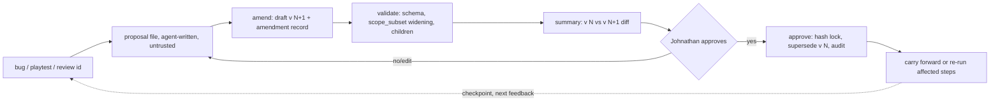

> Public pack copy for ember-courier-harness. Original team draft paths may still mention /workspace/...; treat those as historical source locations, not runtime paths in this repo.

# Contract Addendum v0.4: iteration, git, workspace, orchestration, transparency

Owner: Contract Smith. Date: 2026-10-23. Documentation only; nothing built, run, installed or pushed. `CONTRACT_SYSTEM.md` (CS), `SCHEMA_DECISIONS_v0.2.md` (1A) and `CONTRACT_FIXES_v0.3.md` (CF) are unchanged. Everything in CF stands: id pattern `^ct-[a-z]+(-[a-z0-9]+)*-[0-9]+$`, `git.push` is `needs_approval` only where a contract lists it (else `deny`), baseline forbidden list `network.*, publish.*, submit.*, payment.*, fs.delete, deploy.*`, and the **nine-step gate order is unchanged**. Read with `/workspace/triage-spec/TRIAGE_ADDENDUM_ITERATION.md` (TA); the two are kept consistent (differences listed in section 3.7).

**[D]** = DECIDED by Contract Smith, Hack Lead/Johnathan may override. **[OPEN-J]** = needs Johnathan. No Meta model, tool or rule is assumed; the Oct 26 rules check stays **[UNVERIFIED]**. The architecture Page returned 403 to my fetch, so I relied on `ARCHITECTURE_DRAFT.md`; Hack Lead should check conflicts against the 22 sections.

## 1. Purpose

Johnathan's new requirements, for the contract subsystem only: (1) iteration-first, contracts versioned and amended, feedback flowing back; (2) contracts and rounds in git, CI verifying the lock; (3) attach to an existing workspace safely; (4) orchestrator/worker/verifier child contracts with budgets; (5) transparency: real statuses, evidence labels, an audit viewer, an AI-versus-human marker; (6) OPA as an option. Quality over breadth: the MVP cut (section 5.1) is small.

## 2. Design

### 2.1 Decisions (all **[D]**: DECIDED by Contract Smith, Hack Lead/Johnathan may override)

| # | Decision |
|---|---|
| D1 | `status` becomes `draft \| approved \| revoked \| superseded`. Approving v<N+1> atomically sets v<N> to `superseded` (not `revoked`). Both are terminal. |
| D2 | After that audit entry, actions are checked against v<N+1> only. No grace period. |
| D3 | `max_calls` counters are per version (reset). `spend` is cumulative across all versions of the same `id`. An amendment cannot reset a budget. |
| D4 | Orchestration data lives in `extensions.orchestration`; amendment history in `extensions.lineage`. Both are reserved namespaces. The gate never reads them. |
| D5 | One function `scope_subset(a, b)` serves both the child-vs-parent check and the amendment "widening" computation. |
| D6 | Audit entries gain `actor_type` (`ai\|human\|system`), `actor`, `approval_ref`. |
| D7 | Claim labels are `verified`, `self_reported`, `unverified`, derived by the harness, never typed. |
| D8 | MVP gate is the one-function gate. OPA is an option behind the same input document (2.7). |
| D9 | `git.commit` `branch` and `git.branch` `name` use `equals`. The compiler knows the concrete round and `contract_id` at draft time, so no pattern is needed. |
| D10 | Scaffold writes use extra class `scaffold_write` (listed in `requires_approval`). |

### 2.2 Status transitions

| From | To | Trigger | Note |
|---|---|---|---|
| (none) | `draft` | `compile()` or `amend()` | |
| `draft` | `approved` | `approve()` by Johnathan | hash locked; if v<N-1> is `approved`, it moves to `superseded` in the same audit entry |
| `draft` | `revoked` | withdrawn | the draft is discarded and logged |
| `approved` | `superseded` | approval of the next version | terminal |
| `approved` | `revoked` | `revoke()` | terminal; children cascade (2.6) |

Rules: only the head (`approved`) version can be amended. A `revoked` or `superseded` version cannot, and a revived scope is a new `id` with `extensions.lineage.derived_from`. At most one `draft` successor exists per id. `status` is outside the content hash, so these transitions never change `content_hash`.

**Authoritative state** is the audit log (`approval` entries carry `supersedes: <version>`). `contracts/<id>/STATE.json` is a derived cache written only by the harness.

### 2.3 In-flight actions under a superseded version

- A `check()` that returned `allow` before the approval entry's `seq` stays in the log, annotated `late_under_superseded` when its evidence arrives afterwards.
- New `check()` calls resolve to v<N+1>. An action that pins `contract_version: N` (new optional action field) gets `deny` (`reason: contract_superseded`).
- One-time approvals and a pending `needs_approval` bind to `(contract_id, version)` (CF 1.1 rule 5), so a supersession voids them. The identical action under v<N+1> returns `needs_approval` again.
- A step's result is judged at completion time against the version then in force: evidence required by v<N+1> for that `action_id` must exist, else `incomplete`.
- Counters per D3. Each version resolves its own `time_window` (24h cap, CF section 7).

### 2.4 Feedback to amendment (the loop)



`amend(contract_id, proposal) -> draft v<N+1>, amendment_record, summary`: the compiler copies v<N>, applies the proposal's `changes[]` (JSON-pointer ops), and sets `version` N+1, `status` draft and `approved_*`/`content_hash` null. `intent_text` is carried forward byte-for-byte. Whatever Johnathan says about the change goes into the amendment `reason`, never into `intent_text`. An `amendment_log` entry `{to_version, round, reason, source_id, from_hash}` is appended to `extensions.lineage.amendment_log`, so it is hashed. The proposal is untrusted input (agents write only `triage/amendments/*.json`, as in TA 2.2), and the compiler recomputes `widening`. The summary shows a field-level v<N> vs v<N+1> diff, with "WIDER THAN USUAL" per widening item.

### 2.5 Cheap re-run

`affected_actions(record)` maps `changed_fields`: pointers under `/allowed_actions[action_id]` or `/required_evidence/<action_id>` affect that action only. `agent`, `inputs`, `allowed_paths`, `forbidden_actions`, `requires_approval` or a narrowed `limits` affect all. A pure widening of `max_calls`, `spend_usd` or the window affects none. For unaffected actions the previous `complete` StepResult is `carried_forward`: the harness re-runs `verify_evidence` on the stored payload (hashes recomputed, no tool re-run) and records an `evidence` entry under the new version. Affected actions re-run under v<N+1>.

### 2.6 Orchestration

**Where the role lives [D4]:** `extensions.orchestration`, not a new top-level field. Reasons: the schema forbids other top-level keys and a role field would break every port; the gate must not depend on it (the subset check runs at `approve()`, not at `check()`); the content hash covers it, so roles cannot be edited after approval; and one-contract-one-agent is preserved (a role is a property of this contract, not of the agent).

```json
"extensions": { "orchestration": {
  "role": "orchestrator|worker|verifier",
  "parent_id": "ct-triage-round-0001",
  "budget_share": { "max_calls": 120, "spend_usd": 0 },
  "branch": "round/1/ct-fix-0042-1",
  "envelope": { "max_calls": 220, "spend_usd": 0 } } }
```
`envelope` appears only on a parent (the ceiling for the subtree); `branch` only on workers; `parent_id` only on children.

**Subset check [D5].** `scope_subset(child, parent) -> ok | fail(items)`; if undecidable, **fail**. A child is a subset iff all hold:
1. Every child allowed action matches a parent action with the same `tool` and `class`, and for each parent constraint the child's is at least as tight: `equals v` within `equals v`/`one_of`/matching `pattern`; `one_of` a subset; `pattern` identical string (else child must use `equals`); `max` ≤, `min` ≥; `no_overwrite_unless_same_hash` kept if present.
2. `path_within` and path globs: the child glob, treated as a literal string, must match a parent glob; a `**` in the child must meet a `**` in the same parent segment.
3. Parent forbidden entries are a subset of the child's; parent `requires_approval` is a subset of the child's.
4. Child `time_window` inside the parent's; child `max_calls` and `spend_usd` ≤ `budget_share`.
5. `parent.limits.max_calls + Σ child.limits.max_calls ≤ parent.envelope.max_calls`, same for spend. That makes the aggregate bound hold by construction, with no gate change; the viewer sums used counts for display.

**Rules.** Roles `orchestrator`, `worker`, `verifier` each have their own contract. A worker needs a `branch` and `equals` constraints on `git.commit`/`git.add` branch; two approved workers cannot share a branch (one per worker). The verifier's `agent` differs from the worker's and from whoever proposed the amendment (author = agent in the audit trail for that task), and the verifier has no src write. **Cascade:** parent `revoked` revokes all children. When a parent is superseded, the check re-runs on each approved child, and a failing child is `revoked` (`reason: parent_narrowed`) in the same audit entry. A child amendment is bounded by the same check, so it cannot exceed its parent. Agents may never list `contracts/**` in `allowed_paths.write` (schema error), so only the harness writes contract files.

### 2.7 OPA: an OPTION, not a decision

**Mapping.** The host builds one JSON input and gets one decision back:
```json
{ "action": {"agent":"","tool":"","args":{},"paths":{"read":[],"write":[]},"spend":0,
             "contract_id":"","contract_version":0},
  "contract": { "...approved contract, extensions omitted..." },
  "state": { "now":"", "hash_ok":true, "inputs_verified":true, "calls_used":0,
             "spend_used_lineage":0, "approval_unconsumed_for_action_hash":false } }
-> { "decision":"allow|deny|needs_approval", "reason":"", "step":4 }
```
A policy `package contract.gate` would implement steps 3 to 9 as an ordered `else` chain (illustrative, not run).

**Stays outside OPA (host code):** contract selection (step 1), hash recompute (2), `inputs_verify` (2b), counters from the audit log, writing the audit entry before returning (fail closed, and deny if OPA is unreachable), one-time approval consumption, evidence checks, supersession atomicity, amendment diffing and `scope_subset`. Step order is enforced by the chain, with fixtures proving it.

| For a hackathon | Pros | Cons |
|---|---|---|
| OPA/Rego | Declarative; matches Muse Code `PreToolUse` hook pattern (PRIOR_ART #1, #5); policy reviewable in CI | Second language and binary; glob dialect risk (OPA's `glob.match` may support braces and classes, so the dialect must be pinned and such patterns rejected at validation; **verify**); process-spawn latency per call; two sources of truth |
| One-function gate (Python/TS) | About one file; one language; one glob implementation; easy to table-test | Hand-rolled; no external policy tooling |

My recommendation (not a decision): build the one-function gate; freeze the input document above now so OPA can slot in later; if adopted, CS-45 proves equivalence. Order is unchanged either way. **[OPEN-J]**

### 2.8 Transparency model

**Real statuses.** A status string in any record (contract, StepResult, bug, round) must carry `status_basis: <audit seq>`. The viewer shows the status only if that entry exists and says the same thing; otherwise it renders "claimed, unverified". `complete` requires evidence per CS 2.5 with at least one machine-checked item.

**Evidence labels [D7].** `verified`: the harness recomputed it from bytes (`file_hash`, `source_dest_hash`, `file_list`, `output_snippet` pass, `actor_type: system`). `self_reported`: `checklist` or `reviewer_note` attested by an agent or person, recorded not recomputed. `unverified`: no evidence or the payload hash no longer matches. Mapping to TA's labels: `measured` with a passing `evidence_ref` is `verified`; `observed` is `self_reported`; `inferred` and `unknown` are `unverified`. A check result has `basis: content | lfs_pointer`; a pointer match alone is `self_reported`.

**Claim record:** `{claim_id, text, status_claimed, evidence_ref, audit_seq, label (derived)}`. Agents write the first four; `label` is computed on read.

**Audit entry additions [D6]** (all new entries):
```json
{ "seq": 41, "kind": "approval", "actor_type": "human", "actor": "johnathan",
  "channel": "ultralord_relay", "relayed_by": "ultralord", "approval_ref": null,
  "contract_id": "ct-fix-0042-1", "contract_version": 2, "supersedes": 1 }
```
`actor_type`: `ai` for a gated agent action, `system` for harness work (verify, evidence check, supersession bookkeeping), `human` only for `approval`, `revocation` and checkpoint approvals, written by the approval interface alone. `approval_ref` on a `decision` entry names the `seq` of the one-time approval it consumed. The viewer derives "human-approved" for any action from the contract-approval `seq` of its `(id, version)` plus `approval_ref`. Limit: the chain proves consistency, not that a human typed it; signing is a later option.

**Viewer data model.** Read-only. The viewer runs `audit_verify` first and shows the result. A rebuildable derived index is allowed; it is never trusted over the JSONL. Query object, all fields optional and ANDed:
`{contract_id, contract_version, agent, actor_type, kind, decision, reason, ts_from, ts_to, seq_from, seq_to, human_approved, limit, order}`. Named views: contract timeline; all denies with reasons; approvals ledger; AI-vs-human counts; amendment lineage (joins `amendment_log`). Result rows carry `seq, ts, kind, actor_type, agent, tool, decision, reason, approved_by_seq, label`.

## 3. Contracts

### 3.1 Amendment record: `contracts/<id>/amendments/v<N>-to-v<N+1>.json`

```json
{ "contract_id": "ct-fix-0042-1", "from_version": 1, "to_version": 2,
  "from_hash": "<hex>", "to_hash": null,
  "changed_fields": ["/allowed_paths/write", "/limits/max_calls"],
  "diff": [ { "op": "add", "pointer": "/allowed_paths/write/-", "old": null, "new": "/repo/src/vfx/fireball/*.cpp" } ],
  "widening": { "computed": true, "items": ["allowed_paths.write +1", "limits.max_calls 120->150"] },
  "reason": "BUG-0042 needs a second source file", "source": { "kind": "bug", "id": "BUG-0042", "snapshot_sha256": "<hex>" },
  "round": 1, "proposal_ref": { "path": "triage/amendments/ct-fix-0042-1.v1-to-v2.json", "sha256": "<hex>" },
  "proposed_by": { "actor": "triage-orch-1", "actor_type": "ai" },
  "approved_by": null, "approved_at": null, "approval_seq": null }
```
`source.kind` is `bug | playtest | review | manual | pipeline`. `changed_fields` and `diff` are computed by the compiler; any hand-typed value is overwritten. `to_hash`, `approved_*` and `approval_seq` fill at approval. The record is a plain file (not part of the contract hash); CI checks it against both contract files.

### 3.2 Lineage namespace (inside the hashed contract)

`extensions.lineage = { "supersedes": {"version": 1, "content_hash": "<hex>"}, "amendment_log": [ ... ], "derived_from": null }`. v1 has `supersedes: null` and an empty log. Chaining each version to the previous hash makes a history that cannot be reordered unnoticed.

### 3.3 Git layout and CI [D]

```
<repo>/
  contracts/<id>/v<N>.json            # approved bytes are never edited, except status
  contracts/<id>/amendments/v<N>-to-v<N+1>.json
  contracts/<id>/STATE.json           # derived cache
  approvals/<id>-v<N>.json            # approval record (approved_by, approved_at, audit seq)
  templates/<role>.json  schema/{contract.schema.json,tools.json}
  rounds/round-NNNN.json              # subsystem-owned (TA: triage/rounds/)
  evidence/<payload-hash>.json        # plain git; large assets in Git LFS
  .gitattributes                      # LFS patterns for png, wav, ogg, blend, glb, fbx
```
Branches: `contract/<id>/v<N+1>` for an amendment (touches only `contracts/<id>/**`, `approvals/`), `round/<N>/<contract_id>` per worker (matches TA). Each local commit carries trailers `Round: N`, `Contract-Hash: <sha256>`, `Subsystem: <ns>` (PRIOR_ART, Aider pattern). Amendments are reviewed as the PR diff of v<N> to v<N+1> plus the amendment record. **Local commits only; push stays `needs_approval`.** PRs and rulesets are Johnathan's step.

**CI script `contract-lock`** (stable job name, as PRIOR_ART warns about renamed required checks). Order:
1. Validate every `contracts/**/v*.json` against the schema.
2. Recompute `content_hash` for each non-draft file; mismatch fails.
3. Against the base ref: a non-draft file may change only `status` along the allowed edges (2.2); any other change fails ("no hashed field changed without version bump").
4. Each version ≥ 2 has an amendment record with matching `from_hash`, `to_version`, and a `diff` equal to the recomputed one.
5. Each approved file has an `approvals/` record naming `johnathan` and the same hash.
6. At most one `approved` version per id; no gap in versions.
7. Run `scope_subset` for each child against its parent.
8. Evidence refs resolve: a payload file's sha256 equals its name; an LFS pointer's `oid sha256:` equals the recorded sha256 (a pointer match is `basis: lfs_pointer`).
9. Optional: a committed `audit/anchors/round-N.txt` head hash exists in the chain.
CODEOWNERS on `contracts/**` is an option (plan support unverified).

### 3.4 Workspace attach and scaffold

Three contracts, run in this order:
1. **`ct-workspace-scan-0001`** (class `read` only): `workspace.scan` plus `fs.read`. Read globs are the workspace root. Secret-like paths are blocked by `forbidden_actions` items with `args_constraints` (`{tool:"fs.read", args_constraints:{path:{path_within:"**/.env*"}}}`, same for `**/*.pem`, `**/id_*`), so no new path-exclude field is needed. Output `scan_report.json` goes to a harness folder via `workspace.write_report` (class `write`, `no_overwrite_unless_same_hash`). It touches nothing in the workspace.
2. **`ct-workspace-plan-0001`**: input `scan_report.json` pinned by `sha256`; `workspace.scaffold_plan` (class `write`) writes only `plans/<id>.json`, the dry run. Each plan entry is `{path, action: create|skip_exists|conflict, content_sha256, bytes}`. `conflict` (an existing file with different content) is reported and never planned for write. Entries under `.git/**`, `.husky/**`, `.github/**` are marked `manual`.
3. **`ct-workspace-apply-0001`**: `workspace.scaffold_apply` of class `scaffold_write`, listed in `requires_approval`. Args: `plan_sha256` (`equals`, pinned), the paths list (each in the plan and under the apply contract's `path_within`), and `dest` with `no_overwrite_unless_same_hash`, so an existing file is never overwritten and a rerun is idempotent. The gate returns `needs_approval` and the `action_hash` covers the whole plan, so Johnathan's one-time yes is approval of the exact dry-run diff. The summary renders the plan as a diff (new files, skipped files, conflicts, manual items). The scaffold adds the repo layout from 3.3 and role templates; it never edits an existing file.

### 3.5 Tool registry additions (class `write` unless noted)

| Tool | Constraint |
|---|---|
| `triage.snapshot_bug`, `triage.write_round`, `triage.record_review` | `path_within` to the dest folder; `no_overwrite_unless_same_hash` on snapshots |
| `triage.propose_amendment` | `path_within` `triage/amendments/*.json`; writes drafts and proposals only, never an approved version (`contracts/**` is not writable by agents) |
| `git.branch` | `name` `equals` the concrete branch (one action per branch, or `one_of` concrete names) |
| `git.worktree_add` | `path_within` the worktree root; `branch` `equals` |
| `workspace.scan` (`read`), `workspace.write_report`, `workspace.scaffold_plan`, `workspace.scaffold_apply` (`scaffold_write`) | as 3.4 |

DECIDED by Contract Smith, Hack Lead/Johnathan may override.

### 3.6 Amendment authority

`approved_by` must be `johnathan` for every version (unchanged). Hack Lead and Ultralord cannot approve, only relay his yes with `channel`/`relayed_by` recorded. **[OPEN-J]** whether narrowing-only amendments may be delegated.

### 3.7 Consistency with TA (what TA should change)

- TA 2.2 and open question 1: "revoke v<N>" becomes **`superseded`**; TA section 7 lists contract statuses as four.
- TA's amendment proposal file stays as the untrusted input; the amendment record in 3.1 is the compiler's, with `proposal_ref` linking them. The two are not duplicates.
- TA labels map per 2.8. TA checkpoints C0 to C3 are `state_transition` entries (`detail: {scope:"round", round, checkpoint}`); approvals at checkpoints are `approval` entries.
- TA open question 4: attempt cap 3, workers per round, and who decides after attempt 3 belong to Hack Lead/Johnathan. **My recommendation: after attempt 3, a `direction_selection`-style human approval (a recorded `reviewer_note` pick) before attempt 4.**
- TR-27 to TR-43 are TA's series; mine are `CS-31` to `CS-45`.

## 4. Data flow

Finding (id) -> proposal file -> `amend()` draft, amendment record, summary diff -> validators (schema, `scope_subset`, parent check) -> Johnathan's approval (relayed yes recorded, `actor_type: human`) -> `approve()`: hash lock, `approvals/` record, one audit entry that approves v<N+1> and supersedes v<N>, children re-checked -> re-run planner (carry forward or re-run) -> every action through `check()` -> local commit with trailers, `contract-lock` run locally -> round checkpoint C0 to C3 -> new feedback. Push, if listed, is a separate `needs_approval`. The viewer renders the chain, labels and markers from the same JSONL.

## 5. MVP cut, build order and acceptance tests

### 5.1 Build order and cut

**Build order** (after CS 2.10 steps 1 to 7, i.e. schema, audit, gate, evidence, compiler, approvals, tests):
1. Schema: `superseded`, the `lineage` and `orchestration` namespaces, `contract_version` on actions. 2. Audit fields (`actor_type`, `actor`, `approval_ref`) and writer rules. 3. Lineage-aware counters (spend across versions, calls per version). 4. `scope_subset()` with a fixture table. 5. `amend()`, amendment record, widening, summary diff. 6. `approve()` atomic supersession and cascade. 7. `contract-lock` script (local). 8. Label derivation and `status_basis`. 9. Viewer queries and the generated report. 10. Envelope and role validators. 11. Workspace scan and plan. 12. Re-run planner. 13. Scaffold apply. 14. (Optional) OPA adapter.

**Must work by Nov 4:** steps 1 to 9, 10 (validators only, roles run sequentially), 11. **Stretch:** 12, 13. **Not in MVP:** OPA, parallel workers, real PRs, rulesets, LFS setup (design plus manifest only), signing, a UI beyond the generated report. Tests CS-31 to CS-44 are the MVP set; CS-45 only if OPA is adopted.

### 5.2 Acceptance tests (continue after CS-30; given/when/then)

31. **Atomic supersession.** Given v1 approved and v2 draft, when v2 is approved, then one `approval` entry carries `supersedes: 1`, and v1 is `superseded` from that `seq`. A v1 action checked afterwards resolves to v2. An action pinned `contract_version: 1` gets `deny` (`contract_superseded`). While v2 was only a draft, decisions were unchanged and a pin on 2 gave `deny`.
32. **In-flight and approvals.** Given an allowed action before the approval and one-time approvals for a v1 action, when v2 is approved, then the old `allow` stays in the log, its late evidence is annotated `late_under_superseded`, the step is `incomplete` until v2's evidence exists, and the identical action returns `needs_approval` again.
33. **Counters.** Given v1 with `max_calls` 12 all used and a nonzero approved cap 1.00 with 0.60 spent, when v2 (cap 1.00) is approved, then the first v2 call is allowed (calls reset), a 0.50 spend is `deny` (cumulative 1.10), and with cap 2.00 it is `needs_approval`.
34. **Amendment record.** Given an amendment proposal, when `amend()` runs, then `intent_text` equals v1's bytes, the v1 file is byte-identical, `changed_fields` and `diff` equal the real diff, a hand-typed `widening` is overwritten, and the `amendment_log` entry is in the hash (editing it changes `content_hash`).
35. **Preconditions and approver.** Given a revoked or superseded version, when `amend()` runs, then it is refused; a second concurrent draft is refused. Approval with `approved_by` other than `johnathan`, or by an `ai` actor, is refused; the approval entry has `actor_type: human` and `channel` set.
36. **CI lock.** Given a repo with approved contracts, then editing a hashed field of an approved file in place fails; a status-only `approved` to `superseded` change passes; v2 without an amendment record fails; two approved versions of one id fail; a diff in `diff` that is not the real diff fails.
37. **Cheap re-run.** Given an amendment changing only `required_evidence` of action X, when the planner runs, then other actions are `carried_forward` after `verify_evidence` recomputes their hashes. Given a change to `allowed_paths`, then all re-run. Given a pure `max_calls` widening, then none re-run.
38. **Scan and plan.** Given a workspace with an existing differing `README.md`, when the scan contract runs, then writes inside the workspace are `deny`, `.env` reads are `deny`, the plan marks the file `conflict` and omits it, and `.github/**` entries are `manual`.
39. **Scaffold apply.** Given the plan pinned by `plan_sha256`, when apply is checked, then `needs_approval` (`scaffold_write`); a different `plan_sha256` is `deny`; after approval only listed new files appear, existing files stay byte-identical, and a rerun changes nothing.
40. **Subset check (table-driven).** Given a parent, then these children fail: an extra action, a looser `max`, a wider glob, `**` against a single-level parent glob, a dropped parent forbidden entry, a missing `requires_approval` class, a window outside the parent. A child with `equals` inside a parent `one_of` or `pattern` passes.
41. **Envelope and cascade.** Given an envelope, when child shares plus the parent's own cap exceed it, then approval is refused; an amendment raising a child above its share is refused; narrowing the parent revokes a failing child (`parent_narrowed`) in the same entry; revoking the parent revokes all children.
42. **Role validators.** Given a worker, then a missing `branch` `equals` constraint, a shared branch, or a verifier whose `agent` equals the worker's or the amendment proposer's fails validation; an agent contract listing `contracts/**` in write paths fails.
43. **Labels and statuses.** Given a claim `complete` with no evidence, then the viewer shows "claimed, unverified" and the step is `incomplete`. Given only a `checklist`, then `self_reported`. Given a passing `file_hash` recomputed by the harness, then `verified`. When the payload byte changes, then it falls to `unverified` and is flagged. A pointer-only match shows `basis: lfs_pointer`.
44. **Marker and viewer.** Given a log with approvals and decisions, then every entry has `actor_type` (a missing one fails `audit_verify`); a `decision` with `actor_type: human` is rejected by the writer; a decision under an approved version shows the approval `seq`; queries by contract, agent, decision, `actor_type` and time range equal a brute-force filter of the JSONL, and a modified index is rebuilt from the log.
45. **OPA conformance (only if the option is adopted).** Given the fixtures of CS-1 to CS-44, when run through both engines, then `decision`, `reason` and `step` are identical, and OPA unreachable gives `deny`.

## 6. Open questions

**For Johnathan [OPEN-J]**
1. Do you approve every amendment yourself, or may narrowing-only amendments go to Hack Lead? (Default: you, always.)
2. Is a relayed chat yes (Ultralord, recorded with `channel` and `relayed_by`) enough to count as approval? (CS Q8.)
3. Which repo hosts `contracts/`: is local-only fine for the demo? Do you want LFS and CI set up, or shown as design only?
4. Audit anchoring (CS Q4): commit only a head hash per round, or the full log? (Default: head hash per round.)
5. May the scaffold create files under `.github/**`, `.husky/**`, `.agents/**`, or are they always manual? (Default: manual.)
6. After attempt 3 on a bug, do you want a human selection before attempt 4? (My recommendation: yes.)
7. OPA: go or no-go for after the hackathon, or never? And the language/runtime, still open (CS Q2).

**For Hack Lead:** attempt cap (3 assumed), max workers per round, and who decides after attempt 3; apply the TA changes in 3.7; check this addendum against the Page's 22 sections.

**Noted:** `lineage` and `orchestration` are reserved namespaces. Defaults for non-triage roles (OQ-C5) and the spend budget (OQ-D9) remain open from CF.

---
## Appendix A: Johnathan's batch decisions (Oct 23, 2026, 7:03 PM ET, via Hack Lead/Ultralord)
Documentation only. CONTRACT_SYSTEM.md (held) untouched.

**A.1 Scope contract (demo step 1).** The compiler turns his intent into a root `scope` contract for a small sample game (role `scope`, class `direction_selection`). He approves it first. Every build contract carries `extensions.lineage.scope_id` plus version, and the validator rejects approval unless the build contract's `allowed_actions`, `allowed_paths` and `limits` are a subset of the scope contract (the same `scope_subset` check as the orchestration ceiling). Widening the scope is an amendment to the scope contract and needs his widening acknowledgement. If the scope version is revoked or superseded, its children are rechecked against the new version; any that no longer fit get `deny` until re-amended. The engine pause stays: `engine_change` is not in the scope contract.

**A.2 `art_direction` block (optional top-level field, hashed).**
```
art_direction: {
  style: string, palette: [hex or named colors], mood: string,
  references: [{path, sha256, note}],   # local files only, no URLs fetched
  do: [string], dont: [string]
}
```
Required on any contract whose `required_evidence` includes an art score. The block is inherited from the scope contract unless a build contract overrides it (an override is a change shown in the diff, not a widening).

**A.3 Evidence kind `art_score` (new).** Written by the verifier only: `{asset_path, sha256, art_direction_hash, per_criterion: [{criterion, score 0-1, confidence 0-1, note}], overall, confidence}`. The gate never auto-passes on a score; asset acceptance is a `requires_approval` step for Johnathan, and the viewer labels scores "AI-scored, not approved". Under `approve_all` the score still goes to him for asset acceptance (direction selection is in `requires_approval`).

**A.4 Technical gates.** Size and alpha remain basic pass/fail technical checks (`checklist` evidence: file opens, has alpha if required, dimensions match the declared target). Numeric quality thresholds are dropped.

**A.5 Tests (proposed):** CT-46 build contract outside scope is rejected at approval; CT-47 a scope revocation denies children until re-amended; CT-48 `art_score` without `art_direction_hash` matching the contract is rejected; CT-49 an art score never resolves asset acceptance by itself.
