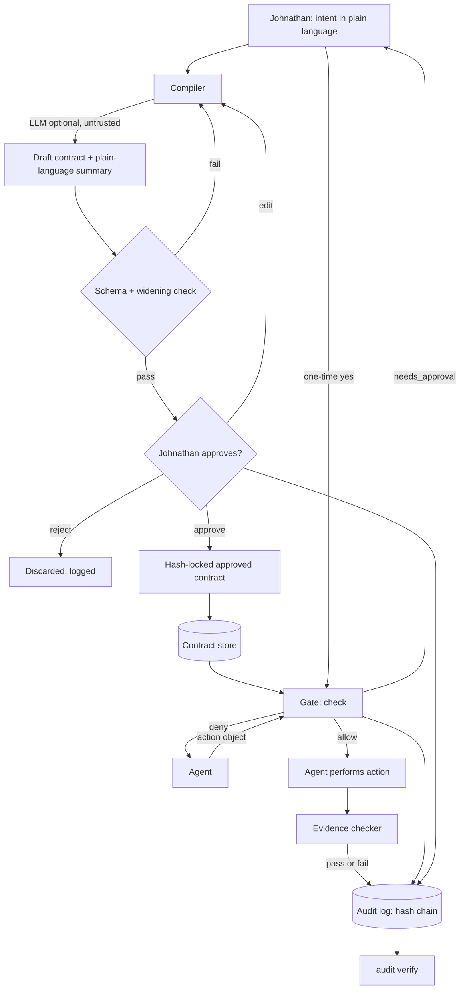

> Public pack copy for ember-courier-harness. Original team draft paths may still mention /workspace/...; treat those as historical source locations, not runtime paths in this repo.

# Contract System: design document

Owner: Contract Smith. Status: DRAFT, documentation only. Date: 2026-10-23.
Project: Johnathan Rossi's Meta Global AI Developer Hackathon entry (Oct 26 to Nov 4, 2026, submission due Nov 4, 9:00 PM ET), a contract-driven game-development harness for Wrathful Conquest.

Scope note: nothing in this document has been built, run or installed. A previous attempt may have left files under `/workspace/contract-system`. They are an **unapproved, shelved sketch**, are not part of this design, and have not been run, changed or deleted. At the time of writing that folder did not exist on the box.

Marker convention: **[OPEN]** means unsettled and is also listed in section 6. **[UNVERIFIED]** means it depends on hackathon rules not yet checked.

---

## Quick reference: contract fields (other subsystems start here)

| Field | Type | Required | One-line meaning |
|---|---|---|---|
| `id` | string | yes | Stable contract id, e.g. `ct-asset-ingest-0001` |
| `version` | int | yes | Increments on every edit; an edit makes the contract a new draft |
| `agent` | string | yes | The one agent allowed to act under it |
| `intent_text` | string | yes | Johnathan's original words, verbatim |
| `goal` | string | yes | Compiler's strict one-sentence restatement |
| `inputs` | list | yes (may be empty) | Files or values the agent may consume, with optional `sha256` |
| `allowed_actions` | list | yes | Whitelist: `tool` plus argument constraints |
| `forbidden_actions` | list | yes | Explicit denies; always override allows |
| `allowed_paths` | `{read[], write[]}` | yes | Path globs the agent may read or write |
| `limits` | object | yes | `spend_usd` (default 0), `max_calls`, `time_window` |
| `required_evidence` | map | yes | Per action: what proof must exist before the step counts as done |
| `requires_approval` | list | yes | Action classes that always return `needs_approval` |
| `status` | enum | yes | `draft`, `approved`, `revoked` |
| `extensions` | object | no | One namespace per subsystem (e.g. `triage`, `pipeline`). Ignored by the gate, covered by the content hash. Decided by Hack Lead, Johnathan can override |
| `approved_by` | string or null | when approved | Must be `johnathan` |
| `approved_at` | ISO-8601 or null | when approved | Time of approval |
| `content_hash` | string or null | when approved | sha256 over the canonical content (see 3.2) |

Full definitions, rules and a worked example are in section 3.

---

## 1. Purpose

Every agent on the hackathon team (asset, animation, sound, coding, bug triage) does work that can touch files, spend money, or reach outside systems. The contract system makes that work safe and checkable:

1. **Intent to contract.** Johnathan states what he wants in plain language. A compiler turns it into a strict, machine-readable contract. He reads a plain-language summary and approves it.
2. **Gate.** Before each action, a gate checks the action against the approved contract. Anything not explicitly allowed is denied.
3. **Evidence.** A step is only "done" when the evidence its contract demands exists and checks out.
4. **Audit.** Every gate decision and evidence check goes into a tamper-evident log, so the demo can show exactly what each agent was allowed to do and did.

This is the hackathon's core idea: agents never work from vibes, only inside a contract the user has approved.

## 2. Design

### 2.1 Principles

- **Deny by default.** No contract, no action. An action not matched by `allowed_actions`, or matched by `forbidden_actions`, is denied.
- **User approves.** Only Johnathan can move a contract to `approved`. Agents and the compiler cannot.
- **Nothing live, published, spent or pushed without Johnathan's yes.** These always return `needs_approval`, even inside an approved contract, and need a separate per-action approval recorded in the audit log. Spend defaults to $0. No `git push`, no posting, no submission.
- **Hash-based tamper evidence.** Approval locks a content hash. The audit log is a hash chain. Any change is detectable.
- **Transport-neutral.** The gate is one pure function over a plain action object. Tool calls, MCP, shell wrappers or a game-engine bridge are thin adapters on top.
- **Plain files, plain JSON.** Contracts and logs are human-readable JSON/JSONL so any language can read them and a port is mechanical.
- **No assumptions about the platform.** No Meta model, track or tool is assumed available (see section 3.9).

### 2.2 Components

| Component | Job |
|---|---|
| Schema | JSON Schema file defining the contract shape (single source of truth) |
| Compiler | Intent text to draft contract plus plain-language summary |
| Approval store | Holds contracts and their status; records Johnathan's approval and hash |
| Gate | `check(action) -> decision`, writes audit entry every time |
| Evidence checker | Verifies required evidence for a completed action or step |
| Audit log | Append-only JSONL hash chain plus a `verify` routine |
| Adapters | Thin wrappers per transport (later) |

### 2.3 Intent-to-contract compiler

Flow:

1. **Intent in.** Johnathan's words, e.g. "Bring the Molten Slag fireball concept into the asset folder and check it."
2. **Draft contract.** Compiler fills the schema, status `draft`, `intent_text` verbatim. It starts from a template per agent role (asset, coding, triage) and only widens permissions where the intent requires. Unknowns become explicit blanks or questions, never guesses.
3. **Plain-language summary.** Auto-generated from the contract fields, not written free-hand: who may act, what they may do, where they may read and write, the spend cap, what evidence is required, and what always needs a fresh yes. The summary is derived from the same fields the gate enforces, so it cannot drift from them.
4. **User approval.** Johnathan approves, edits, or rejects. Approval records `approved_by`, `approved_at`.
5. **Hash lock.** On approval the canonical content hash is computed and stored. The gate refuses any contract whose recomputed hash differs from the stored one.
6. **Edits invalidate approval.** Any change to a hashed field bumps `version`, resets `status` to `draft`, clears `approved_*` and `content_hash`, and requires a new approval. Old versions stay on file for the audit trail.

Where an LLM plugs in: only at step 2, to map free text to a draft (pick template, fill `goal`, propose paths and evidence). Its output is untrusted. It must pass schema validation, a **widening check** (no permission beyond the role template unless flagged for Johnathan) and a human read of the summary. The LLM never runs the gate, approves, or computes hashes. Which model does this is **[OPEN]**; no Meta model is assumed (3.9). A deterministic template-only compiler (no LLM) is a valid fallback and the MVP baseline.

### 2.4 Gate

One transport-neutral function:

```
check(action) -> { decision, reason, contract_id, contract_version, audit_seq }

action = {
  agent:  string,        // who is acting
  tool:   string,        // e.g. "fs.copy", "git.commit", "image.generate"
  args:   object,        // tool arguments
  paths:  { read[], write[] },   // paths this action will touch
  spend:  number         // USD this action would cost (0 if none)
}
decision in { "allow", "deny", "needs_approval" }
```

Evaluation order (first match wins, all steps logged):

1. Find the agent's `approved` contract; none, or `draft`/`revoked`, gives **deny**.
2. Recompute the content hash; mismatch gives **deny** (tampered).
3. Time window expired gives **deny**.
4. Matches `forbidden_actions` gives **deny**.
5. No match in `allowed_actions`, or args violate that action's constraints, gives **deny**.
6. Any path outside `allowed_paths` (read for reads, write for writes, after normalizing `..` and symlinks) gives **deny**.
7. `spend` would push cumulative spend over `limits.spend_usd`, or `max_calls` exceeded, gives **deny**.
8. Action class in `requires_approval` (live, publish, spend > 0, push) gives **needs_approval**. It becomes allowable only through a recorded one-time approval for that exact action.
9. Otherwise **allow**.

Every call, including denies, appends an audit entry before returning. If the audit write fails, the gate denies (fail closed).

**Stateful limits.** The gate keeps per-contract counters (calls used, spend used) derived from the audit log, so they survive restarts and cannot be reset by editing a side file. Counters are incremented on `allow`, not on deny.

The gate is a check, not a sandbox: it only constrains agents that call it. See open question Q3.

### 2.5 Evidence checks

Each action in `required_evidence` names evidence kinds that must be present before the step is marked complete:

| Kind | What is checked |
|---|---|
| `file_hash` | File exists at path; recorded sha256 matches the actual file |
| `file_list` | Listed files exist under an allowed path; sizes recorded |
| `source_dest_hash` | `source_path`, `dest_path`, and equal sha256 for both (copy integrity) |
| `url` | A URL string is recorded (existence is recorded, not fetched, unless the contract allows a fetch) |
| `output_snippet` | Recorded output matches an expected pattern (e.g. test summary line) |
| `reviewer_note` | A note from a named reviewer role (QA, Johnathan) is attached |
| `checklist` | Named boolean checks, each attested, e.g. `images_viewed`, `no_lore_text`, `no_trademarked_material` |

Rules: evidence is attached to the audit log by hash; a missing or failing item makes the step `incomplete`, never silently passed. Checks that need human judgment (e.g. "no trademarked material") are `checklist` or `reviewer_note` items attested by a person or reviewer agent. The system records the attestation but does not verify the claim itself.

### 2.6 Audit log

- Append-only JSONL file, one entry per gate decision, approval, revocation or evidence check.
- Entry: `seq`, `ts` (ISO-8601 with zone), `kind`, `agent`, `contract_id`, `contract_version`, `action` (as submitted), `decision`, `reason`, `evidence_refs`, `prev_hash`, `entry_hash`.
- `entry_hash = sha256(canonical_json(entry without entry_hash))`; `prev_hash` is the previous entry's `entry_hash` (first entry uses a fixed genesis value).
- `verify` re-walks the chain and reports the first broken `seq`, if any. It detects edits, deletions and reordering.
- Limit: a hash chain proves internal consistency, not that the whole file was not replaced. Optional anchoring (e.g. recording the head hash in Johnathan's approval message or committing it locally) is **[OPEN]** Q4.

### 2.7 Proposed layout (appendix A, for later build)

```
contract-system/
  schema/contract.schema.json      # JSON Schema (source of truth)
  templates/<role>.json            # compiler starting points (asset, coding, triage)
  contracts/<id>/v<version>.json   # every version kept
  approvals/                       # approval records
  audit/audit.jsonl                # hash-chained log
  docs/SCHEMA.md
```
This is a proposal only; nothing has been created.

### 2.8 Interfaces (appendix B)

- `compile(intent_text, agent, role) -> draft_contract, summary`
- `approve(contract_id, version, approver) -> approved_contract` (only callable from the user-facing approval step)
- `revoke(contract_id, reason)`
- `check(action) -> decision` (the gate)
- `verify_evidence(contract_id, action_id, evidence) -> pass | fail(+items)`
- `audit_verify() -> ok | first_bad_seq`

### 2.9 Acceptance tests (appendix C, to run once building is allowed)

1. No contract for the agent: deny.
2. Draft or revoked contract: deny.
3. Edit any hashed field of an approved contract on disk: gate denies with hash mismatch.
4. Allowed tool with an argument outside its constraint: deny.
5. Read or write outside `allowed_paths`, including via `..` and a symlink: deny.
6. Forbidden action that is also in allowed: deny.
7. Spend above $0 with default limits: deny or `needs_approval`, never allow.
8. `git push`, post, publish, submit: always `needs_approval`.
9. `max_calls` and `time_window` enforced across a restart.
10. Every decision, including denies, appears in the audit log; flipping one byte makes `audit_verify` fail at that `seq`.
11. Editing an approved contract resets it to draft and requires re-approval.
12. Audit write failure: gate denies.

### 2.10 Build step order (appendix D, when building is allowed)

1. Schema and canonical-hash rule. 2. Audit log plus `verify`. 3. Gate with limits. 4. Evidence checker. 5. Template-only compiler plus summary generator. 6. Approval store. 7. Acceptance tests above. 8. Adapters. 9. LLM-assisted compile (optional).

## 3. Contracts

### 3.1 Field by field

- **`id`** (string, required). Unique and stable across versions, e.g. `ct-asset-ingest-0001`.
- **`version`** (int, required, starts at 1). Bumped on any edit. Approval applies to one `(id, version)` only.
- **`agent`** (string, required). The single agent identity allowed to act. One contract, one agent. A multi-agent job is several contracts.
- **`intent_text`** (string, required). Johnathan's original request, verbatim, kept for audit.
- **`goal`** (string, required). Strict one-sentence restatement the compiler produced; what "done" means.
- **`inputs`** (list, required, may be empty). Each item: `{ name, path | value, sha256? }`. If `sha256` is set, the gate/evidence check refuses the input if the file differs. Unlisted inputs are not usable.
- **`allowed_actions`** (list, required). Each item: `{ action_id, tool, args_constraints, class }`. `args_constraints` is a map of argument name to a constraint: `equals`, `one_of`, `pattern` (glob/regex), `max`/`min`, or `path_within` (a path glob). Arguments not named in the constraints are rejected unless `allow_extra_args: true`. `class` is `read`, `write`, `compute`, `local_commit`, or an approval class (below).
- **`forbidden_actions`** (list, required). Same shape, always wins over allows. Baseline entries for every contract: `git.push`, `network.post`, `publish.*`, `submit.*`, `payment.*`, `fs.delete` outside scratch.
- **`allowed_paths`** (`{ read[], write[] }`, required). Globs. Paths normalized and symlinks resolved before matching. Write does not imply read. Empty list means none.
- **`limits`** (object, required).
  - `spend_usd` (number, default **0**).
  - `max_calls` (int, total allowed actions; default is small and role-specific **[OPEN]** Q6).
  - `time_window` (`{ not_before, not_after }`, ISO-8601 with zone). Outside the window: deny.
- **`required_evidence`** (map, required). `action_id` to a list of evidence items `{ kind, params }` (kinds in 2.5). Actions with no entry require no evidence only if `allow_no_evidence: true` is set for that action; the compiler defaults to requiring at least a `file_hash` or `output_snippet` for write actions.
- **`requires_approval`** (list, required). Action classes that always return `needs_approval`. Mandatory members: `live`, `publish`, `spend`, `push`, `submit`, `send_message`. Removing a mandatory member makes the schema invalid.
- **`extensions`** (object, optional). One namespace per subsystem, for example `extensions.triage` and `extensions.pipeline`. The gate ignores it and the content hash covers it, so changing it invalidates approval. Decided by Hack Lead; Johnathan can still override when he reviews.
- **`status`** (enum `draft | approved | revoked`). Only `approved` is usable. `revoked` is permanent for that version.
- **`approved_by`** (string or null). Must be `johnathan` when approved.
- **`approved_at`** (ISO-8601 with zone, or null).
- **`content_hash`** (string or null). sha256 of the canonical JSON of the contract with these fields removed: `status`, `approved_by`, `approved_at`, `content_hash`. Canonical JSON means keys sorted, UTF-8, no insignificant whitespace.

### 3.2 Rules

1. Schema validation failure means the contract cannot be approved.
2. `agent`, `allowed_*`, `forbidden_actions`, `limits`, `required_evidence`, `requires_approval`, `inputs` and `goal` are all inside the hash. Changing any of them invalidates approval.
3. Approval of contract B never extends contract A.
4. Role templates (asset, coding, triage) set safe defaults. Anything broader than the template is flagged in the summary as "WIDER THAN USUAL".

### 3.3 Worked example (asset ingest step)

```json
{
  "id": "ct-asset-ingest-0001",
  "version": 1,
  "agent": "pipeline-smith",
  "intent_text": "Bring the Molten Slag fireball concept images into the concepts folder and check they are intact.",
  "goal": "Copy the three Molten Slag refined images from the generation store into /workspace/concepts/fireball/molten-slag/refined/ and record their hashes.",
  "inputs": [
    { "name": "hero",    "path": "<generation-store>/molten_slag_hero.png" },
    { "name": "impact",  "path": "<generation-store>/molten_slag_impact.png" },
    { "name": "palette", "path": "<generation-store>/molten_slag_palette.png" }
  ],
  "allowed_actions": [
    { "action_id": "ingest_copy", "tool": "fs.copy", "class": "write",
      "args_constraints": {
        "src":  { "path_within": "<generation-store>/molten_slag_*.png" },
        "dest": { "path_within": "/workspace/concepts/fireball/molten-slag/refined/*.png" }
      } },
    { "action_id": "hash_file", "tool": "fs.sha256", "class": "read",
      "args_constraints": { "path": { "path_within": "/workspace/concepts/fireball/molten-slag/refined/*.png" } } }
  ],
  "forbidden_actions": [
    { "tool": "git.push" }, { "tool": "network.*" }, { "tool": "publish.*" },
    { "tool": "payment.*" }, { "tool": "fs.delete" }
  ],
  "allowed_paths": {
    "read":  ["<generation-store>/molten_slag_*.png", "/workspace/concepts/fireball/molten-slag/refined/*"],
    "write": ["/workspace/concepts/fireball/molten-slag/refined/*.png"]
  },
  "limits": {
    "spend_usd": 0,
    "max_calls": 12,
    "time_window": { "not_before": "2026-10-26T12:00:00-04:00", "not_after": "2026-10-26T23:59:00-04:00" }
  },
  "required_evidence": {
    "ingest_copy": [
      { "kind": "source_dest_hash", "params": { "fields": ["source_path", "dest_path", "sha256"] } },
      { "kind": "file_list", "params": { "expect_count": 3 } },
      { "kind": "checklist", "params": { "items": ["images_viewed", "no_lore_text", "no_trademarked_material"] } }
    ]
  },
  "requires_approval": ["live", "publish", "spend", "push", "submit", "send_message"],
  "status": "approved",
  "approved_by": "johnathan",
  "approved_at": "<set at approval>",
  "content_hash": "<computed at approval>"
}
```
The `<generation-store>` path is a placeholder; where generated images actually land is **[OPEN]** Q7. The date window above is illustrative only.

### 3.4 Approval points

| Point | Who | What happens |
|---|---|---|
| Contract approval | Johnathan | Draft becomes approved, hash locked |
| Edit after approval | Johnathan | New version, back to draft, re-approve |
| Any `live/publish/spend/push/submit/send_message` action | Johnathan, per action | Gate returns `needs_approval`; one-time approval recorded in the audit log |
| Revocation | Johnathan (or Hack Lead on his behalf, **[OPEN]** Q5) | Status `revoked`, gate denies from then on |

### 3.5 How other subsystems use contracts

- **Asset pipeline (Pipeline Smith).** One contract per step (ingest, cut, bake, import, validate, plus design-with-concepts, animation, sound). `ingest` copies from the generation store into `/workspace/concepts/<topic>/` and records `source_path`, `dest_path`, `sha256` as evidence (example above). Later steps list the ingested files as `inputs` with their `sha256`, and read only from that folder. Audio/other external services are separate actions with `spend_usd` 0 unless Johnathan approves a nonzero cap.
- **Coding under contract (Triage Smith).** Role template `coding`: write paths limited to named source paths, actions limited to edit, run tests, run lint, and `git.commit` with `class: local_commit`. `git.push` is forbidden and also in `requires_approval`. Required evidence: `output_snippet` of test and lint results, `file_hash` of changed files, `reviewer_note` for the review gate. No engine paths unless Johnathan lifts the engine pause (engine work needs his yes). Changes to those paths are denied by default.
- **Bug triage fix contracts.** Triage creates a **fix contract** per bug as a draft from a template: `goal` from the bug id and repro, `allowed_paths.write` limited to the files routed to, evidence of a failing repro before and passing after plus a regression test. It is still approved by Johnathan before any agent acts. Intake and dedupe are read-only contracts.
- **All subsystems** call `check(action)` before acting and attach evidence after. The shared field shape (Quick reference) is stable. Field additions are optional and versioned, so downstream code does not break.

### 3.6 Hackathon config placeholder (to be filled by Hack Lead after the Oct 26 rules check)

Everything here is **[UNVERIFIED]**. Nothing in the design depends on it. Do not assume any Meta model or tool is available or required.

```yaml
hackathon_config:   # UNVERIFIED: fill after official rules check on Oct 26
  event_name: "TBD"
  official_rules_url: "TBD"
  rules_checked_by: "TBD"
  rules_checked_at: "TBD"
  submission_deadline: "2026-11-04 21:00 America/New_York (from kickoff; confirm)"
  track: "TBD"
  required_models: []        # empty means none assumed
  allowed_models: []         # empty means none assumed
  required_tools_or_apis: [] # empty means none assumed
  submission_format: "TBD"
  disallowed_material: ["copyrighted or trademarked material"]  # from kickoff rules
  judging_criteria: "TBD"
```
The config feeds only the compiler's templates (which tools may appear in `allowed_actions`) and a README for judges. It never relaxes the gate.

## 4. Data flow



## 5. MVP cut

**Must work by Nov 4 (smallest useful core):**
1. Contract schema (JSON Schema) and canonical hash rule, with 2 templates: `asset-step` and `coding`.
2. Gate with deny by default, `allowed_actions` with arg constraints, `allowed_paths`, forbidden list, spend $0 and `max_calls`, and `needs_approval` for push/publish/spend/live/submit.
3. Hash-chained audit log with `verify`.
4. Evidence checks: `file_hash`, `source_dest_hash`, `file_list`, `output_snippet`, `checklist`.
5. Template-based compiler with the generated plain-language summary and hash-locked approval (edits invalidate).
6. One end-to-end demo: Molten Slag ingest contract, one allowed action, one denied action, one `needs_approval` action, a tamper test, and an audit verify.
7. Acceptance tests 1 to 12 in 2.9.

**Dropped or later:** LLM-assisted compiler (template-only first; add LLM drafting only if time allows and a model is permitted), adapters for every transport beyond one, time-window and cross-restart nuance beyond basics if short on time (keep `max_calls` and spend), multi-agent delegation chains, a polished approval UI (approval can be a chat message plus a recorded record), audit anchoring, regex/glob edge cases beyond a documented subset, signature-based approval (public-key signing), OS-level sandboxing.

All of this stays documentation-only until Johnathan lifts the "no building" rule.

## 6. Open questions (for Johnathan)

1. **Building go-ahead.** When can building start, and may it be in `/workspace/contract-system-doc/` or a new repo, local only?
2. **Language/runtime** for the harness (Python, TypeScript, other)? Hack Lead suggested Python 3 plus JSON Schema for a first pass; schemas stay plain JSON so a port is mechanical. Not decided.
3. **Enforcement.** Gate only constrains agents that call it. Is "agents are required to call the gate, and the audit log shows it" enough for the hackathon, or should it be an enforced wrapper around tools?
4. **Audit anchoring.** Should the audit head hash be recorded somewhere outside the log (e.g. in the approval message)?
5. **Who may revoke?** Johnathan only, or Hack Lead and Ultralord on his behalf?
6. **Default `max_calls` and time windows** per role: what are sensible defaults, and should approvals expire automatically?
7. **Generation store.** Where do generated images land and can the box see that path? (Concept Artist reports images land in a store not visible from the shell.)
8. **Approval channel.** Is a chat "yes" through Ultralord enough to count as approval, or must it be recorded another way?
9. **Compiler model.** If an LLM drafts contracts, which one, and is a template-only compiler acceptable for the demo? No Meta model is assumed until the event page and rules confirm one.
10. **Engine pause.** Should coding templates hard-deny the engine repo paths until he lifts the pause?
11. **Hackathon requirements** (section 3.6): track, model, tool and submission requirements are unverified. Hack Lead fills them after the Oct 26 rules check.
12. **Shared contract format.** Is the field shape in the Quick reference frozen for Pipeline Smith and Triage Smith to build against, or do they want changes?
13. **Extensions.** DECIDED by Hack Lead (Johnathan can override on review): the schema has an optional `extensions` object with one namespace per subsystem (`triage`, `pipeline`), ignored by the gate and covered by the content hash.
