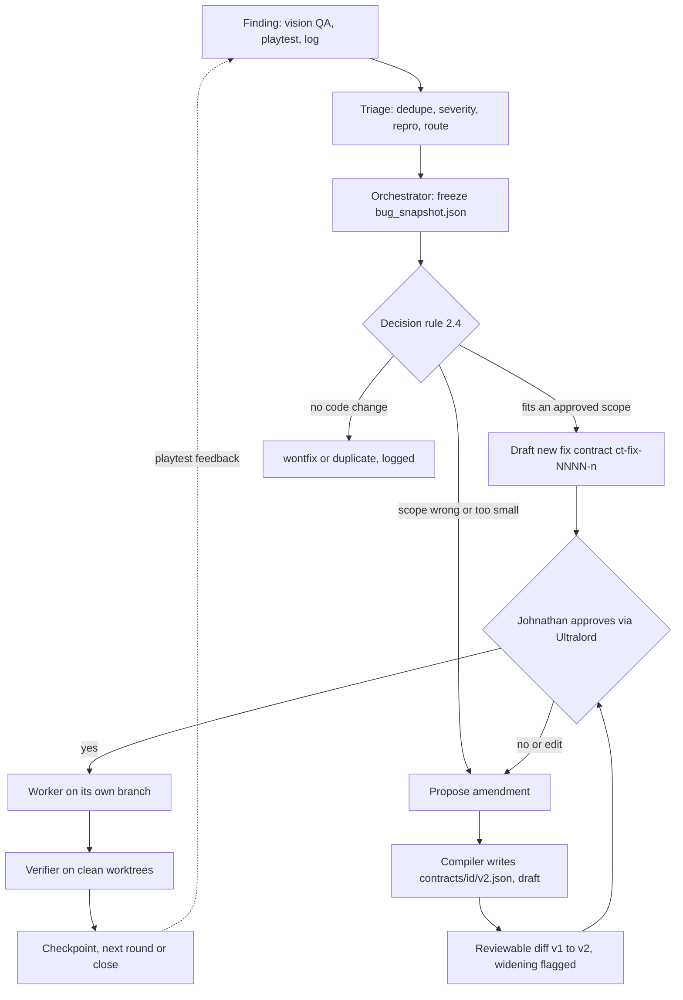

> Public pack copy for ember-courier-harness. Original team draft paths may still mention /workspace/...; treat those as historical source locations, not runtime paths in this repo.

# Triage Addendum: Iteration, Git, Orchestration, Transparency

Documentation only; nothing is built, pushed or run; held specs untouched. Names follow `CONTRACT_FIXES_v0.3.md` (CF), `SCHEMA_DECISIONS_v0.2.md` (1A) and `TRIAGE_PROPOSED_FIXES.md` (TF).
Labels: **[S]** sourced (Johnathan's requirements via Ultralord, Hack Lead, the contract docs, `PRIOR_ART.md`). **[A]** assumed by Triage Smith. Prior-art picks (OPA, Muse Code hooks, rulesets, LFS) are **options, not decisions**. Nothing is assumed about Meta models **[UNVERIFIED until the Oct 26 rules check]**.

## 1. Purpose

**Iteration-first** triage and coding [S]: contracts are versioned and amended, never one-shot. A triaged bug either becomes a fix task, or a reviewable **contract amendment** (a new version file, shown as a diff, approved by Johnathan). Fix and verify work is split across **orchestrator, worker and verifier** contracts, one branch per worker, with budgets. Quality over breadth [S]: coding and triage only.

Fixed rules [S]: gate order unchanged; deny by default; `spend_usd` 0 means a spending call is `deny`; `git.push` is `needs_approval` only where a coding contract lists it with `force` false, else `deny`; `git.remote`, `git.force`, `deploy.*`, `network.*` are `deny`; engine paths stay `deny` while the pause stands.

## 2. Design

### 2.1 Bug to amendment flow

### 2.2 Amendment file, diff and naming [A]

- Contract versions are files `contracts/<id>/v<N>.json` (CS 2.7, CF M-24) [S]. An approved file is **never edited**. An amendment is a new `v<N+1>.json`, `status: draft`, `approved_*` and `content_hash` null; any hashed-field edit already resets approval [S].
- Agents cannot write `contracts/`. The orchestrator writes only a **proposal** to `triage/amendments/<id>.v<N>-to-v<N+1>.json`; the harness compiler turns it into the draft file [A].
- Proposal fields: `contract_id`, `from_version`, `to_version`, `trigger` (`bug_id`, `snapshot_sha256`), `reason`, `changes[]` (`{op, pointer, old, new}`), `widening` (computed, never typed), `proposed_by`, `proposed_at`.
- Review diff = git diff of `v<N>.json` to `v<N+1>.json` plus the proposal. Widening (new write path, higher `max_calls` or `thresholds`, new action or class, longer window) is shown as "WIDER THAN USUAL" [S: compile summary rule].
- Approving `v<N+1>` atomically moves `v<N>` to status `superseded` (Contract Smith, 2026-10-23), with no grace period, so the gate finds one approved version [A]. `max_calls` counters reset per version; spend is cumulative across the lineage.

### 2.3 Versioning and round checkpoints [A]

- **Round** = one batch of bug work, record `triage/rounds/round-NNNN.json` (plain data): contract ids and versions, branches, checkpoints, status.
- Checkpoints, each an audit entry of kind `state_transition` or `approval`: **C0** plan (tasks listed; contracts approved). **C1** worker commit reviewed. **C2** verifier evidence recorded. **C3** round close: S0/S1 `close_critical`, push decision, next-round list.
- A new round waits for C3 or `abandoned` with a reason. Playtest feedback becomes new findings in the next round's C0.
- Cheap re-runs: a failed verify re-runs only that task under the same approved contract. Only a scope change needs an amendment.

### 2.4 Contract change versus fix task only [A]

| Situation | Outcome |
|---|---|
| Fix fits template scope (paths, thresholds, actions) | New fix contract `ct-fix-0042-1` (needs approval as always) |
| Attempt failed, same scope | New attempt `ct-fix-0042-2`; max 3 attempts, then Hack Lead decides (circuit breaker [S pattern]) |
| Fix needs a write path, action, evidence or threshold outside the approved contract | **Amendment** to that contract |
| Root cause is a wrong expectation in a pipeline or concept contract | Triage proposes; the owning subsystem drafts the amendment [A] |
| Engine path needed | Amendment only after Johnathan lifts the pause; class `engine_change` |
| Duplicate or wontfix | No contract; logged |

### 2.5 Frozen `bug_snapshot.json` [S, M-16]

The orchestrator copies the bug's fixed content (steps, expected, actual, evidence list with sha256) and the bug file's sha256 into `triage/fix_contracts/<id>/bug_snapshot.json`, pinned in `inputs` with `sha256`. Later bug-file edits never touch the contract hash (TR-26). A new version may pin a new snapshot `bug_snapshot.v<N>.json`; existing snapshots are never overwritten (`no_overwrite_unless_same_hash`).

## 3. Contracts

One contract, one agent [S]. All three roles: `spend_usd` 0, `requires_approval` = the six mandatory classes plus `engine_change`, `close_critical`, no `live` action. Defaults [A]: `ttl_hours` 4 (cap 24).

| | Orchestrator `ct-triage-orch-0001` | Worker `ct-fix-0042-1` | Verifier `ct-triage-verify-0001` |
|---|---|---|---|
| Agent | `triage-orch-1` | `coder-agent-1` | `verifier-agent-1`, must differ from the worker [S] |
| Actions | `fs.read`; `triage.snapshot_bug`, `triage.propose_amendment`, `triage.write_round` (class `write`); `git.branch` (class `write`, `name` `equals` the concrete `round/<N>/<contract_id>` the compiler fills in at draft time; CA v0.4 D9); `git.worktree_add` (under the worktree root) | As TF section 1 (read, write src and test, `make` one_of, `git.add`, `git.commit`) plus the `git_push` action | `fs.read`; `cmd.run` one_of `make test`; `triage.record_review` |
| Write paths | `triage/amendments/*`, `triage/rounds/*`, `triage/fix_contracts/*/bug_snapshot*.json` | `src/vfx/fireball/**`, `tests/regression/BUG-0042/*` | `triage/reviews/*` |
| Never | any src write, commit, push | `contracts/**`, `.git/**`, engine, push to any branch but its own | any src write, commit, push |
| `max_calls` | 40 | 120 (reads count) | 60 |
| Evidence | `file_hash` (snapshot, proposal) | `file_hash` per write; `output_snippet` labels `pre_fix_fail`, `post_fix_pass`, `commit_id`; checklist `diff_within_limit` | `output_snippet` (pre and post runs), `reviewer_note`, checklist `reviewer_differs_from_author` |
| Approval points | Contract approval; amendment approval | Contract approval; each push (`needs_approval`) | Contract approval; `close_critical` for S0/S1 |

New tools to register in the tool registry [A]: `triage.snapshot_bug`, `triage.propose_amendment`, `triage.write_round`, `triage.record_review`, `git.branch`, `git.worktree_add`. Existing: `fs.*`, `cmd.run`, `git.add`, `git.commit`, `git.push`.

**Branch-per-worker rules [S+A]**
1. The orchestrator creates `round/<N>/<contract_id>` and a worktree for it. The worker's `git.commit` and `git.add` carry a `branch` constraint equal to that branch (`equals`). A commit anywhere else is `deny`.
2. One worker per branch, one commit per fix contract version, message `^BUG-0042 ct-fix-0042-1: .+`. Commits stay local.
3. Workers never merge, rebase or delete branches (unlisted, so `deny`). Merging is Johnathan's step outside the harness.
4. `git.push` returns `needs_approval` once, for the exact `{remote, branch, commit}` (CF push rule). Opening a PR is a network action: `deny`; Johnathan opens it.

## 4. Data flow

Finding, triage record (`triage/bugs/BUG-0042.json`, mutable), orchestrator snapshot, proposal or new fix contract draft, Johnathan's approval (audit `approval`), worker commit on its branch, verifier re-run of the regression test on two clean worktrees (base commit, worker commit), checkpoint C2, `can_close`. Every action passes the one gate and lands in the audit log [S]. CI (see TR-39) is a script on the repo: it recomputes each approved contract's `content_hash` and checks the diff against `allowed_paths.write`. A GitHub ruleset with CODEOWNERS on `contracts/**` is an option [S]. Evidence files (screenshots, video) go in Git LFS; a plain-git manifest holds their sha256 [A].

## 5. MVP cut (by Nov 4) [A]

**Must work:** one bug, one round (TR-43), one local CI script, and a generated report `triage/report/round-N.md`.
**Dropped:** parallel workers (roles run in sequence), real PRs or rulesets, LFS setup, OPA, a viewer UI, automatic amendment drafting, fan-out, amendments to pipeline contracts (proposal only), multi-round automation.

## 6. Acceptance tests (continue after TR-26)

27. Snapshot pinned: edit the bug file after snapshot; contract hash unchanged; `verify_inputs` passes; edit the snapshot itself, action `deny` (`inputs_unverified`).
28. Amendment draft: `v2.json` is `draft`, `version` 2, `approved_*` null; `v1.json` is byte-identical.
29. A draft `v2` authorizes nothing (`deny`); after `v2` approval, `v1` actions are `deny`.
30. Diff: `changes[]` equals the real field diff; adding a write path sets `widening: true`; narrowing does not; a hand-typed `widening` is ignored.
31. Engine path in an amendment: still `deny` until approved; the action then returns `needs_approval` (`engine_change`).
32. Decision rule: five fixtures (in scope, retry, out-of-path, engine, duplicate) give contract, attempt `-2`, amendment, amendment plus engine flag, no contract.
33. A fourth attempt for one bug is refused without Hack Lead.
34. Commit on the worker's branch is allowed; on `main`, another worker's branch, or via `git.branch` by the worker: `deny`.
35. Orchestrator and verifier: src write, commit, push all `deny`; verifier agent equal to the worker agent fails validation.
36. Budgets: the 121st worker call and `spend` 0.01 are `deny`.
37. Round gate: `complete` needs C1 to C3 audit entries; a new round while the previous one is open is refused.
38. Push: worker contract with `git_push`: `needs_approval`; `--force`, `git.remote`, `deploy.*`, PR creation: `deny`; push in orchestrator or verifier: `deny`.
39. CI script: editing approved `v1.json` in place fails; adding `v2.json` passes; hash mismatch fails; a diff outside `allowed_paths.write` fails.
40. Evidence labels: `measured` without `evidence_ref`, or `inferred` without `what_would_confirm`, is rejected; "fixed" needs `measured` `post_fix_pass`.
41. Provenance: a record claiming `approved` with no matching audit `approval` shows as "unverified claim"; the agent cannot write the approved marker.
42. Status truth: states `verifying` and `closed` exist only with matching `state_transition` audit entries (counts equal).
43. End to end: finding, snapshot, v1, deny, amendment v2, approval, branch commit, verify, C3, push `needs_approval`; `audit_verify` passes; report matches the log.

**Build order** (after the contract core, Stage 1) [A]: (1) snapshot writer; (2) amendment proposal and diff generator; (3) validators for the three role templates and branch constraint; (4) round record and checkpoints; (5) evidence-label and provenance schema; (6) CI lock script; (7) report generator; (8) end-to-end scenario (TR-43).

## 7. Transparency [S requirements, A mechanics]

- **Statuses are real:** derived from audit entries and evidence, never typed by the agent. Bug states are TF's list; contract statuses `draft/approved/revoked/superseded` (CA D1); step results `complete/incomplete/failed/needs_approval` (CF M-19); round status `planned, in_progress, awaiting_approval, complete, abandoned`. `incomplete` is never shown as done.
- **Evidence labels** on claims (CA 2.8 maps these onto its harness-derived `verified/self_reported/unverified`; the merged draft should keep one set, CA's, for the audit viewer): `observed`, `measured`, `inferred`, `unknown` [prior-art pattern, option]. Record `{claim, label, source_ref, inputs, limits, what_would_confirm?}`. Severity and root cause are `inferred` until a test or reviewer confirms.
- **AI versus approved marker:** each triage record carries `origin` (`ai` or `human`, plus `agent`). The viewer computes `approved` by joining audit `approval` entries (`approved_by: johnathan`, `audit_seq`). Display: "AI-proposed" or "Approved by Johnathan, seq N". Model id stays null [UNVERIFIED].
- **Audit viewer:** read-only render of the audit log plus records; MVP is the generated report (decisions, denies, approvals, hash-chain result).

## 8. Open questions

**Contract Smith (answered, 2026-10-23)**
1. `v<N>` becomes `superseded` atomically on approval of `v<N+1>`; `max_calls` resets per version, spend is cumulative across the lineage.
2. `equals` on `git.commit` and on the `git.branch` name is enough. All six new tools register as class `write` with a `path_within` or `equals` constraint; `triage.propose_amendment` writes drafts only.
3. `amend(contract_id, proposal)` builds the draft `v<N+1>`; `intent_text` carries forward unchanged; a hashed `amendment_log` entry (round, reason, source id) is appended.

**Hack Lead (answered, 2026-10-23)**
4. Attempt cap per bug: 3. Max workers per round: 2 for the MVP. After attempt 3, Johnathan decides through Ultralord.

**Johnathan**
6. Do you approve every amendment, or may narrowing-only ones go to Hack Lead? (`approved_by` must be `johnathan` today.)
7. Are you the one who merges worker branches and opens PRs, with a one-time push yes through Ultralord?
8. Which repo hosts contracts, and is a local-only repo fine for the demo? Do you want LFS and CI set up for the demo, or shown as a design only?

## Appendix: Johnathan's decisions (Oct 23, 7:00 PM ET, via Ultralord) and what they mean for triage

- **Approval mode:** triage contracts carry Contract Smith's hashed `approval_mode` (`each` default, `approve_all` a widening that needs Johnathan's separate acknowledgement). Under `approve_all`, only actions listed in the approved active version auto-resolve. Each auto-resolution is logged with `resolved_by: approve_all` and labeled "auto-approved" in the viewer, never "approved by Johnathan". Spend at $0, publish, submit, deploy, force push and drafts still `deny`.
- **Commits and PRs:** the fix worker may list `git.open_pr` (non-force push of its own `round/<N>/<contract_id>` branch plus a PR, branch and target `equals`). It is `needs_approval` under `each` and auto-resolves under `approve_all`. Bare `git.push` and PR merge stay `deny`. Evidence is the PR URL plus the head commit with its `Contract-Version` trailer. Orchestrator and verifier never list it.
- **Rollback:** a rollback is a new amendment built on git versioning; `superseded` stays terminal.
- **Contracts as system files:** the harness stores `contracts/` and `triage/`; agents write only proposals.
- **Scaffolding:** the harness may create `.github`, `.husky`, `.agents` files as a dry-run diff that never overwrites.
- **OPA:** no-go. OPA references in this addendum are void.
- **Closure gates unchanged:** regression test fails before and passes after, verifier differs from the author, S0/S1 closes still need Johnathan even under `approve_all` (Johnathan decision D44, Oct 23 7:07 PM ET).
- **Scope contract (Hack Lead, 7:03 PM ET):** every triage, fix and verify contract carries the sample-game `scope_id` and must fit inside it; a fix needing more is a scope amendment with Johnathan's widening acknowledgement. Art-direction failures flagged by vision QA are triaged as bugs, but an `art_score` never closes one by itself; asset acceptance stays with Johnathan.
