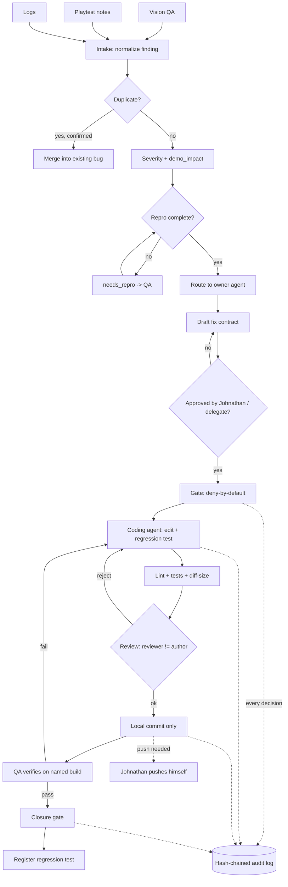

> Public pack copy for ember-courier-harness. Original team draft paths may still mention /workspace/...; treat those as historical source locations, not runtime paths in this repo.

# Bug Triage and Coding Under Contract: Build Spec

Owner: Triage Smith. Status: DRAFT for Hack Lead merge. Documentation only; nothing here has been built or run.

**Labels.** `[S]` = sourced from Johnathan's brief or the team room. `[A]` = assumed by Triage Smith, needs confirmation. Contract field names are a **draft sketch from Contract Smith** and may change; this spec does not depend on any contract-system code. No Meta model is assumed available until the event page or Official Rules confirm it (check Oct 26).

---

## 1. Purpose

Two subsystems of the contract-driven game-development harness for Wrathful Conquest [S]:

- **(A) Bug triage:** turn raw findings (vision QA, playtests, logs) into deduplicated, severity-rated, reproducible, routed bug records, then drive each to verified closure with a regression test.
- **(B) Coding under contract:** let a coding agent change code only inside an approved fix contract: allowed paths, tests, lint, independent review, local commits only, full audit log. Never push or deploy [S].

Why it matters for the hackathon: it demonstrates the core idea [S] that every agent acts inside a machine-checkable contract the user approves, applied to the highest-risk activity (editing code).

Rules inherited [S]: nothing is published, submitted, spent or pushed without Johnathan's yes via Ultralord; engine work needs his yes while the engine pause stands; no copyrighted or trademarked material.

---

## 2. Design

### 2.1 Bug intake (A)

Sources [S]: vision QA (screenshot/video review), playtests (human notes), logs (crash, assert, error lines).

Each source produces a **finding**: `source`, `build_id`, `timestamp`, `summary`, `evidence[]` (file path + sha256), optional `log_excerpt`. An intake step normalizes findings into a Bug record in state `new`. Intake may only write under `triage/bugs/` [A].

### 2.2 Deduplication [A]

A new bug is compared to open bugs by fingerprint:
1. Logs: normalized top-3 stack frames or error code + subsystem (strip addresses, timestamps, numbers).
2. Visual/playtest: same `area` + same `symptom_tag` + same `build_id` family.
3. Text similarity is a hint only; a duplicate is **proposed** and a human or QA agent confirms. Merge keeps the oldest bug, appends evidence and a `duplicate_count`.

### 2.3 Severity (S0 to S3) [A: thresholds are proposals]

| Sev | Rule | Examples |
|---|---|---|
| S0 | Crash, hang, data loss/corrupt save, or blocks launching or finishing the demo path | Crash on load; save wipes world |
| S1 | Core loop broken or major feature unusable, no workaround | Cannot mine/build/craft; spell never fires |
| S2 | Feature degraded, workaround exists, or clear visual/audio defect | Wrong glow color; stutter in one area |
| S3 | Cosmetic, polish, typo, low-visibility | Minor clipping; text misalignment |

**Demo-impact flag** (`demo_impact: true|false`): true if the bug appears on the scripted demo/trailer path. Independent of severity. Priority order: S0 > any demo_impact S1 > S1 > demo_impact S2 > S2 > S3. Severity is proposed by the triage step; **S0 and any demo_impact change of severity require reviewer confirmation** [A].

### 2.4 Repro capture and completeness [A]

A bug is `triaged` only when it passes a completeness check:
- `build_id`, `steps[]` (numbered), `expected`, `actual`, `frequency` (always/often/sometimes/once), `evidence[]` (at least one file with sha256), `area`.
- Logs-only crash bugs may substitute `log_excerpt` for steps.
Incomplete bugs go to `needs_repro` and are routed back to QA with a list of missing fields.

### 2.5 Routing (A) [S owners list; A mapping]

Owner agents [S]: Engine, Editor, QA, Narrative, Concept Artist, Herald, Comms, Systems Designer.

| Area tag | Owner |
|---|---|
| rendering, physics, crash, performance, engine code | Engine |
| tools, level/world editing, asset import | Editor |
| repro, verification, regression tests | QA |
| dialogue, quest text, lore consistency | Narrative |
| visual look, VFX/palette mismatch vs approved concept | Concept Artist |
| store pages, announcements, public posts | Herald |
| messages to users/community | Comms |
| balance, crafting/loot numbers, progression | Systems Designer |

Ambiguous areas go to Hack Lead for assignment. Herald/Comms bugs never lead to code changes. While the engine pause stands [S], any Engine-owned bug sets `requires_approval: true` on its fix contract.

### 2.6 Lifecycle

`new -> triaged | needs_repro -> assigned -> fix_contract_drafted -> contract_approved -> in_fix -> in_review -> verifying -> closed` (also `wontfix`, `duplicate`, `reopened`). Only forward transitions listed in Appendix A's state table are legal [A].

### 2.7 Closure gate

A bug may enter `closed` only if all hold [A]:
1. Fix contract status `approved` and all its required evidence present.
2. Review recorded with `reviewer != author`.
3. Regression test exists, fails on the pre-fix commit, passes on the fix commit (evidence: output snippets).
4. QA verifies on a named build (repro steps re-run, evidence attached); verifier differs from author.
5. S0/S1: Johnathan's or Hack Lead's acknowledgment recorded via Ultralord.

### 2.8 Regression tests [A]

Every closed S0-S2 bug gets one regression test registered in `triage/regression/index.json` (bug id, test path, command, build introduced). S3 is optional. The regression suite is re-run at every closure and before demo freeze.

### 2.9 Coding under contract (B)

A coding agent receives a **fix contract** (section 3.2) and may only:
- read and write paths listed in `allowed_paths`;
- run the whitelisted commands in `allowed_actions` (build, unit tests, lint, formatter, `git add`, `git commit` local);
- never run `git push`, deploy, publish, network upload, package install, or anything in `forbidden_actions`.

Gate behavior: deny by default [S]. Any action not matched by an allowed action, or touching a path outside `allowed_paths`, is denied and logged. Anything live/published/spent/pushed returns `needs approval` [S].

Code quality gates, in order [A]: (1) path-scope check on the diff, (2) lint clean, (3) tests pass including the new regression test, (4) diff size within `limits.max_files` / `max_lines`, (5) review by a different agent or human, (6) local commit.

**Commit rules [A]:** commit message includes `bug_id`, `contract_id`, `author`, `reviewer`; one commit per fix contract; commits stay local. Pushing is performed by Johnathan himself.

**Audit log [S]:** hash-chained JSONL. Every gate decision (allow/deny/needs_approval), every command, every state transition is an entry: `seq`, `ts`, `actor`, `contract_id`, `action`, `args`, `decision`, `evidence_refs`, `prev_hash`, `hash`. Hash = sha256 over the canonical entry including `prev_hash`.

**Approval points [S+A]:**
- Fix contract `draft -> approved`: Johnathan (via Ultralord) or Hack Lead if delegated [A]; always Johnathan for Engine code while the pause stands [S].
- Any path outside `allowed_paths` (contract amendment).
- Any push, deploy, publish, spend.
- Closing S0/S1.

---

## 3. Contracts (inputs, allowed actions and paths, limits, required evidence, approval points)

Field names follow Contract Smith's **draft sketch** [S, unstable]: `id, agent, intent_text, inputs, allowed_actions, allowed_paths, forbidden_actions, limits, required_evidence, requires_approval, status`. Triage-specific fields are under `extensions` [A] so they can be moved or dropped if the shared schema changes.

### 3.1 Bug record (JSON example)

```json
{
  "id": "BUG-0042",
  "agent": "triage",
  "intent_text": "Triage finding: ember glow missing on Molten Slag fireball impact",
  "inputs": [
    {"path": "triage/evidence/BUG-0042/impact_frame.png", "sha256": "<hash>"},
    {"path": "triage/evidence/BUG-0042/run.log", "sha256": "<hash>"}
  ],
  "allowed_actions": [
    {"tool": "triage.write_bug", "args": {"path_prefix": "triage/bugs/"}},
    {"tool": "triage.set_severity", "args": {"max_without_review": "S2"}}
  ],
  "allowed_paths": {"read": ["triage/evidence/", "triage/bugs/"], "write": ["triage/bugs/"]},
  "forbidden_actions": ["git.push", "net.upload", "fs.write_outside_allowed"],
  "limits": {"spend_usd": 0, "max_calls": 50, "time_window": "PT1H"},
  "required_evidence": {
    "triage.write_bug": ["file_hash"],
    "triage.set_severity": ["reviewer_note"]
  },
  "requires_approval": false,
  "status": "approved",
  "extensions": {
    "bug": {
      "title": "Fireball impact has no ember glow",
      "source": "vision_qa",
      "build_id": "dev-2026-10-27-a",
      "area": "vfx",
      "severity": "S2",
      "demo_impact": true,
      "frequency": "always",
      "steps": ["Load test map", "Cast fireball at stone wall", "Observe impact"],
      "expected": "Orange ember glow on impact per approved concept",
      "actual": "Grey flash only",
      "fingerprint": "vfx|fireball_impact|no_glow",
      "duplicate_of": null,
      "duplicate_count": 0,
      "owner": "Concept Artist",
      "state": "triaged",
      "completeness": {"complete": true, "missing": []}
    }
  }
}
```

### 3.2 Fix contract (JSON example)

```json
{
  "id": "FIX-0042-1",
  "agent": "coder",
  "intent_text": "Restore ember glow on fireball impact (BUG-0042) without touching engine core",
  "inputs": [
    {"path": "triage/bugs/BUG-0042.json", "sha256": "<hash>"}
  ],
  "allowed_actions": [
    {"tool": "fs.read", "args": {}},
    {"tool": "fs.write", "args": {"max_files": 3, "max_lines_changed": 80}},
    {"tool": "cmd.run", "args": {"allow": ["make test", "make lint", "make format"]}},
    {"tool": "git.add", "args": {}},
    {"tool": "git.commit", "args": {"local_only": true, "message_must_include": ["BUG-0042", "FIX-0042-1"]}}
  ],
  "allowed_paths": {
    "read": ["src/vfx/", "tests/", "triage/bugs/BUG-0042.json"],
    "write": ["src/vfx/fireball/", "tests/regression/BUG-0042/"]
  },
  "forbidden_actions": [
    "git.push", "git.remote", "git.force", "deploy.*", "net.*",
    "pkg.install", "cmd.run:rm -rf", "fs.write:src/engine/", "fs.write:contracts/", "fs.write:triage/audit/"
  ],
  "limits": {"spend_usd": 0, "max_calls": 120, "time_window": "PT2H"},
  "required_evidence": {
    "fs.write": ["file_hash"],
    "cmd.run": ["output_snippet"],
    "git.commit": ["commit_id", "file_hash"],
    "review": ["reviewer_note"]
  },
  "requires_approval": true,
  "status": "draft",
  "extensions": {
    "bug_id": "BUG-0042",
    "author": "coder-agent-1",
    "reviewer": "reviewer-agent-2",
    "reviewer_must_differ_from_author": true,
    "regression_test": {"path": "tests/regression/BUG-0042/test_ember_glow.*", "must_fail_before": true, "must_pass_after": true},
    "gates": ["path_scope", "lint", "tests", "diff_size", "review", "local_commit"],
    "approval_points": ["contract_approve", "path_amendment", "push", "close_S0_S1"]
  }
}
```

### 3.3 Permissions summary

| Step | Reads | Writes | Evidence required | Needs approval |
|---|---|---|---|---|
| Intake | `triage/evidence/` | `triage/bugs/` | file hashes | No |
| Dedupe/merge | `triage/bugs/` | `triage/bugs/` | merge note | Human/QA confirm |
| Severity S0, or demo_impact change | bug | bug | reviewer note | Yes (reviewer) |
| Routing | bug | bug (`owner`) | none | No (ambiguous: Hack Lead) |
| Fix contract approve | contract | contract status | approver id | **Yes** |
| Code change | per contract | per contract | hashes, test output | Within contract only |
| Review | diff | review record | reviewer note | No |
| Local commit | diff | local git | commit id | No |
| Push/deploy/publish | n/a | n/a | n/a | **Always; not performed by agents** |
| Close S0/S1 | bug | bug | verification output | **Yes** |

### 3.4 Limits defaults [A]
`spend_usd: 0`, `max_calls: 120` per fix contract, time window 2h, `max_files: 3`, `max_lines_changed: 80`. Exceeding a limit denies the action and logs it.

---

## 4. Data flow



---

## 5. MVP cut (smallest part that must work by Nov 4, and what gets dropped)

Must work (demoable end to end on one real or staged bug) [A]:
1. Bug record schema + intake of at least two sources (a screenshot finding and a log excerpt), written as JSON files.
2. Exact-fingerprint dedupe with human-confirmed merge.
3. S0-S3 + demo_impact applied by documented rules; routing table lookup.
4. Repro completeness check with `needs_repro` bounce.
5. Fix contract with path scope, forbidden actions, limits; deny-by-default gate check on a proposed action list (allow / deny / needs_approval).
6. Reviewer != author check; local commit rule; push refused and logged.
7. Hash-chained audit log with a verify routine, and tamper detection.
8. Closure gate checking evidence, regression test, verifier.

Dropped or deferred: fuzzy/semantic dedupe, automated vision-QA screenshot analysis (use Meta models only if the event page confirms availability), auto-assignment from history, dashboards, multi-repo support, flaky-test handling, automatic bisecting, trend reports, Notion/Mission Control sync (manual card update instead).

Suggested daily split of the 10-day window (Oct 26 to Nov 4) [A]: D1-2 schema and intake; D3-4 dedupe, severity, routing, completeness; D5-6 fix contract and gate; D7 review/commit rules and audit; D8 closure + regression; D9 end-to-end demo run and fixes; D10 freeze, demo script, submission materials.

---

## 6. Open questions (for Johnathan)

1. **Engine pause:** may a coding agent edit engine code in the demo, or only tools/scripts/sample content? (Assumed: Engine bugs need approval per contract.)
2. **Approver:** do you approve every fix contract yourself, or may Hack Lead approve non-engine ones?
3. **Demo target:** should the demo use real Wrathful Conquest bugs, or a small staged sample project to avoid touching the engine?
4. **Severity thresholds:** are the S0-S3 rules in 2.3 acceptable? What exactly is the "demo path"?
5. **Repo and test tooling:** what language, build command, test and lint tools should the contract whitelist (e.g. which `make` targets)?
6. **Models:** which models may be used inside the harness? Not assumed until the event page / Official Rules confirm them (check Oct 26).
7. **Local commits:** is a local git repo acceptable for commits, and who performs the final push?
8. **Contract Smith (via Hack Lead):** are `extensions`, the `allowed_paths` read/write object, and per-action `required_evidence` the final shape? Which hash and canonical-JSON rules does the audit log use?
9. **Hack Lead:** where do bug and fix records live (single repo folder vs shared store), and do Mission Control cards mirror bug status?

---

## Appendix A. File and interface layout (for the implementing agent)

Language assumed to match whatever Johnathan picks [A]; interfaces below are language-neutral.

```
triage/
  bugs/              BUG-####.json          (Bug record, 3.1)
  evidence/          BUG-####/*             (screenshots, logs; hashed)
  fix_contracts/     FIX-####-n.json        (Fix contract, 3.2)
  reviews/           FIX-####-n.review.json (reviewer, verdict, note, ts)
  regression/        index.json
  audit/             audit.jsonl            (append-only, hash-chained)
  config/            severity_rules.json, routing.json, limits.json
src/triage/          (implementation: intake, dedupe, severity, completeness, route, closure)
src/codegate/        (implementation: gate, path_scope, diff_check, commit_guard, audit)
tests/triage/        (tests for the above)
```

Interfaces (names are suggestions) [A]:
- `intake(finding) -> Bug`
- `find_duplicate(bug, open_bugs) -> candidate | None`
- `rate(bug) -> {severity, demo_impact, needs_review}`
- `check_completeness(bug) -> {complete, missing[]}`
- `route(bug) -> owner`
- `draft_fix_contract(bug) -> FixContract(status=draft)`
- `gate(contract, action) -> {decision: allow|deny|needs_approval, reason}`
- `check_diff(contract, diff) -> {ok, violations[]}`
- `check_review(contract, review) -> {ok}` (fails when reviewer == author)
- `commit_guard(contract, command) -> allow|deny` (refuses push, remote, force)
- `can_close(bug) -> {ok, missing[]}`
- `audit_append(entry)`, `audit_verify() -> {ok, first_bad_seq}`

State transitions (Appendix A table) [A]: new->triaged|needs_repro|duplicate; needs_repro->triaged; triaged->assigned->fix_contract_drafted->contract_approved->in_fix->in_review->verifying->closed; in_review->in_fix (rejected); verifying->in_fix (failed); closed->reopened->triaged; any->wontfix (with reason and approval for S0/S1).

## Appendix B. Step order (build order)

1. Bug record schema and sample files (3 bugs: visual, playtest, log).
2. Intake normalizer.
3. Audit log append + verify (needed by everything after).
4. Fingerprint dedupe and merge.
5. Severity rules and demo-impact flag; config files.
6. Repro completeness check; `needs_repro` path.
7. Routing table.
8. Fix contract builder and validator (checks required fields, forbidden `git.push`, `spend_usd` = 0).
9. Gate: deny-by-default decisions and path scope.
10. Diff check, lint/test runner whitelist, reviewer != author.
11. Commit guard (local only; push refused).
12. Closure gate and regression index.
13. End-to-end scripted demo scenario.

## Appendix C. Acceptance tests (concrete, checkable)

Triage:
1. Two findings with the same fingerprint produce one bug with `duplicate_count: 1` after confirmed merge; unconfirmed stays two bugs.
2. Crash log finding rates S0; a cosmetic typo rates S3; same bug on the demo path sets `demo_impact: true` without changing severity.
3. Bug missing `steps` (non-log) goes to `needs_repro` and lists `steps` in `missing`.
4. Each area tag in the routing table maps to the listed owner; unknown area returns "Hack Lead".
5. S0 rating without a reviewer note is rejected.
6. An illegal transition (e.g. `new -> closed`) is refused and logged.

Coding:
7. Write to a path outside `allowed_paths` returns `deny` and an audit entry.
8. `git push`, `git remote add`, `git push --force`, any `deploy.*`, any `net.*` return `deny`.
9. Fix contract with `status: draft` cannot authorize any write (`deny`: not approved).
10. Contract with `spend_usd` > 0, or missing `forbidden_actions`, fails validation.
11. Diff of 4 files or 81 changed lines against limits (3 / 80) is rejected.
12. Review where `reviewer == author` is rejected; with a different reviewer it passes.
13. Commit without `bug_id` and `contract_id` in message is rejected.
14. Commit succeeds locally; `git log` shows no remote operation; audit log has the entry.
15. Failing lint or failing tests block the review step.

Closure and audit:
16. Closure refused if regression test did not fail pre-fix, or did not pass post-fix.
17. Closure refused if verifier == author, or S0/S1 lacks approval record.
18. `audit_verify()` passes on an untouched log; editing, deleting or reordering any line makes it fail and reports the first bad `seq`.
19. 100% of gate decisions in an end-to-end run have a matching audit entry (counts equal).
20. End-to-end demo: one bug goes `new -> closed` with all evidence files present and hashes matching.

## Appendix D. Out of scope

Pushing, deploying, publishing, any spend; engine-core edits unless Johnathan approves; building art, audio, or animation assets; defining the contract schema or compiler itself (Contract Smith); player-facing communications (Herald, Comms); automatic fixes with no review; any claim about Meta model capabilities beyond the event page.
